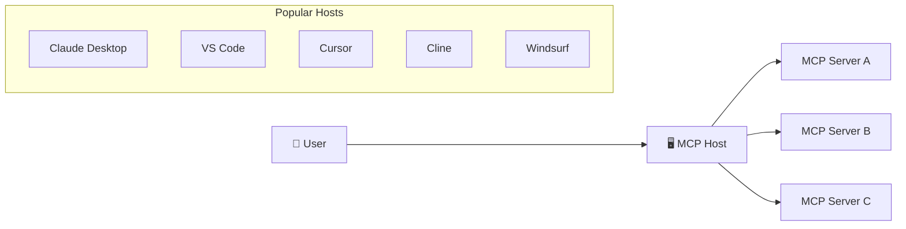

# Setting Up Popular MCP Host Clients

> [!NOTE]
> Host configurations that point to `/sse` are legacy HTTP+SSE examples for
> MCP `2025-11-25`. For MCP `2026-07-28`, select Streamable HTTP in hosts that
> support it and use the endpoint configured by the server.

This guide covers how to configure and use MCP servers with popular AI host applications. Each host has its own configuration approach, but once set up, they all communicate with MCP servers using the standardized protocol.

## What is an MCP Host?

An **MCP Host** is an AI application that can connect to MCP servers to extend its capabilities. Think of it as the "front end" that users interact with, while MCP servers provide the "back end" tools and data.



## Prerequisites

- An MCP server to connect to (see [Module 3.1 - First Server](../01-first-server/README.md))
- The host application installed on your system
- Basic familiarity with JSON configuration files

---

## 1. Claude Desktop

**Claude Desktop** is Anthropic's official desktop application that natively supports MCP.

### Installation

1. Download Claude Desktop from [claude.ai/download](https://claude.ai/download)
2. Install and sign in with your Anthropic account

### Configuration

Claude Desktop uses a JSON configuration file to define MCP servers.

**Configuration file location:**
- **macOS**: `~/Library/Application Support/Claude/claude_desktop_config.json`
- **Windows**: `%APPDATA%\Claude\claude_desktop_config.json`
- **Linux**: `~/.config/Claude/claude_desktop_config.json`

**Example configuration:**

```json
{
  "mcpServers": {
    "calculator": {
      "command": "python",
      "args": ["-m", "mcp_calculator_server"],
      "env": {
        "PYTHONPATH": "/path/to/your/server"
      }
    },
    "weather": {
      "command": "node",
      "args": ["/path/to/weather-server/build/index.js"]
    },
    "memory": {
      "command": "npx",
      "args": ["-y", "@modelcontextprotocol/server-memory"]
    }
  }
}
```

### Configuration Options

| Field | Description | Example |
|-------|-------------|---------|
| `command` | The executable to run | `"python"`, `"node"`, `"npx"` |
| `args` | Command line arguments | `["-m", "my_server"]` |
| `env` | Environment variables | `{"API_KEY": "xxx"}` |
| `cwd` | Working directory | `"/path/to/server"` |

### Testing Your Setup

1. Save the configuration file
2. Restart Claude Desktop completely (quit and reopen)
3. Open a new conversation
4. Look for the 🔌 icon indicating connected servers
5. Try asking Claude to use one of your tools

### Troubleshooting Claude Desktop

**Server not appearing:**
- Check the configuration file syntax with a JSON validator
- Ensure the command path is correct
- Check Claude Desktop logs: Help → Show Logs

**Server crashes on startup:**
- Test your server manually in terminal first
- Check environment variables are set correctly
- Ensure all dependencies are installed

---

## 2. VS Code with GitHub Copilot

VS Code supports MCP through GitHub Copilot Chat extensions.

### Prerequisites

1. VS Code 1.99+ installed
2. GitHub Copilot extension installed
3. GitHub Copilot Chat extension installed

### Configuration

VS Code uses `.vscode/mcp.json` in your workspace or user settings.

**Workspace configuration** (`.vscode/mcp.json`):

```json
{
  "servers": {
    "my-calculator": {
      "type": "stdio",
      "command": "python",
      "args": ["-m", "mcp_calculator_server"]
    },
    "my-remote-server": {
      "type": "http",
      "url": "http://localhost:8080/mcp"
    }
  }
}
```

Use `"type": "http"` for servers that use the Streamable HTTP transport, and `"type": "sse"` only for servers that still use the legacy HTTP+SSE transport.

**User configuration:** to make a server available in every workspace, run **MCP: Add Server** from the Command Palette (Ctrl+Shift+P / Cmd+Shift+P) and add it to your user configuration instead of the workspace. The entry uses the same format, for example:

```json
{
  "servers": {
    "memory": {
      "type": "stdio",
      "command": "npx",
      "args": ["-y", "@modelcontextprotocol/server-memory"]
    }
  }
}
```

See [Use MCP servers in VS Code](https://code.visualstudio.com/docs/copilot/chat/mcp-servers) for all options.

### Using MCP in VS Code

1. Open the Copilot Chat panel (Ctrl+Shift+I / Cmd+Shift+I) and switch to **Agent** mode
2. Select **Configure Tools** in the chat input to see the MCP tools and enable or disable them
3. Use natural language to invoke tools: "Calculate 25 * 48 using the calculator"

### Troubleshooting VS Code

**MCP servers not loading:**
- Check Output panel → "MCP" for error logs
- Reload window: Ctrl+Shift+P → "Developer: Reload Window"
- Verify the server runs standalone first

---

## 3. Cursor

**Cursor** is an AI-first code editor with built-in MCP support.

### Installation

1. Download Cursor from [cursor.com](https://cursor.com)
2. Install and sign in

### Configuration

Cursor uses a similar configuration format to Claude Desktop.

**Configuration file location:**
- **macOS**: `~/.cursor/mcp.json`
- **Windows**: `%USERPROFILE%\.cursor\mcp.json`
- **Linux**: `~/.cursor/mcp.json`

**Example configuration:**

```json
{
  "mcpServers": {
    "filesystem": {
      "command": "npx",
      "args": ["-y", "@modelcontextprotocol/server-filesystem", "/path/to/allowed/directory"]
    },
    "github": {
      "url": "https://api.githubcopilot.com/mcp/",
      "headers": {
        "Authorization": "Bearer ${env:GITHUB_PAT}"
      }
    }
  }
}
```

The `github` entry uses GitHub's official remote MCP server ([github/github-mcp-server](https://github.com/github/github-mcp-server)); the older `@modelcontextprotocol/server-github` npm package is archived and unmaintained. `${env:GITHUB_PAT}` reads a GitHub personal access token from your environment, so the token isn't stored in the file.

### Using MCP in Cursor

1. Open Cursor's AI chat (Ctrl+L / Cmd+L)
2. MCP tools appear automatically in suggestions
3. Ask the AI to perform tasks using connected servers

---

## 4. Cline

**Cline** is an open-source coding agent that runs as a VS Code extension, a JetBrains plugin, and a command-line tool. All of them share the same MCP support. The sections below use the CLI.

### Installation

```bash
npm install -g cline
```

### Configuration

Sign in or configure a model provider first:

```bash
cline auth
```

Add MCP servers with the interactive wizard. For a stdio server, everything after `--` is the command and its arguments; remote servers take a transport and a URL:

```bash
# stdio server started by Cline
cline mcp install calculator -- python /path/to/server.py

# remote Streamable HTTP server
cline mcp install my-remote-server --transport http http://localhost:8080/mcp

# open the MCP settings wizard
cline mcp
```

The wizard needs an interactive terminal (TTY).

### Using Cline

```bash
# Start an interactive session
cline -i

# Single task
cline "Calculate the square root of 144 using the calculator"
```

See `cline --help` and [cline.bot](https://cline.bot) for all options.

---

## 5. Windsurf

**Windsurf** is another AI-powered code editor with MCP support.

### Configuration

Windsurf is now part of Devin Desktop, and its MCP setup has changed. MCP servers are configured in an `mcp_config.json` file, either for a project (checked into the repository) or for your user. The file locations and format are described in the [MCP documentation](https://docs.windsurf.com/windsurf/cascade/mcp). It supports the stdio, Streamable HTTP, and SSE transports.

---

## Transport Types Comparison

Different hosts support different transport mechanisms:

| Host | stdio | SSE/HTTP | WebSocket |
|------|-------|----------|-----------|
| Claude Desktop | ✅ | ❌ | ❌ |
| VS Code | ✅ | ✅ | ❌ |
| Cursor | ✅ | ✅ | ❌ |
| Cline | ✅ | ✅ | ❌ |
| Windsurf | ✅ | ✅ | ❌ |

**stdio** (standard input/output): Best for local servers started by the host
**SSE/HTTP**: Best for remote servers or servers shared between multiple clients

---

## Common Troubleshooting

### Server won't start

1. **Test the server manually first:**
   ```bash
   # For Python
   python -m your_server_module
   
   # For Node.js
   node /path/to/server/index.js
   ```

2. **Check the command path:**
   - Use absolute paths when possible
   - Ensure the executable is in your PATH

3. **Verify dependencies:**
   ```bash
   # Python
   pip list | grep mcp
   
   # Node.js
   npm list @modelcontextprotocol/sdk
   ```

### Server connects but tools don't work

1. **Check server logs** - Most hosts have logging options
2. **Verify tool registration** - Use MCP Inspector to test
3. **Check permissions** - Some tools need file/network access

### Environment variables not passed

- Some hosts sanitize environment variables
- Use the `env` configuration field explicitly
- Avoid sensitive data in config files (use secrets management)

---

## Security Best Practices

1. **Never commit API keys** to configuration files
2. **Use environment variables** for sensitive data
3. **Limit server permissions** to only what's needed
4. **Review server code** before granting access to your system
5. **Use allowlists** for file system and network access

---

## What's Next

- [3.13 - Debugging with MCP Inspector](../13-mcp-inspector/README.md)
- [3.1 - Create your first MCP server](../01-first-server/README.md)
- [Module 5 - Advanced Topics](../../05-AdvancedTopics/README.md)

---

## Additional Resources

- [Claude Desktop MCP Documentation](https://docs.anthropic.com/en/docs/claude-desktop/mcp)
- [Use MCP servers in VS Code](https://code.visualstudio.com/docs/copilot/chat/mcp-servers)
- [MCP Specification - Transports](https://modelcontextprotocol.io/specification/2026-07-28/basic/transports/)
- [Cursor MCP documentation](https://cursor.com/docs/context/mcp)
- [Official MCP Servers Registry](https://github.com/modelcontextprotocol/servers)
