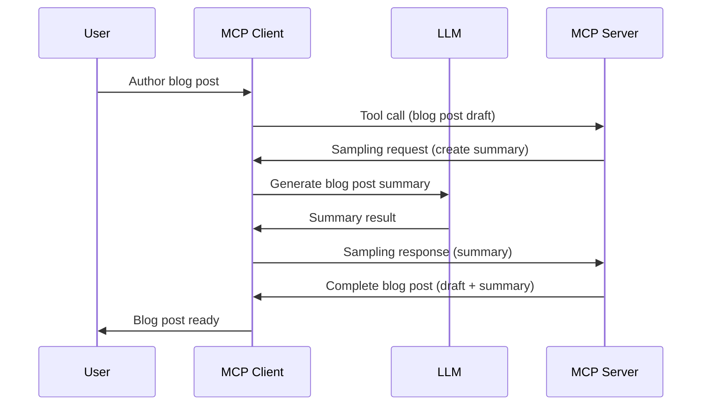

# Sampling - delegate features to the Client

> [!WARNING]
> **Sampling is deprecated as of MCP `2026-07-28`**
> ([SEP-2577](https://github.com/modelcontextprotocol/modelcontextprotocol/pull/2577)).
>
> - **What is deprecated:** the Sampling client feature, meaning the
>   `sampling` client capability and the `sampling/createMessage` request a
>   server sends to borrow the client's LLM.
> - **What to use instead:** integrate your server directly with an LLM
>   provider API, as listed in the official
>   [Deprecated Features](https://modelcontextprotocol.io/specification/2026-07-28/deprecated)
>   registry. See
>   [Recommended replacement: call the LLM provider directly](#recommended-replacement-call-the-llm-provider-directly)
>   below for a working example.
> - **Why this lesson is kept:** existing servers and clients still use
>   Sampling over `2025-11-25` connections. The feature stays in the
>   specification for compatibility and is eligible for removal in the first
>   revision released on or after July 28, 2027.
> - **What the SDK does today:** with MCP Python SDK 2.3.0,
>   `ctx.session.create_message(...)` works only on connections that used the
>   `2025-11-25` `initialize` handshake. On a `2026-07-28` connection it raises
>   `NoBackChannelError`, and every call emits an `MCPDeprecationWarning`.
>
> See [What's Changed in MCP: The 2026-07-28 Specification](../../01-CoreConcepts/mcp-2026-07-28.md)
> for the full picture.

In legacy implementations, Sampling lets an MCP server request help from an LLM
managed by the client. For new implementations, call the chosen LLM provider
directly instead.

Let's explore some use cases and how to build a solution involving sampling.

## Overview

In this lesson, we focus on explaining when and where to use Sampling and how to configure it.

## Learning Objectives

In this chapter, we will:

- Explain what Sampling is and when to use it.
- Show how to configure Sampling in MCP.
- Provide examples of Sampling in action.
- Replace Sampling with a direct LLM provider call, the pattern recommended
  for new servers.

## What is Sampling and why use it?

Sampling is an advanced feature that works in the following way:



### Sampling request

Ok, now we have a mile high view of a credible scenario, let's talk about the sampling request the server sends back to the client. Here's what such a request can look like in JSON-RPC format:

```json
{
  "jsonrpc": "2.0",
  "id": 1,
  "method": "sampling/createMessage",
  "params": {
    "messages": [
      {
        "role": "user",
        "content": {
          "type": "text",
          "text": "Create a blog post summary of the following blog post: <BLOG POST>"
        }
      }
    ],
    "modelPreferences": {
      "hints": [
        {
          "name": "gpt-5.1"
        }
      ],
      "intelligencePriority": 0.8,
      "speedPriority": 0.5
    },
    "systemPrompt": "You are a helpful assistant.",
    "maxTokens": 100
  }
}
```

There are a few things here worth calling out:

- Prompt, under content -> text, is our prompt that is an instruction for the LLM to summarize blog post content.

- **modelPreferences**. This section is just that, a preference, a recommendation of what configuration to use with the LLM. The user can choose whether to go with these recommendations or change them. In this case there are recommendations on model to use and speed and intelligence priority.
- **systemPrompt**, this is your normal system prompt that gives your LLM a personality and contains guidance instructions.
- **maxTokens**, this is another property that's used to say how many tokens are recommended to use for this task.

### Sampling response

This response is what the MCP Client ends up sending back to the the MCP Server and is the result of the client calling the LLM, wait for that response and then construct this message. Here's what it can look like in JSON-RPC:

```json
{
  "jsonrpc": "2.0",
  "id": 1,
  "result": {
    "role": "assistant",
    "content": {
      "type": "text",
      "text": "Here's your abstract <ABSTRACT>"
    },
    "model": "gpt-5.1",
    "stopReason": "endTurn"
  }
}
```

The response is an abstract of the blog post just as requested. The client
selected the active `gpt-5.1` deployment from the server's model preference;
model preferences are recommendations, so the client may choose another active
deployment when required.

Ok, now that we understand the main flow, and useful task to use it for "blog post creation + abstract", let's see what we need to do to get it to work.

### Message types

Sampling messages aren't constrained to just text but you can also send, images and audio. Here's how the JSON-RPC looks different:

**Text**

```json
{
  "type": "text",
  "text": "The message content"
}
```

**Image content**

```json
{
  "type": "image",
  "data": "base64-encoded-image-data",
  "mimeType": "image/jpeg"
}
```

**Audio content**

```json
{
  "type": "audio",
  "data": "base64-encoded-audio-data",
  "mimeType": "audio/wav"
}
```

> NOTE: For current status and migration guidance, see the
> [deprecated Sampling documentation](https://modelcontextprotocol.io/specification/2026-07-28/client/sampling).

## How to Configure Sampling in the Client

> Note: if you're only building a server, you don't need to do much here.

In a client, you need to specify the following feature like so:

```json
{
  "capabilities": {
    "sampling": {}
  }
}
```

This will then be picked up when your chosen client initializes with the server.

With the MCP Python SDK, you don't write this JSON yourself. Passing a
`sampling_callback` to `ClientSession` declares the capability, and the callback
answers each sampling request. Because Sampling needs the `2025-11-25`
handshake, call `session.initialize()` before using the session:

```python
async with streamable_http_client("http://localhost:8000/mcp") as (read, write):
    async with ClientSession(read, write, sampling_callback=handle_sampling_message) as session:
        await session.initialize()  # 2025-11-25 handshake, required for Sampling
        result = await session.call_tool("create_product", arguments={"product_name": "paprika", "keywords": "red"})
```

The [solution client](./solution/python/client.py) shows the full version,
including a `handle_sampling_message` callback that calls Azure OpenAI.

## Example of Sampling in Action - Create a Blog Post

Let's code a sampling server together, we will need to do the following:

1. Create a tool on the Server.
1. Said tool should create a sampling request
1. Tool should wait for the client's sampling request to be answered.
1. Then the tool result should be produced.

Let's see the code step by step:

### -1- Create the tool

**python**

```python
@mcp.tool()
async def create_blog(title: str, content: str, ctx: Context) -> str:
    """Create a blog post and generate a summary"""

```

### -2- Create a sampling request

Extend your tool with the following code:

**python**

```python
post = BlogPost(
        id=len(posts) + 1,
        title=title,
        content=content,
        abstract=""
    )

prompt = f"Create an abstract of the following blog post: title: {title} and draft: {content} "

result = await ctx.session.create_message(
        messages=[
            SamplingMessage(
                role="user",
                content=TextContent(type="text", text=prompt),
            )
        ],
        max_tokens=100,
)

```

> **Python SDK 2.x note:** This lesson uses `mcp>=2.3.0,<3`, where `FastMCP` is now called `MCPServer`. `ctx.session.create_message(...)` still works, but only on connections that negotiated protocol `2025-11-25` or earlier (for example a `ClientSession` that calls `session.initialize()`, which is what the solution client does). On a `2026-07-28` connection it raises `NoBackChannelError`, because that protocol version has no server-initiated requests. The SDK also emits an `MCPDeprecationWarning` because Sampling is deprecated. If an existing server must keep Sampling working across protocol versions, see the `Sample` resolver in the [Python SDK migration guide](https://py.sdk.modelcontextprotocol.io/v2/migration/). It is still Sampling, so it is deprecated too; new servers should call an LLM provider directly instead.

### -3- Wait for the response and return response

**python**

```python
post.abstract = result.content.text

posts.append(post)

# return the complete product
return json.dumps({
    "id": post.title,
    "abstract": post.abstract
})
```

### -4- Full code

**python**

```python
import json
from typing import List

from pydantic import BaseModel

from mcp.server.mcpserver import Context, MCPServer
from mcp.types import SamplingMessage, TextContent

mcp = MCPServer("Blog post generator")


class BlogPost(BaseModel):
    id: int
    title: str
    content: str
    abstract: str


posts: List[BlogPost] = []


@mcp.tool()
async def create_blog(title: str, content: str, ctx: Context) -> str:
    """Create a blog post and generate a summary"""

    post = BlogPost(
        id=len(posts) + 1,
        title=title,
        content=content,
        abstract=""
    )

    prompt = f"Create an abstract of the following blog post: title: {title} and draft: {content} "

    # Deprecated: ask the client's LLM to write the abstract (Sampling).
    result = await ctx.session.create_message(
        messages=[
            SamplingMessage(
                role="user",
                content=TextContent(type="text", text=prompt),
            )
        ],
        max_tokens=100,
    )

    post.abstract = result.content.text

    posts.append(post)

    # return the complete blog post
    return json.dumps({
        "id": post.title,
        "abstract": post.abstract
    })


if __name__ == "__main__":
    print("Starting server on http://localhost:8000/mcp ...")
    mcp.run(transport="streamable-http")
```

You can find this file at [code/python/server.py](./code/python/server.py).
Run it with `python server.py`; it listens on `http://localhost:8000/mcp`. When
the tool runs, the server prints an `MCPDeprecationWarning` for the
`create_message` call. That warning is expected: it reminds you that Sampling is
deprecated.

### -5- Testing it in Visual Studio Code

To test this out in Visual Studio Code, do the following:

1. Start server in terminal
1. Add it to *mcp.json* (and ensure it's started) e.g something like so:

   ```json
   "servers": {
      "blog-server": {
        "type": "http",
        "url": "http://localhost:8000/mcp"
      }
   }
   ```

1. Type a prompt:

   ```text
   create a blog post named "Where Python comes from", the content is "Python is actually named after Monty Python Flying Circus"
   ```

1. Allow sampling to happen. First time you test this you will be presented with an additional dialog you will need to accept, then you will see the normal dialog for asking you to run a tool

1. Inspect results. You will see the results both nicely rendered in GitHub Copilot Chat but you can also inspect the raw JSON response.

> [!NOTE]
> This works only while the client talks to the server over the `2025-11-25`
> protocol. If a client connects with `2026-07-28`, the tool call fails with
> an error similar to `Cannot send 'sampling/createMessage': this transport
> context has no back-channel for server-initiated requests.` In that case,
> use the direct LLM pattern in the next section.

**Bonus**. Visual Studio Code tooling has great support for sampling.  You can configure Sampling access on your installed server by navigating to it like so:

1. Navigate to extension section.
1. Select the cog icon for your installed server in the "MCP SERVERS - INSTALLED" section.
1. Select "Configure Model Access", here you can select which Models GitHub Copilot is allowed to use when performing sampling. You can also see all sampling requests that happened lately by selecting "Show Sampling requests".

## Recommended replacement: call the LLM provider directly

The specification's recommended replacement for Sampling is to integrate the
server directly with an LLM provider API. Instead of asking the client's LLM,
the tool calls the model itself. Here is the same blog post tool without
Sampling:

```python
import os

from openai import AsyncOpenAI

from mcp.server.mcpserver import MCPServer

mcp = MCPServer("Blog post generator (direct LLM)")


async def generate_abstract(title: str, content: str) -> str:
    """Ask the LLM provider for a short abstract of a blog post."""
    llm = AsyncOpenAI(
        base_url=f"{os.environ['AZURE_OPENAI_ENDPOINT'].rstrip('/')}/openai/v1/",
        api_key=os.environ["AZURE_OPENAI_API_KEY"],
    )
    response = await llm.chat.completions.create(
        model=os.getenv("AZURE_OPENAI_DEPLOYMENT", "gpt-5.1"),
        messages=[
            {"role": "system", "content": "You write short, accurate blog post abstracts."},
            {"role": "user", "content": f"Create an abstract of this blog post. Title: {title}. Draft: {content}"},
        ],
        max_completion_tokens=100,
    )
    return response.choices[0].message.content


@mcp.tool()
async def create_blog(title: str, content: str) -> str:
    """Create a blog post and generate a summary"""
    abstract = await generate_abstract(title, content)
    ...
```

The full, runnable file is
[code/python/server_direct_llm.py](./code/python/server_direct_llm.py). To run
it, install `openai` next to `mcp`, set `AZURE_OPENAI_ENDPOINT` and
`AZURE_OPENAI_API_KEY` (and optionally `AZURE_OPENAI_DEPLOYMENT`), then run
`python server_direct_llm.py`.

Compared with Sampling:

- **Works with every client and protocol version.** The tool no longer sends a
  request back to the client, so it works on `2026-07-28` connections and with
  clients that never supported Sampling.
- **The tool has no `ctx` parameter.** It doesn't need the client at all.
- **The server owns the model.** It holds the API key, picks the model, and pays
  for the tokens. Treat that key like any other secret, and apply the safety
  checks the client used to do for you, such as limits on prompt size and cost.

## Assignment

In this assignment, you will build a slightly different Sampling namely a sampling integration that supports generating a product description. Here's your scenario:

**Scenario**: The back office worker at an e-commerce needs help, it takes way too much time to generate product descriptions. Therefore, you are to build a solution where you can call a tool "create_product" with "title" and "keywords" as arguments and it should produce a complete product including a "description" field that should be populated by a client's LLM.

TIP: use what you learned earlier to construct this server and its tool using a sampling request.

BONUS: build a second version of `create_product` that calls an LLM provider
directly, as shown in the recommended replacement section, and compare the two.

## Solution

[Solution](./solution/README.md)

## Key Takeaways

- Sampling lets a server delegate a task to the client's LLM through
  `sampling/createMessage`.
- Sampling is deprecated as of MCP `2026-07-28`. Keep it only for existing
  `2025-11-25` servers and clients.
- With MCP Python SDK 2.3.0, `ctx.session.create_message` works only after the
  `2025-11-25` `initialize` handshake and raises `NoBackChannelError` on
  `2026-07-28` connections.
- For new servers, call the LLM provider API directly from your tool.

## What's Next

- [Chapter 4 - Practical implementation](../../04-PracticalImplementation/README.md)
