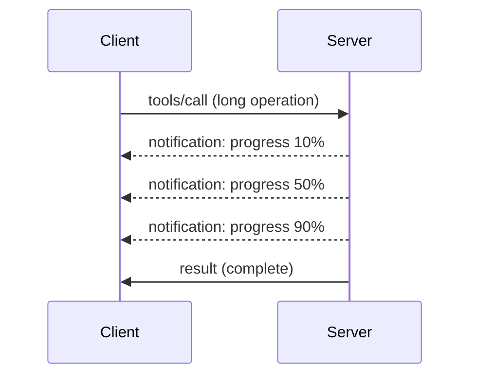

# MCP Protocol Features Deep Dive

This guide explores advanced MCP protocol features that go beyond basic tool and resource handling. Understanding these features helps you build more robust, user-friendly, and production-ready MCP servers.

> **MCP `2026-07-28` scope:** server process startup and shutdown remain
> application concerns, but the MCP `initialize` handshake and protocol-level
> sessions are removed. The Logging section below is retained for legacy
> implementations; new servers should use `stderr` or OpenTelemetry. Tasks is
> now a separately versioned extension. See
> [What's Changed in MCP: The 2026-07-28 Specification](../../01-CoreConcepts/mcp-2026-07-28.md).

## Features Covered

1. **Progress Notifications** - Report progress for long-running operations
2. **Request Cancellation** - Allow clients to cancel in-flight requests
3. **Resource Templates** - Dynamic resource URIs with parameters
4. **Application Lifecycle** - Server process startup and shutdown
5. **Logging Control (Legacy)** - Deprecated MCP logging configuration
6. **Error Handling Patterns** - Consistent error responses

---

## 1. Progress Notifications

For operations that take time (data processing, file downloads, API calls), progress notifications keep users informed.

### How It Works



### Python Implementation

```python
import os
from mcp.server.mcpserver import Context, MCPServer

# MCP Python SDK 2.x: pip install "mcp[cli]>=2.3.0,<3"
mcp = MCPServer("progress-server")

@mcp.tool()
async def process_large_file(file_path: str, ctx: Context) -> str:
    """Process a large file with progress updates."""

    # Get file size for progress calculation
    file_size = os.path.getsize(file_path)
    processed = 0

    with open(file_path, 'rb') as f:
        while chunk := f.read(8192):
            # Process chunk
            await process_chunk(chunk)
            processed += len(chunk)

            # Send a progress notification. The SDK uses the progress token
            # from the request and skips this if the client didn't ask for progress.
            progress = (processed / file_size) * 100
            await ctx.report_progress(
                progress,
                total=100,
                message=f"Processing: {progress:.1f}%"
            )

    return f"Processed {file_size} bytes"

@mcp.tool()
async def batch_operation(items: list[str], ctx: Context) -> str:
    """Process multiple items with progress."""

    results = []
    total = len(items)

    for i, item in enumerate(items):
        result = await process_item(item)
        results.append(result)

        # Report progress after each item
        await ctx.report_progress(
            i + 1,
            total=total,
            message=f"Processed {i + 1}/{total}: {item}"
        )

    return f"Completed {total} items"
```

### TypeScript Implementation

```typescript
import { Server } from "@modelcontextprotocol/sdk/server/index.js";

server.setRequestHandler(CallToolSchema, async (request, extra) => {
  const { name, arguments: args } = request.params;
  
  if (name === "process_data") {
    const items = args.items as string[];
    const results = [];
    
    for (let i = 0; i < items.length; i++) {
      const result = await processItem(items[i]);
      results.push(result);
      
      // Send progress notification
      await extra.sendNotification({
        method: "notifications/progress",
        params: {
          progressToken: request.id,
          progress: i + 1,
          total: items.length,
          message: `Processing item ${i + 1}/${items.length}`
        }
      });
    }
    
    return { content: [{ type: "text", text: JSON.stringify(results) }] };
  }
});
```

### Client Handling (Python)

```python
async def handle_progress(progress: float, total: float | None, message: str | None) -> None:
    """Handle progress notifications from server."""
    print(f"Progress: {progress}/{total} - {message}")

# Pass the handler when calling the tool; progress updates arrive while the call runs
result = await session.call_tool(
    "process_large_file",
    {"file_path": "/data/large.csv"},
    progress_callback=handle_progress,
)
```

---

## 2. Request Cancellation

Allow clients to cancel requests that are no longer needed or taking too long.

### Python Implementation

```python
import asyncio
from mcp.server.mcpserver import MCPServer

mcp = MCPServer("cancellable-server")

@mcp.tool()
async def long_running_search(query: str) -> str:
    """Search that can be cancelled."""

    results = []

    try:
        for page in range(100):  # Search through many pages
            # Simulate page search
            page_results = await search_page(query, page)
            results.extend(page_results)

            # Every await is a point where cancellation can take effect
            await asyncio.sleep(0.1)
    except asyncio.CancelledError:
        # When the client cancels the request, the SDK cancels this task.
        # Clean up, then re-raise: no result is sent for a cancelled request.
        print(f"Search cancelled after {len(results)} results")
        raise

    return f"Found {len(results)} total results"

@mcp.tool()
async def download_file(url: str) -> str:
    """Download with cancellation support."""

    # `async with` blocks close the HTTP session even if the request is cancelled
    async with aiohttp.ClientSession() as session:
        async with session.get(url) as response:
            downloaded = 0

            async for chunk in response.content.iter_chunked(8192):
                downloaded += len(chunk)

            return f"Downloaded {downloaded} bytes"
```

### Cleaning Up on Cancellation

```python
import asyncio

async def with_cleanup(work, cleanup):
    """Run `work`, and always run `cleanup`, even when the request is cancelled."""
    try:
        return await work()
    except asyncio.CancelledError:
        print("Request cancelled, cleaning up")
        raise  # always re-raise so the SDK knows the task was cancelled
    finally:
        await cleanup()
```

### Client-Side Cancellation

```python
import asyncio

async def search_with_timeout(session, query, timeout=30):
    """Search with automatic cancellation on timeout."""

    try:
        # If the timeout expires, wait_for cancels the call and the SDK
        # sends a notifications/cancelled message to the server for us.
        return await asyncio.wait_for(
            session.call_tool("long_running_search", {"query": query}),
            timeout=timeout,
        )
    except asyncio.TimeoutError:
        return "Search timed out"
```

---

## 3. Resource Templates

Resource templates allow dynamic URI construction with parameters, useful for APIs and databases.

### Defining Templates

```python
from mcp.server.mcpserver import MCPServer

mcp = MCPServer("template-server")

# With MCPServer, a URI containing {placeholders} becomes a resource template.
# The placeholders are passed to the function as arguments.

@mcp.resource("db://users/{user_id}", name="User Profile", mime_type="application/json")
async def user_profile(user_id: str) -> str:
    """Fetch user profile by ID"""
    return await fetch_user(user_id)

@mcp.resource("api://weather/{city}/{date}", name="Weather Data", mime_type="application/json")
async def weather(city: str, date: str) -> str:
    """Historical weather for city and date"""
    return await fetch_weather(city, date)

@mcp.resource("file://{path}", name="File Content", mime_type="text/plain")
async def file_content(path: str) -> str:
    """Read file at given path"""
    return await read_file(path)
```

### TypeScript Implementation

```typescript
server.setRequestHandler(ListResourceTemplatesSchema, async () => {
  return {
    resourceTemplates: [
      {
        uriTemplate: "github://repos/{owner}/{repo}/issues/{issue_number}",
        name: "GitHub Issue",
        description: "Fetch a specific GitHub issue",
        mimeType: "application/json"
      },
      {
        uriTemplate: "db://tables/{table}/rows/{id}",
        name: "Database Row",
        description: "Fetch a row from a database table",
        mimeType: "application/json"
      }
    ]
  };
});

server.setRequestHandler(ReadResourceSchema, async (request) => {
  const uri = request.params.uri;
  
  // Parse GitHub issue URI
  const githubMatch = uri.match(/^github:\/\/repos\/([^/]+)\/([^/]+)\/issues\/(\d+)$/);
  if (githubMatch) {
    const [_, owner, repo, issueNumber] = githubMatch;
    const issue = await fetchGitHubIssue(owner, repo, parseInt(issueNumber));
    return {
      contents: [{
        uri,
        mimeType: "application/json",
        text: JSON.stringify(issue, null, 2)
      }]
    };
  }
  
  throw new Error(`Unknown resource URI: ${uri}`);
});
```

---

## 4. Application Lifecycle

This section covers application process startup and shutdown, not the removed
MCP `initialize` handshake. Proper lifecycle handling ensures clean resource
management.

### Python Lifecycle Management

```python
from contextlib import asynccontextmanager
from dataclasses import dataclass
from mcp.server.mcpserver import Context, MCPServer

@dataclass
class AppState:
    db_connection: object
    cache: object

@asynccontextmanager
async def lifespan(server: MCPServer):
    """Manage server lifecycle."""

    # Startup
    print("🚀 Server starting...")
    db_connection = await create_database_connection()
    cache = await create_cache_client()
    print("✅ Resources initialized")

    try:
        yield AppState(db_connection=db_connection, cache=cache)  # Server runs here
    finally:
        # Shutdown
        print("🛑 Server shutting down...")
        await db_connection.close()
        await cache.close()
        print("✅ Resources cleaned up")

mcp = MCPServer("lifecycle-server", lifespan=lifespan)

@mcp.tool()
async def query_database(sql: str, ctx: Context) -> str:
    """Use the shared database connection."""
    state: AppState = ctx.request_context.lifespan_context
    result = await state.db_connection.execute(sql)
    return str(result)
```

### TypeScript Lifecycle

```typescript
import { Server } from "@modelcontextprotocol/sdk/server/index.js";

class ManagedServer {
  private server: Server;
  private dbConnection: DatabaseConnection | null = null;
  
  constructor() {
    this.server = new Server({
      name: "lifecycle-server",
      version: "1.0.0"
    });
    
    this.setupHandlers();
  }
  
  async start() {
    // Initialize resources
    console.log("🚀 Server starting...");
    this.dbConnection = await createDatabaseConnection();
    console.log("✅ Database connected");
    
    // Start server
    await this.server.connect(transport);
  }
  
  async stop() {
    // Cleanup resources
    console.log("🛑 Server shutting down...");
    if (this.dbConnection) {
      await this.dbConnection.close();
    }
    await this.server.close();
    console.log("✅ Cleanup complete");
  }
  
  private setupHandlers() {
    this.server.setRequestHandler(CallToolSchema, async (request) => {
      // Use this.dbConnection safely
      // ...
    });
  }
}

// Usage with graceful shutdown
const server = new ManagedServer();

process.on('SIGINT', async () => {
  await server.stop();
  process.exit(0);
});

await server.start();
```

---

## 5. Logging Control (Legacy)

> [!WARNING]
> MCP Logging is deprecated in `2026-07-28` and is eligible for removal in the
> first specification revision released on or after July 28, 2027. The examples
> below are for compatibility with older implementations. Use `stderr` with
> stdio and OpenTelemetry for structured observability in new servers.

Legacy MCP versions support server-side logging levels that clients can control. In the MCP Python SDK 2.x, `MCPServer` handles the client's log level for you, so your code only decides what to log. Server-side diagnostics should go to `stderr`:

### Implementing Logging Levels

```python
import logging
import sys
from mcp.server.mcpserver import MCPServer

mcp = MCPServer("logging-server")

# For stdio servers, write logs to stderr (stdout carries MCP messages)
logging.basicConfig(stream=sys.stderr, level=logging.INFO)
logger = logging.getLogger("mcp-server")

@mcp.tool()
async def debug_operation(data: str) -> str:
    """Tool with various logging levels."""
    logger.debug(f"Processing data: {data}")

    try:
        result = process(data)
        logger.info(f"Successfully processed: {result}")
        return result
    except Exception as e:
        logger.error(f"Processing failed: {e}")
        raise
```

### Sending Log Messages to Client

```python
@mcp.tool()
async def complex_operation(input: str, ctx: Context) -> str:
    """Operation that logs to client."""

    # Send a log notification to the client (legacy MCP logging;
    # the SDK marks it deprecated and emits an MCPDeprecationWarning)
    await ctx.info(f"Starting complex operation with input: {input}")

    # Do work...
    result = await do_work(input)

    await ctx.debug(f"Operation complete, result size: {len(result)}")

    return result
```

---

## 6. Error Handling Patterns

Consistent error handling improves debugging and user experience.

### MCP Error Codes

```python
from mcp.server.mcpserver.exceptions import ToolError
from mcp.shared.exceptions import MCPError
from mcp.types import INVALID_PARAMS

# Tool execution failures: raise ToolError (or a subclass). The client receives
# a normal tool result with is_error=True, so the LLM can read the message.

class ValidationError(ToolError):
    """Invalid input parameters."""

class NotFoundError(ToolError):
    """Requested resource not found."""
    def __init__(self, resource: str):
        super().__init__(f"Not found: {resource}")

class PermissionDeniedError(ToolError):
    """Access denied."""
    def __init__(self, action: str):
        super().__init__(f"Permission denied: {action}")

class InternalError(ToolError):
    """Internal server error."""

# Protocol errors: raise MCPError when the request itself must be rejected.
# The client receives a JSON-RPC error with this code instead of a tool result.
def reject_request(message: str) -> None:
    raise MCPError(code=INVALID_PARAMS, message=message)
```

### Structured Error Responses

```python
@mcp.tool()
async def safe_operation(input: str) -> str:
    """Tool with comprehensive error handling."""

    # Validate input
    if not input:
        raise ValidationError("Input cannot be empty")

    if len(input) > 10000:
        raise ValidationError(f"Input too large: {len(input)} chars (max 10000)")

    try:
        # Check permissions
        if not await check_permission(input):
            raise PermissionDeniedError(f"read {input}")

        # Perform operation
        result = await perform_operation(input)

        if result is None:
            raise NotFoundError(input)

        return result

    except ToolError:
        raise  # already a clear message for the client
    except ConnectionError as e:
        raise InternalError(f"Database connection failed: {e}")
    except TimeoutError as e:
        raise InternalError(f"Operation timed out: {e}")
    except Exception as e:
        # Log unexpected errors
        logger.exception("Unexpected error in safe_operation")
        raise InternalError(f"Unexpected error: {type(e).__name__}")
```

### Error Handling in TypeScript

```typescript
import { McpError, ErrorCode } from "@modelcontextprotocol/sdk/types.js";

function validateInput(data: unknown): asserts data is ValidInput {
  if (typeof data !== "object" || data === null) {
    throw new McpError(
      ErrorCode.InvalidParams,
      "Input must be an object"
    );
  }
  // More validation...
}

server.setRequestHandler(CallToolSchema, async (request) => {
  try {
    validateInput(request.params.arguments);
    
    const result = await performOperation(request.params.arguments);
    
    return {
      content: [{ type: "text", text: JSON.stringify(result) }]
    };
    
  } catch (error) {
    if (error instanceof McpError) {
      throw error;  // Already an MCP error
    }
    
    // Convert other errors
    if (error instanceof NotFoundError) {
      throw new McpError(ErrorCode.InvalidRequest, error.message);
    }
    
    // Unknown error
    console.error("Unexpected error:", error);
    throw new McpError(
      ErrorCode.InternalError,
      "An unexpected error occurred"
    );
  }
});
```

---

## Version-Sensitive Features

### Tasks Extension

Tasks is an official, separately versioned extension in MCP `2026-07-28`. A
server may return a task handle from a tool call, and the client drives the task
with `tasks/get`, `tasks/update`, and `tasks/cancel`. The experimental
`2025-11-25` Tasks API is not backward compatible, and `tasks/list` no longer
exists.

### Tool Annotations

Tool annotations describe behavior such as read-only, destructive, idempotent,
or open-world operation. They are hints and must not be treated as trusted
authorization or safety guarantees unless they come from a trusted server.

---

## What's Next

- [Module 8 - Best Practices](../../08-BestPractices/README.md)
- [5.14 - Context Engineering](../mcp-contextengineering/README.md)
- [MCP Specification Changelog](https://modelcontextprotocol.io/specification/2026-07-28/changelog)

---

## Additional Resources

- [MCP Specification 2026-07-28](https://modelcontextprotocol.io/specification/2026-07-28/)
- [JSON-RPC 2.0 Error Codes](https://www.jsonrpc.org/specification#error_object)
- [Python SDK Examples](https://github.com/modelcontextprotocol/python-sdk/tree/main/examples)
- [TypeScript SDK Examples](https://github.com/modelcontextprotocol/typescript-sdk/tree/main/examples)
