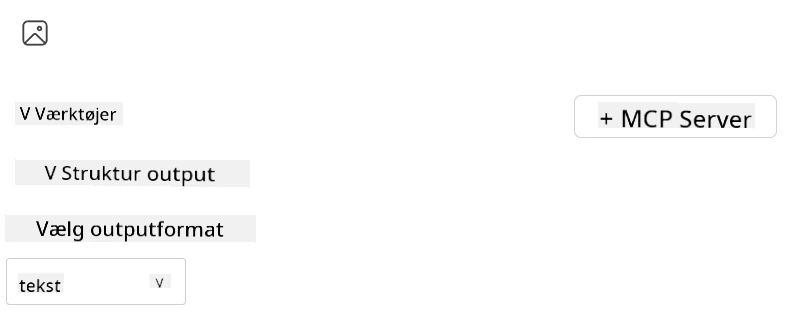
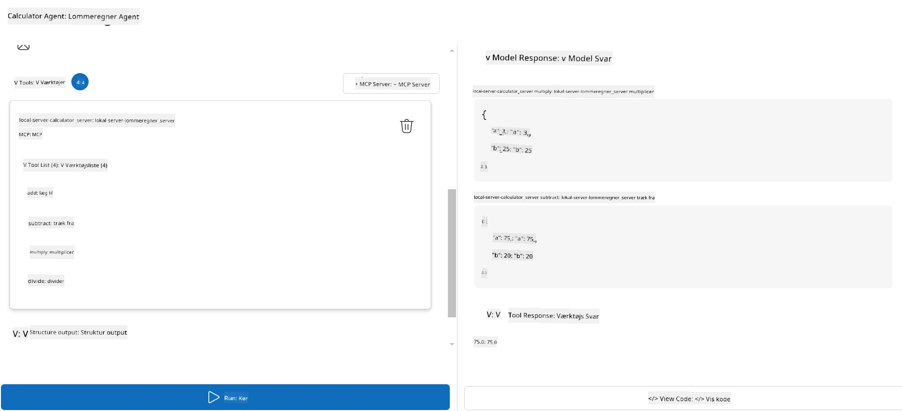

# Brug af en server med Microsoft Foundry Toolkit til Visual Studio Code

Når du bygger en AI-agent, handler det ikke kun om at generere smarte svar; det handler også om at give din agent evnen til at handle. Det er her Model Context Protocol (MCP) kommer ind. MCP gør det nemt for agenter at få adgang til eksterne værktøjer og tjenester på en ensartet måde. Tænk på det som at tilslutte din agent til et værktøjskasse, den *faktisk* kan bruge.

Lad os sige, at du forbinder en agent til din lommeregner-MCP-server. Pludselig kan din agent udføre matematiske operationer blot ved at modtage en prompt som “Hvad er 47 gange 89?”—uden at skulle kode logik eller bygge speciallavede API'er.

## Oversigt

Denne lektion gennemgår, hvordan man tilslutter en lommeregner-MCP-server til en agent med
[Microsoft Foundry Toolkit til Visual Studio Code](https://aka.ms/AIToolkit),
hvilket giver din agent mulighed for at udføre matematiske operationer via naturligt sprog.

Microsoft Foundry Toolkit forenkler udvikling og test af generative
AI-applikationer med lokale og cloud-hostede modeller.

*Bemærk*: Toolkittet understøtter i øjeblikket Python- og TypeScript-MCP-skabeloner.

## Læringsmål

Ved slutningen af denne lektion vil du kunne:

- Bruge en MCP-server med Microsoft Foundry Toolkit.
- Konfigurere en agent-konfiguration, så den kan opdage og bruge værktøjer leveret af MCP-serveren.
- Benytte MCP-værktøjer via naturligt sprog.

## Fremgangsmåde

Her er en overordnet tilgang:

- Opret en agent og definer dens systemprompt.
- Opret en MCP-server med regneværktøjer.
- Forbind Agent Builder til MCP-serveren.
- Test agentens kald af værktøjer via naturligt sprog.

Fantastisk, nu hvor vi forstår flowet, lad os konfigurere en AI-agent til at bruge eksterne værktøjer via MCP og dermed forbedre dens kapaciteter!

## Forudsætninger

- [Visual Studio Code](https://code.visualstudio.com/)
- [Microsoft Foundry Toolkit til Visual Studio Code](https://aka.ms/AIToolkit)

## Øvelse: Brug af en server

> [!WARNING]
> Bemærk for macOS-brugere. Vi undersøger i øjeblikket et problem, der påvirker installation af afhængigheder på macOS. Som følge heraf vil macOS-brugere ikke kunne gennemføre denne vejledning lige nu. Vi opdaterer instruktionerne, så snart en løsning er tilgængelig. Tak for jeres tålmodighed og forståelse!

I denne øvelse vil du bygge, køre og forbedre en AI-agent med værktøjer fra
en MCP-server inde i Visual Studio Code ved hjælp af Microsoft Foundry Toolkit.

### -0- Forberedelse, tilføj en Microsoft Foundry GPT-5.1 udrulning

Opret en Microsoft Foundry-ressource, udrul **GPT-5.1**, og tilføj udrulningen
til **Mine Modeller**. Gennemgå
[modelens udfasningsplan](https://learn.microsoft.com/azure/foundry/openai/concepts/model-retirement-schedule)
når du vælger en udrulning.

1. Åbn **Microsoft Foundry Toolkit** fra **Aktivitetslinjen**.
1. I sektionen **Katalog**, vælg **Modeller** for at åbne **Modelkataloget**. Vælger du **Modeller**, åbnes **Modelkataloget** i en ny editorfane.
1. Forbind dit Microsoft Foundry-projekt, og vælg din **GPT-5.1**-udrulning.
1. Klik på **+ Tilføj** for at tilføje udrulningen til din liste over **Mine Modeller**.
1. Bekræft i **Aktivitetslinjen**, at udrulningen vises i listen.

### -1- Opret en agent

**Agent (Prompt) Builder** gør det muligt at oprette og tilpasse dine egne AI-drevne agenter. I denne sektion skal du oprette en ny agent og tildele en model til at drive samtalen.

1. Åbn **Microsoft Foundry Toolkit** fra **Aktivitetslinjen**.
1. I sektionen **Værktøjer**, vælg **Agent (Prompt) Builder**. Når du vælger **Agent (Prompt) Builder**, åbnes **Agent (Prompt) Builder** i en ny editorfane.
1. Klik på knappen **+ Ny Agent**. Udvidelsen starter en opsætningsguide via **Kommando Paletten**.
1. Indtast navnet **Calculator Agent** og tryk på **Enter**.
1. I **Agent (Prompt) Builder**, vælg din **GPT-5.1** Foundry-udrulning.

### -2- Opret en systemprompt til agenten

Nu hvor agenten er skitseret, er det tid til at definere dens personlighed og formål. I denne sektion bruger du funktionen **Generer systemprompt** til at beskrive agentens tiltænkte adfærd—i dette tilfælde en lommeregneragent—og få modellen til at skrive systemprompten for dig.

1. I afsnittet **Prompt** klik på knappen **Generer systemprompt**. Denne knap åbner promptbyggeren, som bruger AI til at generere en systemprompt for agenten.
1. I vinduet **Generer en prompt**, indtast følgende: `You are a helpful and efficient math assistant. When given a problem involving basic arithmetic, you respond with the correct result.`
1. Klik på knappen **Generer**. En notifikation vises nederst til højre og bekræfter, at systemprompten bliver genereret. Når generationen er færdig, vises prompten i feltet **Systemprompt** i **Agent (Prompt) Builder**.
1. Gennemgå **Systemprompt** og rediger den om nødvendigt.

### -3- Opret en MCP-server

Nu hvor du har defineret agentens systemprompt – der styrer dens adfærd og svar – er det tid til at udstyre agenten med praktiske evner. I denne sektion opretter du en lommeregner-MCP-server med værktøjer til addition, subtraktion, multiplikation og division. Denne server vil give din agent mulighed for at udføre matematiske operationer i realtid som svar på naturlige sprogspørgsmål.



Microsoft Foundry Toolkit inkluderer skabeloner til oprettelse af MCP-servere. Vi vil
bruge Pythonskabelonen til lommeregner-MCP-serveren.

*Bemærk*: Toolkittet understøtter i øjeblikket Python- og TypeScript-MCP-skabeloner.

1. I sektionen **Værktøjer** i **Agent (Prompt) Builder**, klik på knappen **+ MCP Server**. Udvidelsen starter en opsætningsguide via **Kommando Paletten**.
1. Vælg **+ Tilføj server**.
1. Vælg **Opret en ny MCP-server**.
1. Vælg **python-weather** som skabelon.
1. Vælg **Standardmappe** til at gemme MCP-serverens skabelon.
1. Indtast følgende navn til serveren: **Calculator**
1. Et nyt Visual Studio Code-vindue åbnes. Vælg **Ja, jeg har tillid til forfatterne**.
1. Brug terminalen (**Terminal** > **Ny terminal**) til at oprette et virtuelt miljø: `python -m venv .venv`
1. Brug terminalen til at aktivere det virtuelle miljø:
    1. Windows - `.venv\Scripts\activate`
    1. macOS/Linux - `source .venv/bin/activate`
1. Brug terminalen til at installere afhængighederne: `pip install -e .[dev]`
1. I **Explorer**-visningen i **Aktivitetslinjen**, udvid **src**-mappen og vælg **server.py** for at åbne filen i editoren.
1. Erstat koden i filen **server.py** med følgende og gem:

    ```python
    """
    Sample MCP Calculator Server implementation in Python.

    
    This module demonstrates how to create a simple MCP server with calculator tools
    that can perform basic arithmetic operations (add, subtract, multiply, divide).
    """
    
    from mcp.server.fastmcp import FastMCP
    
    server = FastMCP("calculator")
    
    @server.tool()
    def add(a: float, b: float) -> float:
        """Add two numbers together and return the result."""
        return a + b
    
    @server.tool()
    def subtract(a: float, b: float) -> float:
        """Subtract b from a and return the result."""
        return a - b
    
    @server.tool()
    def multiply(a: float, b: float) -> float:
        """Multiply two numbers together and return the result."""
        return a * b
    
    @server.tool()
    def divide(a: float, b: float) -> float:
        """
        Divide a by b and return the result.
        
        Raises:
            ValueError: If b is zero
        """
        if b == 0:
            raise ValueError("Cannot divide by zero")
        return a / b
    ```

### -4- Kør agenten med lommeregner-MCP-serveren

Nu hvor din agent har værktøjer, er det tid til at bruge dem! I denne sektion sender du prompts til agenten for at teste og validere, om agenten bruger det rigtige værktøj fra lommeregner-MCP-serveren.



Du vil køre lommeregner-MCP-serveren på din lokale udviklingsmaskine via **Agent Builder** som MCP-klient.

1. Tryk `F5` for at starte fejlfinding af MCP-serveren. **Agent (Prompt) Builder** åbnes i en ny editorfane. Serverens status vises i terminalen.
1. I feltet **Bruger-prompt** i **Agent (Prompt) Builder**, indtast følgende prompt: `I bought 3 items priced at $25 each, and then used a $20 discount. How much did I pay?`
1. Klik på knappen **Kør** for at generere agentens svar.
1. Gennemgå agentens output. Modellen bør konkludere, at du betalte **$55**.
1. Her er en forklaring på, hvad der bør ske:
    - Agenten vælger værktøjerne **multiply** og **subtract** til at hjælpe med beregningen.
    - De respektive `a` og `b` værdier tildeles til værktøjet **multiply**.
    - De respektive `a` og `b` værdier tildeles til værktøjet **subtract**.
    - Svaret fra hvert værktøj vises i den respektive **Tool Response**.
    - Det endelige output fra modellen vises i det endelige **Model Response**.
1. Send yderligere prompts for at teste agenten yderligere. Du kan ændre den eksisterende prompt i feltet **Bruger-prompt** ved at klikke ind i feltet og erstatte den eksisterende prompt.
1. Når du er færdig med at teste agenten, kan du stoppe serveren via **terminalen** ved at trykke **CTRL/CMD+C** for at afslutte.

## Opgave

Prøv at tilføje et ekstra værktøj til din **server.py** fil (fx at returnere kvadratroden af et tal). Send yderligere prompts, der kræver, at agenten bruger dit nye værktøj (eller de eksisterende værktøjer). Husk at genstarte serveren for at indlæse de nyligt tilføjede værktøjer.

## Løsning

[Løsning](./solution/README.md)

## Vigtige konklusioner

De vigtigste punkter fra dette kapitel er følgende:

- Microsoft Foundry Toolkit kan anvende MCP-servere og deres værktøjer.
- Du kan tilføje nye værktøjer til MCP-servere og udvide agentens kapabiliteter til at opfylde ændrede behov.
- Microsoft Foundry Toolkit inkluderer skabeloner til MCP-servere til at oprette brugerdefinerede værktøjer.

## Yderligere ressourcer

- [Microsoft Foundry Toolkit dokumentation](https://aka.ms/AIToolkit/doc)

## Hvad er det næste
- Næste: [Test & Fejlfinding](../08-testing/README.md)

---

<!-- CO-OP TRANSLATOR DISCLAIMER START -->
**Ansvarsfraskrivelse**:
Dette dokument er blevet oversat ved hjælp af AI-oversættelsestjenesten [Co-op Translator](https://github.com/Azure/co-op-translator). Selvom vi bestræber os på nøjagtighed, skal du være opmærksom på, at automatiserede oversættelser kan indeholde fejl eller unøjagtigheder. Det originale dokument på dets oprindelige sprog bør betragtes som den autoritative kilde. For kritisk information anbefales professionel menneskelig oversættelse. Vi påtager os intet ansvar for misforståelser eller fejltolkninger, der opstår som følge af brugen af denne oversættelse.
<!-- CO-OP TRANSLATOR DISCLAIMER END -->