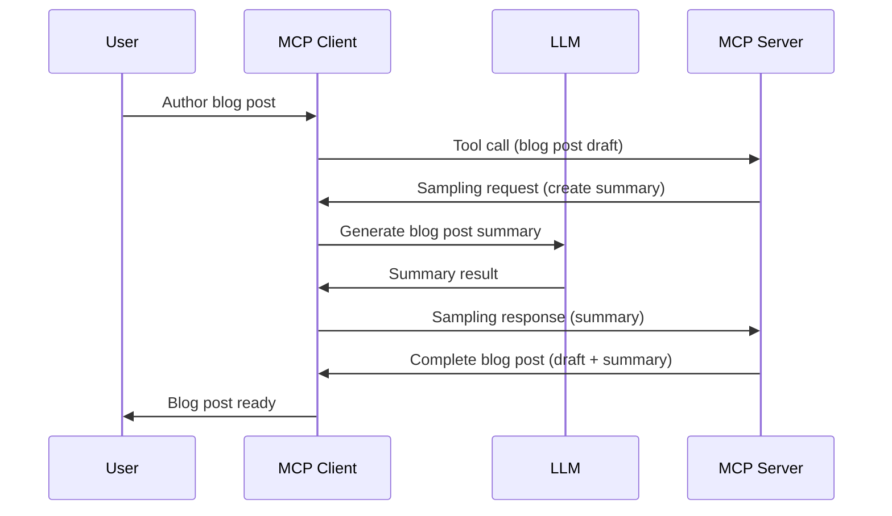

> [!WARNING]
> Sampling er forældet i MCP `2026-07-28`. Denne lektion bevares for
> ældre implementeringer. Nye servere bør integrere direkte med en LLM
> leverandør-API.

# Sampling - deleger funktioner til Klienten

> Sampling forbliver i `2026-07-28` specifikationen for kompatibilitet og er
> kandidat til fjernelse i den første revision udgivet den 28. juli eller senere,
> 2027. Eksempler i denne lektion kan anvende SDK API'er, der implementerer `2025-11-25`.
> Se [Hvad er ændret i MCP: Specifikationen 2026-07-28](../../01-CoreConcepts/mcp-2026-07-28.md).

I ældre implementeringer tillader Sampling, at en MCP-server kan bede om hjælp fra en LLM
styret af klienten. For nye implementeringer skal man i stedet kalde den valgte LLM-leverandør
direkte.

Lad os udforske nogle brugsscenarier og hvordan man bygger en løsning med sampling.

## Oversigt

I denne lektion fokuserer vi på at forklare hvornår og hvor man skal bruge Sampling, og hvordan man konfigurerer det.

## Læringsmål

I dette kapitel vil vi:

- Forklare hvad Sampling er og hvornår det skal bruges.
- Vise hvordan man konfigurerer Sampling i MCP.
- Give eksempler på Sampling i praksis.

## Hvad er Sampling og hvorfor bruge det?

Sampling er en avanceret funktion, som fungerer på følgende måde:



### Sampling-forespørgsel

Ok, nu har vi et overblik over et plausibelt scenarie, lad os tale om sampling-forespørgslen som serveren sender tilbage til klienten. Sådan kan en sådan forespørgsel se ud i JSON-RPC format:

```json
{
  "jsonrpc": "2.0",
  "id": 1,
  "method": "sampling/createMessage",
  "params": {
    "messages": [
      {
        "role": "user",
        "content": {
          "type": "text",
          "text": "Create a blog post summary of the following blog post: <BLOG POST>"
        }
      }
    ],
    "modelPreferences": {
      "hints": [
        {
          "name": "gpt-5.1"
        }
      ],
      "intelligencePriority": 0.8,
      "speedPriority": 0.5
    },
    "systemPrompt": "You are a helpful assistant.",
    "maxTokens": 100
  }
}
```

Der er et par ting her, som er værd at fremhæve:

- Prompt, under content -> text, er vores prompt, som er en instruktion til LLM om at opsummere blogindholdet.

- **modelPreferences**. Denne sektion er netop det, en præference, en anbefaling om hvilken konfiguration der skal bruges med LLM'en. Brugeren kan vælge at følge disse anbefalinger eller ændre dem. I dette tilfælde er der anbefalinger om modelvalg og prioritering af hastighed og intelligens.
- **systemPrompt**, dette er din normale system-prompt, som giver LLM'en en personlighed og indeholder vejledende instruktioner.
- **maxTokens**, dette er endnu en egenskab, der angiver hvor mange tokens der anbefales brugt til denne opgave.

### Sampling-svar

Dette svar er det, som MCP-klienten ender med at sende tilbage til MCP-serveren og er resultatet af, at klienten kalder LLM'en, venter på svaret og derefter konstruerer denne besked. Sådan kan det se ud i JSON-RPC:

```json
{
  "jsonrpc": "2.0",
  "id": 1,
  "result": {
    "role": "assistant",
    "content": {
      "type": "text",
      "text": "Here's your abstract <ABSTRACT>"
    },
    "model": "gpt-5.1",
    "stopReason": "endTurn"
  }
}
```

Svaret er et abstrakt af blogindlægget, præcis som forespurgt. Klienten
valgte den aktive `gpt-5.1` deployment ud fra serverens modelpræference;
modelpræferencer er anbefalinger, så klienten kan vælge en anden aktiv
deployment, hvis nødvendigt.

Ok, nu hvor vi forstår hovedflowet, og at en nyttig opgave er "blogindlægsskrivning + abstrakt", lad os se hvad vi skal gøre for at få det til at fungere.

### Beskedtyper

Sampling-beskeder er ikke begrænset til kun tekst, men du kan også sende billeder og lyd. Sådan ser JSON-RPC forskellig ud:

**Tekst**

```json
{
  "type": "text",
  "text": "The message content"
}
```

**Billedindhold**

```json
{
  "type": "image",
  "data": "base64-encoded-image-data",
  "mimeType": "image/jpeg"
}
```

**Lydindhold**

```json
{
  "type": "audio",
  "data": "base64-encoded-audio-data",
  "mimeType": "audio/wav"
}
```

> NOTE: For aktuel status og migrationsvejledning, se
> [den forældede Sampling-dokumentation](https://modelcontextprotocol.io/specification/2026-07-28/client/sampling).

## Sådan konfigureres Sampling i klienten

> Bemærk: hvis du kun bygger en server, behøver du ikke gøre meget her.

I en klient skal du angive følgende funktion sådan her:

```json
{
  "capabilities": {
    "sampling": {}
  }
}
```

Dette vil så blive registreret, når din valgte klient initialiseres med serveren.

## Eksempel på Sampling i praksis - Opret et blogindlæg

Lad os kode en sampling-server sammen, vi skal gøre følgende:

1. Opret et værktøj på serveren.
1. Det nævnte værktøj skal lave en sampling-forespørgsel
1. Værktøjet skal vente på, at klientens sampling-forespørgsel bliver besvaret.
1. Så skal værktøjets resultat produceres.

Lad os se koden trin for trin:

### -1- Opret værktøjet

**python**

```python
@mcp.tool()
async def create_blog(title: str, content: str, ctx: Context[ServerSession, None]) -> str:
    """Create a blog post and generate a summary"""

```

### -2- Opret en sampling-forespørgsel

Udvid dit værktøj med følgende kode:

**python**

```python
post = BlogPost(
        id=len(posts) + 1,
        title=title,
        content=content,
        abstract=""
    )

prompt = f"Create an abstract of the following blog post: title: {title} and draft: {content} "

result = await ctx.session.create_message(
        messages=[
            SamplingMessage(
                role="user",
                content=TextContent(type="text", text=prompt),
            )
        ],
        max_tokens=100,
)

```

### -3- Vent på svar og returner svar

**python**

```python
post.abstract = result.content.text

posts.append(post)

# return the complete product
return json.dumps({
    "id": post.title,
    "abstract": post.abstract
})
```

### -4- Fuld kode

**python**

```python
from starlette.applications import Starlette
from starlette.routing import Mount, Host

from mcp.server.fastmcp import Context, FastMCP

from mcp.server.session import ServerSession
from mcp.types import SamplingMessage, TextContent

import json


from uuid import uuid4
from typing import List
from pydantic import BaseModel


mcp = FastMCP("Blog post generator")

# app = FastAPI()

posts = []

class BlogPost(BaseModel):
    id: int
    title: str
    content: str
    abstract: str

posts: List[BlogPost] = []

@mcp.tool()
async def create_blog(title: str, content: str, ctx: Context[ServerSession, None]) -> str:
    """Create a blog post and generate a summary"""

    post = BlogPost(
        id=len(posts) + 1,
        title=title,
        content=content,
        abstract=""
    )

    prompt = f"Create an abstract of the following blog post: title: {title} and draft: {content} "

    result = await ctx.session.create_message(
        messages=[
            SamplingMessage(
                role="user",
                content=TextContent(type="text", text=prompt),
            )
        ],
        max_tokens=100,
    )

    post.abstract = result.content.text

    posts.append(post)

    # return the complete blog post
    return json.dumps({
        "id": post.title,
        "abstract": post.abstract
    })

if __name__ == "__main__":
    print("Starting server...")
    # mcp.run()
    mcp.run(transport="streamable-http")

# run app with: python server.py
```

### -5- Test i Visual Studio Code

For at teste dette i Visual Studio Code, gør følgende:

1. Start serveren i terminalen
1. Tilføj den til *mcp.json* (og sørg for den er startet), fx sådan her:

   ```json
   "servers": {
      "blog-server": {
        "type": "http",
        "url": "http://localhost:8000/mcp"
      }
   }
   ```

1. Skriv en prompt:

   ```text
   create a blog post named "Where Python comes from", the content is "Python is actually named after Monty Python Flying Circus"
   ```

1. Tillad sampling at ske. Første gang du tester dette, vil du få vist en ekstra dialog, som du skal acceptere, derefter ser du den normale dialog, der beder dig om at køre et værktøj.

1. Undersøg resultaterne. Du vil se resultaterne både pænt gengivet i GitHub Copilot Chat, men du kan også inspicere det rå JSON-svar.

**Bonus**. Visual Studio Codes værktøjer har god støtte til sampling. Du kan konfigurere sampling-adgang på din installerede server ved at navigere til den således:

1. Gå til udvidelsesafsnittet.
1. Vælg tandhjulsikonet for din installerede server under "MCP SERVERS - INSTALLED".
1 Vælg "Configure Model Access", her kan du vælge hvilke modeller GitHub Copilot må bruge ved sampling. Du kan også se alle sampling-forespørgsler der er sket for nylig ved at vælge "Show Sampling requests".

## Opgave

I denne opgave vil du bygge en lidt anderledes Sampling, nemlig en sampling-integration der understøtter generering af produktbeskrivelser. Her er dit scenarie:

**Scenarie**: Backoffice-medarbejderen i en e-handel har brug for hjælp, det tager alt for meget tid at generere produktbeskrivelser. Derfor skal du bygge en løsning, hvor du kan kalde et værktøj "create_product" med "title" og "keywords" som argumenter, og det skal producere et komplet produkt inklusive et "description"-felt, som skal udfyldes af en klients LLM.

TIP: brug det, du lærte tidligere til at konstruere denne server og dens værktøj ved hjælp af en sampling-forespørgsel.

## Løsning

[Løsning](./solution/README.md)

## Nøglepointer

Sampling er en kraftfuld funktion, som tillader serveren at delegere opgaver til klienten, når den har brug for hjælp fra en LLM.

## Hvad er det næste

- [Kapitel 4 - Praktisk implementering](../../04-PracticalImplementation/README.md)

---

<!-- CO-OP TRANSLATOR DISCLAIMER START -->
**Ansvarsfraskrivelse**:
Dette dokument er blevet oversat ved hjælp af AI-oversættelsestjenesten [Co-op Translator](https://github.com/Azure/co-op-translator). Selvom vi bestræber os på nøjagtighed, skal du være opmærksom på, at automatiserede oversættelser kan indeholde fejl eller unøjagtigheder. Det originale dokument på dets oprindelige sprog bør betragtes som den autoritative kilde. For kritisk information anbefales professionel menneskelig oversættelse. Vi påtager os intet ansvar for misforståelser eller fejltolkninger, der opstår som følge af brugen af denne oversættelse.
<!-- CO-OP TRANSLATOR DISCLAIMER END -->