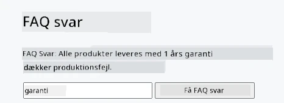
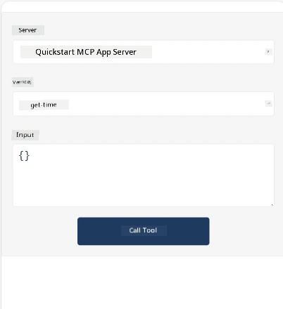
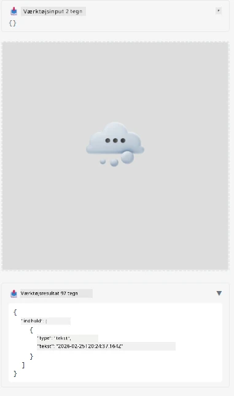

Her er et eksempel, der demonstrerer MCP App

## Installation 

1. Naviger til *mcp-app* mappen
1. Kør `npm install`, dette skulle installere frontend- og backend-afhængigheder

Verificer at backend kompilerer ved at køre:

```sh
npx tsc --noEmit
```

Der bør ikke være nogen output, hvis alt er i orden.

## Kør backend

> Dette kræver lidt ekstra arbejde hvis du bruger en Windows-maskine, da MCP Apps-løsningen bruger `concurrently` biblioteket, som du skal finde en erstatning for. Her er den problematiske linje i *package.json* for MCP App:

```json
"start": "concurrently \"cross-env NODE_ENV=development INPUT=mcp-app.html vite build --watch\" \"tsx watch main.ts\""
```

Denne app består af to dele, en backend-del og en vært-del.

Start backenden ved at køre:

```sh
npm start
```

Dette skulle starte backenden på `http://localhost:3001/mcp`. 

> Bemærk, hvis du er i en Codespace, kan det være nødvendigt at sætte portens synlighed til offentlig. Tjek at du kan nå endpointet i browseren via https://<name af Codespace>.app.github.dev/mcp

## Valgmulighed -1 Test appen i Visual Studio Code

For at teste løsningen i Visual Studio Code, gør følgende:

- Tilføj en serverpost til `mcp.json` sådan her:

    ```json
    {
        "servers": {
            "my-mcp-server-7178eca7": {
                "url": "http://localhost:3001/mcp",
                "type": "http"
            }
        },
        "inputs": []
    }
    ```

1. Tryk på "start" knappen i *mcp.json*
1. Sørg for at et chatvindue er åbent og skriv `get-faq`, du skulle se et resultat som dette:

    

## Valgmulighed -2- Test appen med en vært

Repoet <https://github.com/modelcontextprotocol/ext-apps> indeholder flere forskellige værter, som du kan bruge til at teste dine MVP Apps.

Vi vil præsentere dig for to forskellige muligheder her:

### Lokal maskine

- Naviger til *ext-apps* efter du har klonet repoet.

- Installer afhængigheder

   ```sh
   npm install
   ```

- I et separat terminalvindue, naviger til *ext-apps/examples/basic-host*

    > hvis du er i en Codespace, skal du navigere til serve.ts på linje 27 og erstatte http://localhost:3001/mcp med din Codespace URL for backenden, for eksempel https://psychic-xylophone-657rpjgvxpc5g64-3001.app.github.dev/mcp

- Kør værten:

    ```sh
    npm start
    ```

    Dette skulle forbinde værten med backend, og du burde se appen køre som dette:

    

### Codespace

Det kræver lidt ekstra arbejde at få et Codespace miljø til at fungere. For at bruge en vært gennem Codespace:

- Se *ext-apps* biblioteket og naviger til *examples/basic-host*.
- Kør `npm install` for at installere afhængigheder
- Kør `npm start` for at starte værten.

## Test appen

Prøv appen på følgende måde:

- Vælg "Call Tool" knappen, og du skulle se resultater som dette:

    

Fint, det hele virker.

---

<!-- CO-OP TRANSLATOR DISCLAIMER START -->
**Ansvarsfraskrivelse**:
Dette dokument er blevet oversat ved hjælp af AI-oversættelsestjenesten [Co-op Translator](https://github.com/Azure/co-op-translator). Selvom vi bestræber os på nøjagtighed, skal du være opmærksom på, at automatiserede oversættelser kan indeholde fejl eller unøjagtigheder. Det originale dokument på dets oprindelige sprog bør betragtes som den autoritative kilde. For kritisk information anbefales professionel menneskelig oversættelse. Vi påtager os intet ansvar for misforståelser eller fejltolkninger, der opstår som følge af brugen af denne oversættelse.
<!-- CO-OP TRANSLATOR DISCLAIMER END -->