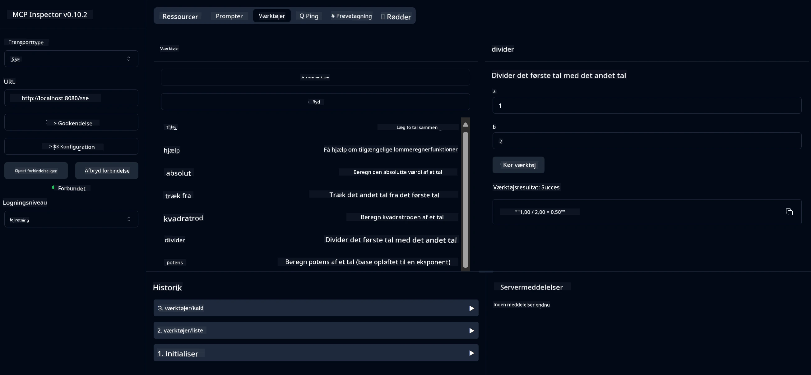

# Grundlæggende Lommeregner MCP Service

> [!NOTE]
> Dette eksempel bruger den ældre HTTP+SSE transport og henvender sig til en SDK kompatibel
> med MCP `2025-11-25`. Nye fjernservere bør bruge `2026-07-28` Streamable
> HTTP support.

Denne service leverer grundlæggende lommeregnerfunktioner via Model Context Protocol (MCP) ved hjælp af Spring Boot med WebFlux transport. Den er designet som et simpelt eksempel for begyndere, der lærer om MCP-implementeringer.

For mere information, se [MCP Server Boot Starter](https://docs.spring.io/spring-ai/reference/api/mcp/mcp-server-boot-starter-docs.html) reference dokumentationen.

## Oversigt

Servicen demonstrerer:
- Support for SSE (Server-Sent Events)
- Automatisk værktøjsregistrering ved brug af Spring AI’s `@Tool` annotation
- Grundlæggende lommeregnerfunktioner:
  - Addition, subtraktion, multiplikation, division
  - Potensberegning og kvadratrod
  - Modulus (rest) og absolut værdi
  - Hjælpefunktion til funktionsbeskrivelser

## Funktioner

Denne lommeregner-service tilbyder følgende funktionaliteter:

1. **Grundlæggende aritmetiske operationer**:
   - Addition af to tal
   - Subtraktion af et tal fra et andet
   - Multiplikation af to tal
   - Division af et tal med et andet (med kontrol for division med nul)

2. **Avancerede operationer**:
   - Potensberegning (at ophøje en base til en eksponent)
   - Kvadratrodsberegning (med kontrol for negative tal)
   - Modulus (rest) beregning
   - Absolut værdiberegning

3. **Hjælpesystem**:
   - Indbygget hjælpefunktion, der forklarer alle tilgængelige operationer

## Brug af servicen

Servicen udstiller følgende API-endpoints via MCP-protokollen:

- `add(a, b)`: Lægge to tal sammen
- `subtract(a, b)`: Trække det andet tal fra det første
- `multiply(a, b)`: Multiplicere to tal
- `divide(a, b)`: Divider det første tal med det andet (med nul-kontrol)
- `power(base, exponent)`: Beregn potens af et tal
- `squareRoot(number)`: Beregn kvadratrod (med kontrol for negative tal)
- `modulus(a, b)`: Beregn rest ved division
- `absolute(number)`: Beregn absolut værdi
- `help()`: Få information om tilgængelige operationer

## Testklient

En simpel testklient er inkluderet i `com.microsoft.mcp.sample.client` pakken. `SampleCalculatorClient` klassen demonstrerer de tilgængelige operationer i lommeregner-servicen.

## Brug af LangChain4j klienten

Projektet inkluderer en LangChain4j eksempelklient i
`com.microsoft.mcp.sample.client.LangChain4jClient` der demonstrerer, hvordan man
integrerer lommeregner-servicen med en Microsoft Foundry model.

### Forudsætninger

1. Opret en Microsoft Foundry-ressource og deployer en aktiv model såsom
   `gpt-5.1`.
2. Indstil model-endpoint, API-nøgle og deployeringsnavn:

   ```bash
   export AZURE_OPENAI_ENDPOINT="https://<resource-name>.openai.azure.com"
   export AZURE_OPENAI_API_KEY="<api-key>"
   export AZURE_OPENAI_DEPLOYMENT="gpt-5.1"
   ```

3. Tjek
   [Microsoft Foundry model retirementsplan](https://learn.microsoft.com/azure/foundry/openai/concepts/model-retirement-schedule)
   før valg af deployment.
4. Sørg for, at lommeregnerserveren kører på `localhost:8080`.

### Kørsel af LangChain4j klient

Dette eksempel demonstrerer:
- Tilslutning til lommeregner MCP-server via SSE transport
- Brug af LangChain4j til at skabe en chatbot, som anvender lommeregneroperationer
- Integration med en deployeret Microsoft Foundry model

Klienten sender følgende eksempelspørgsmål for at demonstrere funktionaliteten:
1. Beregning af summen af to tal
2. Find kvadratrod af et tal
3. Få hjælpeinformation om tilgængelige lommeregner-operationer

Kør eksemplet og tjek konsoludgangen for at se, hvordan AI-modellen bruger lommeregner-værktøjerne til at svare på forespørgsler.

### Microsoft Foundry Modelkonfiguration

LangChain4j klienten bruger Azure OpenAI v1-kompatible endpoint eksponeret af
Microsoft Foundry:

```java
String endpoint = System.getenv("AZURE_OPENAI_ENDPOINT");
ChatLanguageModel model = OpenAiOfficialChatModel.builder()
   .baseUrl(endpoint.replaceAll("/+$", "") + "/openai/v1/")
   .apiKey(System.getenv("AZURE_OPENAI_API_KEY"))
   .isAzure(true)
   .modelName(System.getenv().getOrDefault("AZURE_OPENAI_DEPLOYMENT", "gpt-5.1"))
    .timeout(Duration.ofSeconds(60))
    .build();
```

`AZURE_OPENAI_DEPLOYMENT` skal matche navnet tildelt ved modellens
deployment, hvilket kan adskille sig fra det underliggende modelnavn.

## Afhængigheder

Projektet kræver følgende nøgleafhængigheder:

```xml
<!-- For MCP Server -->
<dependency>
    <groupId>org.springframework.ai</groupId>
    <artifactId>spring-ai-starter-mcp-server-webflux</artifactId>
</dependency>

<!-- For LangChain4j integration -->
<dependency>
    <groupId>dev.langchain4j</groupId>
    <artifactId>langchain4j-mcp</artifactId>
    <version>${langchain4j.version}</version>
</dependency>

<!-- For Microsoft Foundry's OpenAI-compatible endpoint -->
<dependency>
    <groupId>dev.langchain4j</groupId>
   <artifactId>langchain4j-open-ai-official</artifactId>
    <version>${langchain4j.version}</version>
</dependency>
```

## Bygning af projektet

Byg projektet med Maven:
```bash
./mvnw clean install -DskipTests
```

## Kørsel af serveren

### Brug af Java

```bash
java -jar target/calculator-server-0.0.1-SNAPSHOT.jar
```

### Brug af MCP Inspector

MCP Inspector er et nyttigt værktøj til at interagere med MCP-services. For at bruge det med denne lommeregnerservice:

1. **Installer og kør MCP Inspector** i et nyt terminalvindue:
   ```bash
   npx @modelcontextprotocol/inspector
   ```

2. **Åbn web UI** ved at klikke på URL’en vist af appen (typisk http://localhost:6274)

3. **Konfigurer forbindelsen**:
   - Sæt transporttypen til "SSE"
   - Indstil URL’en til SSE-endpointet på din kørende server: `http://localhost:8080/sse`
   - Klik "Connect"

4. **Brug værktøjerne**:
   - Klik "List Tools" for at se tilgængelige lommeregner-funktioner
   - Vælg et værktøj og klik "Run Tool" for at udføre en operation



### Brug af Docker

Projektet indeholder en Dockerfile til containeriseret deployment:

1. **Byg Docker-billedet**:
   ```bash
   docker build -t calculator-mcp-service .
   ```

2. **Kør Docker-containeren**:
   ```bash
   docker run -p 8080:8080 calculator-mcp-service
   ```

Dette vil:
- Bygge et flertrins Docker-billede med Maven 3.9.9 og Eclipse Temurin 24 JDK
- Oprette et optimeret container-billede
- Eksponere servicen på port 8080
- Starte MCP lommeregner-servicen inde i containeren

Du kan tilgå servicen på `http://localhost:8080` når containeren kører.

## Fejlfinding

### Almindelige model-tilslutningsproblemer

1. **Autentificeringsfejl**: Bekræft at `AZURE_OPENAI_API_KEY` tilhører
   ressourcen identificeret ved `AZURE_OPENAI_ENDPOINT`.
2. **Deployment ikke fundet**: Bekræft at `AZURE_OPENAI_DEPLOYMENT` præcist matcher
   deployeringsnavnet i Microsoft Foundry.
3. **Ratebegrænsning**: Tjek deployeringskvoten og prøv igen efter det interval,
   som servicen returnerer.

For mere hjælp, se
[LangChain4j dokumentationen](https://github.com/langchain4j/langchain4j) og
[Microsoft Foundry dokumentationen](https://learn.microsoft.com/azure/ai-foundry/).

---

<!-- CO-OP TRANSLATOR DISCLAIMER START -->
**Ansvarsfraskrivelse**:
Dette dokument er blevet oversat ved hjælp af AI-oversættelsestjenesten [Co-op Translator](https://github.com/Azure/co-op-translator). Selvom vi bestræber os på nøjagtighed, skal du være opmærksom på, at automatiserede oversættelser kan indeholde fejl eller unøjagtigheder. Det originale dokument på dets oprindelige sprog bør betragtes som den autoritative kilde. For kritisk information anbefales professionel menneskelig oversættelse. Vi påtager os intet ansvar for misforståelser eller fejltolkninger, der opstår som følge af brugen af denne oversættelse.
<!-- CO-OP TRANSLATOR DISCLAIMER END -->