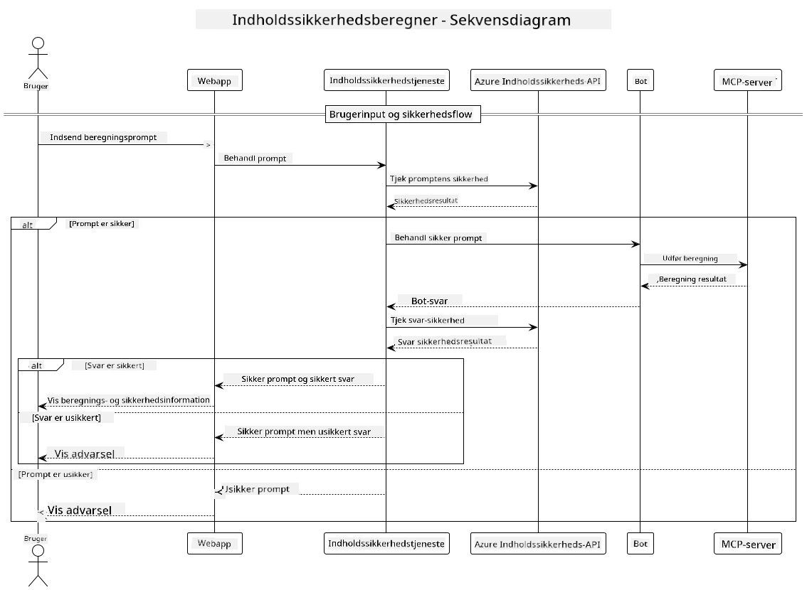

## Systemarkitektur

Dette projekt demonstrerer en webapplikation, der bruger indholdssikkerhedskontrol, før brugerforespørgsler sendes til en kalkulator-service via Model Context Protocol (MCP).



### Sådan fungerer det

1. **Brugerinput**: Brugeren indtaster en beregningsforespørgsel i webgrænsefladen
2. **Indholdssikkerhedsscreening (Input)**: Forespørgslen analyseres af Azure Content Safety API
3. **Sikkerhedsbeslutning (Input)**:
   - Hvis indholdet er sikkert (alvorlighedsgrad < 2 i alle kategorier), fortsætter det til kalkulatoren
   - Hvis indholdet er markeret som potentielt skadeligt, stoppes processen og returnerer en advarsel
4. **Kalkulatorintegration**: Sikkert indhold behandles af LangChain4j, som kommunikerer med MCP-kalkulatorserveren
5. **Indholdssikkerhedsscreening (Output)**: Botens svar analyseres af Azure Content Safety API
6. **Sikkerhedsbeslutning (Output)**:
   - Hvis botsvaret er sikkert, vises det for brugeren
   - Hvis botsvaret er markeret som potentielt skadeligt, erstattes det med en advarsel
7. **Svar**: Resultater (hvis sikre) vises til brugeren sammen med begge sikkerhedsanalyser

## Brug af Model Context Protocol (MCP) med kalkulatorservices

Dette projekt demonstrerer, hvordan man bruger Model Context Protocol (MCP) til at kalde kalkulator-MCP-services fra LangChain4j. Implementeringen bruger en lokal MCP-server, der kører på port 8080, til at levere kalkulatorfunktioner.

### Opsætning af Azure Content Safety Service

Før du bruger indholdssikkerhedsfunktionerne, skal du oprette en Azure Content Safety-service:

1. Log ind på [Azure Portal](https://portal.azure.com)
2. Klik på "Create a resource" og søg efter "Content Safety"
3. Vælg "Content Safety" og klik på "Create"
4. Indtast et unikt navn til din ressource
5. Vælg dit abonnement og din ressourcegruppe (eller opret en ny)
6. Vælg en understøttet region (se [Region availability](https://azure.microsoft.com/en-us/global-infrastructure/services/?products=cognitive-services) for detaljer)
7. Vælg en passende prismodel
8. Klik på "Create" for at implementere ressourcen
9. Når implementeringen er fuldført, klik på "Go to resource"
10. I venstre panel under "Resource Management", vælg "Keys and Endpoint"
11. Kopiér enten en af nøglerne og endpoint-URL'en til brug i næste trin

### Konfigurering af miljøvariabler

Indstil Microsoft Foundry model-endpoint, API-nøgle og deploymentsnavn:
```sh
export AZURE_OPENAI_ENDPOINT="https://<resource-name>.openai.azure.com"
export AZURE_OPENAI_API_KEY="<api-key>"
export AZURE_OPENAI_DEPLOYMENT="gpt-5.1"
```

For indholdssikkerhedsfunktioner, indstil:
```sh
export CONTENT_SAFETY_ENDPOINT=<your_content_safety_endpoint>
export CONTENT_SAFETY_KEY=<your_content_safety_key>
```

Disse miljøvariabler bruges af applikationen til at autentificere med Azure Content Safety-servicen. Hvis disse variabler ikke er sat, vil applikationen bruge pladsholder-værdier til demonstrationsformål, men indholdssikkerhedsfunktionerne vil ikke fungere korrekt.

### Start af kalkulator MCP-serveren

Før du kører klienten, skal du starte kalkulator MCP-serveren i SSE-tilstand på localhost:8080.

## Projektbeskrivelse

Dette projekt demonstrerer integrationen af Model Context Protocol (MCP) med LangChain4j for at kalde kalkulatorservices. Nøglefunktioner inkluderer:

- Brug af MCP til at forbinde til en kalkulatorservice for grundlæggende matematiske operationer
- Dobbelttjek af indholdssikkerhed på både brugerforespørgsler og botsvar
- Integration med en deployeret Microsoft Foundry-model via LangChain4j
- Brug af Server-Sent Events (SSE) til MCP-transport

## Indholdssikkerhedsintegration

Projektet inkluderer omfattende indholdssikkerhedsfunktioner for at sikre, at både brugerinput og systemets svar er fri for skadeligt indhold:

1. **Input-screening**: Alle brugerforespørgsler analyseres for skadelige indholdskategorier såsom hadtale, vold, selvskade og seksuelt indhold, før de behandles.

2. **Output-screening**: Selv ved brug af potentielt ucensurerede modeller kontrollerer systemet alle genererede svar gennem de samme indholdssikkerhedsfiltre, før de vises for brugeren.

Denne dobbelte tilgang sikrer, at systemet forbliver sikkert uanset hvilken AI-model der anvendes, og beskytter brugerne mod både skadelige input og potentielt problematiske AI-genererede output.

## Webklient

Applikationen inkluderer en brugervenlig webgrænseflade, der giver brugerne mulighed for at interagere med Content Safety Calculator-systemet:

### Funktioner i webgrænsefladen

- Simpelt, intuitivt formular til indtastning af beregningsforespørgsler
- Dobbelttjek af indholdssikkerhed (input og output)
- Feedback i realtid om prompt- og svarsikkerhed
- Farvekodede sikkerhedsindikatorer for nem tolkning
- Rent, responsivt design, der fungerer på forskellige enheder
- Eksempel på sikre forespørgsler til at vejlede brugerne

### Brug af webklienten

1. Start applikationen:
   ```sh
   mvn spring-boot:run
   ```

2. Åbn din browser og naviger til `http://localhost:8087`

3. Indtast en beregningsforespørgsel i det angivne tekstfelt (f.eks. "Calculate the sum of 24.5 and 17.3")

4. Klik på "Submit" for at behandle din forespørgsel

5. Se resultaterne, som vil inkludere:
   - Indholdssikkerhedsanalyse af din forespørgsel
   - Den beregnede resultat (hvis forespørgslen var sikker)
   - Indholdssikkerhedsanalyse af botens svar
   - Eventuelle sikkerhedsadvarsler, hvis enten input eller output blev markeret

Webklienten håndterer automatisk begge indholdssikkerhedsverifikationer, hvilket sikrer, at alle interaktioner er sikre og passende, uanset hvilken AI-model der bruges.

---

<!-- CO-OP TRANSLATOR DISCLAIMER START -->
**Ansvarsfraskrivelse**:
Dette dokument er blevet oversat ved hjælp af AI-oversættelsestjenesten [Co-op Translator](https://github.com/Azure/co-op-translator). Selvom vi bestræber os på nøjagtighed, skal du være opmærksom på, at automatiserede oversættelser kan indeholde fejl eller unøjagtigheder. Det originale dokument på dets oprindelige sprog bør betragtes som den autoritative kilde. For kritisk information anbefales professionel menneskelig oversættelse. Vi påtager os intet ansvar for misforståelser eller fejltolkninger, der opstår som følge af brugen af denne oversættelse.
<!-- CO-OP TRANSLATOR DISCLAIMER END -->