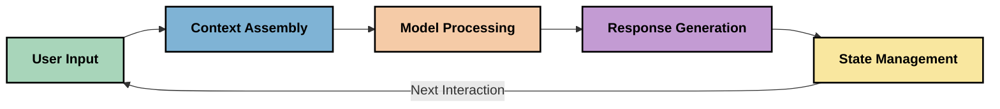
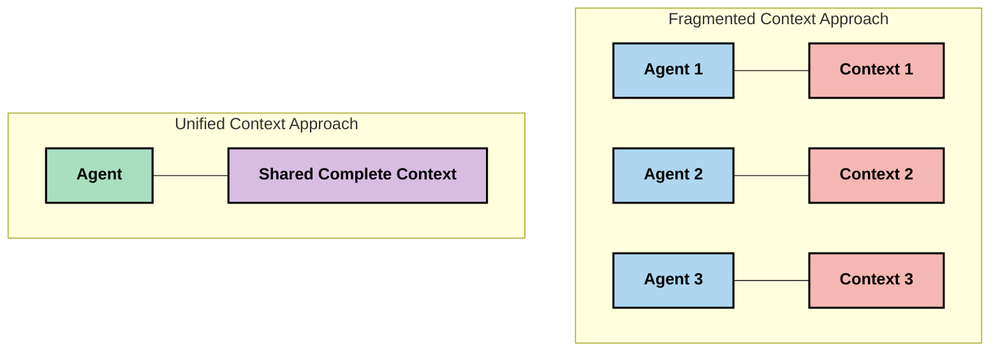
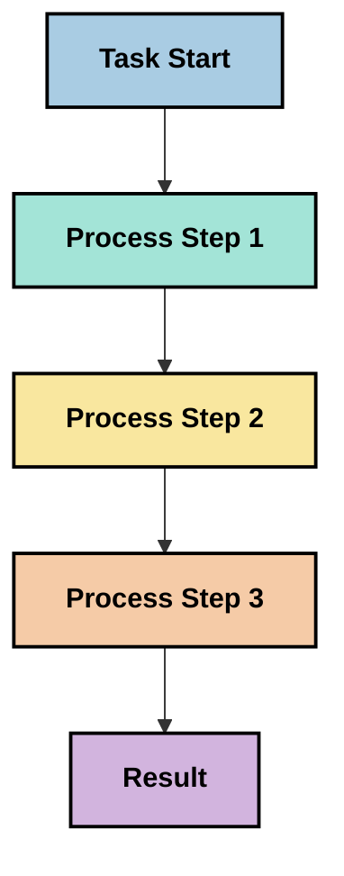
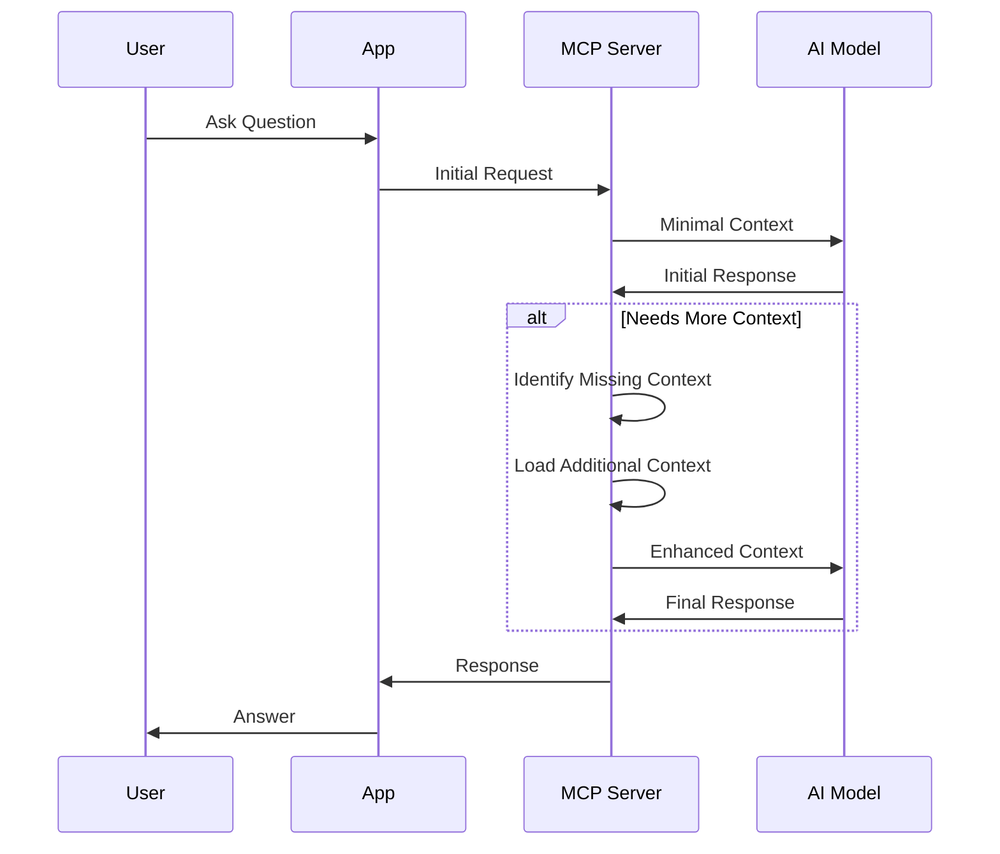
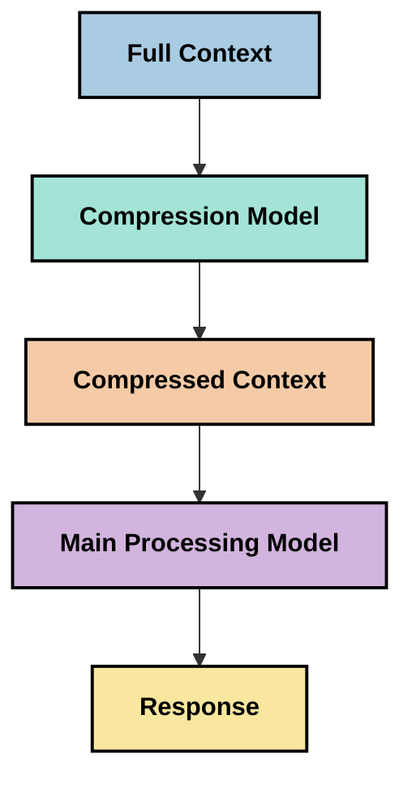
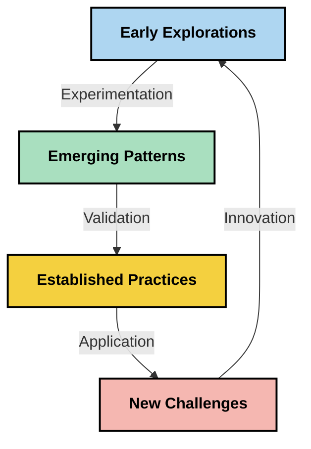

# Kontekst-Engineering: Et Fremvoksende Koncept i MCP-Økosystemet

## Oversigt

Kontekst-engineering er et fremvoksende koncept inden for AI-området, som undersøger, hvordan information struktureres, leveres og vedligeholdes gennem interaktioner mellem klienter og AI-tjenester. Efterhånden som Model Context Protocol (MCP)-økosystemet udvikler sig, bliver forståelsen af, hvordan man effektivt håndterer kontekst, stadig vigtigere. Denne modul introducerer konceptet kontekst-engineering og udforsker dets potentielle anvendelser i MCP-implementeringer.

## Læringsmål

Ved slutningen af dette modul vil du kunne:

- Forstå det fremvoksende koncept kontekst-engineering og dets potentielle rolle i MCP-applikationer
- Identificere nøgleudfordringer i kontekststyring, som MCP-protokolens design adresserer
- Udforske teknikker til forbedring af modelpræstation gennem bedre kontekst-håndtering
- Overveje tilgange til at måle og evaluere konteksteffektivitet
- Anvende disse fremvoksende koncepter til at forbedre AI-oplevelser gennem MCP-rammeværket

## Introduktion til Kontekst-Engineering

Kontekst-engineering er et fremvoksende koncept, der fokuserer på den bevidste design og styring af informationsflow mellem brugere, applikationer og AI-modeller. I modsætning til etablerede felter som prompt-engineering er kontekst-engineering stadig under definition af praktikere, mens de arbejder på at løse de unikke udfordringer ved at forsyne AI-modeller med den rette information på det rette tidspunkt.

Efterhånden som store sprogmodeller (LLMs) har udviklet sig, er betydningen af kontekst blevet stadigt mere tydelig. Kvaliteten, relevansen og strukturen af den kontekst, vi leverer, påvirker direkte modeloutput. Kontekst-engineering undersøger dette forhold og søger at udvikle principper for effektiv kontekststyring.

> "I 2025 er modellerne derude ekstremt intelligente. Men selv den klogeste person vil ikke være i stand til at udføre deres job effektivt uden konteksten af, hvad de bliver bedt om at gøre... 'Kontekst-engineering' er næste niveau af prompt-engineering. Det handler om at gøre dette automatisk i et dynamisk system." — Walden Yan, Cognition AI

Kontekst-engineering kan omfatte:

1. **Kontekstudvælgelse**: Bestemme, hvilken information der er relevant for en given opgave
2. **Kontekststrukturering**: Organisere information for at maksimere modellens forståelse
3. **Kontektlevering**: Optimere hvordan og hvornår information sendes til modeller
4. **Kontekstvedligeholdelse**: Styring af kontekstens tilstand og udvikling over tid
5. **Kontekst-evaluering**: Måle og forbedre kontekstens effektivitet

Disse fokusområder er særligt relevante for MCP-økosystemet, som tilbyder en standardiseret måde for applikationer at levere kontekst til LLM'er.


## Perspektivet af Kontekst-Rejsen

En måde at visualisere kontekst-engineering på er at spore rejsen, som information tager gennem et MCP-system:



### Nøglefaser i Kontekst-Rejsen:

1. **Brugerinput**: Rå information fra brugeren (tekst, billeder, dokumenter)
2. **Kontekstsammensætning**: Kombinere brugerinput med systemkontekst, samtalehistorik og anden hentet information
3. **Modelbehandling**: AI-modellen behandler den samlede kontekst
4. **Responsgenerering**: Modellen producerer output baseret på den leverede kontekst
5. **Tilstandsadministration**: Systemet opdaterer sin interne tilstand baseret på interaktionen

Dette perspektiv fremhæver den dynamiske karakter af kontekst i AI-systemer og rejser vigtige spørgsmål om, hvordan man bedst håndterer information på hvert trin.

## Fremvoksende Principper i Kontekst-Engineering

Efterhånden som feltet kontekst-engineering tager form, begynder nogle tidlige principper at dukke op fra praktikere. Disse principper kan hjælpe med at informere valg af MCP-implementeringer:

### Princip 1: Del Konteksten Fuldstændigt

Konteksten bør deles fuldstændigt mellem alle komponenter i et system i stedet for at være fragmenteret på tværs af flere agenter eller processer. Når konteksten er distribueret, kan beslutninger truffet i et systemområde komme i konflikt med dem i andre områder.



I MCP-applikationer antyder dette design af systemer, hvor konteksten flyder problemfrit gennem hele pipeline i stedet for at være opdelt.

### Princip 2: Anerkend, at Handlinger Indeholder Implicitte Beslutninger

Hver handling, en model foretager, indeholder implicitte beslutninger om, hvordan konteksten skal fortolkes. Når flere komponenter handler på forskellige kontekster, kan disse implicitte beslutninger komme i konflikt og føre til inkonsistente resultater.

Dette princip har vigtige implikationer for MCP-applikationer:
- Foretræk lineær behandling af komplekse opgaver frem for parallel eksekvering med fragmenteret kontekst
- Sikr, at alle beslutningspunkter har adgang til den samme kontekstuelle information
- Design systemer, hvor senere trin kan se den fulde kontekst af tidligere beslutninger

### Princip 3: Balancer Kontekstdybde med Vinduesbegrænsninger

Efterhånden som samtaler og processer bliver længere, overfyldes kontekstvinduerne til sidst. Effektiv kontekst-engineering udforsker tilgange til at håndtere spændingen mellem omfattende kontekst og tekniske begrænsninger.

Mulige tilgange, der undersøges, inkluderer:
- Kontekstkompression, der bevarer væsentlig information, mens tokenforbruget reduceres
- Progressiv indlæsning af kontekst baseret på relevans for de aktuelle behov
- Summering af tidligere interaktioner, samtidig med at nøglebeslutninger og fakta bevares

## Kontekst-Udfordringer og MCP-Protokol-Design

Model Context Protocol (MCP) blev designet med forståelse for unikke udfordringer ved kontekststyring. At forstå disse udfordringer hjælper med at forklare nøgleaspekter i MCP-protokolens design:


### Udfordring 1: Begrænsninger i Kontekstvindue
De fleste AI-modeller har faste størrelser på kontekstvinduer, hvilket begrænser, hvor meget information de kan behandle på én gang.

**MCP-designsvar:** 
- Protokollen understøtter struktureret, ressourcebaseret kontekst, der kan refereres effektivt
- Ressourcer kan pagineres og indlæses progressivt

### Udfordring 2: Bestemmelse af Relevans
Det er vanskeligt at afgøre, hvilke oplysninger der er mest relevante at inkludere i konteksten.

**MCP-designsvar:**
- Fleksible værktøjer tillader dynamisk hentning af information baseret på behov
- Strukturerede prompts muliggør konsekvent kontekstorganisering

### Udfordring 3: Kontekstpersistens
Håndtering af tilstand på tværs af interaktioner kræver omhyggelig sporing af kontekst.

**MCP-designsvar:**
- Standardiseret sessionsstyring
- Tydeligt definerede interaktionsmønstre for kontekstudvikling

### Udfordring 4: Multi-modal Kontekst
Forskellige typer data (tekst, billeder, strukturerede data) kræver forskellig håndtering.

**MCP-designsvar:**
- Protokoldesign tilpasser forskellige indholdstyper
- Standardiseret repræsentation af multi-modal information

### Udfordring 5: Sikkerhed og Privatliv
Kontekst indeholder ofte følsomme oplysninger, som skal beskyttes.

**MCP-designsvar:**
- Klare grænser mellem klient- og serveransvar
- Lokale behandlingsmuligheder for at minimere dataeksponering

At forstå disse udfordringer og hvordan MCP adresserer dem giver et fundament til at udforske mere avancerede kontekst-engineering-teknikker.

## Fremvoksende Tilgange til Kontekst-Engineering

Efterhånden som feltet kontekst-engineering udvikler sig, dukker flere lovende tilgange op. Disse repræsenterer nuværende tankegang snarere end etablerede bedste praksisser og vil sandsynligvis udvikle sig, efterhånden som vi får mere erfaring med MCP-implementeringer.

### 1. Enkelttrådet Lineær Behandling

I modsætning til multi-agent-arkitekturer, der distribuerer kontekst, finder nogle praktikere, at enkelttrådet lineær behandling giver mere konsekvente resultater. Dette stemmer overens med princippet om at vedligeholde en samlet kontekst.



Selvom denne tilgang kan virke mindre effektiv end parallel behandling, giver den ofte mere sammenhængende og pålidelige resultater, fordi hvert trin bygger på en fuldstændig forståelse af tidligere beslutninger.

### 2. Kontekstopdeling og Prioritering

Opdeling af store kontekster i håndterbare stykker og prioritering af det mest væsentlige.

```python
# Conceptual Example: Context Chunking and Prioritization
def process_with_chunked_context(documents, query):
    # 1. Break documents into smaller chunks
    chunks = chunk_documents(documents)
    
    # 2. Calculate relevance scores for each chunk
    scored_chunks = [(chunk, calculate_relevance(chunk, query)) for chunk in chunks]
    
    # 3. Sort chunks by relevance score
    sorted_chunks = sorted(scored_chunks, key=lambda x: x[1], reverse=True)
    
    # 4. Use the most relevant chunks as context
    context = create_context_from_chunks([chunk for chunk, score in sorted_chunks[:5]])
    
    # 5. Process with the prioritized context
    return generate_response(context, query)
```

Konceptet ovenfor illustrerer, hvordan vi kan opdele store dokumenter i håndterbare dele og vælge kun de mest relevante dele til kontekst. Denne tilgang kan hjælpe med at arbejde inden for kontekstvinduesbegrænsninger samtidig med at man udnytter store vidensbaser.

### 3. Progressiv Indlæsning af Kontekst

Indlæse kontekst progressivt efter behov i stedet for alt på én gang.



Progressiv kontekstindlæsning starter med minimal kontekst og udvider kun, når det er nødvendigt. Dette kan betydeligt reducere token-forbruget for simple forespørgsler, samtidig med at evnen til at håndtere komplekse spørgsmål bevares.

### 4. Kontekstkompression og Summering

Reducere kontekststørrelsen, mens væsentlig information bevares.



Kontekstkompression fokuserer på:
- Fjernelse af overflødig information
- Summering af langt indhold
- Udtrækning af nøglefakta og detaljer
- Bevarelse af kritiske kontextelementer
- Optimering for token-effektivitet

Denne tilgang kan være særlig værdifuld til at vedligeholde lange samtaler inden for kontekstvinduer eller til effektiv behandling af store dokumenter. Nogle praktikere bruger specialiserede modeller specielt til kontekstkompression og summering af samtalehistorik.


## Eksplorative Overvejelser om Kontekst-Engineering

Når vi udforsker det fremvoksende felt kontekst-engineering, er der flere overvejelser, det er værd at have i tankerne ved arbejde med MCP-implementeringer. Disse er ikke foreskrevne bedste praksisser, men snarere områder til udforskning, som kan give forbedringer i dit specifikke brugsscenarie.

### Overvej Dine Kontekstmål

Før du implementerer komplekse kontekststyringsløsninger, skal du klart formulere, hvad du forsøger at opnå:
- Hvilken specifik information har modellen brug for for at få succes?
- Hvilken information er væsentlig kontra supplerende?
- Hvad er dine præstationsbegrænsninger (latens, token-grænser, omkostninger)?

### Udforsk Lagdelte Kontekst-tilgange

Nogle praktikere finder succes med kontekst arrangeret i konceptuelle lag:
- **Kernetlag**: Væsentlig information, modellen altid behøver
- **Situationslag**: Kontekst specifik for den aktuelle interaktion
- **Understøttende lag**: Yderligere information, der kan være hjælpsom
- **Fallback-lag**: Information tilgået kun når nødvendigt

### Undersøg Hentningsstrategier

Effektiviteten af din kontekst afhænger ofte af, hvordan du henter information:
- Semantisk søgning og embeddings for at finde konceptuelt relevant information
- Nøgleordsbaseret søgning for specifikke faktuelle detaljer
- Hybridtilgange, der kombinerer flere hentningsmetoder
- Metadatafiltrering for at indsnævre omfang baseret på kategorier, datoer eller kilder

### Eksperimentér med Kontekst Sammenhæng

Struktur og flow i din kontekst kan påvirke modelforståelsen:
- Gruppering af relateret information
- Brug af ensartet formatering og organisering
- Vedligeholdelse af logisk eller kronologisk rækkefølge, hvor det er relevant
- Undgåelse af modstridende information

### Vurder Afvejningerne ved Multi-Agent Arkitekturer

Selv om multi-agent arkitekturer er populære i mange AI-rammeværk, medfører de betydelige udfordringer for kontekststyring:
- Kontekstfragmentering kan føre til inkonsistente beslutninger på tværs af agenter
- Parallel behandling kan medføre konflikter, som er svære at forene
- Kommunikationsomkostninger mellem agenter kan opveje præstationsgevinster
- Komplekst tilstandsstyring er påkrævet for at opretholde sammenhæng

I mange tilfælde kan en enkelt-agent tilgang med omfattende kontekststyring give mere pålidelige resultater end flere specialiserede agenter med fragmenteret kontekst.

### Udvikl Evalueringsmetoder

For at forbedre kontekst-engineering over tid, overvej hvordan du vil måle succes:
- A/B-test af forskellige kontekststrukturer
- Overvågning af token-forbrug og svartider
- Sporing af brugertilfredshed og opgavefuldførelsesrate
- Analyse af hvornår og hvorfor kontekststrategier fejler

Disse overvejelser repræsenterer aktive udforskningsområder inden for kontekst-engineering. Når feltet modnes, vil mere definitive mønstre og praksisser sandsynligvis opstå.

## Måling af Konteksteffektivitet: Et Udviklende Rammeværk

Efterhånden som kontekst-engineering opstår som koncept, begynder praktikere at udforske, hvordan vi kan måle dens effektivitet. Der findes endnu ikke et etableret rammeværk, men forskellige måleparametre overvejes, som kan hjælpe med at styre fremtidigt arbejde.

### Potentielle Måledimensioner


#### 1. Overvejelser om Inputeffektivitet

- **Kontekst-til-respons-forhold**: Hvor meget kontekst er nødvendig i forhold til responsets størrelse?
- **Tokenudnyttelse**: Hvilken procentdel af de leverede konteksttokens synes at påvirke responsen?
- **Kontekstreduktion**: Hvor effektivt kan vi komprimere rå information?

#### 2. Præstationsmæssige Overvejelser

- **Latenspåvirkning**: Hvordan påvirker kontekststyring svartiden?
- **Tokenøkonomi**: Optimerer vi token-forbruget effektivt?
- **Hentningspræcision**: Hvor relevant er den hentede information?
- **Ressourceudnyttelse**: Hvilke computermæssige ressourcer kræves?

#### 3. Kvalitetsmæssige Overvejelser

- **Responsrelevans**: Hvor godt adresserer responsen forespørgslen?
- **Faktuel Nøjagtighed**: Forbedrer kontekststyring faktuel korrekthed?
- **Konsistens**: Er svarene konsistente på tværs af lignende forespørgsler?
- **Hallucinationsrate**: Reducerer bedre kontekst modelhallucinationer?

#### 4. Brugeroplevelses-Overvejelser

- **Følgende-op-frekvens**: Hvor ofte har brugere behov for afklaringer?
- **Opgavefuldførelse**: Opnår brugere deres mål?
- **Tilfredshedsindikatorer**: Hvordan vurderer brugere deres oplevelse?

### Eksplorative Tilgange til Måling

Når du eksperimenterer med kontekst-engineering i MCP-implementeringer, overvej disse eksplorative tilgange:

1. **Baseline-sammenligninger**: Etabler en baseline med simple konteksttilgange før du tester mere sofistikerede metoder

2. **Inkrementelle ændringer**: Ændr ét aspekt af kontekststyring ad gangen for at isolere effekterne

3. **Brugercentreret evaluering**: Kombinér kvantitative målinger med kvalitativ brugerfeedback

4. **Fejl-analyse**: Undersøg tilfælde hvor kontekststrategier fejler for at forstå mulige forbedringer

5. **Multi-dimensionel vurdering**: Overvej afvejninger mellem effektivitet, kvalitet og brugeroplevelse

Denne eksperimentelle, flerfacetterede tilgang til måling stemmer overens med kontekst-engineerings fremvoksende karakter.

## Afsluttende Overvejelser

Kontekst-engineering er et fremvoksende udforskningsområde, der potentielt kan blive centralt for effektive MCP-applikationer. Ved omhyggeligt at overveje, hvordan information flyder gennem dit system, kan du muligvis skabe AI-oplevelser, der er mere effektive, præcise og værdifulde for brugerne.

De teknikker og tilgange, der er skitseret i dette modul, repræsenterer tidlig tænkning på området, ikke etablerede praksisser. Kontekst-engineering kan udvikle sig til en mere defineret disciplin, efterhånden som AI-kapaciteter modnes, og vores forståelse fordybes. For nu synes eksperimentering kombineret med omhyggelig måling at være den mest produktive tilgang.

## Potentielle Fremtidige Retninger

Feltet kontekst-engineering er stadig i sin spæde start, men flere lovende retninger tegner sig:

- Kontekst-engineering-principper kan have betydelig indvirkning på modelpræstation, effektivitet, brugeroplevelse og pålidelighed
- Enkelttrådede tilgange med omfattende kontekststyring kan overgå multi-agent-arkitekturer til mange brugstilfælde
- Specialiserede modeller til kontekstkompression kan blive standardkomponenter i AI-pipelines
- Spændingen mellem kontekstfuldstændighed og tokenbegrænsninger vil sandsynligvis drive innovation i kontekstbehandling
- Efterhånden som modeller bliver dygtigere til effektiv menneskelignende kommunikation, kan ægte multi-agent-samarbejde blive mere levedygtigt
- MCP-implementeringer kan udvikle sig til at standardisere kontekststyringsmønstre, der opstår fra nuværende eksperimenter



## Ressourcer

### Officielle MCP-Ressourcer
- [Model Context Protocol Website](https://modelcontextprotocol.io/)
- [Model Context Protocol Specification](https://github.com/modelcontextprotocol/modelcontextprotocol)
- [MCP Dokumentation](https://modelcontextprotocol.io/docs)
- [MCP C# SDK](https://github.com/modelcontextprotocol/csharp-sdk)
- [MCP Python SDK](https://github.com/modelcontextprotocol/python-sdk)
- [MCP TypeScript SDK](https://github.com/modelcontextprotocol/typescript-sdk)
- [MCP Inspektør](https://github.com/modelcontextprotocol/inspector) - Visuelt testværktøj til MCP-servere

### Artikler om Context Engineering
- [Byg ikke multi-agenter: Principper for Context Engineering](https://cognition.ai/blog/dont-build-multi-agents) - Walden Yans indsigter om principper for context engineering
- [En praktisk guide til at bygge agenter](https://cdn.openai.com/business-guides-and-resources/a-practical-guide-to-building-agents.pdf) - OpenAIs guide til effektiv agentdesign
- [Opbygning af effektive agenter](https://www.anthropic.com/engineering/building-effective-agents) - Anthropics tilgang til agentudvikling

### Relateret forskning
- [Dynamisk opslagstilføjelse for store sprogmodeller](https://arxiv.org/abs/2310.01487) - Forskning i dynamiske opslagstilgange
- [Fortabt midt i: Hvordan sprogmodeller bruger lange kontekster](https://arxiv.org/abs/2307.03172) - Vigtig forskning om mønstre i kontekstbehandling
- [Hierarkisk tekstbetinget billedgenerering med CLIP latent](https://arxiv.org/abs/2204.06125) - DALL-E 2 artikel med indsigt i kontekststrukturering
- [Undersøgelse af kontekstens rolle i store sprogmodelarkitekturer](https://aclanthology.org/2023.findings-emnlp.124/) - Seneste forskning om håndtering af kontekst
- [Multi-agent samarbejde: En oversigt](https://arxiv.org/abs/2304.03442) - Forskning i multi-agent systemer og deres udfordringer

### Yderligere ressourcer
- [Optimeringsteknikker for kontekstvindue](https://learn.microsoft.com/en-us/azure/ai-services/openai/concepts/context-window)
- [Avancerede RAG teknikker](https://www.microsoft.com/en-us/research/blog/retrieval-augmented-generation-rag-and-frontier-models/)
- [Semantic Kernel dokumentation](https://github.com/microsoft/semantic-kernel)
- [Microsoft Foundry Toolkit til Visual Studio Code](https://github.com/microsoft/vscode-ai-toolkit)

## Hvad er det næste

- [5.15 MCP Custom Transport](../mcp-transport/README.md)

---

<!-- CO-OP TRANSLATOR DISCLAIMER START -->
**Ansvarsfraskrivelse**:
Dette dokument er blevet oversat ved hjælp af AI-oversættelsestjenesten [Co-op Translator](https://github.com/Azure/co-op-translator). Selvom vi bestræber os på nøjagtighed, skal du være opmærksom på, at automatiserede oversættelser kan indeholde fejl eller unøjagtigheder. Det originale dokument på dets oprindelige sprog bør betragtes som den autoritative kilde. For kritisk information anbefales professionel menneskelig oversættelse. Vi påtager os intet ansvar for misforståelser eller fejltolkninger, der opstår som følge af brugen af denne oversættelse.
<!-- CO-OP TRANSLATOR DISCLAIMER END -->