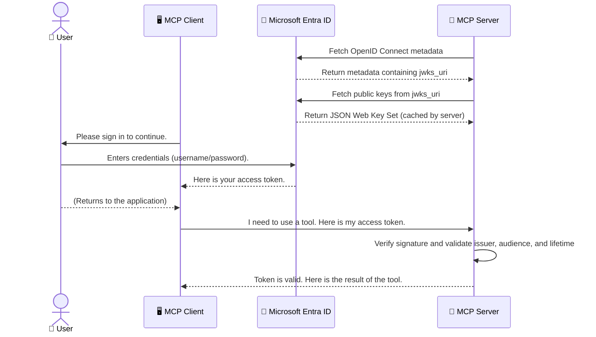

# Sikring af AI-workflows: Entra ID-godkendelse til Model Context Protocol-servere

> [!NOTE]
> Fjernserverkoden i denne lektion beskytter ældre `/sse` og `/message`
> endpoints og retter sig mod MCP `2025-11-25`. Bevar dets identitets- og tokenvaliderings-
> praksis, men brug en `2026-07-28`-kompatibel Streamable HTTP-transport til nye
> implementeringer.

## Introduktion
At sikre din Model Context Protocol (MCP)-server er lige så vigtigt som at låse hoveddøren til dit hus. Hvis du efterlader din MCP-server åben, udsætter du dine værktøjer og data for uautoriseret adgang, hvilket kan føre til sikkerhedsbrud. Microsoft Entra ID tilbyder en robust cloud-baseret identitets- og adgangsstyringsløsning, der hjælper med at sikre, at kun autoriserede brugere og applikationer kan interagere med din MCP-server. I dette afsnit vil du lære, hvordan du beskytter dine AI-workflows ved hjælp af Entra ID-godkendelse.

## Læringsmål
Når du har gennemgået dette afsnit, vil du kunne:

- Forstå vigtigheden af at sikre MCP-servere.
- Forklare grundlæggende om Microsoft Entra ID og OAuth 2.0-godkendelse.
- Genkende forskellen mellem offentlige og fortrolige klienter.
- Implementere Entra ID-godkendelse i både lokale (offentlige klienter) og fjernstyrede (fortrolige klienter) MCP-server-scenarier.
- Anvende sikkerhedsmæssige bedste praksisser ved udvikling af AI-workflows.

## Sikkerhed og MCP

Ligesom du ikke ville lade hoveddøren i dit hus stå ulåst, bør du ikke lade din MCP-server være åben for alle. At sikre dine AI-workflows er afgørende for at bygge robuste, pålidelige og sikre applikationer. Dette kapitel vil introducere dig til at bruge Microsoft Entra ID til at sikre dine MCP-servere, så kun autoriserede brugere og applikationer kan interagere med dine værktøjer og data.

## Hvorfor sikkerhed er vigtigt for MCP-servere

Forestil dig, at din MCP-server har et værktøj, der kan sende e-mails eller få adgang til en kundedatabase. En usikret server ville betyde, at hvem som helst potentielt kunne bruge det værktøj, hvilket kan føre til uautoriseret dataadgang, spam eller andre skadelige aktiviteter.

Ved at implementere godkendelse sikrer du, at hver anmodning til din server bliver verificeret, hvilket bekræfter identiteten af den bruger eller applikation, der laver anmodningen. Dette er det første og vigtigste skridt i at sikre dine AI-workflows.

## Introduktion til Microsoft Entra ID

[**Microsoft Entra ID**](https://adoption.microsoft.com/microsoft-security/entra/) er en cloud-baseret identitets- og adgangsstyringstjeneste. Tænk på det som en universel sikkerhedsvagt for dine applikationer. Den håndterer den komplekse proces med at verificere brugeridentiteter (godkendelse) og bestemme, hvad de har lov til at gøre (autorisation).

Ved at bruge Entra ID kan du:

- Muliggøre sikker login for brugere.
- Beskytte API’er og tjenester.
- Administrere adgangspolitikker fra et centralt sted.

For MCP-servere tilbyder Entra ID en robust og bredt anerkendt løsning til at styre, hvem der kan få adgang til din servers kapaciteter.

---

## Forstå magien: Sådan fungerer Entra ID-godkendelse

Entra ID bruger åbne standarder som **OAuth 2.0** til at håndtere godkendelse. Selvom detaljerne kan være komplicerede, er kernekonceptet simpelt og kan forstås gennem en analogi.

### En blid introduktion til OAuth 2.0: Valetlåsen

Tænk på OAuth 2.0 som en valet-service for din bil. Når du ankommer til en restaurant, giver du ikke valet’en din hovednøgle. I stedet giver du en **valetlås**, der har begrænsede tilladelser—den kan starte bilen og låse dørene, men den kan ikke åbne bagagerummet eller handskerummet.

I denne analogi:

- **Du** er **Brugeren**.
- **Din bil** er **MCP-serveren** med dens værdifulde værktøjer og data.
- **Valet’en** er **Microsoft Entra ID**.
- **Parkeringsvagten** er **MCP-klienten** (applikationen, der forsøger at få adgang til serveren).
- **Valetlåsen** er **Adgangstokenet**.

Adgangstokenet er en sikker tekststreng, som MCP-klienten modtager fra Entra ID efter, at du har logget ind. Klienten præsenterer derefter denne token til MCP-serveren ved hver anmodning. Serveren kan verificere tokenet for at sikre, at anmodningen er legitim, og at klienten har de nødvendige tilladelser, alt sammen uden nogensinde at skulle håndtere dine faktiske legitimationsoplysninger (som din adgangskode).

### Godkendelsesflowet

Sådan fungerer processen i praksis:



MCP-serveren kalder ikke Entra ID for at validere hver adgangstoken. Den
verificerer kryptografisk JWT-signaturen med Entra IDs cachede offentlige nøgle
og validerer tokenets påstande, inklusive dets udsteder, modtager og levetid.
Serveren læser `jwks_uri` fra OpenID Connect metadata, henter de offentlige
nøgler fra den URI og opdaterer dem periodisk for at håndtere nøglerotation. Brug
et understøttet tokenvalideringsbibliotek i stedet for at implementere denne logik
selv. Se detaljer i
[Valider tokens i Microsofts identitetsplatform](https://learn.microsoft.com/entra/identity-platform/access-tokens#validate-tokens).

### Introduktion til Microsoft Authentication Library (MSAL)

Før vi dykker ned i koden, er det vigtigt at introducere en nøglekomponent, du vil se i eksemplerne: **Microsoft Authentication Library (MSAL)**.

MSAL er et bibliotek udviklet af Microsoft, som gør det meget nemmere for udviklere at håndtere godkendelse. I stedet for at du skal skrive al den komplekse kode til at håndtere sikkerhedstoken, administrere indlogninger og opdatere sessioner, tager MSAL sig af det tunge løft.

At bruge et bibliotek som MSAL anbefales stærkt, fordi:

- **Det er sikkert:** Det implementerer industristandardprotokoller og bedste sikkerhedspraksis, hvilket reducerer risikoen for sårbarheder i din kode.
- **Det forenkler udviklingen:** Det abstraherer kompleksiteten i OAuth 2.0- og OpenID Connect-protokollerne og giver dig mulighed for at tilføje robust godkendelse til din applikation med blot få kodelinjer.
- **Det vedligeholdes:** Microsoft vedligeholder og opdaterer aktivt MSAL for at imødekomme nye sikkerhedstrusler og platformændringer.

MSAL understøtter mange forskellige sprog og applikationsrammer, herunder .NET, JavaScript/TypeScript, Python, Java, Go og mobilplatforme som iOS og Android. Det betyder, at du kan bruge de samme konsistente godkendelsesmønstre på tværs af hele dit teknologistak.

For at lære mere om MSAL kan du tjekke den officielle [MSAL oversigtsdokumentation](https://learn.microsoft.com/entra/identity-platform/msal-overview).

---

## Sikring af din MCP-server med Entra ID: En trin-for-trin guide

Lad os nu gennemgå, hvordan du sikrer en lokal MCP-server (en, der kommunikerer over `stdio`) ved hjælp af Entra ID. Dette eksempel bruger en **offentlig klient**, som egner sig til applikationer, der kører på en brugers maskine, som en desktop-app eller en lokal udviklingsserver.

### Scenarie 1: Sikring af en lokal MCP-server (med en offentlig klient)

I dette scenarie ser vi på en MCP-server, der kører lokalt, kommunikerer over `stdio` og bruger Entra ID til at godkende brugeren, før adgang til værktøjerne tillades. Serveren vil have et enkelt værktøj, der henter brugerens profiloplysninger fra Microsoft Graph API.

#### 1. Opsætning af applikationen i Entra ID

Før du skriver kode, skal du registrere din applikation i Microsoft Entra ID. Dette fortæller Entra ID om din applikation og giver den tilladelse til at bruge godkendelsestjenesten.

1. Naviger til **[Microsoft Entra-portalen](https://entra.microsoft.com/)**.
2. Gå til **App-registreringer** og klik på **Ny registrering**.
3. Giv din applikation et navn (f.eks. "Min lokale MCP-server").
4. For **Understøttede kontotyper** vælg **Konti i denne organisationsmappe kun**.
5. Du kan lade **Redirect URI** være tom for dette eksempel.
6. Klik på **Registrer**.

Når registreringen er fuldført, skal du notere **Applikations-ID (klient)** og **Directory (lejer) ID**. Du skal bruge disse i din kode.

#### 2. Koden: En gennemgang

Lad os se på nøgledele af koden, der håndterer godkendelse. Den fulde kode til dette eksempel findes i mappen [Entra ID - Lokal - WAM](https://github.com/Azure-Samples/mcp-auth-servers/tree/main/src/entra-id-local-wam) i [mcp-auth-servers GitHub-repositoriet](https://github.com/Azure-Samples/mcp-auth-servers).

**`AuthenticationService.cs`**

Denne klasse er ansvarlig for håndtering af interaktionen med Entra ID.

- **`CreateAsync`**: Denne metode initialiserer `PublicClientApplication` fra MSAL (Microsoft Authentication Library). Den er konfigureret med din applikations `clientId` og `tenantId`.
- **`WithBroker`**: Dette aktiverer brug af en broker (som Windows Web Account Manager), hvilket giver en mere sikker og gnidningsløs single sign-on-oplevelse.
- **`AcquireTokenAsync`**: Dette er kerne metoden. Den prøver først at hente et token stille og roligt (dvs. brugeren skal ikke logge ind igen, hvis de allerede har en gyldig session). Hvis et stille token ikke kan opnås, vil den bede brugeren om at logge ind interaktivt.

```csharp
// Simplified for clarity
public static async Task<AuthenticationService> CreateAsync(ILogger<AuthenticationService> logger)
{
    var msalClient = PublicClientApplicationBuilder
        .Create(_clientId) // Your Application (client) ID
        .WithAuthority(AadAuthorityAudience.AzureAdMyOrg)
        .WithTenantId(_tenantId) // Your Directory (tenant) ID
        .WithBroker(new BrokerOptions(BrokerOptions.OperatingSystems.Windows))
        .Build();

    // ... cache registration ...

    return new AuthenticationService(logger, msalClient);
}

public async Task<string> AcquireTokenAsync()
{
    try
    {
        // Try silent authentication first
        var accounts = await _msalClient.GetAccountsAsync();
        var account = accounts.FirstOrDefault();

        AuthenticationResult? result = null;

        if (account != null)
        {
            result = await _msalClient.AcquireTokenSilent(_scopes, account).ExecuteAsync();
        }
        else
        {
            // If no account, or silent fails, go interactive
            result = await _msalClient.AcquireTokenInteractive(_scopes).ExecuteAsync();
        }

        return result.AccessToken;
    }
    catch (Exception ex)
    {
        _logger.LogError(ex, "An error occurred while acquiring the token.");
        throw; // Optionally rethrow the exception for higher-level handling
    }
}
```

**`Program.cs`**

Her sættes MCP-serveren op, og godkendelsestjenesten integreres.

- **`AddSingleton<AuthenticationService>`**: Dette registrerer `AuthenticationService` i dependency injection-containeren, så den kan bruges af andre dele af applikationen (som vores værktøj).
- **`GetUserDetailsFromGraph` værktøjet**: Dette værktøj kræver en instans af `AuthenticationService`. Før noget udføres, kalder det `authService.AcquireTokenAsync()` for at få en gyldig adgangstoken. Hvis godkendelsen er succesfuld, bruger det tokenet til at kalde Microsoft Graph API og hente brugerens detaljer.

```csharp
// Simplified for clarity
[McpServerTool(Name = "GetUserDetailsFromGraph")]
public static async Task<string> GetUserDetailsFromGraph(
    AuthenticationService authService)
{
    try
    {
        // This will trigger the authentication flow
        var accessToken = await authService.AcquireTokenAsync();

        // Use the token to create a GraphServiceClient
        var graphClient = new GraphServiceClient(
            new BaseBearerTokenAuthenticationProvider(new TokenProvider(authService)));

        var user = await graphClient.Me.GetAsync();

        return System.Text.Json.JsonSerializer.Serialize(user);
    }
    catch (Exception ex)
    {
        return $"Error: {ex.Message}";
    }
}
```

#### 3. Sådan fungerer det hele sammen

1. Når MCP-klienten forsøger at bruge `GetUserDetailsFromGraph`-værktøjet, kalder værktøjet først `AcquireTokenAsync`.
2. `AcquireTokenAsync` får MSAL-biblioteket til at tjekke for en gyldig token.
3. Hvis der ikke findes en token, bliver brugeren via broker-bedt om at logge ind med sin Entra ID-konto.
4. Når brugeren logger ind, udsteder Entra ID en adgangstoken.
5. Værktøjet modtager tokenet og bruger det til at lave et sikkert kald til Microsoft Graph API.
6. Brugerens detaljer returneres til MCP-klienten.

Denne proces sikrer, at kun godkendte brugere kan bruge værktøjet og dermed effektivt sikre din lokale MCP-server.

### Scenarie 2: Sikring af en fjern-MCP-server (med en fortrolig klient)

Når din MCP-server kører på en fjernmaskine (som en cloud-server) og kommunikerer over en protokol som HTTP Streaming, er sikkerhedskravene anderledes. I dette tilfælde bør du bruge en **fortrolig klient** og **Authorization Code Flow**. Dette er en mere sikker metode, fordi applikationens hemmeligheder aldrig udsættes for browseren.

Dette eksempel bruger en TypeScript-baseret MCP-server, der bruger Express.js til at håndtere HTTP-anmodninger.

#### 1. Opsætning af applikationen i Entra ID

Opsætningen i Entra ID er ligesom den offentlige klient, men med én væsentlig forskel: du skal oprette en **klienthemmelighed**.

1. Naviger til **[Microsoft Entra-portalen](https://entra.microsoft.com/)**.
2. Gå i din app-registrering til fanen **Certifikater & hemmeligheder**.
3. Klik på **Ny klienthemmelighed**, giv den en beskrivelse, og klik på **Tilføj**.
4. **Vigtigt:** Kopiér hemmelighedsværdien med det samme. Du vil ikke kunne se den igen.
5. Du skal også konfigurere en **Redirect URI**. Gå til fanen **Godkendelse**, klik på **Tilføj en platform**, vælg **Web**, og indtast redirect URI for din applikation (f.eks. `http://localhost:3001/auth/callback`).

> **⚠️ Vigtig sikkerhedsnote:** For produktionsapplikationer anbefaler Microsoft kraftigt at bruge **hemmelighedsløse godkendelsesmetoder** såsom **Managed Identity** eller **Workload Identity Federation** i stedet for klienthemmeligheder. Klienthemmeligheder udgør sikkerhedsrisici, da de kan blive eksponeret eller kompromitteret. Managed Identity giver en mere sikker tilgang ved at fjerne behovet for at gemme legitimationsoplysninger i din kode eller konfiguration.
>
> For mere information om managed identities og hvordan du implementerer dem, se [Oversigt over Managed Identities for Azure-ressourcer](https://learn.microsoft.com/entra/identity/managed-identities-azure-resources/overview).

#### 2. Koden: En gennemgang

Dette eksempel bruger en session-baseret tilgang. Når brugeren godkendes, gemmer serveren adgangstokenet og refresh tokenet i en session og giver brugeren en sessionstoken. Denne sessionstoken bruges så til efterfølgende anmodninger. Den fulde kode til dette eksempel findes i mappen [Entra ID - Fortrolig klient](https://github.com/Azure-Samples/mcp-auth-servers/tree/main/src/entra-id-cca-session) i [mcp-auth-servers GitHub-repositoriet](https://github.com/Azure-Samples/mcp-auth-servers).

**`Server.ts`**

Denne fil sætter Express-serveren og MCP transportlaget op.

- **`requireBearerAuth`**: Dette er middleware, der beskytter `/sse` og `/message` endpoints. Den tjekker for et gyldigt bearer-token i `Authorization` headeren på anmodningen.
- **`EntraIdServerAuthProvider`**: Dette er en brugerdefineret klasse, der implementerer `McpServerAuthorizationProvider` interfacet. Den er ansvarlig for at håndtere OAuth 2.0 flowet.
- **`/auth/callback`**: Dette endpoint håndterer redirectet fra Entra ID, efter brugeren er godkendt. Det bytter autoriseringskoden til en adgangstoken og et refresh token.

```typescript
// Simplified for clarity
const app = express();
const { server } = createServer();
const provider = new EntraIdServerAuthProvider();

// Protect the SSE endpoint
app.get("/sse", requireBearerAuth({
  provider,
  requiredScopes: ["User.Read"]
}), async (req, res) => {
  // ... connect to the transport ...
});

// Protect the message endpoint
app.post("/message", requireBearerAuth({
  provider,
  requiredScopes: ["User.Read"]
}), async (req, res) => {
  // ... handle the message ...
});

// Handle the OAuth 2.0 callback
app.get("/auth/callback", (req, res) => {
  provider.handleCallback(req.query.code, req.query.state)
    .then(result => {
      // ... handle success or failure ...
    });
});
```

**`Tools.ts`**

Denne fil definerer de værktøjer, som MCP-serveren leverer. `getUserDetails` værktøjet ligner det i det foregående eksempel, men det henter adgangstokenet fra sessionen.

```typescript
// Simplified for clarity
server.setRequestHandler(CallToolRequestSchema, async (request) => {
  const { name } = request.params;
  const context = request.params?.context as { token?: string } | undefined;
  const sessionToken = context?.token;

  if (name === ToolName.GET_USER_DETAILS) {
    if (!sessionToken) {
      throw new AuthenticationError("Authentication token is missing or invalid. Ensure the token is provided in the request context.");
    }

    // Get the Entra ID token from the session store
    const tokenData = tokenStore.getToken(sessionToken);
    const entraIdToken = tokenData.accessToken;

    const graphClient = Client.init({
      authProvider: (done) => {
        done(null, entraIdToken);
      }
    });

    const user = await graphClient.api('/me').get();

    // ... return user details ...
  }
});
```

**`auth/EntraIdServerAuthProvider.ts`**

Denne klasse håndterer logikken for:

- At omdirigere brugeren til Entra ID login-siden.
- At udveksle autorisationskoden for et adgangstoken.
- At gemme token i `tokenStore`.
- At opdatere adgangstokenet, når det udløber.

#### 3. Hvordan det hele fungerer sammen

1. Når en bruger først forsøger at oprette forbindelse til MCP-serveren, vil `requireBearerAuth` middleware se, at de ikke har en gyldig session og omdirigere dem til Entra ID login-siden.
2. Brugeren logger ind med deres Entra ID-konto.
3. Entra ID omdirigerer brugeren tilbage til `/auth/callback` endpointet med en autorisationskode.
4. Serveren udveksler koden for et adgangstoken og et refresh-token, gemmer dem og opretter en sessionstoken, som sendes til klienten.
5. Klienten kan nu bruge denne sessionstoken i `Authorization` headeren for alle fremtidige forespørgsler til MCP-serveren.
6. Når `getUserDetails` værktøjet kaldes, bruger det sessionstoken til at finde Entra ID adgangstokenet og bruger det derefter til at kalde Microsoft Graph API.

Denne flow er mere kompleks end offentlige klientflows, men er nødvendigt for internetvendte endpoints. Da fjern-MCP-servere er tilgængelige over det offentlige internet, kræver de stærkere sikkerhedsforanstaltninger for at beskytte mod uautoriseret adgang og potentielle angreb.


## Sikkerheds bedste praksis

- **Brug altid HTTPS**: Krypter kommunikationen mellem klient og server for at beskytte tokens mod aflytning.
- **Implementér Role-Based Access Control (RBAC)**: Tjek ikke kun *om* en bruger er autentificeret; tjek *hvad* de har tilladelse til at gøre. Du kan definere roller i Entra ID og kontrollere dem i din MCP-server.
- **Overvåg og auditér**: Log alle autentificeringsbegivenheder, så du kan opdage og reagere på mistænkelig aktivitet.
- **Håndtér ratebegrænsning og throttling**: Microsoft Graph og andre API'er implementerer ratebegrænsning for at forhindre misbrug. Implementér eksponentiel backoff og genforsøgslogik i din MCP-server for pænt at håndtere HTTP 429 (For mange forespørgsler) respons. Overvej at cache ofte tilgåede data for at reducere API-kald.
- **Sikker tokenlagring**: Gem adgangs- og refresh-tokens sikkert. For lokale applikationer brug systemets sikre lagringsmekanismer. For serverapplikationer overvej krypteret lagring eller sikre nøglehåndteringstjenester som Azure Key Vault.
- **Håndtering af tokenudløb**: Adgangstokens har begrænset levetid. Implementér automatisk tokenopdatering med refresh tokens for at sikre en sømløs brugeroplevelse uden genautentificering.
- **Overvej at bruge Azure API Management**: Selvom implementering af sikkerhed direkte i din MCP-server giver dig fin kontrol, kan API-gateways som Azure API Management håndtere mange af disse sikkerhedsaspekter automatisk, herunder autentificering, autorisation, ratebegrænsning og overvågning. De tilbyder et centraliseret sikkerhedslag mellem dine klienter og MCP-servere. For flere detaljer om brug af API-gateways med MCP, se vores [Azure API Management Your Auth Gateway For MCP Servers](https://techcommunity.microsoft.com/blog/integrationsonazureblog/azure-api-management-your-auth-gateway-for-mcp-servers/4402690).


## Nøglepointer

- At sikre din MCP-server er afgørende for at beskytte dine data og værktøjer.
- Microsoft Entra ID tilbyder en robust og skalerbar løsning til autentificering og autorisation.
- Brug en **offentlig klient** til lokale applikationer og en **fortrolig klient** til fjernservere.
- **Authorization Code Flow** er den mest sikre mulighed for webapplikationer.


## Øvelse

1. Tænk på en MCP-server, du kunne bygge. Ville det være en lokal server eller en fjernserver?
2. Baseret på dit svar, ville du bruge en offentlig eller fortrolig klient?
3. Hvilke rettigheder ville din MCP-server anmode om for at udføre handlinger mod Microsoft Graph?


## Hands-on Øvelser

### Øvelse 1: Registrér en applikation i Entra ID
Gå til Microsoft Entra portalen.
Registrér en ny applikation til din MCP-server.
Notér Applikations-ID (client ID) og Domæne-ID (tenant ID).

### Øvelse 2: Sikr en lokal MCP-server (offentlig klient)
- Følg kodeeksemplet for at integrere MSAL (Microsoft Authentication Library) til brugergodkendelse.
- Test autentificeringsflowet ved at kalde MCP-værktøjet, der henter brugeroplysninger fra Microsoft Graph.

### Øvelse 3: Sikr en fjern MCP-server (fortrolig klient)
- Registrér en fortrolig klient i Entra ID og opret en klienthemmelighed.
- Konfigurer din Express.js MCP-server til at bruge Authorization Code Flow.
- Test de beskyttede endpoints og bekræft adgang baseret på token.

### Øvelse 4: Anvend sikkerhed bedste praksis
- Aktiver HTTPS for din lokale eller fjernserver.
- Implementér rollebaseret adgangskontrol (RBAC) i din serverlogik.
- Tilføj tokenudløbshåndtering og sikker tokenlagring.

## Ressourcer

1. **MSAL Oversigtsdokumentation**  
   Lær hvordan Microsoft Authentication Library (MSAL) muliggør sikker tokenindhentning på tværs af platforme:  
   [MSAL Overview on Microsoft Learn](https://learn.microsoft.com/en-gb/entra/msal/overview)

2. **Azure-Samples/mcp-auth-servers GitHub Repository**  
   Referenceimplementeringer af MCP-servere, der demonstrerer autentificeringsflows:  
   [Azure-Samples/mcp-auth-servers on GitHub](https://github.com/Azure-Samples/mcp-auth-servers)

3. **Managed Identities for Azure Resources Oversigt**  
   Forstå hvordan man eliminerer hemmeligheder ved at bruge system- eller bruger-tildelte styrede identiteter:  
   [Managed Identities Overview on Microsoft Learn](https://learn.microsoft.com/en-us/entra/identity/managed-identities-azure-resources/)

4. **Azure API Management: Dit Auth Gateway for MCP Servers**  
   En grundig gennemgang af brugen af APIM som en sikker OAuth2 gateway for MCP-servere:  
   [Azure API Management Your Auth Gateway For MCP Servers](https://techcommunity.microsoft.com/blog/integrationsonazureblog/azure-api-management-your-auth-gateway-for-mcp-servers/4402690)

5. **Microsoft Graph Tilladelses Reference**  
   Omfattende liste over delegerede og applikationstilladelser for Microsoft Graph:  
   [Microsoft Graph Permissions Reference](https://learn.microsoft.com/zh-tw/graph/permissions-reference)


## Læringsmål
Efter at have gennemført denne sektion vil du kunne:

- Formulere hvorfor autentificering er kritisk for MCP-servere og AI-workflows.
- Opsætte og konfigurere Entra ID autentificering til både lokale og fjern MCP-server scenarier.
- Vælge passende klienttype (offentlig eller fortrolig) baseret på din servers implementering.
- Implementere sikre kodningspraksisser, inklusive tokenlagring og rollebaseret autorisation.
- Trygt beskytte din MCP-server og dens værktøjer mod uautoriseret adgang.

## Hvad er næste skridt

- [5.13 Model Context Protocol (MCP) Integration med Microsoft Foundry](../mcp-foundry-agent-integration/README.md)

---

<!-- CO-OP TRANSLATOR DISCLAIMER START -->
**Ansvarsfraskrivelse**:
Dette dokument er blevet oversat ved hjælp af AI-oversættelsestjenesten [Co-op Translator](https://github.com/Azure/co-op-translator). Selvom vi bestræber os på nøjagtighed, skal du være opmærksom på, at automatiserede oversættelser kan indeholde fejl eller unøjagtigheder. Det originale dokument på dets oprindelige sprog bør betragtes som den autoritative kilde. For kritisk information anbefales professionel menneskelig oversættelse. Vi påtager os intet ansvar for misforståelser eller fejltolkninger, der opstår som følge af brugen af denne oversættelse.
<!-- CO-OP TRANSLATOR DISCLAIMER END -->