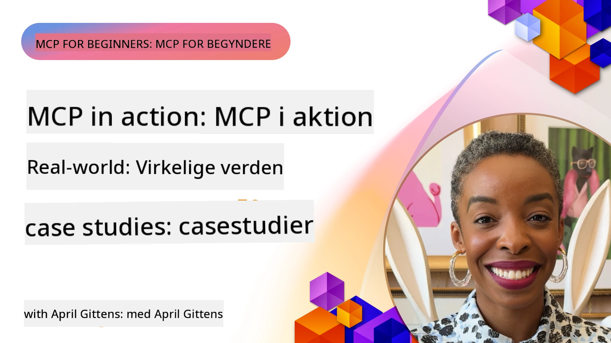

# MCP i aktion: Virkelige cases

_(Klik på billedet ovenfor for at se videoen til denne lektion)_

Model Context Protocol (MCP) er ved at transformere, hvordan AI-applikationer interagerer med data, værktøjer og tjenester. Dette afsnit præsenterer virkelige case-studier, som demonstrerer praktiske anvendelser af MCP i forskellige virksomhedsscenarier.

## Oversigt

Dette afsnit fremviser konkrete eksempler på MCP-implementeringer og fremhæver, hvordan organisationer udnytter denne protokol til at løse komplekse forretningsudfordringer. Ved at undersøge disse case-studier får du indsigt i MCP’s alsidighed, skalerbarhed og praktiske fordele i virkelige situationer.

## Centrale læringsmål

Ved at udforske disse case-studier vil du:

- Forstå, hvordan MCP kan anvendes til at løse specifikke forretningsproblemer
- Lære om forskellige integrationsmønstre og arkitektoniske tilgange
- Genkende bedste praksis for implementering af MCP i virksomhedsmiljøer
- Få indsigt i udfordringer og løsninger, der er mødt i virkelige implementeringer
- Identificere muligheder for at anvende lignende mønstre i dine egne projekter

## Udvalgte case-studier

### 1. [Azure AI Rejseagenter – Referenceimplementering](./travelagentsample.md)

Dette case-studie undersøger Microsofts omfattende referencesolution, der demonstrerer, hvordan man bygger en multi-agent, AI-drevet rejseplanlægningsapplikation ved brug af MCP, Azure OpenAI og Azure AI Search. Projektet viser:

- Multi-agent orkestrering gennem MCP
- Enterprise data integration med Azure AI Search
- Sikker, skalerbar arkitektur baseret på Azure-tjenester
- Udvidelige værktøjer med genanvendelige MCP-komponenter
- Konverserende brugeroplevelse drevet af Azure OpenAI

Arkitekturen og implementeringsdetaljerne giver værdifuld indsigt i bygning af komplekse multi-agent systemer med MCP som koordineringslag.

### 2. [Opdatering af Azure DevOps-artefakter med YouTube-data](./UpdateADOItemsFromYT.md)

Dette case-studie demonstrerer en praktisk anvendelse af MCP til automatisering af arbejdsprocesser. Det viser, hvordan MCP-værktøjer kan bruges til:

- At udtrække data fra online platforme (YouTube)
- At opdatere arbejdsopgaver i Azure DevOps-systemer
- At skabe gentagelige automatiseringsarbejdsgange
- At integrere data på tværs af forskellige systemer

Dette eksempel illustrerer, hvordan selv relativt simple MCP-implementeringer kan give betydelige effektivitetstiltag ved at automatisere rutineopgaver og forbedre datakonsistensen på tværs af systemer.

### 3. [Dokumentationshentning i realtid med MCP](./docs-mcp/README.md)

Dette case-studie guider dig gennem at forbinde en Python-konsolklient til en Model Context Protocol (MCP) server for at hente og logge Microsoft-dokumentation i realtid og kontekstbevidst. Du lærer at:

- Forbinde til en MCP-server ved hjælp af en Python-klient og den officielle MCP SDK
- Bruge streaming HTTP-klienter til effektiv, realtime datahentning
- Kalde dokumentationsværktøjer på serveren og logge svar direkte i konsollen
- Integrere opdateret Microsoft-dokumentation i din arbejdsgang uden at forlade terminalen

Kapitel inkluderer en hands-on opgave, en minimal fungerende kodeeksempel samt links til yderligere ressourcer for dybere læring. Se den fulde gennemgang og kode i det linkede kapitel for at forstå, hvordan MCP kan transformere dokumentationsadgang og udviklerproduktivitet i konsolbaserede miljøer.

### 4. [Interaktiv studieplansgenerator webapp med MCP](./docs-mcp/README.md)

Dette case-studie demonstrerer, hvordan man bygger en interaktiv webapplikation ved brug af Chainlit og Model Context Protocol (MCP) til at generere personlige studieplaner for ethvert emne. Brugere kan angive et emne (såsom "AI-900 certificering") og en studieduration (f.eks. 8 uger), og appen giver en uge-for-uge oversigt over anbefalet indhold. Chainlit muliggør en konverserende chatgrænseflade, hvilket gør oplevelsen engagerende og tilpassende.

- Konverserende webapp drevet af Chainlit
- Brugerinitierede prompts for emne og varighed
- Uge-for-uge anbefalinger via MCP
- Realtids adaptive svar i en chatgrænseflade

Projektet illustrerer, hvordan konverserende AI og MCP kan kombineres for at skabe dynamiske, bruger-drevne undervisningsværktøjer i et moderne webmiljø.

### 5. [Dokumentation i editor med MCP-server i VS Code](./docs-mcp/README.md)

Dette case-studie demonstrerer, hvordan du kan hente Microsoft Learn Docs direkte ind i dit VS Code-miljø ved brug af MCP-serveren—ingen flere browserfaner! Du ser, hvordan du:

- Øjeblikkeligt søger og læser dokumentation inde i VS Code med MCP-panelet eller kommandopaletten
- Refererer dokumentation og indsætter links direkte i dine README- eller kursusmarkdown-filer
- Bruger GitHub Copilot og MCP sammen for sømløse, AI-drevne dokumentations- og kodearbejdsgange
- Validerer og forbedrer din dokumentation med realtime feedback og Microsoft-kildefastholdelse
- Integrerer MCP med GitHub-arbejdsgange for kontinuerlig dokumentationsvalidering

Implementeringen indeholder:

- Eksempel `.vscode/mcp.json` konfiguration for nem opsætning
- Skærmbilledegennemgange af oplevelsen i editoren
- Tips til at kombinere Copilot og MCP for maksimal produktivitet

Dette scenarie er ideelt for kursusforfattere, dokumentationsskribenter og udviklere, der ønsker at holde fokus i deres editor, mens de arbejder med docs, Copilot og valideringsværktøjer—alle drevet af MCP.

### 6. [APIM MCP Server Oprettelse](./apimsample.md)

Dette case-studie giver en trin-for-trin vejledning i, hvordan man opretter en MCP-server ved brug af Azure API Management (APIM). Det dækker:

- Opsætning af en MCP-server i Azure API Management
- Eksponering af API-operationer som MCP-værktøjer
- Konfiguration af politikker for ratebegrænsning og sikkerhed
- Test af MCP-serveren ved brug af Visual Studio Code og GitHub Copilot

Dette eksempel illustrerer, hvordan man udnytter Azures kapabiliteter til at skabe en robust MCP-server, der kan bruges i forskellige applikationer og forbedre integrationen af AI-systemer med virksomhedens API’er.

### 7. [GitHub MCP Registry — Accelererende agentintegration](https://github.com/mcp)

Dette case-studie undersøger, hvordan GitHub’s MCP Registry, lanceret i september 2025, adresserer en kritisk udfordring i AI-økosystemet: den fragmenterede søgning og udrulning af Model Context Protocol (MCP) servere.

#### Oversigt
**MCP Registry** løser den voksende udfordring med spredte MCP-servere på tværs af repositories og registries, hvilket tidligere gjorde integration langsom og fejlbehæftet. Disse servere gør det muligt for AI-agenter at interagere med eksterne systemer som API’er, databaser og dokumentationskilder.

#### Problemstilling
Udviklere, der bygger agentbaserede arbejdsflows, stod over for flere udfordringer:
- **Dårlig opdagelighed** af MCP-servere på tværs af forskellige platforme
- **Redundant opsætning** spredt på fora og dokumentation
- **Sikkerhedsrisici** fra uverificerede og utroværdige kilder
- **Manglende standardisering** i serverkvalitet og kompatibilitet

#### Løsningsarkitektur
GitHub’s MCP Registry centraliserer betroede MCP-servere med nøglefunktioner:
- **One-click install** integration via VS Code for strømlinet opsætning
- **Signal-til-støj sortering** efter stjerner, aktivitet og fællesskabsverifikation
- **Direkte integration** med GitHub Copilot og andre MCP-kompatible værktøjer
- **Åben bidragsmodel** som muliggør bidrag fra både fællesskab og erhvervspartnere

#### Forretningsmæssig effekt
Registry’en har leveret målbare forbedringer:
- **Hurtigere onboarding** for udviklere med værktøjer som Microsoft Learn MCP Server, der streamer officiel dokumentation direkte til agenter
- **Forbedret produktivitet** via specialiserede servere som `github-mcp-server`, der muliggør naturlig sprog-GitHub-automatisering (PR-oprettelse, CI-kørsler, kodegennemgang)
- **Styrket økosystemtillid** gennem kuraterede lister og gennemsigtige konfigurationsstandarder

#### Strategisk værdi
For praktikere, der specialiserer sig i agent-lifecycle management og reproducerbare arbejdsflows, tilbyder MCP Registry:
- **Modulær agentudrulning** med standardiserede komponenter
- **Registry-baserede evalueringspipelines** for konsekvent test og validering
- **Tværværktøjs interoperabilitet** der muliggør sømløs integration på tværs af forskellige AI-platforme

Dette case-studie demonstrerer, at MCP Registry er mere end blot en directory — det er en fundamental platform for skalerbar, praktisk modelintegration og agentbaseret systemudrulning.

### 8. [Publicering til sociale netværk fra en agent](./publora-social-publishing.md)

Dette case-studie gennemgår en **skrivbar fjern-MCP-server** — en server, hvis værktøjer udfører irreversible handlinger på en brugers vegne — med social publicering som eksempel. En agent udarbejder et opslag, en person godkender det, og serveren planlægger udsendelse på tværs af netværk.

Det interessante er de designbegrænsninger, som publicering medfører, og som gælder for enhver server, der skriver frem for at læse:

- **Åben opdagelse, autentificeret eksekvering** — `tools/list` besvares uden legitimationsoplysninger, så registries og klienter kan introspektere, mens enhver `tools/call` kræver et token og ellers returnerer `401` med en `WWW-Authenticate` header
- **OAuth-registrering uden out-of-band trin** — dynamisk klientregistrering i dag, med Client ID Metadata-dokumenter som den retning, `2026-07-28` specifikationen peger på
- **Værktøjets annoteringer** (`readOnlyHint`, `destructiveHint`, `idempotentHint`), som klienter bruger til at afgøre, hvad der skal bekræftes — hints frem for håndhævelse, og noget som connector directories nu forventer ved gennemgang
- **Uopfindelige identifikatorer**, så en halucineret værdi svigter højt i stedet for at handle på en plausibel udseende værdi
- **Idempotensnøgler på post-oprettende værktøjer**, så en gentagelse fra agent runtime ikke bliver til en duplikat-publicering
- **En no-op mål beskrevet i værktøjsskemaet**, som øver hele skrive-forløbet og ikke publicerer noget, til vurderere og kontinuerlig integration

Kapitel afsluttes med en kort tjekliste, du kan anvende på en server, du bygger.

## Konklusion

Disse otte omfattende case-studier demonstrerer den bemærkelsesværdige alsidighed og praktiske anvendelser af Model Context Protocol på tværs af forskellige virkelige scenarier. Fra komplekse multi-agent rejseplanlægningssystemer og enterprise API management til strømlinede dokumentationsarbejdsgange og det revolutionerende GitHub MCP Registry, fremviser disse eksempler, hvordan MCP giver en standardiseret, skalerbar måde at forbinde AI-systemer med de værktøjer, data og tjenester, de behøver for at levere enestående værdi.

Case-studierne strækker sig over flere dimensioner af MCP-implementering:
- **Enterprise-integration**: Azure API Management og Azure DevOps-automatisering
- **Multi-agent orkestrering**: Rejseplanlægning med koordinerede AI-agenter
- **Udviklerproduktivitet**: VS Code-integration og realtime dokumentationsadgang
- **Økosystemudvikling**: GitHub’s MCP Registry som en funderende platform
- **Uddannelsesanvendelser**: Interaktive studieplangeneratorer og konverserende grænseflader

Ved at studere disse implementeringer får du vigtige indsigter i:
- **Arkitektoniske mønstre** for forskellige skalaer og anvendelsestilfælde
- **Implementeringsstrategier**, der balancerer funktionalitet med vedligeholdelse
- **Sikkerheds- og skalerbarhedsovervejelser** for produktionsudrulninger
- **Bedste praksis** for MCP-serverudvikling og klientintegration
- **Økosystem-tænkning** for at bygge sammenhængende AI-drevne løsninger

Disse eksempler viser samlet set, at MCP ikke blot er et teoretisk framework men en moden, produktionsklar protokol, der muliggør praktiske løsninger på komplekse forretningsudfordringer. Uanset om du bygger simple automatiseringsværktøjer eller sofistikerede multi-agent systemer, giver de her viste mønstre og tilgange et solidt fundament for dine egne MCP-projekter.

## Yderligere ressourcer

- [Azure AI Travel Agents GitHub Repository](https://github.com/Azure-Samples/azure-ai-travel-agents)
- [Azure DevOps MCP Tool](https://github.com/microsoft/azure-devops-mcp)
- [Playwright MCP Tool](https://github.com/microsoft/playwright-mcp)
- [Microsoft Docs MCP Server](https://github.com/MicrosoftDocs/mcp)
- [GitHub MCP Registry — Accelerating Agentic Integration](https://github.com/mcp)
- [MCP Community Examples](https://github.com/microsoft/mcp)

## Hvad er det næste

- Forrige: [Modul 8: Best Practices](../08-BestPractices/README.md)
- Næste: [Modul 10: Strømlining af AI-arbejdsgange: Oprettelse af en MCP-server med Microsoft Foundry Toolkit](../10-StreamliningAIWorkflowsBuildingAnMCPServerWithAIToolkit/README.md)

---

<!-- CO-OP TRANSLATOR DISCLAIMER START -->
**Ansvarsfraskrivelse**:
Dette dokument er blevet oversat ved hjælp af AI-oversættelsestjenesten [Co-op Translator](https://github.com/Azure/co-op-translator). Selvom vi bestræber os på nøjagtighed, skal du være opmærksom på, at automatiserede oversættelser kan indeholde fejl eller unøjagtigheder. Det originale dokument på dets oprindelige sprog bør betragtes som den autoritative kilde. For kritisk information anbefales professionel menneskelig oversættelse. Vi påtager os intet ansvar for misforståelser eller fejltolkninger, der opstår som følge af brugen af denne oversættelse.
<!-- CO-OP TRANSLATOR DISCLAIMER END -->