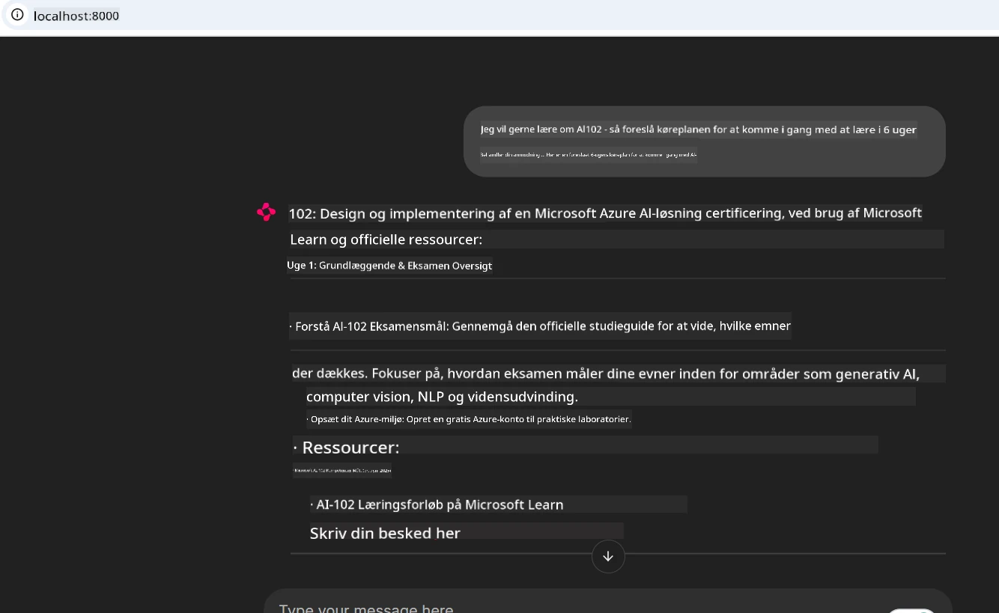
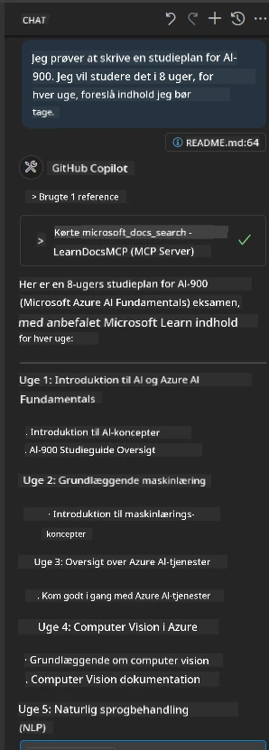

# Case Study: Forbindelse til Microsoft Learn Docs MCP-serveren fra en klient

Har du nogensinde oplevet at jonglere mellem dokumentationssider, Stack Overflow og endeløse søgemaskinefaner, alt imens du prøver at løse et problem i din kode? Måske har du en ekstra skærm kun til dokumentation, eller du skifter konstant mellem dit IDE og en browser. Ville det ikke være bedre, hvis du kunne bringe dokumentationen direkte ind i din arbejdsproces—integreret i dine apps, dit IDE eller endda dine egne brugerdefinerede værktøjer? I dette case study vil vi udforske præcis hvordan man gør det ved at forbinde direkte til Microsoft Learn Docs MCP-serveren fra din egen klientapplikation.

## Oversigt

Moderne udvikling handler om mere end blot at skrive kode—det handler om at finde de rette oplysninger på det rette tidspunkt. Dokumentation findes overalt, men sjældent hvor du har mest brug for den: inde i dine værktøjer og arbejdsprocesser. Ved at integrere dokumentationshentning direkte i dine applikationer kan du spare tid, reducere kontekstskift og øge produktiviteten. I dette afsnit viser vi, hvordan du forbinder en klient til Microsoft Learn Docs MCP-serveren, så du kan få adgang til realtids- og kontekstbevidst dokumentation uden nogensinde at forlade din app.

Vi vil gennemgå processen med at etablere en forbindelse, sende en forespørgsel og håndtere streaming-svar effektivt. Denne tilgang strømliner ikke blot din arbejdsproces, men åbner også døren for at bygge smartere og mere hjælpsomme udviklerværktøjer.

## Læringsmål

Hvorfor gør vi dette? Fordi de bedste udvikleroplevelser er dem, der fjerner friktion. Forestil dig en verden, hvor din kodeeditor, chatbot eller webapp kan besvare dine dokumentationsspørgsmål øjeblikkeligt ved brug af det nyeste indhold fra Microsoft Learn. Når du er færdig med dette kapitel, vil du vide, hvordan du:

- Forstår grundlæggende MCP server-klient kommunikation til dokumentation
- Implementerer en konsol- eller webapplikation til at forbinde til Microsoft Learn Docs MCP-serveren
- Bruger streaming HTTP-klienter til realtidsdokumentationshentning
- Logger og fortolker dokumentationssvar i din applikation

Du vil se, hvordan disse færdigheder kan hjælpe dig med at bygge værktøjer, der ikke blot er reaktive, men virkelig interaktive og kontekstbevidste.

## Scenario 1 - Realtidsdokumentation med MCP

I dette scenarie vil vi vise dig, hvordan man forbinder en klient til Microsoft Learn Docs MCP-serveren, så du kan få adgang til realtids- og kontekstbevidst dokumentation uden nogensinde at forlade din app.

Lad os omsætte det i praksis. Din opgave er at skrive en app, som forbinder til Microsoft Learn Docs MCP-serveren, kalder `microsoft_docs_search` værktøjet og logger streaming-svaret til konsollen.

### Hvorfor denne tilgang?
Fordi det er fundamentet til at bygge mere avancerede integrationer—uanset om du vil drive en chatbot, en IDE-udvidelse eller et webdashboard.

Du finder koden og instruktionerne til dette scenarie i [`solution`](./solution/README.md) mappen inden for dette case study. Trinene vejleder dig gennem opsætningen af forbindelsen:
- Brug den officielle MCP SDK og streaming HTTP-klient til forbindelsen
- Kald `microsoft_docs_search` værktøjet med en forespørgselsparameter for at hente dokumentation
- Implementer korrekt logning og fejlhåndtering
- Opret en interaktiv konsolgrænseflade, som tillader brugere at indtaste flere søgeforespørgsler

Dette scenarie demonstrerer, hvordan man:
- Forbinder til Docs MCP-serveren
- Sender en forespørgsel
- Parser og udskriver resultaterne

Sådan kunne det se ud, når løsningen køres:

```
Prompt> What is Azure Key Vault?
Answer> Azure Key Vault is a cloud service for securely storing and accessing secrets. ...
```

Nedenfor ses en minimal eksempel-løsning. Den fulde kode og detaljer findes i løsningsmappen.

<details>
<summary>Python</summary>

```python
import asyncio
from mcp.client.streamable_http import streamablehttp_client
from mcp import ClientSession

async def main():
    async with streamablehttp_client("https://learn.microsoft.com/api/mcp") as (read_stream, write_stream, _):
        async with ClientSession(read_stream, write_stream) as session:
            await session.initialize()
            result = await session.call_tool("microsoft_docs_search", {"query": "Azure Functions best practices"})
            print(result.content)

if __name__ == "__main__":
    asyncio.run(main())
```

- For den komplette implementering og logning, se [`scenario1.py`](../../../../09-CaseStudy/docs-mcp/solution/python/scenario1.py).
- For installations- og brugsinstruktioner, se filen [`README.md`](./solution/python/README.md) i samme mappe.
</details>


## Scenario 2 - Interaktiv studieplan-generator webapp med MCP

I dette scenarie lærer du, hvordan du integrerer Docs MCP i et webudviklingsprojekt. Målet er at gøre det muligt for brugere at søge i Microsoft Learn-dokumentation direkte fra en webgrænseflade, så dokumentationen bliver øjeblikkeligt tilgængelig i din app eller på dit site.

Du vil se, hvordan man:
- Opsætter en webapp
- Forbinder til Docs MCP-serveren
- Håndterer brugerinput og viser resultater

Sådan kunne det se ud, når løsningen køres:

```
User> I want to learn about AI102 - so suggest the roadmap to get it started from learn for 6 weeks

Assistant> Here’s a detailed 6-week roadmap to start your preparation for the AI-102: Designing and Implementing a Microsoft Azure AI Solution certification, using official Microsoft resources and focusing on exam skills areas:

---
## Week 1: Introduction & Fundamentals
- **Understand the Exam**: Review the [AI-102 exam skills outline](https://learn.microsoft.com/en-us/credentials/certifications/exams/ai-102/).
- **Set up Azure**: Sign up for a free Azure account if you don't have one.
- **Learning Path**: [Introduction to Azure AI services](https://learn.microsoft.com/en-us/training/modules/intro-to-azure-ai/)
- **Focus**: Get familiar with Azure portal, AI capabilities, and necessary tools.

....more weeks of the roadmap...

Let me know if you want module-specific recommendations or need more customized weekly tasks!
```

Nedenfor ses en minimal eksempel-løsning. Den fulde kode og detaljer findes i løsningsmappen.



<details>
<summary>Python (Chainlit)</summary>

Chainlit er et framework til at bygge samtale-AI webapps. Det gør det let at skabe interaktive chatbots og assistenter, der kan kalde MCP værktøjer og vise resultater i realtid. Det er ideelt til hurtig prototyping og brugervenlige grænseflader.

```python
import chainlit as cl
import requests

MCP_URL = "https://learn.microsoft.com/api/mcp"

@cl.on_message
def handle_message(message):
    query = {"question": message}
    response = requests.post(MCP_URL, json=query)
    if response.ok:
        result = response.json()
        cl.Message(content=result.get("answer", "No answer found.")).send()
    else:
        cl.Message(content="Error: " + response.text).send()
```

- For komplet implementering, se [`scenario2.py`](../../../../09-CaseStudy/docs-mcp/solution/python/scenario2.py).
- For opsætning og instruktioner til kørsel, se [`README.md`](./solution/python/README.md).
</details>


## Scenario 3: Dokumentation i editoren med MCP-server i VS Code

Hvis du vil have Microsoft Learn Docs direkte inde i din VS Code (i stedet for at skifte browserfaner), kan du bruge MCP-serveren i din editor. Det giver dig mulighed for at:
- Søge og læse dokumentation i VS Code uden at forlade din kode-arbejdsproces.
- Referere til dokumentation og indsætte links direkte i dine README- eller kursusfiler.
- Udnytte GitHub Copilot og MCP sammen for en sammenhængende, AI-drevet dokumentationsarbejdsproces.

**Du vil lære hvordan:**
- Tilføj en gyldig `.vscode/mcp.json` fil til roden af dit workspace (se eksempel nedenfor).
- Åbn MCP-panelet eller brug kommando-paletten i VS Code til at søge i og indsætte dokumentation.
- Referer direkte til dokumentation i dine markdown-filer, mens du arbejder.
- Kombiner denne arbejdsproces med GitHub Copilot for endnu større produktivitet.

Her er et eksempel på, hvordan du opsætter MCP-serveren i VS Code:

```json
{
  "servers": {
    "LearnDocsMCP": {
      "url": "https://learn.microsoft.com/api/mcp"
    }
  }
}
```

</details>

> For en detaljeret gennemgang med screenshots og trin-for-trin guide, se [`README.md`](./solution/scenario3/README.md).



Denne tilgang er ideel for alle, der bygger tekniske kurser, skriver dokumentation eller udvikler kode med hyppige referencemuligheder.

## Vigtige pointer

At integrere dokumentation direkte i dine værktøjer er ikke bare en bekvemmelighed—det er en game changer for produktiviteten. Ved at forbinde til Microsoft Learn Docs MCP-serveren fra din klient kan du:

- Eliminere kontekstskift mellem din kode og dokumentation
- Hente opdateret, kontekstbevidst dokumentation i realtid
- Bygge smartere, mere interaktive udviklerværktøjer

Disse færdigheder hjælper dig med at skabe løsninger, der ikke blot er effektive, men også fornøjelige at bruge.

## Yderligere ressourcer

For at uddybe din forståelse, undersøg disse officielle ressourcer:

- [Microsoft Learn Docs MCP Server (GitHub)](https://github.com/MicrosoftDocs/mcp)
- [Kom godt i gang med Azure MCP Server (mcp-python)](https://learn.microsoft.com/en-us/azure/developer/azure-mcp-server/get-started#create-the-python-app)
- [Hvad er Azure MCP Server?](https://learn.microsoft.com/en-us/azure/developer/azure-mcp-server/)
- [Model Context Protocol (MCP) Introduktion](https://modelcontextprotocol.io/introduction)
- [Tilføj plugins fra en MCP Server (Python)](https://learn.microsoft.com/en-us/semantic-kernel/concepts/plugins/adding-mcp-plugins)

## Hvad er næste skridt

- Tilbage til: [Case Studies Oversigt](../README.md)
- Fortsæt til: [Modul 10: Effektivisering af AI-arbejdsgange med Microsoft Foundry Toolkit](../../10-StreamliningAIWorkflowsBuildingAnMCPServerWithAIToolkit/README.md)

---

<!-- CO-OP TRANSLATOR DISCLAIMER START -->
**Ansvarsfraskrivelse**:
Dette dokument er blevet oversat ved hjælp af AI-oversættelsestjenesten [Co-op Translator](https://github.com/Azure/co-op-translator). Selvom vi bestræber os på nøjagtighed, skal du være opmærksom på, at automatiserede oversættelser kan indeholde fejl eller unøjagtigheder. Det originale dokument på dets oprindelige sprog bør betragtes som den autoritative kilde. For kritisk information anbefales professionel menneskelig oversættelse. Vi påtager os intet ansvar for misforståelser eller fejltolkninger, der opstår som følge af brugen af denne oversættelse.
<!-- CO-OP TRANSLATOR DISCLAIMER END -->