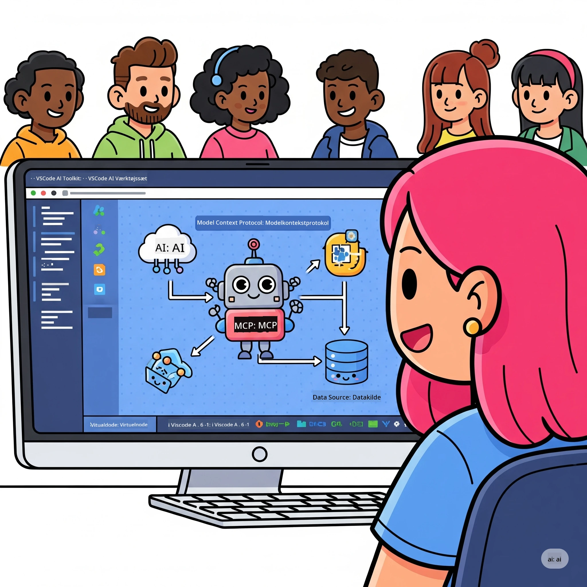
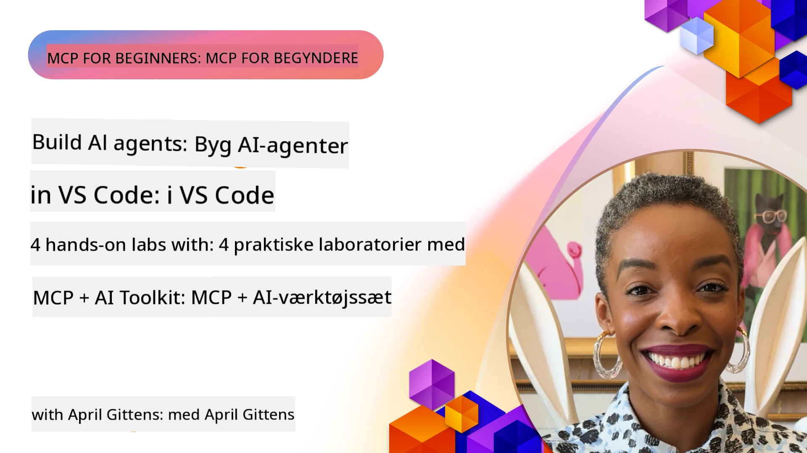

# Strømlining af AI-arbejdsgange: Bygning af en MCP-server med Microsoft Foundry Toolkit

## 🎯  Oversigt

_(Klik på billedet ovenfor for at se video af denne lektion)_

Velkommen til **Model Context Protocol (MCP) Workshop**! Denne omfattende praktiske workshop kombinerer to banebrydende teknologier for at revolutionere AI-applikationsudvikling:

> **Kompatibilitetsnote:** workshopkoden er bygget og testet med MCP
> `2025-11-25`, som vist ved badge ovenfor. Brug
> [den aktuelle `2026-07-28` specifikation](https://modelcontextprotocol.io/specification/2026-07-28/)
> til nye protokolimplementeringer og gennemgå SDK-release-noter inden
> du migrerer laboratorierne.

- **🔗 Model Context Protocol (MCP)**: En åben standard for sømløs AI-værktøjsintegration
- **🛠️ Microsoft Foundry Toolkit Extension til VS Code**: Microsofts kraftfulde AI-udviklingstilføjelse

### 🎓 Hvad du lærer

Ved afslutningen af denne workshop mestrer du kunsten at bygge intelligente applikationer, der forbinder AI-modeller med virkelige værktøjer og tjenester. Fra automatiseret test til brugerdefinerede API-integrationer opnår du praktiske færdigheder til at løse komplekse forretningsudfordringer.

## 🏗️ Teknologistak

### 🔌 Model Context Protocol (MCP)

MCP er **"USB-C for AI"** - en universel standard, der forbinder AI-modeller med eksterne værktøjer og datakilder.

**✨ Nøglefunktioner:**

- 🔄 **Standardiseret integration**: Universal grænseflade til AI-værktøjsforbindelser
- 🏛️ **Fleksibel arkitektur**: Lokale & fjernservere via stdio/SSE-transport
- 🧰 **Rigt økosystem**: Værktøjer, prompts og ressourcer i én protokol
- 🔒 **Klar til enterprise**: Indbygget sikkerhed og pålidelighed

**🎯 Hvorfor MCP betyder noget:**
Ligesom USB-C fjernede kabelrod, fjerner MCP kompleksiteten ved AI-integrationer. Én protokol, uendelige muligheder.

### 🤖 Microsoft Foundry Toolkit Extension til VS Code

Microsofts flagskibsudvidelse til AI-udvikling, som forvandler VS Code til en AI-kraftstation.

**🚀 Kernefunktioner:**

- 📦 **Modelkatalog**: Adgang til modeller fra Azure AI, GitHub, Hugging Face, Ollama
- ⚡ **Lokal inferens**: ONNX-optimeret CPU/GPU/NPU-udførelse
- 🏗️ **Agentbygger**: Visuel AI-agentudvikling med MCP-integration
- 🎭 **Multi-modal**: Tekst-, syns- og struktureret output-understøttelse

**💡 Udviklingsfordele:**

- Zero-konfig modeludrulning
- Visuel prompt-udvikling
- Realtidstestnings-lekeplads
- Sømløs MCP-serverintegration

## 📚 Læringsrejse

### [🚀 Modul 1: Microsoft Foundry Toolkit Grundlæggende](./lab1/README.md)

**Varighed**: 15 minutter

- 🛠️ Installer og konfigurer Microsoft Foundry Toolkit til VS Code
- 🗂️ Udforsk Modelkataloget (100+ modeller fra GitHub, ONNX, OpenAI, Anthropic, Google)
- 🎮 Mestring af den interaktive lekeplads til realtidstest af modeller
- 🤖 Byg din første AI-agent med Agentbyggeren
- 📊 Evaluer modelpræstation med indbyggede metrics (F1, relevans, lighed, koherens)
- ⚡ Lær batch-behandling og multi-modal understøttelse

**🎯 Læringsresultat**: Skab en funktionel AI-agent med omfattende forståelse af Microsoft Foundry Toolkits funktioner

### [🌐 Modul 2: MCP med Microsoft Foundry Toolkit Grundlæggende](./lab2/README.md)

**Varighed**: 20 minutter

- 🧠 Mestring af Model Context Protocol (MCP) arkitektur og koncepter
- 🌐 Udforsk Microsofts MCP-server økosystem
- 🤖 Byg en browserautomationsagent med Playwright MCP-server
- 🔧 Integrer MCP-servere med Microsoft Foundry Toolkit Agentbygger
- 📊 Konfigurer og test MCP-værktøjer inden for dine agenter
- 🚀 Eksportér og deployér MCP-drevne agenter til produktionsbrug

**🎯 Læringsresultat**: Udrul en AI-agent superopladet med eksterne værktøjer gennem MCP

### [🔧 Modul 3: Avanceret MCP-udvikling med Microsoft Foundry Toolkit](./lab3/README.md)

**Varighed**: 20 minutter

- 💻 Opret brugerdefinerede MCP-servere ved hjælp af Microsoft Foundry Toolkit
- 🐍 Konfigurer og brug den nyeste MCP Python SDK (v1.9.3)
- 🔍 Sæt MCP Inspector op og brug til debugging
- 🛠️ Byg en Weather MCP-server med professionelle debugging-arbejdsgange
- 🧪 Debug MCP-servere i både Agentbygger- og Inspector-miljøer

**🎯 Læringsresultat**: Udvikle og debugge brugerdefinerede MCP-servere med moderne værktøjer

### [🐙 Modul 4: Praktisk MCP-udvikling - Specialbygget GitHub Clone Server](./lab4/README.md)

**Varighed**: 30 minutter

- 🏗️ Byg en real-world GitHub Clone MCP-server til udviklingsarbejdsgange
- 🔄 Implementer smart repository-kloning med validering og fejlhåndtering
- 📁 Opret intelligent mappestyring og VS Code-integration
- 🤖 Brug GitHub Copilot Agent Mode med brugerdefinerede MCP-værktøjer
- 🛡️ Anvend pålidelighed klar til produktion og tværplatformskompatibilitet

**🎯 Læringsresultat**: Udrul en produktionsklar MCP-server, der strømliner reelle udviklingsarbejdsgange

## 💡 Anvendelser og indvirkning i den virkelige verden

### 🏢 Enterprise-anvendelsestilfælde

#### 🔄 DevOps-automatisering

Forvandl din udviklingsarbejdsgang med intelligent automatisering:

- **Smart Repository Management**: AI-drevet kodegennemgang og sammenfletningsbeslutninger
- **Intelligent CI/CD**: Automatiseret pipelineoptimering baseret på kodeændringer
- **Issue Triage**: Automatisk bug-klassificering og tildeling

#### 🧪 Kvalitetssikringsrevolution

Forbedr testning med AI-drevet automatisering:

- **Intelligent testgenerering**: Opret omfattende testsuiter automatisk
- **Visuel regressionstestning**: AI-drevet UI-ændringsdetektion
- **Præstationsovervågning**: Proaktiv fejlidentifikation og løsning

#### 📊 Intelligens i datapipelines

Byg smartere databehandlingsarbejdsgange:

- **Adaptive ETL-processer**: Selvioptimerende datatransformationer
- **Anomalidetektion**: Realtidsovervågning af datakvalitet
- **Intelligent routing**: Smart styring af dataflow

#### 🎧 Forbedring af kundeoplevelsen

Skab enestående kundeinteraktioner:

- **Konstektbevidst support**: AI-agenter med adgang til kundehistorik
- **Proaktiv fejlretning**: Predictive kundeservice
- **Multi-kanal integration**: Enhedlig AI-oplevelse på tværs af platforme

## 🛠️ Forudsætninger & opsætning

### 💻 Systemkrav

| Komponent | Krav | Noter |
|-----------|-------------|-------|
| **Operativsystem** | Windows 10+, macOS 10.15+, Linux | Ethvert moderne OS |
| **Visual Studio Code** | Seneste stabile version | Krævet til Microsoft Foundry Toolkit |
| **Node.js** | v18.0+ og npm | Til udvikling af MCP-servere |
| **Python** | 3.10+ | Valgfrit til Python MCP-servere |
| **Hukommelse** | Mindst 8GB RAM | 16GB anbefalet til lokale modeller |

### 🔧 Udviklingsmiljø

#### Anbefalede VS Code-udvidelser

- **Microsoft Foundry Toolkit** (ms-windows-ai-studio.windows-ai-studio)
- **Python** (ms-python.python)
- **Python Debugger** (ms-python.debugpy)
- **GitHub Copilot** (GitHub.copilot) - Valgfri men hjælpsom

#### Valgfrie værktøjer

- **uv**: Moderne Python-pakkemanager
- **MCP Inspector**: Visuelt debugging-værktøj til MCP-servere
- **Playwright**: Til webautomatiseringseksempler

## 🎖️ Læringsresultater & certificeringsvej

### 🏆 Tjekliste for færdighedsbeherskelse

Ved at fuldføre denne workshop opnår du færdigheder i:

#### 🎯 Kernekompetencer

- [ ] **MCP-protokolbeherskelse**: Dybt kendskab til arkitektur og implementeringsmønstre
- [ ] **Microsoft Foundry Toolkit-kompetence**: Ekspertbrug af Microsoft Foundry Toolkit til hurtig udvikling
- [ ] **Udvikling af brugerdefinerede servere**: Byg, deployér og vedligehold produktions-MCP-servere
- [ ] **Fremragende værktøjsintegration**: Sømløs forbindelse mellem AI og eksisterende udviklingsarbejdsgange
- [ ] **Anvendelse af problemløsning**: Anvend lærte færdigheder på reelle forretningsudfordringer

#### 🔧 Tekniske færdigheder

- [ ] Opsæt og konfigurer Microsoft Foundry Toolkit i VS Code
- [ ] Design og implementer brugerdefinerede MCP-servere
- [ ] Integrer Microsoft Foundry-modeller med MCP-arkitektur
- [ ] Byg automatiserede testarbejdsgange med Playwright
- [ ] Deploy AI-agenter til produktionsbrug
- [ ] Debug og optimer MCP-serverpræstation

#### 🚀 Avancerede funktioner

- [ ] Arkitekter enterprise-skala AI-integrationer
- [ ] Implementer sikkerhedspraksis for AI-applikationer
- [ ] Design skalerbare MCP-serverarkitekturer
- [ ] Skab brugerdefinerede værktøjskæder til specifikke domæner
- [ ] Mentorér andre i AI-native udvikling

## 📖 Yderligere ressourcer

- [MCP specifikation (2026-07-28)](https://modelcontextprotocol.io/specification/2026-07-28/)
- [Microsoft Foundry Toolkit GitHub Repository](https://github.com/microsoft/vscode-ai-toolkit)
- [Eksempelsamling af MCP-servere](https://github.com/modelcontextprotocol/servers)
- [Guide til bedste praksis](https://modelcontextprotocol.io/docs/best-practices)
- [OWASP MCP Top 10](https://microsoft.github.io/mcp-azure-security-guide/mcp/) - Sikkerhedspraksis

---

**🚀 Klar til at revolutionere din AI-udviklingsarbejdsgang?**

Lad os bygge fremtiden for intelligente applikationer sammen med MCP og Microsoft Foundry Toolkit!

## Hvad er næste skridt

Fortsæt til: [Modul 11: MCP Server Hands-On Labs](../11-MCPServerHandsOnLabs/README.md)

---

<!-- CO-OP TRANSLATOR DISCLAIMER START -->
**Ansvarsfraskrivelse**:
Dette dokument er blevet oversat ved hjælp af AI-oversættelsestjenesten [Co-op Translator](https://github.com/Azure/co-op-translator). Selvom vi bestræber os på nøjagtighed, skal du være opmærksom på, at automatiserede oversættelser kan indeholde fejl eller unøjagtigheder. Det originale dokument på dets oprindelige sprog bør betragtes som den autoritative kilde. For kritisk information anbefales professionel menneskelig oversættelse. Vi påtager os intet ansvar for misforståelser eller fejltolkninger, der opstår som følge af brugen af denne oversættelse.
<!-- CO-OP TRANSLATOR DISCLAIMER END -->