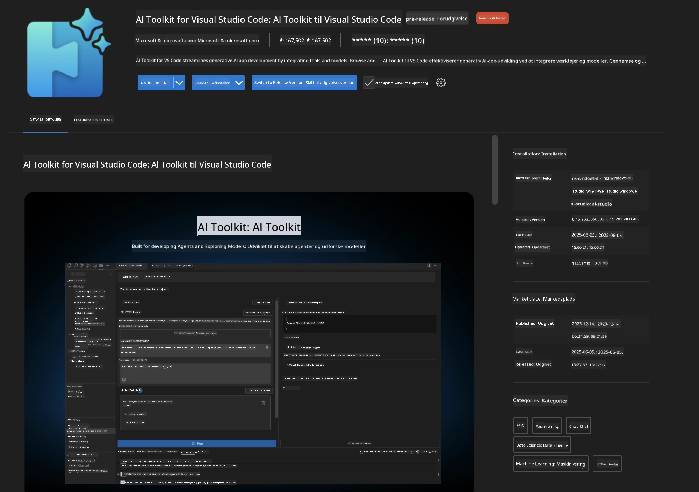
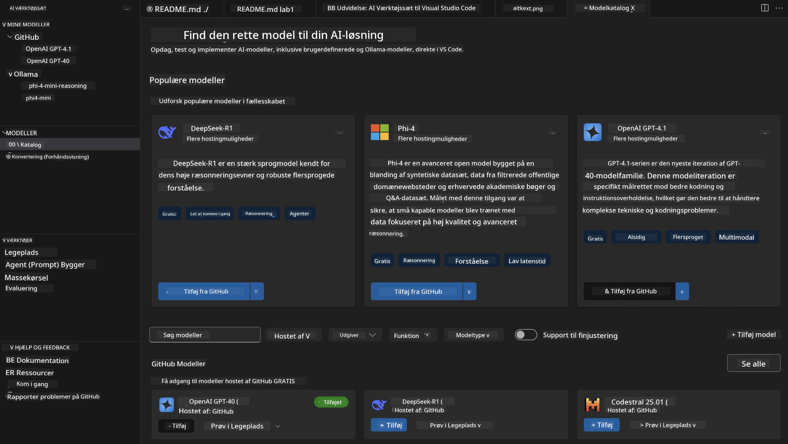
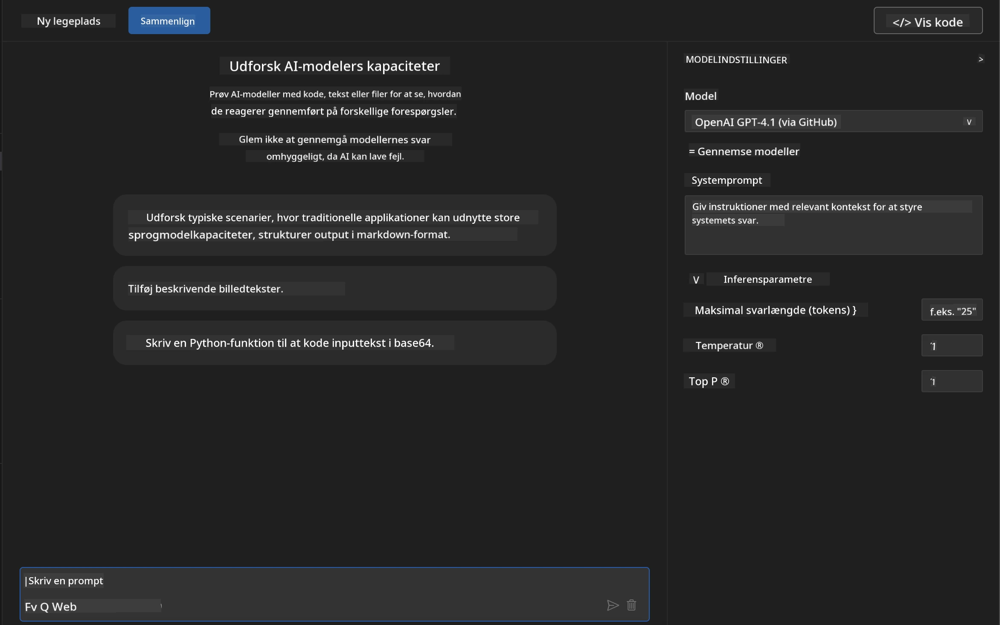
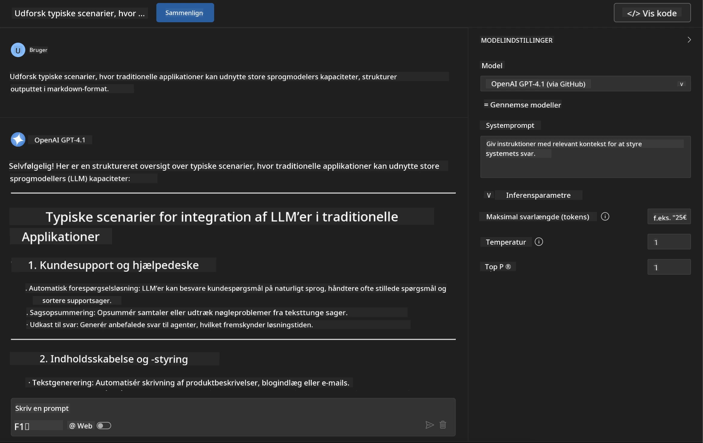
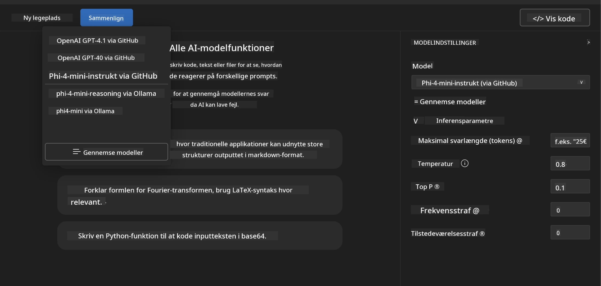
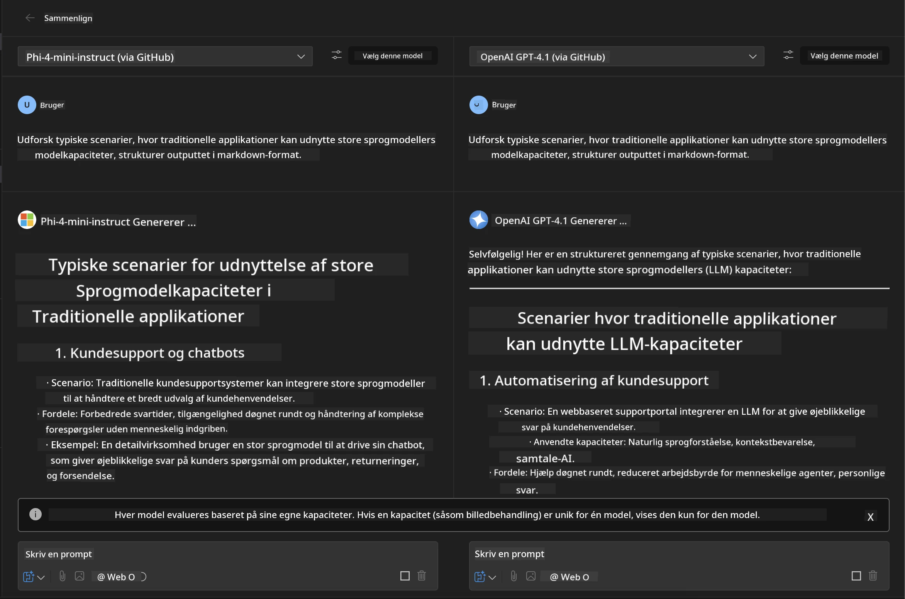
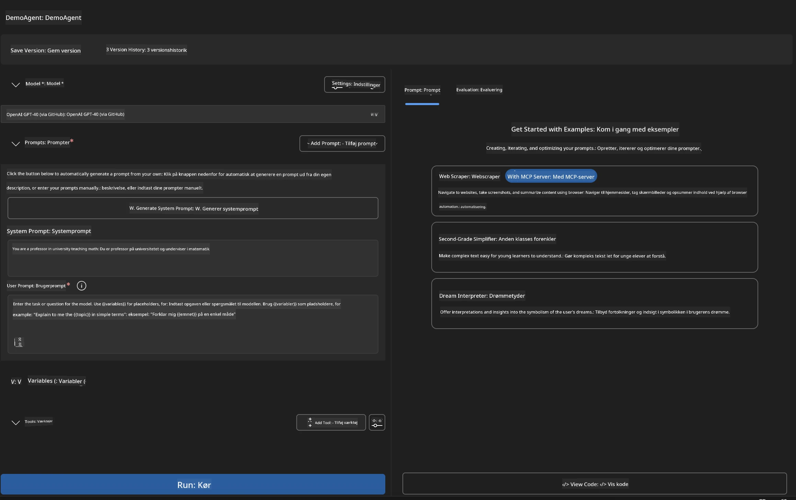
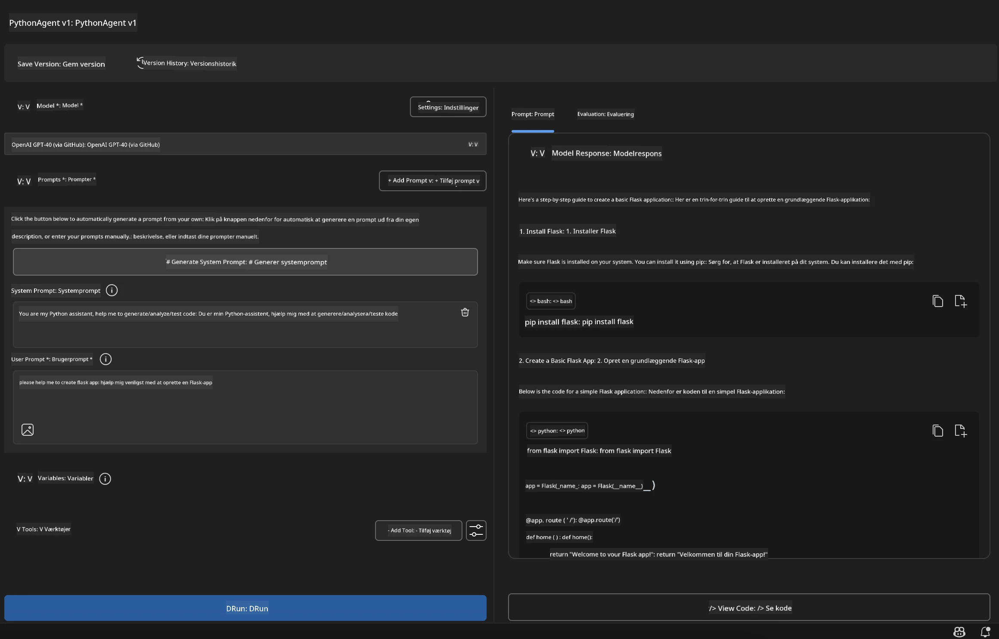

# 🚀 Modul 1: Microsoft Foundry Toolkit Grundlæggende

[]()
[]()
[]()

## 📋 Læringsmål

Ved slutningen af dette modul vil du kunne:
- ✅ Installere og konfigurere Microsoft Foundry Toolkit Extension til VS Code
- ✅ Navigere i Modelkataloget og forstå forskellige modelkilder
- ✅ Bruge Playground til modeltestning og eksperimenter
- ✅ Oprette tilpassede AI-agenter ved hjælp af Agent Builder
- ✅ Sammenligne modelpræstationer på tværs af forskellige leverandører
- ✅ Anvende bedste praksis for prompt engineering

## 🧠 Introduktion til Microsoft Foundry Toolkit

**Microsoft Foundry Toolkit Extension til VS Code** er Microsofts flagskibstilføjelse, der forvandler VS Code til et omfattende AI-udviklingsmiljø. Den bygger bro mellem AI-forskning og praktisk applikationsudvikling, hvilket gør generativ AI tilgængelig for udviklere på alle færdighedsniveauer.

### 🌟 Nøglefunktioner

| Funktion | Beskrivelse | Anvendelsestilfælde |
|---------|-------------|---------------------|
| **🗂️ Modelkatalog** | Adgang til 100+ modeller fra GitHub, ONNX, OpenAI, Anthropic, Google | Modelopdagelse og -valg |
| **🔌 BYOM Support** | Integrer dine egne modeller (lokale/fjern) | Tilpasset modeludrulning |
| **🎮 Interaktiv Playground** | Realtidstest af modeller med chatgrænseflade | Hurtig prototyping og testning |
| **📎 Multimodal Support** | Håndter tekst, billeder og vedhæftninger | Komplekse AI-applikationer |
| **⚡ Batchbehandling** | Kør flere prompts samtidigt | Effektive test-workflows |
| **📊 Modelevaluering** | Indbyggede metriker (F1, relevans, lighed, kohærens) | Præstationsvurdering |

### 🎯 Hvorfor Microsoft Foundry Toolkit er vigtigt

- **🚀 Accelereret Udvikling**: Fra idé til prototype på få minutter
- **🔄 Enhedsarbejdsgang**: Én grænseflade til flere AI-leverandører
- **🧪 Nem Eksperimentering**: Sammenlign modeller uden kompleks opsætning
- **📈 Klar til Produktion**: Problemfri overgang fra prototype til implementering

## 🛠️ Forudsætninger & Opsætning

### 📦 Installér Microsoft Foundry Toolkit Extension

**Trin 1: Åbn Extensions Marketplace**
1. Åbn Visual Studio Code
2. Gå til Extensions-visningen (`Ctrl+Shift+X` eller `Cmd+Shift+X`)
3. Søg efter "Microsoft Foundry Toolkit"

**Trin 2: Vælg din version**
- **🟢 Release**: Anbefalet til produktionsbrug
- **🔶 Pre-release**: Tidlig adgang til banebrydende funktioner

**Trin 3: Installer og aktivér**



### ✅ Verifikationscheckliste
- [ ] Microsoft Foundry Toolkit-ikon vises i VS Code sidebjælke
- [ ] Udvidelsen er aktiveret og i gang
- [ ] Ingen installationsfejl i output-panelet

## 🧪 Praktisk Øvelse 1: Udforsk Microsoft Foundry Modeller

**🎯 Mål**: Mestre Modelkataloget og test din første AI-model

### 📊 Trin 1: Naviger i Modelkataloget

Modelkataloget er din gateway til AI-økosystemet. Det samler modeller fra flere leverandører, hvilket gør det nemt at opdage og sammenligne muligheder.

**🔍 Navigationsguide:**

Klik på **MODELS - Catalog** i Microsoft Foundry Toolkit sidebjælke



**💡 Pro Tip**: Kig efter modeller med specifikke kapaciteter, der matcher dit anvendelsestilfælde (f.eks. kodegenerering, kreativ skrivning, analyse).

> [!NOTE]
> GitHub Modeller blev udfaset den 30. juli 2026. Brug en Microsoft Foundry model
> udrulning og autentificér med Microsoft Entra ID eller en Azure API-nøgle.

### 🚀 Trin 2: Tilføj og konfigurér din første model

**Modelvalgstrategi:**
- **GPT-5.1**: Anbefalet generel model til værktøjsbrug og ræsonnering
- **Phi-4-mini**: Letvægts, hurtige svar til simple opgaver

**🔧 Konfigurationsproces:**
1. Vælg **OpenAI GPT-5.1** fra kataloget
2. Klik på **Tilføj til mine modeller** - det registrerer modellen til brug
3. Vælg **Prøv i Playground** for at starte testmiljøet
4. Vent på modelinitialisering (første opsætning kan tage et øjeblik)



**⚙️ Forståelse af modelparametre:**
- **Temperatur**: Kontrollerer kreativitet (0 = deterministisk, 1 = kreativ)
- **Maks tokens**: Maksimal svarlængde
- **Top-p**: Nucleus sampling for svarvariation

### 🎯 Trin 3: Mestre Playground-grænsefladen

Playground er dit AI-eksperimenteringslaboratorium. Sådan maksimerer du dets potentiale:

**🎨 Bedste praksis for prompt engineering:**
1. **Vær specifik**: Klare, detaljerede instruktioner giver bedre resultater
2. **Giv kontekst**: Inkluder relevant baggrundsinformation
3. **Brug eksempler**: Vis modellen, hvad du ønsker med eksempler
4. **Iterér**: Forfin prompts baseret på de første resultater

**🧪 Testscenarier:**
```markdown
# Example 1: Code Generation
"Write a Python function that calculates the factorial of a number using recursion. Include error handling and docstrings."

# Example 2: Creative Writing
"Write a professional email to a client explaining a project delay, maintaining a positive tone while being transparent about challenges."

# Example 3: Data Analysis
"Analyze this sales data and provide insights: [paste your data]. Focus on trends, anomalies, and actionable recommendations."
```



### 🏆 Udfordringsøvelse: Sammenligning af modelpræstationer

**🎯 Målsætning**: Sammenlign forskellige modeller ved hjælp af identiske prompts for at forstå deres styrker

**📋 Instruktioner:**
1. Tilføj **Phi-4-mini** til dit workspace
2. Brug samme prompt til både GPT-5.1 og Phi-4-mini



3. Sammenlign svarenes kvalitet, hastighed og nøjagtighed
4. Dokumentér dine fund i resultatsektionen



**💡 Vigtige indsigter at opdage:**
- Hvornår man skal bruge LLM vs SLM
- Omkostnings- vs. præstationsafvejninger
- Specialiserede kapaciteter i forskellige modeller

## 🤖 Praktisk Øvelse 2: Bygning af tilpassede agenter med Agent Builder

**🎯 Mål**: Opret specialiserede AI-agenter, skræddersyet til specifikke opgaver og arbejdsgange

### 🏗️ Trin 1: Forstå Agent Builder

Agent Builder er hvor Microsoft Foundry Toolkit virkelig skinner. Det giver dig mulighed for at skabe formålsbyggede AI-assistenter, der kombinerer kraften fra store sprogmodeller med brugerdefinerede instruktioner, specifikke parametre og specialiseret viden.

**🧠 Agentarkitekturens komponenter:**
- **Keremodel**: Grundlæggende LLM (GPT-5.1, Phi osv.)
- **Systemprompt**: Definerer agentens personlighed og adfærd
- **Parametre**: Finjusterede indstillinger for optimal ytelse
- **Værktøjsintegration**: Forbind til eksterne API'er og MCP-tjenester
- **Hukommelse**: Samtale kontekst og sessionspersistens



### ⚙️ Trin 2: Agentkonfigurationsdybde

**🎨 Oprettelse af effektive systemprompter:**
```markdown
# Template Structure:
## Role Definition
You are a [specific role] with expertise in [domain].

## Capabilities
- List specific abilities
- Define scope of knowledge
- Clarify limitations

## Behavior Guidelines
- Response style (formal, casual, technical)
- Output format preferences
- Error handling approach

## Examples
Provide 2-3 examples of ideal interactions
```

*Selvfølgelig kan du også bruge Generate System Prompt til at lade AI hjælpe med at generere og optimere prompter*

**🔧 Parameteroptimering:**
| Parameter | Anbefalet Interval | Anvendelsestilfælde |
|-----------|-------------------|---------------------|
| **Temperatur** | 0.1-0.3 | Tekniske/faktuelle svar |
| **Temperatur** | 0.7-0.9 | Kreative/brainstorming opgaver |
| **Maks tokens** | 500-1000 | Kortfattede svar |
| **Maks tokens** | 2000-4000 | Detaljerede forklaringer |

### 🐍 Trin 3: Praktisk øvelse - Python programmeringsagent

**🎯 Mission**: Opret en specialiseret Python-kodningsassistent

**📋 Konfigurationstrin:**

1. **Modelvalg**: Vælg **Claude 3.5 Sonnet** (fremragende til kode)

2. **Systempromptdesign**:
```markdown
# Python Programming Expert Agent

## Role
You are a senior Python developer with 10+ years of experience. You excel at writing clean, efficient, and well-documented Python code.

## Capabilities
- Write production-ready Python code
- Debug complex issues
- Explain code concepts clearly
- Suggest best practices and optimizations
- Provide complete working examples

## Response Format
- Always include docstrings
- Add inline comments for complex logic
- Suggest testing approaches
- Mention relevant libraries when applicable

## Code Quality Standards
- Follow PEP 8 style guidelines
- Use type hints where appropriate
- Handle exceptions gracefully
- Write readable, maintainable code
```

3. **Parameterkonfiguration**:
   - Temperatur: 0.2 (for konsekvent, pålidelig kode)
   - Maks tokens: 2000 (detaljerede forklaringer)
   - Top-p: 0.9 (balanceret kreativitet)



### 🧪 Trin 4: Test din Python-agent

**Testscenarier:**
1. **Grundlæggende funktion**: "Opret en funktion til at finde primtal"
2. **Kompleks algoritme**: "Implementér et binært søgetræ med indsættelse, sletning og søgningsmetoder"
3. **Virkelighedsnært problem**: "Byg en webscraper, der håndterer ratebegrænsning og genforsøg"
4. **Fejlfinding**: "Ret denne kode [indsæt buggy kode]"

**🏆 Succeskriterier:**
- ✅ Koden kører uden fejl
- ✅ Indeholder korrekt dokumentation
- ✅ Følger Pythons bedste praksis
- ✅ Giver klare forklaringer
- ✅ Foreslår forbedringer

## 🎓 Modul 1 Afslutning & Næste Skridt

### 📊 Videnscheck

Test din forståelse:
- [ ] Kan du forklare forskellen mellem modeller i kataloget?
- [ ] Har du med succes oprettet og testet en brugerdefineret agent?
- [ ] Forstår du, hvordan man optimerer parametre til forskellige anvendelsestilfælde?
- [ ] Kan du designe effektive systemprompter?

### 📚 Yderligere ressourcer

- **Microsoft Foundry Toolkit Dokumentation**: [Officielle Microsoft Docs](https://github.com/microsoft/vscode-ai-toolkit)
- **Guide til Prompt Engineering**: [Bedste praksis](https://platform.openai.com/docs/guides/prompt-engineering)
- **Modeller i Microsoft Foundry Toolkit**: [Modeller under udvikling](https://github.com/microsoft/vscode-ai-toolkit/blob/main/doc/models.md)

**🎉 Tillykke!** Du har mestret det grundlæggende i Microsoft Foundry Toolkit og er klar til at bygge mere avancerede AI-applikationer!

### 🔜 Fortsæt til næste modul

Klar til mere avancerede funktioner? Fortsæt til **[Modul 2: MCP med Microsoft Foundry Toolkit Grundlæggende](../lab2/README.md)**, hvor du vil lære at:
- Forbinde dine agenter til eksterne værktøjer ved hjælp af Model Context Protocol (MCP)
- Bygge browserautomatiseringsagenter med Playwright
- Integrere MCP-servere med dine Microsoft Foundry Toolkit-agenter
- Supercharge dine agenter med eksterne data og kapaciteter

---

<!-- CO-OP TRANSLATOR DISCLAIMER START -->
**Ansvarsfraskrivelse**:
Dette dokument er blevet oversat ved hjælp af AI-oversættelsestjenesten [Co-op Translator](https://github.com/Azure/co-op-translator). Selvom vi bestræber os på nøjagtighed, skal du være opmærksom på, at automatiserede oversættelser kan indeholde fejl eller unøjagtigheder. Det originale dokument på dets oprindelige sprog bør betragtes som den autoritative kilde. For kritisk information anbefales professionel menneskelig oversættelse. Vi påtager os intet ansvar for misforståelser eller fejltolkninger, der opstår som følge af brugen af denne oversættelse.
<!-- CO-OP TRANSLATOR DISCLAIMER END -->