# 🌐 Modul 2: MCP med Microsoft Foundry Toolkit Grundprincipper


## 📋 Læringsmål

Ved slutningen af dette modul vil du være i stand til at:

- ✅ Forstå Model Context Protocol (MCP) arkitektur og fordele
- ✅ Udforske Microsofts MCP server-økosystem
- ✅ Integrere MCP servere med Microsoft Foundry Toolkit Agent Builder
- ✅ Bygge en funktionel browserautomatiseringsagent ved hjælp af Playwright MCP
- ✅ Konfigurere og teste MCP værktøjer inden for dine agenter
- ✅ Eksportere og deployere MCP-drevne agenter til produktionsbrug

## 🎯 Opbygning på Modul 1

I Modul 1 mestrede vi Microsoft Foundry Toolkit grundprincipper og oprettede vores
første Python Agent. Nu vil vi **forstærke** dine agenter ved at forbinde dem
til eksterne værktøjer og tjenester gennem den revolutionerende
**Model Context Protocol (MCP)**.

Tænk på det som en opgradering fra en simpel lommeregner til en fuld computer. Dine AI
agenter vil få evnen til at:

- 🌐 Gennemse og interagere med websites
- 📁 Få adgang til og manipulere filer
- 🔧 Integrere med virksomhedssystemer
- 📊 Behandle realtidsdata fra API’er

## 🧠 Forståelse af Model Context Protocol (MCP)

### 🔍 Hvad er MCP?

Model Context Protocol (MCP) er **"USB-C for AI-applikationer"**: en åben
standard, der forbinder Large Language Models (LLM’er) til eksterne værktøjer, datas
kilder og tjenester. Ligesom USB-C giver én universel forbindelse, reducerer MCP
kompleksiteten ved AI-integration gennem én standardiseret protokol.

### 🎯 Problemet MCP Løser

**Før MCP:**

- 🔧 Tilpassede integrationer for hvert værktøj
- 🔄 Leverandørlås med proprietære løsninger  
- 🔒 Sikkerhedssårbarheder fra improviserede forbindelser
- ⏱️ Måneder med udvikling til simple integrationer

**Med MCP:**

- ⚡ Plug-and-play værktøjsintegration
- 🔄 Leverandøruafhængig arkitektur
- 🛡️ Indbyggede sikkerhedspraksis
- 🚀 Minutter til at tilføje nye funktioner

### 🏗️ MCP Arkitektur Dybtgående

MCP følger en **klient-server arkitektur**, der skaber et sikkert, skalerbart økosystem:

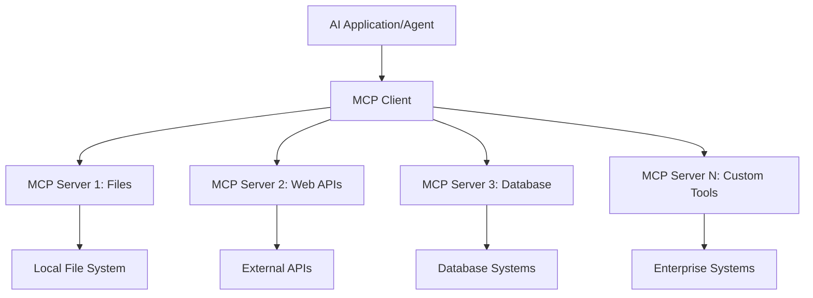

**🔧 Kernekomponenter:**

| Komponent | Rolle | Eksempler |
| --------- | ---- | -------- |
| **MCP Hosts** | Forbruger MCP tjenester | VS Code, Foundry Toolkit |
| **MCP Clients** | Håndterer protokolforbindelser | Indbygget i hosts |
| **MCP Servers** | Leverer funktionaliteter | Playwright, Filer, Azure, GitHub |
| **Transportlag** | Forbinder klienter og servere | stdio, HTTP, WebSockets |

## 🏢 Microsofts MCP Server-Økosystem

Microsoft fører MCP-økosystemet med en omfattende suite af
virksomhedsklasse-servere, der adresserer virkelige forretningsbehov.

### 🌟 Udvalgte Microsoft MCP Servere

#### 1. ☁️ Azure MCP Server

**🔗 Repository**: [azure/azure-mcp](https://github.com/azure/azure-mcp)
**🎯 Formål**: Omfattende ressourcestyring i Azure med AI-integration

**✨ Nøglefunktioner:**

- Deklarativ infrastruktur-provisionering
- Realtidsressourceovervågning
- Omkostningsoptimeringsanbefalinger
- Sikkerhedsoverholdelsestjek

**🚀 Anvendelsesscenarier:**

- Infrastruktur-som-kode med AI-assistance
- Automatisk skalering af ressourcer
- Optimering af cloud-omkostninger
- DevOps workflow-automatisering

#### 2. 📊 Microsoft Dataverse MCP

**📚 Dokumentation**: [Microsoft Dataverse Integration](https://go.microsoft.com/fwlink/?linkid=2320176)
**🎯 Formål**: Naturligt sprog interface til forretningsdata

**✨ Nøglefunktioner:**

- Forespørgsler i databasen via naturligt sprog
- Forståelse af forretningskontekst
- Tilpassede promptskabeloner
- Virksomhedsdatastyring

**🚀 Anvendelsesscenarier:**

- Business intelligence rapportering
- Kundedataanalyse
- Salgspipeline indsigter
- Overholdelsesdata-forespørgsler

#### 3. 🌐 Playwright MCP Server

**🔗 Repository**: [microsoft/playwright-mcp](https://github.com/microsoft/playwright-mcp)
**🎯 Formål**: Browserautomatisering og web-interaktionsfunktioner

**✨ Nøglefunktioner:**

- Cross-browser automatisering (Chrome, Firefox, Safari)
- Intelligent elementdetektion
- Skærmbilleder og PDF-generering
- Netværkstrafikovervågning

**🚀 Anvendelsesscenarier:**

- Automatiserede test workflows
- Web scraping og dataudtræk
- UI/UX overvågning
- Automatisering af konkurrentanalyse

#### 4. 📁 Files MCP Server

**🔗 Repository**: [microsoft/files-mcp-server](https://github.com/microsoft/files-mcp-server)
**🎯 Formål**: Intelligent filsystemoperationer

**✨ Nøglefunktioner:**

- Deklarativ filstyring
- Indholdssynkronisering
- Versionskontrol integration
- Metadataudtræk

**🚀 Anvendelsesscenarier:**

- Dokumentationsstyring
- Organisation af kode-repositorier
- Workflow for indholdspublicering
- Filhåndtering i datapipelines

#### 5. 📝 MarkItDown MCP Server

**🔗 Repository**: [microsoft/markitdown](https://github.com/microsoft/markitdown)
**🎯 Formål**: Avanceret Markdown-behandling og manipulation

**✨ Nøglefunktioner:**

- Avanceret Markdown-parsing
- Formatkonvertering (MD ↔ HTML ↔ PDF)
- Analyse af indholdsstruktur
- Skabelonbehandling

**🚀 Anvendelsesscenarier:**

- Workflows for teknisk dokumentation
- Content management systemer
- Rapportgenerering
- Vidensbaseautomation

#### 6. 📈 Clarity MCP Server

**📦 Pakke**: [@microsoft/clarity-mcp-server](https://www.npmjs.com/package/@microsoft/clarity-mcp-server)
**🎯 Formål**: Webanalyse og brugeradfærdsindsigt

**✨ Nøglefunktioner:**

- Heatmap-dataanalyse
- Optagelser af brugersessioner
- Performancemålinger
- Analyse af konverteringsflow

**🚀 Anvendelsesscenarier:**

- Optimering af websteder
- Brugererfaring forskning
- A/B testanalyse
- Business intelligence dashboards

### 🌍 Community-økosystem

Ud over Microsofts servere inkluderer MCP-økosystemet:

- **🐙 GitHub MCP**: Repositoriehåndtering og kodeanalyse
- **🗄️ Database MCP’er**: PostgreSQL, MySQL, MongoDB-integrationer
- **☁️ Cloud Provider MCP’er**: AWS, GCP, Digital Ocean værktøjer
- **📧 Kommunikations MCP’er**: Slack, Teams, Email integrationer

## 🛠️ Praktisk Lab: Bygning af en Browser Automationsagent

**🎯 Projektmål**: Oprette en intelligent browserautomationsagent ved hjælp af
Playwright MCP server, der kan navigere på websider, udtrække information og
udføre komplekse webinteraktioner.

### 🚀 Fase 1: Agent Grundopsætning

#### Trin 1: Initialiser Din Agent

1. **Åbn Microsoft Foundry Toolkit Agent Builder**
2. **Opret Ny Agent** med følgende konfiguration:
   - **Navn**: `BrowserAgent`
   - **Model**: Vælg GPT-5.1. Se
      [Microsoft Foundry model udfasningsplan](https://learn.microsoft.com/azure/foundry/openai/concepts/model-retirement-schedule)
      for aktuelle model livscyklus information.

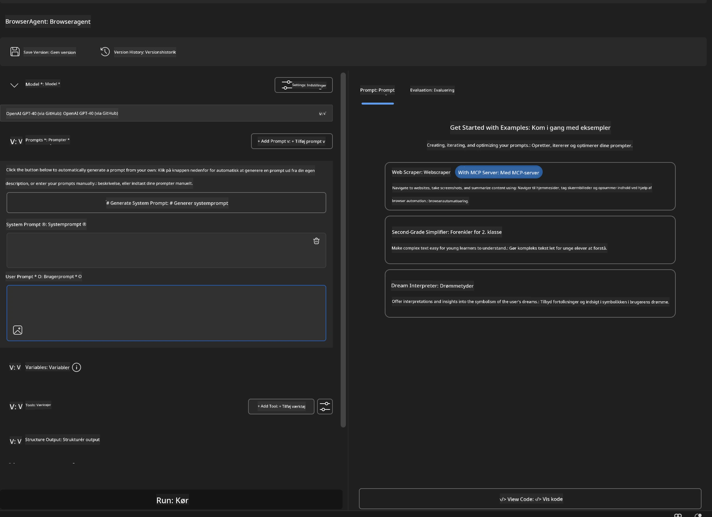

### 🔧 Fase 2: MCP Integrationsworkflow

#### Trin 3: Tilføj MCP Server Integration

1. **Naviger til Værktøjssektionen** i Agent Builder
2. **Klik "Tilføj Værktøj"** for at åbne integrationsmenuen
3. **Vælg "MCP Server"** blandt tilgængelige muligheder

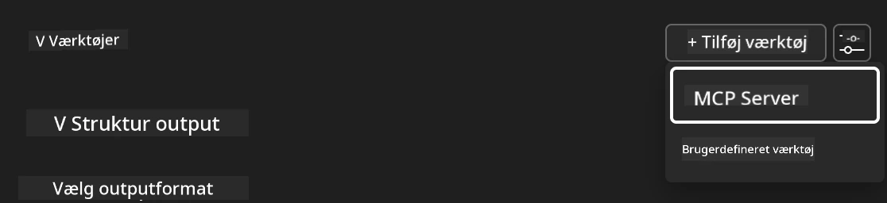

**🔍 Forståelse af Værktøjstyper:**

- **Indbygget Værktøjer**: Forudkonfigurerede Microsoft Foundry Toolkit funktioner
- **MCP Servere**: Eksterne serviceintegrationer
- **Custom APIs**: Dine egne serviceendpoints
- **Funktionskald**: Direkte modelfunktionsadgang

#### Trin 4: MCP Server Udvælgelse

1. **Vælg "MCP Server"** mulighed for at fortsætte
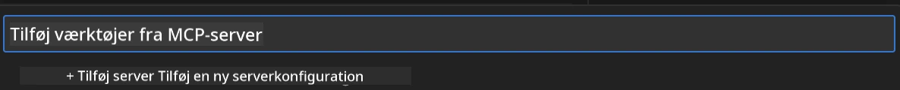

2. **Gennemse MCP Katalog** for at udforske tilgængelige integrationer
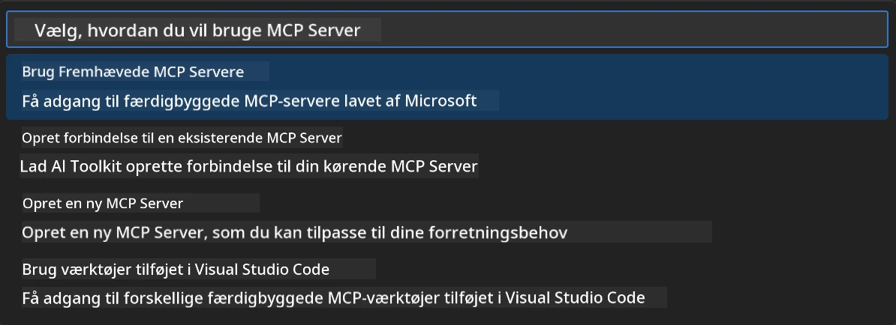

### 🎮 Fase 3: Playwright MCP Konfiguration

#### Trin 5: Vælg og Konfigurer Playwright

1. **Klik "Brug Udvalgte MCP Servere"** for at få adgang til Microsofts verificerede servere
2. **Vælg "Playwright"** fra den udvalgte liste
3. **Accepter Standard MCP ID** eller tilpas til dit miljø

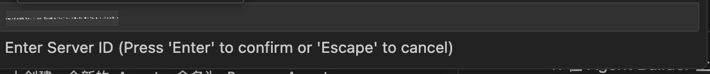

#### Trin 6: Aktiver Playwright Funktioner

**🔑 Kritisk Trin**: Vælg **ALLE** tilgængelige Playwright metoder for maksimal funktionalitet

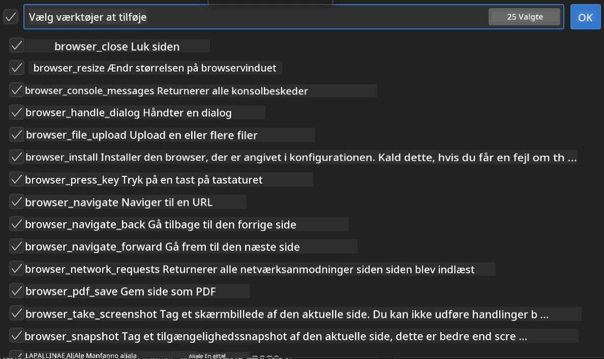

**🛠️ Væsentlige Playwright Værktøjer:**

- **Navigation**: `goto`, `goBack`, `goForward`, `reload`
- **Interaktion**: `click`, `fill`, `press`, `hover`, `drag`
- **Ekstraktion**: `textContent`, `innerHTML`, `getAttribute`
- **Validering**: `isVisible`, `isEnabled`, `waitForSelector`
- **Optagelse**: `screenshot`, `pdf`, `video`
- **Netværk**: `setExtraHTTPHeaders`, `route`, `waitForResponse`

#### Trin 7: Verificer Integrationssucces

**✅ Succesindikatorer:**

- Alle værktøjer vises i Agent Builder grænsefladen
- Ingen fejlmeddelelser i integrationspanelet
- Playwright server status viser "Forbundet"

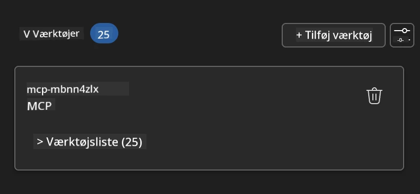

**🔧 Fejlretning af Almindelige Problemer:**

- **Forbindelse Mislykkedes**: Tjek internetforbindelse og firewall-indstillinger
- **Manglende Værktøjer**: Sørg for at alle funktioner blev valgt under opsætning
- **Tilladelsesfejl**: Bekræft at VS Code har nødvendige systemtilladelser

### 🎯 Fase 4: Avanceret Prompt-Design

#### Trin 8: Design Intelligente System-Prompter

Opret sofistikerede prompter, der udnytter Playwrights fulde potentiale:

```markdown
# Web Automation Expert System Prompt

## Core Identity
You are an advanced web automation specialist with deep expertise in browser
automation, web scraping, and user experience analysis. You have access to
Playwright tools for comprehensive browser control.

## Capabilities & Approach
### Navigation Strategy
- Always start with screenshots to understand page layout
- Use semantic selectors (text content, labels) when possible
- Implement wait strategies for dynamic content
- Handle single-page applications (SPAs) effectively

### Error Handling
- Retry failed operations with exponential backoff
- Provide clear error descriptions and solutions
- Suggest alternative approaches when primary methods fail
- Always capture diagnostic screenshots on errors

### Data Extraction
- Extract structured data in JSON format when possible
- Provide confidence scores for extracted information
- Validate data completeness and accuracy
- Handle pagination and infinite scroll scenarios

### Reporting
- Include step-by-step execution logs
- Provide before/after screenshots for verification
- Suggest optimizations and alternative approaches
- Document any limitations or edge cases encountered

## Ethical Guidelines
- Respect robots.txt and rate limiting
- Avoid overloading target servers
- Only extract publicly available information
- Follow website terms of service
```

#### Trin 9: Opret Dynamiske Brugerprompter

Design prompter, der demonstrerer forskellige funktioner:

**🌐 Eksempel på Webanalyse:**

```markdown
Navigate to github.com/kinfey and provide a comprehensive analysis including:
1. Repository structure and organization
2. Recent activity and contribution patterns  
3. Documentation quality assessment
4. Technology stack identification
5. Community engagement metrics
6. Notable projects and their purposes

Include screenshots at key steps and provide actionable insights.
```

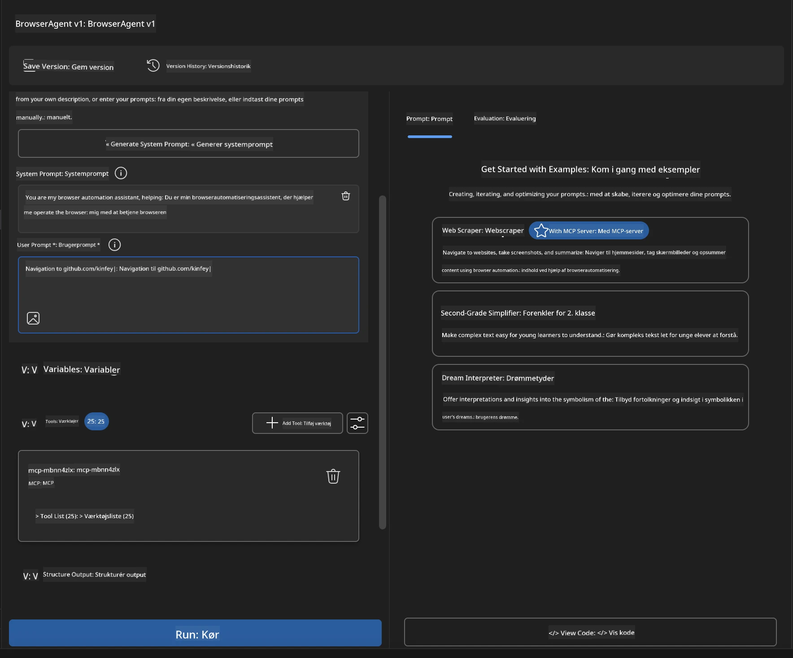

### 🚀 Fase 5: Udførelse og Test

#### Trin 10: Kør Din Første Automatisering

1. **Klik "Kør"** for at starte automatiseringssekvensen
2. **Overvåg Udførelsen i Realtid**:
   - Chrome browser åbnes automatisk
   - Agent navigerer til målsiden
   - Skærmbilleder optages af hvert vigtigt trin
   - Analyse-resultater strømmer i realtid

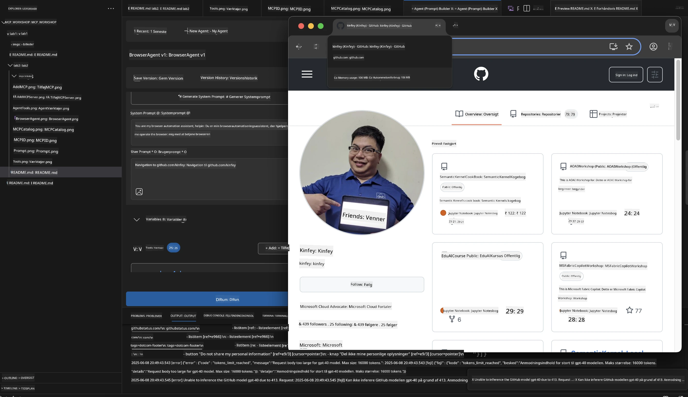

#### Trin 11: Analyser Resultater og Indsigter

Gennemgå omfattende analyser i Agent Builder grænsefladen:

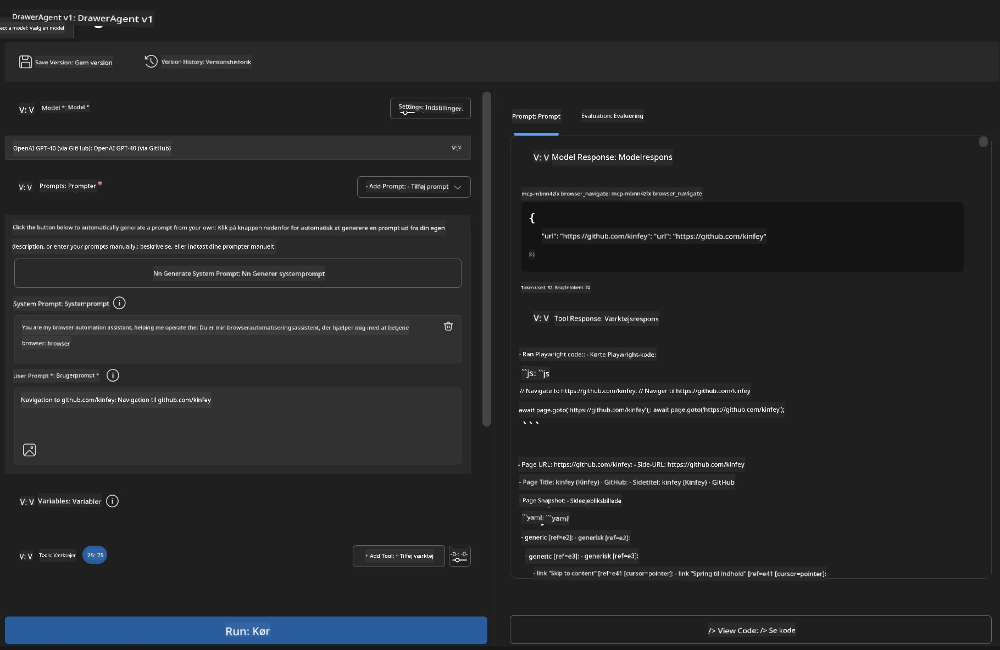

### 🌟 Fase 6: Avancerede Funktioner og Deployment

#### Trin 12: Eksport og Produktionsrelease

Agent Builder understøtter flere deployeringsmuligheder:

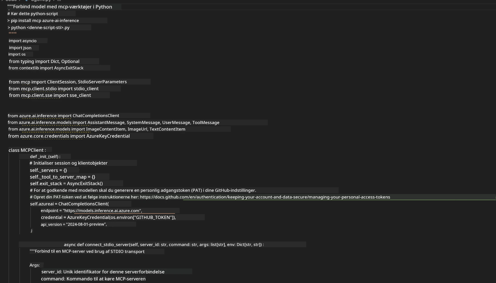

## 🎓 Modul 2 Resumé & Næste Skridt

### 🏆 Opnåelse Låst Op: MCP Integrationsmester

**✅ Opnåede Kompetencer:**

- [ ] Forståelse af MCP arkitektur og fordele
- [ ] Navigation i Microsofts MCP server-økosystem
- [ ] Integration af Playwright MCP med Microsoft Foundry Toolkit
- [ ] Opbygning af sofistikerede browserautomationsagenter
- [ ] Avanceret promptdesign til webautomatisering

### 📚 Yderligere Ressourcer

- **🔗 MCP Specifikation**: [Officiel Protokol Dokumentation](https://modelcontextprotocol.io/)
- **🛠️ Playwright API**: [Komplet Metodereference](https://playwright.dev/docs/api/class-playwright)
- **🏢 Microsoft MCP Servere**:
   [Virksomhedsintegrationsguide](https://github.com/microsoft/mcp-servers)
- **🌍 Community Eksempler**: [MCP Server Galleri](https://github.com/modelcontextprotocol/servers)

**🎉 Tillykke!** Du har med succes mestret MCP integration og kan nu
bygge produktionsklare AI agenter med eksterne værktøjskapaciteter!

### 🔜 Fortsæt til Næste Modul

Klar til at tage dine MCP færdigheder til næste niveau? Fortsæt til
**[Modul 3: Avanceret MCP Udvikling med Microsoft Foundry Toolkit](../lab3/README.md)**
hvor du vil lære at:

- Oprette dine egne tilpassede MCP servere
- Konfigurere og bruge den nyeste MCP Python SDK
- Opsætte MCP Inspector til fejlfinding
- Mestrer avancerede MCP server udviklingsworkflows
- Bygge en Weather MCP Server fra bunden

---

<!-- CO-OP TRANSLATOR DISCLAIMER START -->
**Ansvarsfraskrivelse**:
Dette dokument er blevet oversat ved hjælp af AI-oversættelsestjenesten [Co-op Translator](https://github.com/Azure/co-op-translator). Selvom vi bestræber os på nøjagtighed, skal du være opmærksom på, at automatiserede oversættelser kan indeholde fejl eller unøjagtigheder. Det originale dokument på dets oprindelige sprog bør betragtes som den autoritative kilde. For kritisk information anbefales professionel menneskelig oversættelse. Vi påtager os intet ansvar for misforståelser eller fejltolkninger, der opstår som følge af brugen af denne oversættelse.
<!-- CO-OP TRANSLATOR DISCLAIMER END -->