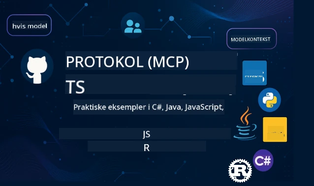

 

[](https://GitHub.com/microsoft/mcp-for-beginners/graphs/contributors)
[](https://GitHub.com/microsoft/mcp-for-beginners/issues)
[](https://GitHub.com/microsoft/mcp-for-beginners/pulls)
[](http://makeapullrequest.com)
[](https://mcptoplist.com/server/mcp.so%2Fmcp-for-beginners%2Fmicrosoft)

[](https://GitHub.com/microsoft/mcp-for-beginners/watchers)
[](https://GitHub.com/microsoft/mcp-for-beginners/fork)
[](https://GitHub.com/microsoft/mcp-for-beginners/stargazers)


[](https://discord.gg/nTYy5BXMWG)

Følg disse trin for at komme i gang med at bruge disse ressourcer:
1. **Fork depotet**: Klik på [](https://GitHub.com/microsoft/mcp-for-beginners/fork)
2. **Klon depotet**:   `git clone https://github.com/microsoft/mcp-for-beginners.git`
3. **Deltag i** [](https://discord.gg/nTYy5BXMWG)


### 🌐 Flersprog understøttelse

#### Oversættelser vedligeholdes med [Co-op Translator](https://github.com/Azure/co-op-translator)

<!-- CO-OP TRANSLATOR LANGUAGES TABLE START -->
[Arabic](../ar/README.md) | [Bengali](../bn/README.md) | [Bulgarian](../bg/README.md) | [Burmese (Myanmar)](../my/README.md) | [Chinese (Simplified)](../zh-CN/README.md) | [Chinese (Traditional, Hong Kong)](../zh-HK/README.md) | [Chinese (Traditional, Macau)](../zh-MO/README.md) | [Chinese (Traditional, Taiwan)](../zh-TW/README.md) | [Croatian](../hr/README.md) | [Czech](../cs/README.md) | [Danish](./README.md) | [Dutch](../nl/README.md) | [Estonian](../et/README.md) | [Finnish](../fi/README.md) | [French](../fr/README.md) | [German](../de/README.md) | [Greek](../el/README.md) | [Hebrew](../he/README.md) | [Hindi](../hi/README.md) | [Hungarian](../hu/README.md) | [Indonesian](../id/README.md) | [Italian](../it/README.md) | [Japanese](../ja/README.md) | [Kannada](../kn/README.md) | [Khmer](../km/README.md) | [Korean](../ko/README.md) | [Lithuanian](../lt/README.md) | [Malay](../ms/README.md) | [Malayalam](../ml/README.md) | [Manipuri (Meitei Mayek)](../mni/README.md) | [Marathi](../mr/README.md) | [Nepali](../ne/README.md) | [Nigerian Pidgin](../pcm/README.md) | [Norwegian](../no/README.md) | [Persian (Farsi)](../fa/README.md) | [Polish](../pl/README.md) | [Portuguese (Brazil)](../pt-BR/README.md) | [Portuguese (Portugal)](../pt-PT/README.md) | [Punjabi (Gurmukhi)](../pa/README.md) | [Romanian](../ro/README.md) | [Russian](../ru/README.md) | [Serbian (Cyrillic)](../sr/README.md) | [Slovak](../sk/README.md) | [Slovenian](../sl/README.md) | [Spanish](../es/README.md) | [Swahili](../sw/README.md) | [Swedish](../sv/README.md) | [Tagalog (Filipino)](../tl/README.md) | [Tamil](../ta/README.md) | [Telugu](../te/README.md) | [Thai](../th/README.md) | [Turkish](../tr/README.md) | [Ukrainian](../uk/README.md) | [Urdu](../ur/README.md) | [Vietnamese](../vi/README.md)

> **Foretrækker du at klone lokalt?**
>
> Dette depot inkluderer 50+ sprogoversættelser, som markant øger downloadstørrelsen. For at klone uden oversættelser, brug sparse checkout:
>
> **Bash / macOS / Linux:**
> ```bash
> git clone --filter=blob:none --sparse https://github.com/microsoft/mcp-for-beginners.git
> cd mcp-for-beginners
> git sparse-checkout set --no-cone '/*' '!translations' '!translated_images'
> ```
>
> **CMD (Windows):**
> ```cmd
> git clone --filter=blob:none --sparse https://github.com/microsoft/mcp-for-beginners.git
> cd mcp-for-beginners
> git sparse-checkout set --no-cone "/*" "!translations" "!translated_images"
> ```
>
> Dette giver dig alt, hvad du behøver for at fuldføre kurset med en meget hurtigere download.
<!-- CO-OP TRANSLATOR LANGUAGES TABLE END -->

# 🚀 Model Context Protocol (MCP) læseplan for begyndere

## **Lær MCP med praktiske kodeeksempler i C#, Java, JavaScript, Rust, Python og TypeScript**

## 🧠 Oversigt over Model Context Protocol læseplanen
Velkommen til din rejse ind i Model Context Protocol! Hvis du nogensinde har spekuleret på, hvordan AI-applikationer kommunikerer med forskellige værktøjer og tjenester, er du ved at opdage den elegante løsning, der forandrer måden, udviklere bygger intelligente systemer på.

Tænk på MCP som en universel oversætter for AI-applikationer - ligesom USB-porte lader dig forbinde enhver enhed til din computer, lader MCP AI-modeller forbinde til ethvert værktøj eller tjeneste på en standardiseret måde. Uanset om du bygger din første chatbot eller arbejder på komplekse AI-arbejdsgange, vil forståelse af MCP give dig magten til at skabe mere kapable og fleksible applikationer.

Denne læseplan er designet med tålmodighed og omsorg for din læringsrejse. Vi starter med simple koncepter, du allerede forstår, og bygger gradvist din ekspertise gennem praktisk øvelse i dit foretrukne programmeringssprog. Hvert trin indeholder klare forklaringer, praktiske eksempler og masser af opmuntring undervejs.

Når du har gennemført denne rejse, vil du have selvtilliden til at bygge dine egne MCP-servere, integrere dem med populære AI-platforme og forstå, hvordan denne teknologi former AI-udviklingens fremtid. Lad os begynde dette spændende eventyr sammen!

### Officiel dokumentation og specifikationer

Den nuværende protokolrevision er **MCP Specification 2026-07-28**. MCP
specifikationen bruger datobaseret versionsstyring (YYYY-MM-DD format) for at gøre protokol
kompatibilitet eksplicit.

> **Versionsnote:** denne læseplan underviser i de aktuelle `2026-07-28`
> koncepter, inklusive statsløse forespørgsler, Extensions-frameworket, og
> udfasningen af Roots, Sampling og Logging. Nogle praktiske eksempler er stadig
> eksplicit versionsstyret til `2025-11-25`, mens SDK-understøttelsen indhenter. Se
> [Hvad er ændret i MCP: 2026-07-28 specifikationen](./01-CoreConcepts/mcp-2026-07-28.md)
> for ændringer og migrationsvejledning.

Disse ressourcer bliver mere værdifulde, efterhånden som din forståelse vokser, men føl dig ikke presset til at læse alt med det samme. Start med de områder, der interesserer dig mest!
- 📘 [MCP Dokumentation](https://modelcontextprotocol.io/) – Dette er din go-to ressource for trin-for-trin vejledninger og brugerguider. Dokumentationen er skrevet med begyndere i tankerne og giver klare eksempler, du kan følge i dit eget tempo.
- 📜 [MCP Specifikation](https://modelcontextprotocol.io/specification/2026-07-28) – Betragt dette som dit omfattende opslagsværk. Når du arbejder med læseplanen, vil du ofte vende tilbage hertil for at slå specifikke detaljer op og udforske avancerede funktioner.
- 📜 [MCP Specifikations Versionsstyring](https://modelcontextprotocol.io/specification/versioning) – Indeholder information om protokolversionshistorik og hvordan MCP bruger datobaseret versionsstyring (YYYY-MM-DD format).
- 🧑‍💻 [MCP GitHub Repository](https://github.com/modelcontextprotocol) – Her finder du SDK'er, værktøjer og kodeeksempler i flere programmeringssprog. Det er som en skattekiste af praktiske eksempler og klar-til-brug komponenter.
- 🌐 [MCP Community](https://github.com/orgs/modelcontextprotocol/discussions) – Deltag med medstuderende og erfarne udviklere i diskussioner om MCP. Det er et støttende fællesskab, hvor spørgsmål er velkomne, og viden deles frit.
  
## Læringsmål

Når du er færdig med denne læseplan, vil du føle dig selvsikker og begejstret over dine nye færdigheder. Her er, hvad du vil opnå:

• **Forstå MCP grundlæggende**: Du vil forstå, hvad Model Context Protocol er, og hvorfor det revolutionerer, hvordan AI-applikationer samarbejder, med analogier og eksempler, der giver mening.

• **Byg din første MCP-server**: Du vil skabe en fungerende MCP-server i dit foretrukne programmeringssprog, starte med simple eksempler og gradvist bygge dine færdigheder op.

• **Forbind AI-modeller til rigtige værktøjer**: Du vil lære, hvordan man skaber bro mellem AI-modeller og faktiske tjenester, og dermed give dine applikationer stærke nye evner.

• **Implementer sikkerhedsbest practices**: Du vil forstå, hvordan du holder dine MCP-implementeringer sikre, og beskytte både dine applikationer og brugere.

• **Deploy med selvtillid**: Du vil vide, hvordan du fører dine MCP-projekter fra udvikling til produktion med praktiske deploy-strategier, der fungerer i den virkelige verden.

• **Bliv en del af MCP-fællesskabet**: Du vil blive en del af et voksende fællesskab af udviklere, der former AI-applikationsudviklingens fremtid.

## Væsentlig baggrundsviden

Før vi dykker ned i MCP-specifikke ting, lad os sikre, at du føler dig tryg ved nogle grundlæggende koncepter. Bare rolig, hvis du ikke er ekspert i disse områder – vi forklarer alt, du behøver at vide, undervejs!

### Forstå protokoller (Grundlaget)

Tænk på en protokol som reglerne for en samtale. Når du ringer til en ven, ved I begge at sige "hej", tage tur med at tale og sige "farvel", når samtalen er slut. Computerprogrammer har brug for lignende regler for at kommunikere effektivt.

MCP er en protokol – et sæt aftalte regler, der hjælper AI-modeller og applikationer med at have produktive "samtaler" med værktøjer og tjenester. Ligesom samtaleregler gør menneskelig kommunikation smidigere, gør MCP AI-applikationskommunikation meget mere pålidelig og kraftfuld.

### Client-Server forhold (Hvordan programmer arbejder sammen)

Du bruger allerede client-server forhold hver dag! Når du bruger en browser (klienten) til at besøge en hjemmeside, forbinder du til en webserver, der sender dig siden. Browseren ved, hvordan den spørger om information, og serveren ved, hvordan den svarer.

I MCP har vi et lignende forhold: AI-modeller fungerer som klienter, der anmoder om information eller handlinger, mens MCP-servere tilbyder disse funktioner. Det er som at have en hjælpsom assistent (serveren), som AI kan bede om at udføre specifikke opgaver.

### Hvorfor standardisering er vigtigt (At få ting til at fungere sammen)

Forestil dig, hvis hver bilfabrik brugte forskellige formede benzinpumper – du ville skulle have en adapter til hver bil! Standardisering betyder at blive enige om fælles tilgange, så ting fungerer problemfrit sammen.

MCP tilbyder denne standardisering for AI-applikationer. I stedet for at hver AI-model skal have specialkode for at arbejde med hvert værktøj, skaber MCP en universel måde at kommunikere på. Det betyder, at udviklere kan bygge værktøjer én gang og få dem til at virke med mange forskellige AI-systemer.

## 🧭 Oversigt over din læringsvej

Din MCP-rejse er omhyggeligt struktureret for at opbygge din selvtillid og færdigheder gradvist. Hver fase introducerer nye koncepter, samtidig med at det, du allerede har lært, styrkes.

### 🌱 Grundlæggende fase: Forstå det basale (Moduler 0-2)

Her begynder dit eventyr! Vi introducerer MCP-koncepter ved hjælp af velkendte analogier og simple eksempler. Du vil forstå, hvad MCP er, hvorfor det findes, og hvordan det passer ind i den større verden af AI-udvikling.

• **Modul 0 - Introduktion til MCP**: Vi begynder med at udforske, hvad MCP er, og hvorfor det er så vigtigt for moderne AI-applikationer. Du vil se virkelige eksempler på MCP i aktion og forstå, hvordan det løser almindelige problemer, udviklere møder.

• **Modul 1 - Kerneteknikker forklaret**: Her lærer du de essentielle byggesten i MCP. Vi bruger mange analogier og visuelle eksempler for at sikre, at koncepterne føles naturlige og forståelige.

• **Modul 2 - Sikkerhed i MCP**: Sikkerhed kan lyde skræmmende, men vi viser dig, hvordan MCP indeholder indbyggede sikkerhedsfunktioner og lærer dig bedste praksis, der beskytter dine applikationer fra starten.

### 🔨 Bygge fase: Skabe dine første implementeringer (Modul 3)

Nu begynder den virkelige sjov! Du får praktisk erfaring med at bygge faktiske MCP-servere og klienter. Bare rolig – vi starter simpelt og guider dig gennem hvert trin.

Dette modul inkluderer flere praktiske vejledninger, der lader dig øve i dit foretrukne programmeringssprog. Du vil oprette din første server, bygge en klient til at forbinde til den og endda integrere med populære udviklingsværktøjer som VS Code.

Hver vejledning indeholder komplette kodeeksempler, fejlfindingsråd og forklaringer på, hvorfor vi træffer specifikke designvalg. Ved afslutningen af denne fase vil du have fungerende MCP-implementeringer, som du kan være stolt af!

### 🚀 Vækstfase: Avancerede koncepter og anvendelse i den virkelige verden (Moduler 4-5)

Med det grundlæggende på plads er du klar til at udforske mere sofistikerede MCP-funktioner. Vi vil dække praktiske implementeringsstrategier, fejlfindingsmetoder og avancerede emner som multimodal AI-integration.

Du vil også lære, hvordan du skalerer dine MCP-implementeringer til produktionsbrug og integrerer med cloudplatforme som Azure. Disse moduler forbereder dig på at bygge MCP-løsninger, der kan håndtere krav i den virkelige verden.

### 🌟 Mestre fase: Fællesskab og specialisering (Moduler 6-11)

Den sidste fase har fokus på at tilslutte sig MCP-fællesskabet og specialisere sig inden for de områder, du finder mest interessante. Du vil lære at bidrage til open source MCP-projekter, implementere avancerede autentificeringsmønstre og bygge omfattende databasede løsninger.

Modul 11 fortjener særlig omtale - det er en komplet 13-labs praktisk læringssti, der lærer dig at bygge produktionsklare MCP-servere med PostgreSQL-integration. Det er som et afsluttende projekt, der samler alt, hvad du har lært!

### 📚 Komplett pensumstruktur

| Modul | Emne | Beskrivelse | Link |
|--------|-------|-------------|------|
| **Modul 0-3: Grundlæggende** | | | |
| 00 | Introduktion til MCP | Oversigt over Model Context Protocol og dens betydning i AI-pipelines | [Læs mere](./00-Introduction/README.md) |
| 01 | Kernbegreber forklaret | Grundig udforskning af kernemåder i MCP | [Læs mere](./01-CoreConcepts/README.md) |
| 1.1 | Hvad er ændret i MCP (2026-07-28) | Stateless protokol, Extensions framework og funktioner, der udfases i den nuværende specifikation | [Guide](./01-CoreConcepts/mcp-2026-07-28.md) |
| 02 | Sikkerhed i MCP | Sikkerhedstrusler og bedste praksis | [Læs mere](./02-Security/README.md) |
| 2.1 | CIMD og DCR-godkendelse | Sammenligning af foretrukken CIMD-registrering med forældet DCR-fald tilbage ved brug af en beskyttet MCP-server | [Eksempel](./02-Security/samples/cimd-dcr-auth/README.md) |
| 03 | Kom godt i gang med MCP | Opsætning af miljø, grundlæggende servere/klienter, integration | [Læs mere](./03-GettingStarted/README.md) |
| **Modul 3: Byg din første server & klient** | | | |
| 3.1 | Første server | Opret din første MCP-server | [Guide](./03-GettingStarted/01-first-server/README.md) |
| 3.2 | Første klient | Udvikl en grundlæggende MCP-klient | [Guide](./03-GettingStarted/02-client/README.md) |
| 3.3 | Klient med LLM | Integrer store sprogmodeller | [Guide](./03-GettingStarted/03-llm-client/README.md) |
| 3.4 | VS Code-integration | Brug MCP-servere i VS Code | [Guide](./03-GettingStarted/04-vscode/README.md) |
| 3.5 | stdio-server | Opret servere ved hjælp af stdio-transport | [Guide](./03-GettingStarted/05-stdio-server/README.md) |
| 3.6 | HTTP-streaming | Implementer HTTP-streaming i MCP | [Guide](./03-GettingStarted/06-http-streaming/README.md) |
| 3.7 | Microsoft Foundry Toolkit | Brug Microsoft Foundry Toolkit med MCP | [Guide](./03-GettingStarted/07-aitk/README.md) |
| 3.8 | Test | Test din MCP-serverimplementering | [Guide](./03-GettingStarted/08-testing/README.md) |
| 3.9 | Udrulning | Udrul MCP-servere til produktion | [Guide](./03-GettingStarted/09-deployment/README.md) |
| 3.10 | Avanceret serverbrug | Brug avancerede servere til avanceret funktionsbrug og forbedret arkitektur | [Guide](./03-GettingStarted/10-advanced/README.md) |
| 3.11 | Enkel autentificering | Et kapitel, der viser dig autentificering fra starten og RBAC | [Guide](./03-GettingStarted/11-simple-auth/README.md) |
| 3.12 | MCP Hosts | Konfigurer Claude Desktop, Cursor, Cline og andre MCP-hosts | [Guide](./03-GettingStarted/12-mcp-hosts/README.md) |
| 3.13 | MCP Inspector | Fejlret og test MCP-servere med Inspector-værktøjet | [Guide](./03-GettingStarted/13-mcp-inspector/README.md) |
| 3.14 | Sampling | Brug sampling til at samarbejde med klienten | [Guide](./03-GettingStarted/14-sampling/README.md) |
| 3.15 | MCP Apps | Byg MCP-apps | [Guide](./03-GettingStarted/15-mcp-apps/README.md) |
| **Modul 4-5: Praktisk & avanceret** | | | |
| 04 | Praktisk implementering | SDK'er, fejlfinding, test, genanvendelige promptskabeloner | [Læs mere](./04-PracticalImplementation/README.md) |
| 4.1 | Pagination | Håndter store resultatsæt med cursor-baseret pagination | [Guide](./04-PracticalImplementation/pagination/README.md) |
| 05 | Avancerede emner i MCP | Multimodal AI, skalering, virksomhedsbrug | [Læs mere](./05-AdvancedTopics/README.md) |
| 5.1 | Azure-integration | MCP-integration med Azure | [Guide](./05-AdvancedTopics/mcp-integration/README.md) |
| 5.2 | Multimodalitet | Arbejde med flere modaliteter | [Guide](./05-AdvancedTopics/mcp-multi-modality/README.md) |
| 5.3 | OAuth2-demo | Implementer OAuth2-autentificering | [Guide](./05-AdvancedTopics/mcp-oauth2-demo/README.md) |
| 5.4 | Root-kontekster | Forstå og implementer root-kontekster | [Guide](./05-AdvancedTopics/mcp-root-contexts/README.md) |
| 5.5 | Routing | MCP-routingstrategier | [Guide](./05-AdvancedTopics/mcp-routing/README.md) |
| 5.6 | Sampling | Samplingsteknikker i MCP | [Guide](./05-AdvancedTopics/mcp-sampling/README.md) |
| 5.7 | Skalering | Skaler MCP-implementeringer | [Guide](./05-AdvancedTopics/mcp-scaling/README.md) |
| 5.8 | Sikkerhed | Avancerede sikkerhedshensyn | [Guide](./05-AdvancedTopics/mcp-security/README.md) |
| 5.9 | Websøgning | Implementer websøgningsfunktionaliteter | [Guide](./05-AdvancedTopics/web-search-mcp/README.md) |
| 5.10 | Realtidsstreaming | Byg realtime streaming-funktionalitet | [Guide](./05-AdvancedTopics/mcp-realtimestreaming/README.md) |
| 5.11 | Realtidssøgning | Implementer realtime-søgning | [Guide](./05-AdvancedTopics/mcp-realtimesearch/README.md) |
| 5.12 | Entra ID autentificering | Autentificering med Microsoft Entra ID | [Guide](./05-AdvancedTopics/mcp-security-entra/README.md) |
| 5.13 | Foundry-integration | Integrer med Microsoft Foundry | [Guide](./05-AdvancedTopics/mcp-foundry-agent-integration/README.md) |
| 5.14 | Kontekstteknik | Teknikker til effektiv kontekstteknik | [Guide](./05-AdvancedTopics/mcp-contextengineering/README.md) |
| 5.15 | MCP Custom Transport | Tilpassede transportimplementeringer | [Guide](./05-AdvancedTopics/mcp-transport/README.md) |
| 5.16 | Protokolfunktioner | Statusnotifikationer, aflysning, ressource-skabeloner | [Guide](./05-AdvancedTopics/mcp-protocol-features/README.md) |
| 5.17 | Adversarial Multi-Agent Reasoning | To agenter argumenterer modstridende synspunkter med delte MCP-værktøjer, evalueret af en dommeragent | [Guide](./05-AdvancedTopics/mcp-adversarial-agents/README.md) |
| **Modul 6-10: Fællesskab & bedste praksis** | | | |
| 06 | Fællesskabsbidrag | Hvordan man bidrager til MCP-økosystemet | [Guide](./06-CommunityContributions/README.md) |
| 07 | Indsigter fra tidlig adoption | Historier om implementering i den virkelige verden | [Guide](./07-LessonsfromEarlyAdoption/README.md) |
| 08 | Bedste praksis for MCP | Ydeevne, fejltolerance, robusthed | [Guide](./08-BestPractices/README.md) |
| 09 | MCP case-studier | Praktiske implementeringseksempler | [Guide](./09-CaseStudy/README.md) |
| 10 | Praktisk workshop | Byg en MCP-server med Microsoft Foundry Toolkit | [Lab](./10-StreamliningAIWorkflowsBuildingAnMCPServerWithAIToolkit/README.md) |
| **Modul 11: MCP Server Hands On Lab** | | | |
| 11 | MCP Server Database Integration | Omfattende 13-labs praktisk læringssti for PostgreSQL-integration | [Labs](./11-MCPServerHandsOnLabs/README.md) |
| 11.1 | Introduktion | Oversigt over MCP med databaseintegration og detailanalyse-cases | [Lab 00](./11-MCPServerHandsOnLabs/00-Introduction/README.md) |
| 11.2 | Kernearkitektur | Forståelse af MCP-serverarkitektur, databaselag og sikkerhedsmønstre | [Lab 01](./11-MCPServerHandsOnLabs/01-Architecture/README.md) |
| 11.3 | Sikkerhed & Multi-Tenancy | Rækkeniveau-sikkerhed, autentificering og multi-tenant dataadgang | [Lab 02](./11-MCPServerHandsOnLabs/02-Security/README.md) |
| 11.4 | Miljøopsætning | Opsætning af udviklingsmiljø, Docker, Azure-ressourcer | [Lab 03](./11-MCPServerHandsOnLabs/03-Setup/README.md) |
| 11.5 | Databasedesign | PostgreSQL-opsætning, detail-skema design og eksempeldata | [Lab 04](./11-MCPServerHandsOnLabs/04-Database/README.md) |
| 11.6 | MCP Serverimplementering | Bygning af FastMCP-server med databaseintegration | [Lab 05](./11-MCPServerHandsOnLabs/05-MCP-Server/README.md) |
| 11.7 | Værktøjsudvikling | Oprettelse af databaseforespørgselsværktøjer og skema introspektion | [Lab 06](./11-MCPServerHandsOnLabs/06-Tools/README.md) |
| 11.8 | Semantisk søgning | Implementering af vektorindlejring med Azure OpenAI og pgvector | [Lab 07](./11-MCPServerHandsOnLabs/07-Semantic-Search/README.md) |
| 11.9 | Test & Fejlfinding | Teststrategier, fejlfindingværktøjer og valideringsmetoder | [Lab 08](./11-MCPServerHandsOnLabs/08-Testing/README.md) |
| 11.10 | VS Code-integration | Konfiguration af VS Code MCP-integration og AI Chat-brug | [Lab 09](./11-MCPServerHandsOnLabs/09-VS-Code/README.md) |
| 11.11 | Udrulningsstrategier | Docker-udrulning, Azure Container Apps og skaleringshensyn | [Lab 10](./11-MCPServerHandsOnLabs/10-Deployment/README.md) |
| 11.12 | Overvågning | Application Insights, logning, ydeevneovervågning | [Lab 11](./11-MCPServerHandsOnLabs/11-Monitoring/README.md) |
| 11.13 | Bedste praksis | Ydeevneoptimering, sikkerhedshærdning og tips til produktion | [Lab 12](./11-MCPServerHandsOnLabs/12-Best-Practices/README.md) |
| **Modul 12: MCP-værktøjer** | | | |
| 12.1 | Værktøjer | MCP-brug i Copilot App | [ Guide ](./12-tooling/README.md) |

### 💻 Eksempelprojekter med kode

En af de mest spændende dele ved at lære MCP er at se dine kodefærdigheder udvikle sig progressivt. Vi har designet vores kodeeksempler til at starte simpelt og blive mere sofistikerede, efterhånden som din forståelse uddybes. Her er hvordan vi introducerer koncepterne – med kode der er let at forstå, men som demonstrerer ægte MCP-principper, vil du forstå ikke kun hvad denne kode gør, men også hvorfor den er struktureret på denne måde og hvordan den passer ind i større MCP-applikationer.

#### Grundlæggende MCP-lommeregner-eksempler

| Sprog | Beskrivelse | Link |
|----------|-------------|------|
| C# | MCP-servereksempel | [Se kode](./03-GettingStarted/samples/csharp/README.md) |
| Java | MCP-lommeregner | [Se kode](./03-GettingStarted/samples/java/calculator/README.md) |
| JavaScript | MCP-demo | [Se kode](./03-GettingStarted/samples/javascript/README.md) |
| Python | MCP-server | [Se kode](../../03-GettingStarted/samples/python/mcp_calculator_server.py) |
| TypeScript | MCP-eksempel | [Se kode](./03-GettingStarted/samples/typescript/README.md) |
| Rust | MCP-eksempel | [Se kode](./03-GettingStarted/samples/rust/README.md) |

#### Avancerede MCP-implementeringer

| Sprog | Beskrivelse | Link |
|----------|-------------|------|
| C# | Avanceret eksempel | [Se kode](./04-PracticalImplementation/samples/csharp/README.md) |
| Java med Spring | Containerapp-eksempel | [Se kode](./04-PracticalImplementation/samples/java/containerapp/README.md) |
| JavaScript | Avanceret eksempel | [Se kode](./04-PracticalImplementation/samples/javascript/README.md) |
| Python | Kompleks implementering | [Se kode](./04-PracticalImplementation/samples/python/README.md) |
| TypeScript | Container-eksempel | [Se kode](./04-PracticalImplementation/samples/typescript/README.md) |


## 🎯 Forudsætninger for at lære MCP

For at få mest muligt ud af dette pensum bør du have:

- Grundlæggende kendskab til programmering i mindst et af følgende sprog: C#, Java, JavaScript, Python eller TypeScript
- Forståelse af klient-server-modellen og API'er
- Fortrolighed med REST- og HTTP-koncepter
- (Valgfrit) Baggrund i AI/ML-koncept

- Deltagelse i vores fællesskabsdiskussioner for støtte

## 📚 Studieguide & ressourcer

Dette lager indeholder flere ressourcer til at hjælpe dig med at navigere og lære effektivt:

### Studieguide

En omfattende [Studieguide](./study_guide.md) er tilgængelig for at hjælpe dig med effektiv navigation i dette lager. Dette visuelle pensumkort viser, hvordan alle emner hænger sammen, og giver vejledning i, hvordan man bruger eksempelprojekterne effektivt. Det er især nyttigt, hvis du er en visuel lærende, der kan lide at se det store billede.

Guiden indeholder:
- Et visuelt pensumkort, der viser alle dækkede emner
- Detaljeret opdeling af hver repository-sektion
- Vejledning i, hvordan man bruger prøveprojekter
- Anbefalede læringsveje for forskellige færdighedsniveauer
- Yderligere ressourcer til at supplere din læringsrejse

### Ændringslog

Vi opretholder en detaljeret [Ændringslog](./changelog.md), der sporer alle væsentlige opdateringer i pensummaterialerne, så du kan holde dig opdateret med de seneste forbedringer og tilføjelser.
- Nye indholdsadditioner
- Strukturændringer
- Funktionsforbedringer
- Dokumentationsopdateringer

## 🛠️ Sådan bruger du dette pensum effektivt

Hver lektion i denne guide inkluderer:

1. Klare forklaringer af MCP-koncepter  
2. Live kodeeksempler i flere sprog  
3. Øvelser til at bygge virkelige MCP-applikationer  
4. Ekstra ressourcer til avancerede elever

## 🎓 Din MCP-rejse begynder

Tillykke! Du har netop taget det første skridt på en spændende rejse, der vil udvide dine programmeringsevner og forbinde dig til den nyeste udvikling inden for AI.

### Hvad du allerede har opnået

Ved at læse denne introduktion er du allerede begyndt at opbygge dit MCP-vidensgrundlag. Du forstår, hvad MCP er, hvorfor det er vigtigt, og hvordan dette pensum vil støtte din læringsrejse. Det er en betydelig bedrift og begyndelsen på din ekspertise inden for denne vigtige teknologi.

### Eventyret forude

Mens du bevæger dig gennem modulerne, så husk, at enhver ekspert engang var nybegynder. De koncepter, der måske virker komplekse nu, vil blive naturlige, efterhånden som du øver og anvender dem. Hvert lille skridt bygger op til kraftfulde færdigheder, der vil gavne dig gennem hele din udviklingskarriere.

### Dit støttenetværk

Du bliver en del af et fællesskab af lærende og eksperter, som er passionerede omkring MCP og ivrige efter at hjælpe andre til succes. Uanset om du sidder fast i en kodningsudfordring eller er begejstret for at dele et gennembrud, er fællesskabet her for at støtte din rejse.

Hvis du sidder fast eller har spørgsmål om at bygge AI-apps, så deltag i samtaler med medstuderende og erfarne udviklere om MCP. Det er et støttende fællesskab, hvor spørgsmål er velkomne, og viden deles frit.

[](https://discord.gg/nTYy5BXMWG)

Hvis du har produktfeedback eller fejl under opbygningen, besøg:

[](https://aka.ms/foundry/forum)

### Klar til at begynde?

Dit MCP-eventyr starter nu! Begynd med Modul 0 for at dykke ned i dine første praktiske MCP-oplevelser, eller udforsk prøveprojekterne for at se, hvad du kommer til at bygge. Husk - enhver ekspert startede præcis, hvor du er nu, og med tålmodighed og øvelse vil du blive forbløffet over, hvad du kan opnå.

Velkommen til verdenen af Model Context Protocol-udvikling. Lad os bygge noget fantastisk sammen!

## 🤝 Bidrag til læringsfællesskabet

Dette pensum bliver stærkere med bidrag fra lærende som dig! Uanset om du retter en slåfejl, foreslår en klarere forklaring eller tilføjer et nyt eksempel, hjælper dine bidrag andre begyndere med at få succes.

Tak til Microsoft Valued Professional [Shivam Goyal](https://www.linkedin.com/in/shivam2003/) for at bidrage med kodeeksempler.

Bidragsprocessen er designet til at være imødekommende og støttende. De fleste bidrag kræver en Contributor License Agreement (CLA), men de automatiserede værktøjer guider dig smidigt gennem processen.

## 📜 Open Source læring

Dette hele pensum er tilgængeligt under MIT [LICENSE](../../LICENSE), hvilket betyder, at du kan bruge, modificere og dele det frit. Det understøtter vores mission om at gøre MCP-viden tilgængelig for udviklere overalt.
## 🤝 Bidragsretningslinjer

Dette projekt byder velkommen til bidrag og forslag. De fleste bidrag kræver, at du accepterer en
Contributor License Agreement (CLA), der erklærer, at du har ret til, og faktisk gør, at give os
rettighederne til at bruge dit bidrag. For detaljer, besøg <https://cla.opensource.microsoft.com>.

Når du indsender en pull request, vil en CLA-bot automatisk afgøre, om du skal fremlægge
en CLA og dekorere PR korrekt (f.eks. statuscheck, kommentar). Følg blot instruktionerne
fra botten. Du behøver kun gøre dette én gang på tværs af alle repos, der bruger vores CLA.

Dette projekt har vedtaget [Microsoft Open Source Code of Conduct](https://opensource.microsoft.com/codeofconduct/).
For mere information, se [Code of Conduct FAQ](https://opensource.microsoft.com/codeofconduct/faq/) eller
kontakt [opencode@microsoft.com](mailto:opencode@microsoft.com) med eventuelle yderligere spørgsmål eller kommentarer.

---

*Klar til at starte din MCP-rejse? Begynd med [Module 00 - Introduction to MCP](./00-Introduction/README.md) og tag dine første skridt ind i verdenen af Model Context Protocol-udvikling!*


## 🎒 Andre kurser
Vores team producerer andre kurser! Tjek:

<!-- CO-OP TRANSLATOR OTHER COURSES START -->
### LangChain
[](https://aka.ms/langchain4j-for-beginners)
[](https://aka.ms/langchainjs-for-beginners?WT.mc_id=m365-94501-dwahlin)
[](https://github.com/microsoft/langchain-for-beginners?WT.mc_id=m365-94501-dwahlin)
---

### Azure / Edge / MCP / Agenter
[](https://github.com/microsoft/AZD-for-beginners?WT.mc_id=academic-105485-koreyst)
[](https://github.com/microsoft/edgeai-for-beginners?WT.mc_id=academic-105485-koreyst)
[](https://github.com/microsoft/mcp-for-beginners?WT.mc_id=academic-105485-koreyst)
[](https://github.com/microsoft/ai-agents-for-beginners?WT.mc_id=academic-105485-koreyst)

---
 
### Generativ AI-serie
[](https://github.com/microsoft/generative-ai-for-beginners?WT.mc_id=academic-105485-koreyst)
[-9333EA?style=for-the-badge&labelColor=E5E7EB&color=9333EA)](https://github.com/microsoft/Generative-AI-for-beginners-dotnet?WT.mc_id=academic-105485-koreyst)
[-C084FC?style=for-the-badge&labelColor=E5E7EB&color=C084FC)](https://github.com/microsoft/generative-ai-for-beginners-java?WT.mc_id=academic-105485-koreyst)
[-E879F9?style=for-the-badge&labelColor=E5E7EB&color=E879F9)](https://github.com/microsoft/generative-ai-with-javascript?WT.mc_id=academic-105485-koreyst)

---
 
### Grundlæggende læring
[](https://aka.ms/ml-beginners?WT.mc_id=academic-105485-koreyst)
[](https://aka.ms/datascience-beginners?WT.mc_id=academic-105485-koreyst)
[](https://aka.ms/ai-beginners?WT.mc_id=academic-105485-koreyst)
[](https://github.com/microsoft/Security-101?WT.mc_id=academic-96948-sayoung)
[](https://aka.ms/webdev-beginners?WT.mc_id=academic-105485-koreyst)
[](https://aka.ms/iot-beginners?WT.mc_id=academic-105485-koreyst)
[](https://github.com/microsoft/xr-development-for-beginners?WT.mc_id=academic-105485-koreyst)

---
 
### Copilot-serie
[](https://aka.ms/GitHubCopilotAI?WT.mc_id=academic-105485-koreyst)
[](https://github.com/microsoft/mastering-github-copilot-for-dotnet-csharp-developers?WT.mc_id=academic-105485-koreyst)
[](https://github.com/microsoft/CopilotAdventures?WT.mc_id=academic-105485-koreyst)
<!-- CO-OP TRANSLATOR OTHER COURSES END -->

---

<!-- CO-OP TRANSLATOR DISCLAIMER START -->
**Ansvarsfraskrivelse**:
Dette dokument er blevet oversat ved hjælp af AI-oversættelsestjenesten [Co-op Translator](https://github.com/Azure/co-op-translator). Selvom vi bestræber os på nøjagtighed, skal du være opmærksom på, at automatiserede oversættelser kan indeholde fejl eller unøjagtigheder. Det originale dokument på dets oprindelige sprog bør betragtes som den autoritative kilde. For kritisk information anbefales professionel menneskelig oversættelse. Vi påtager os intet ansvar for misforståelser eller fejltolkninger, der opstår som følge af brugen af denne oversættelse.
<!-- CO-OP TRANSLATOR DISCLAIMER END -->