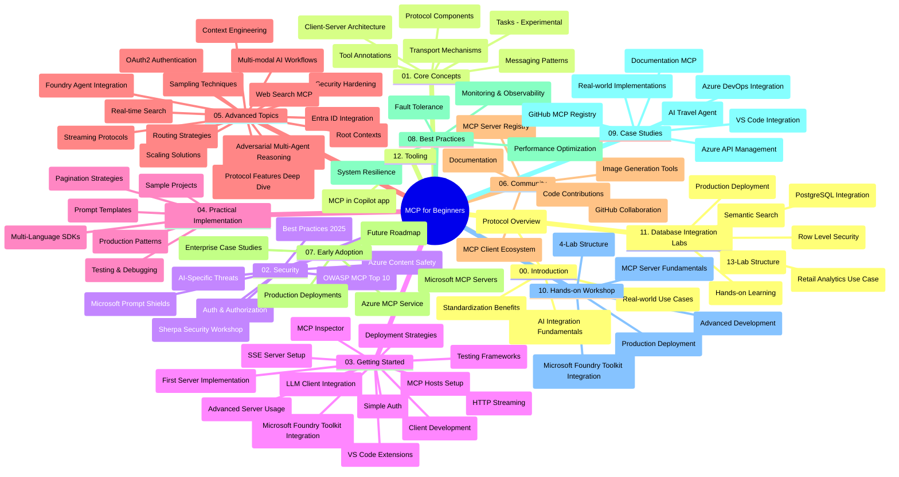

# Model Context Protocol (MCP) for Begyndere - Studieguide

Denne studieguide giver et overblik over lagerstrukturen og indholdet for læseplanen "Model Context Protocol (MCP) for Begyndere". Brug denne guide til effektivt at navigere i lageret og få mest muligt ud af de tilgængelige ressourcer.

## Lageroversigt

Model Context Protocol (MCP) er en standardiseret ramme for interaktioner mellem AI-modeller og klientapplikationer. Oprindeligt oprettet af Anthropic vedligeholdes MCP nu af det bredere MCP-fællesskab gennem den officielle GitHub-organisation. Dette lager indeholder en omfattende læseplan med praktiske kodeeksempler i C#, Java, JavaScript, Python og TypeScript, designet til AI-udviklere, systemarkitekter og softwareingeniører.

## Visuelt Læseplanskort

## Lagerstruktur

Lageret er organiseret i tolv hovedsektioner, der hver fokuserer på forskellige aspekter af MCP:

1. **Introduktion (00-Introduction/)**
   - Oversigt over Model Context Protocol
   - Hvorfor standardisering er vigtigt i AI-pipelines
   - Praktiske anvendelsestilfælde og fordele

2. **Kernebegreber (01-CoreConcepts/)**
   - Client-server arkitektur
   - Centrale protokolkomponenter
   - Messaging-mønstre i MCP
   - Nuværende specifikation: [What's Changed in MCP: The 2026-07-28 Specification](./01-CoreConcepts/mcp-2026-07-28.md) — den statsløse protokolkerne, Extensions framework og udfasning af Roots/Sampling/Logging

3. **Sikkerhed (02-Security/)**
   - Sikkerhedstrusler i MCP-baserede systemer
   - Best Practices for sikring af implementeringer
   - Strategier for autentificering og autorisation
   - Hands-on [CIMD og DCR autorisations-eksempel](./02-Security/samples/cimd-dcr-auth/README.md)
   - **Omfattende sikkerhedsdokumentation**:
     - MCP Sikkerheds Best Practices
     - Azure Content Safety Implementeringsvejledning
     - MCP Sikkerhedskontroller og teknikker
     - MCP Best Practices Quick Reference
   - **Vigtige sikkerhedsemner**:
     - Prompt-injektion og værktøjsforgiftning
     - Session hijacking og confused deputy problemer
     - Token passthrough-sårbarheder
     - Overdrevne tilladelser og adgangskontrol
     - Supply chain sikkerhed for AI-komponenter
     - Microsoft Prompt Shields integration

4. **Kom godt i gang (03-GettingStarted/)**
   - Miljøopsætning og konfiguration
   - Oprettelse af grundlæggende MCP-servere og klienter
   - Integration med eksisterende applikationer
   - Indeholder sektioner for:
     - Første serverimplementering
     - Klientudvikling
     - LLM klient integration
     - VS Code integration
     - Server-Sent Events (SSE) server
     - Avanceret serverbrug
     - HTTP streaming
    - Microsoft Foundry Toolkit integration
     - Teststrategier
     - Deployeringsvejledninger

5. **Praktisk implementering (04-PracticalImplementation/)**
   - Brug af SDK'er på tværs af forskellige programmeringssprog
   - Debugging, test og valideringsteknikker
   - Udformning af genanvendelige promptskabeloner og arbejdsflows
   - Eksempelprojekter med implementeringseksempler

6. **Avancerede emner (05-AdvancedTopics/)**
   - Teknikker til kontekst-engineering
   - Foundry agent integration
   - Multi-modal AI arbejdsflows
   - OAuth2 autentificeringsdemoer
   - Real-time søgefunktioner
   - Real-time streaming
   - Implementering af root contexts
   - Routing-strategier
   - Samplingsteknikker
   - Skaleringsmetoder
   - Sikkerhedsovervejelser
   - Entra ID sikkerhedsintegration
   - Webbrowsersøgning integration
   - Adversarial multi-agent ræsonnement (debattémønstre)

7. **Fællesskabsbidrag (06-CommunityContributions/)**
   - Hvordan bidrage med kode og dokumentation
   - Samarbejde via GitHub
   - Fællesskabsdrevne forbedringer og feedback
   - Brug af forskellige MCP-klienter (Claude Desktop, Cline, VSCode)
   - Arbejde med populære MCP-servere inklusive billedgenerering

8. **Erfaringer fra tidlig adoption (07-LessonsfromEarlyAdoption/)**
   - Implementeringer i praksis og succeshistorier
   - Bygning og udrulning af MCP-baserede løsninger
   - Tendenser og fremtidig køreplan
   - **Microsoft MCP Server Guide**: Omfattende guide til 10 produktionsklare Microsoft MCP servere inklusive:
     - Microsoft Learn Docs MCP Server
     - Azure MCP Server (15+ specialiserede connectors)
     - GitHub MCP Server
     - Azure DevOps MCP Server
     - MarkItDown MCP Server
     - SQL Server MCP Server
     - Playwright MCP Server
     - Dev Box MCP Server
     - Microsoft Foundry MCP Server
     - Microsoft 365 Agents Toolkit MCP Server

9. **Best Practices (08-BestPractices/)**
   - Performance tuning og optimering
   - Design af fejltolerante MCP-systemer
   - Test- og modstandsdygtighedsstrategier

10. **Case Studier (09-CaseStudy/)**
    - **Syv omfattende cases** der demonstrerer MCP's alsidighed på tværs af forskellige scenarier:
    - **Azure AI Rejseagenter**: Multi-agent orkestrering med Azure OpenAI og AI Search
    - **Azure DevOps Integration**: Automatisering af arbejdsflows med YouTube dataopdateringer
    - **Real-Time Dokumentation Retrieval**: Python konsolklient med streaming HTTP
    - **Interaktiv Studieplangenerator**: Chainlit webapp med samtale-AI
    - **In-Editor Dokumentation**: VS Code integration med GitHub Copilot workflows
    - **Azure API Management**: Enterprise API-integration med MCP server oprettelse
    - **GitHub MCP Registry**: Økosystemudvikling og agentisk integrationsplatform
    - Implementeringseksempler der spænder over enterprise-integration, udviklerproduktivitet og økosystemudvikling

11. **Hands-on Workshop (10-StreamliningAIWorkflowsBuildingAnMCPServerWithAIToolkit/)**
    - Omfattende hands-on workshop der kombinerer MCP med Microsoft Foundry Toolkit
    - Opbygning af intelligente applikationer der forbinder AI-modeller med virkelige værktøjer
    - Praktiske moduler der dækker grundlæggende, brugerdefineret serverudvikling og produktionsdeployering
    - **Lab Struktur**:
      - Lab 1: MCP Server Grundlæggende
      - Lab 2: Avanceret MCP Server Udvikling
      - Lab 3: Microsoft Foundry Toolkit Integration
      - Lab 4: Produktionsdeployering og scaling
    - Lab-baseret læringsmetode med trin-for-trin instruktioner

12. **MCP Server Database Integrations Labs (11-MCPServerHandsOnLabs/)**
    - **Omfattende 13-labs læringssti** til opbygning af produktionsklare MCP-servere med PostgreSQL integration
    - **Virkelighedsnær detailanalyse implementering** brugende Zava Retail use case
    - **Enterprise-grade mønstre** inklusive Row Level Security (RLS), semantisk søgning og multi-tenant dataadgang
    - **Komplet lab-struktur**:
      - **Labs 00-03: Grundlag** - Introduktion, Arkitektur, Sikkerhed, Miljøopsætning
      - **Labs 04-06: Opbygning af MCP Server** - Database Design, MCP Server Implementering, Værktøjsudvikling
      - **Labs 07-09: Avancerede Funktioner** - Semantisk Søgning, Test & Debugging, VS Code Integration
      - **Labs 10-12: Produktion & Best Practices** - Deployering, Overvågning, Optimering
    - **Teknologier dækket**: FastMCP framework, PostgreSQL, Azure OpenAI, Azure Container Apps, Application Insights
    - **Læringsresultater**: Produktionsklare MCP-servere, databaseintegrationsmønstre, AI-drevet analyse, enterprisesikkerhed

13. **Værktøjer (12-tooling/)**
    - Lær hvordan du bruger MCP i Copilot app og andre værktøjer

## Yderligere ressourcer

Lageret indeholder understøttende ressourcer:

- **Billedmappe**: Indeholder diagrammer og illustrationer brugt gennem hele læseplanen
- **Oversættelser**: Flersproget support med automatiserede oversættelser af dokumentation
- **Officielle MCP Ressourcer**:
  - [MCP Dokumentation](https://modelcontextprotocol.io/)
  - [MCP Specifikation](https://modelcontextprotocol.io/specification/2026-07-28/)
  - [MCP GitHub Repository](https://github.com/modelcontextprotocol)

## Sådan bruger du dette lager

1. **Sekventiel læring**: Følg kapitlerne i rækkefølge (00 til 11) for en struktureret læringsoplevelse.
2. **Sprog-specifik fokus**: Hvis du er interesseret i et bestemt programmeringssprog, udforsk samples-mapperne for implementeringer i dit foretrukne sprog.
3. **Praktisk implementering**: Start med "Kom godt i gang"-sektionen for at sætte dit miljø op og oprette din første MCP-server og klient.
4. **Avanceret udforskning**: Når du er tryg med det grundlæggende, dyk ned i de avancerede emner for at udvide din viden.
5. **Fællesskabsengagement**: Deltag i MCP-fællesskabet via GitHub-diskussioner og Discord-kanaler for at forbinde med eksperter og andre udviklere.

## MCP Klienter og Værktøjer

Læseplanen dækker forskellige MCP klienter og værktøjer:

1. **Officielle klienter**:
   - Visual Studio Code
   - MCP i Visual Studio Code
   - Claude Desktop
   - Claude i VSCode
   - Claude API

2. **Fællesskabsklienter**:
   - Cline (terminal-baseret)
   - Cursor (kode-editor)
   - ChatMCP
   - Windsurf

3. **MCP Management Værktøjer**:
   - MCP CLI
   - MCP Manager
   - MCP Linker
   - MCP Router

## Populære MCP Servere

Lageret introducerer forskellige MCP servere, inklusive:

1. **Officielle Microsoft MCP Servere**:
   - Microsoft Learn Docs MCP Server
   - Azure MCP Server (15+ specialiserede connectors)
   - GitHub MCP Server
   - Azure DevOps MCP Server
   - MarkItDown MCP Server
   - SQL Server MCP Server
   - Playwright MCP Server
   - Dev Box MCP Server
   - Microsoft Foundry MCP Server
   - Microsoft 365 Agents Toolkit MCP Server

2. **Officielle reference-servere**:
   - Filesystem
   - Fetch
   - Memory
   - Sequential Thinking

3. **Billedgenerering**:
   - Azure OpenAI DALL-E 3
   - Stable Diffusion WebUI
   - Replicate

4. **Udviklingsværktøjer**:
   - Git MCP
   - Terminal Control
   - Code Assistant

5. **Specialiserede servere**:
   - Salesforce
   - Microsoft Teams
   - Jira & Confluence

## Bidrag

Dette lager byder velkommen til bidrag fra fællesskabet. Se sektionen Fællesskabsbidrag for vejledning om, hvordan du effektivt bidrager til MCP-økosystemet.

----

*Denne studieguide blev sidst opdateret den 9. september 2026. Den afspejler MCP
Specifikation `2026-07-28`, den aktuelle protokolrevision. Nogle hands-on
eksempler forbliver eksplicit versionsbestemte til `2025-11-25`, mens deres SDK'er og værktøjer
vedtager de statsløse protokol-API'er.*

---

<!-- CO-OP TRANSLATOR DISCLAIMER START -->
**Ansvarsfraskrivelse**:
Dette dokument er blevet oversat ved hjælp af AI-oversættelsestjenesten [Co-op Translator](https://github.com/Azure/co-op-translator). Selvom vi bestræber os på nøjagtighed, skal du være opmærksom på, at automatiserede oversættelser kan indeholde fejl eller unøjagtigheder. Det originale dokument på dets oprindelige sprog bør betragtes som den autoritative kilde. For kritisk information anbefales professionel menneskelig oversættelse. Vi påtager os intet ansvar for misforståelser eller fejltolkninger, der opstår som følge af brugen af denne oversættelse.
<!-- CO-OP TRANSLATOR DISCLAIMER END -->