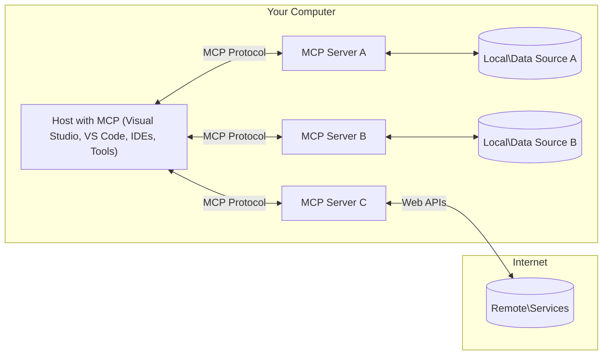

# MCP põhikontseptsioonid: mudelikonteksti protokolli valdamine tehisintellekti integreerimiseks

[](https://youtu.be/earDzWGtE84)

_(Klõpsake ülaloleval pildil, et vaadata selle õppetunni videot)_

The [Mudeli konteksti protokoll (MCP)](https://github.com/modelcontextprotocol) on võimas, standardiseeritud raamistik, mis optimeerib suhtlust suurte keelemudelite (LLM-ide) ning väliste tööriistade, rakenduste ja andmeallikate vahel. 
See juhend tutvustab MCP põhikontseptsioone. Sa õpid selle kliendi-serveri arhitektuuri, oluliste komponentide, kommunikatsioonimehhanismide ja rakenduse parimate praktikate kohta.

- **Kasutaja kontroll ja nõusolek**: Hostid peaksid selgelt näitama, milliseid andmeid ja tööriistu
  server avaldab, lubama kasutajatel toiminguid keelata ning saada selgesõnalist kinnitust
  tundlike või oluliste toimingute puhul. MCP ei nõua kinnitusdialoogi
  enne iga tööriista kutsumist.

- **Andmete privaatsuse kaitse**: Kasutaja andmeid avaldatakse ainult selgesõnalise nõusoleku korral ja need peavad olema kaitstud tugeva juurdepääsukontrolliga kogu suhtluse elutsükli vältel. Rakendused peavad takistama loata andmete edastamist ja hoidma ranget privaatsuse piire.

- **Tööriistade täitmise turvalisus**: Hostid peaksid tegema tööriista kutsed nähtavaks ning
  tagama, et inimene saaks neid keelata. Tundlikud toimingud peaksid kuvama tööriista sisendid
  ja mõju enne täitmist, koos turvapiirangutega, mis takistavad ettenägematut
  või pahatahtlikku tegevust.

- **Ülekande turvalisus**: Kaugühendused peaksid kasutama HTTPS-i ja MCP
  autoriseerimismudelit. Kohalikud stdio-serverid tuginevad protsessi isolatsioonile, usaldusväärsele
  konfiguratsioonile ja pärandatud volituste turvalisele käsitlemisele.

#### Rakendamise juhised:

- **Õiguste haldamine**: Rakendage peenhäälestatud õigussüsteeme, mis võimaldavad kasutajatel kontrollida, millised serverid, tööriistad ja ressursid on kättesaadavad
- **Autentimine & autoriseerimine**: Kasutage turvalisi autentimismeetodeid (OAuth, API-võtmed) koos nõuetekohase tokenite haldamise ja aegumisega  
- **Sisendi valideerimine**: Valideerige kõiki parameetreid ja andmesisendeid vastavalt määratletud skeemidele, et vältida süstimisrünnakuid
- **Auditilogimine**: Hoidke kõigist toimingutest põhjalikke logisid turvajälgimise ja vastavuse tagamiseks

## Ülevaade

See õppetund uurib Mudeli konteksti protokolli (MCP) ökosüsteemi põhistruktuuri ja komponente. Sa õpid kliendi-serveri arhitektuuri, peamisi komponente ning kommunikatsioonimehhanisme, mis toetavad MCP interaktsioone.

## Olulised õpieesmärgid

Selle õppetunni lõpuks sa:

- Mõista MCP kliendi-serveri arhitektuuri.
- Tuvastada hostide, klientide ja serverite rollid ja vastutused.
- Analüüsida põhiomadusi, mis teevad MCP-st paindliku integratsioonikihi.
- Õppida, kuidas informatsioon voolab MCP ökosüsteemis.
- Saada praktilisi teadmisi .NET, Java, Python ja JavaScripti koodinäidete kaudu.

## MCP arhitektuur: põhjalikum ülevaade

MCP ökosüsteem on üles ehitatud kliendi-serveri mudelile. See modulaarne struktuur võimaldab tehisintellekti rakendustel tõhusalt suhelda tööriistade, andmebaaside, API-de ja kontekstuaalsete ressurssidega. Vaatleme seda arhitektuuri selle põhikomponentide kaupa.

MCP keskne lähenemine järgib kliendi-serveri arhitektuuri, kus host-rakendus saab ühendada mitme serveriga:



- **MCP Hostid**: Programmid nagu VSCode, Claude Desktop, IDE-d või AI tööriistad, mis soovivad MCP kaudu andmetele ligi pääseda
- **MCP kliendid**: Protokolli komponendid, mis hoiavad üht loogilist suhet
  serveriga; MCP `2026-07-28` päringud ei sõltu ühest püsivast
  ühendusest ega sessioonist
- **MCP serverid**: Kerged programmid, mis igaüks pakuvad konkreetseid võimekusi läbi standardiseeritud Mudeli konteksti protokolli
- **Kohalikud andmeallikad**: Teie arvuti failid, andmebaasid ja teenused, millele MCP serverid saavad turvaliselt ligi pääseda
- **Kaugteenused**: Välissüsteemid, mis on saadaval üle interneti ja millega MCP serverid saavad API-de kaudu ühenduda.

The MCP Protocol is an evolving standard using date-based versioning
(YYYY-MM-DD vormingus). Praegune protokolli versioon on **2026-07-28**. Vaata
[2026-07-28 protokolli spetsifikatsioon](https://modelcontextprotocol.io/specification/2026-07-28/).

> **Praegune väljaanne:** MCP `2026-07-28` muudab protokolli transportkihi tasandil olekuta
> transportkihi tasandil, eemaldades `initialize` käepigistuse ja protokolli tasandi
> seanssi-IDsid. Samuti formaliseerib see laienduste raamistikku ja deprekeerib
> Roots, Sampling ja Logging uute mustrite kasuks. Vaata
> [Mis muutus MCP-s: 2026-07-28 spetsifikatsioon](./mcp-2026-07-28.md)
> täieliku ülevaate ja migratsiooni juhiste jaoks. Näited, mis otseselt sihivad
> `2025-11-25` jäetakse alles pärandühilduvuse õppetundidena.

### 1. Hostid

In the Model Context Protocol (MCP), **Hostid** on tehisintellekti rakendused, mis toimivad peamise liidesena, mille kaudu kasutajad protokolliga suhtlevad. Hostid koordineerivad ja haldavad ühendusi mitme MCP serveriga, luues iga serveri ühenduse jaoks pühendatud MCP kliente. Hostide näideteks on:

- **Tehisintellekti rakendused**: Claude Desktop, Visual Studio Code, Claude Code
- **Arenduskeskkonnad**: IDE-d ja koodiredaktorid, millel on MCP integratsioon  
- **Kohandatud rakendused**: Eriotstarbelised tehisintellekti agendid ja tööriistad

**Hostid** on rakendused, mis koordineerivad tehisintellekti mudelitega suhtlust. Need:

- **Orkestreerivad AI-mudeleid**: Käivitavad või suhtlevad LLM-idega, et genereerida vastuseid ja koordineerida tehisintellekti töövooge
- **Haldavad kliendisuhteid**: Loovad ja haldavad ühte MCP klienti iga MCP
  serveri jaoks, mida host kasutab
- **Kasutajaliidese juhtimine**: Haldavad vestluse kulgu, kasutajate interaktsioone ja vastuste kuvamist  
- **Rakendavad turvalisust**: Kontrollivad õigusi, turvakitsendusi ja autentimist
- **Kasutaja nõusoleku käsitlemine**: Haldavad kasutaja heakskiitu andmete jagamiseks ja tööriistade käivitamiseks


### 2. Kliendid

**Kliendid** on protokolli komponendid, mida host loob konkreetsete MCP
serverite jaoks. See on loogiline ühe-ühele suhe, mitte nõue püsiva võrguühenduse jaoks.
püsiva võrguühenduse jaoks. MCP `2026-07-28` versioonis on iga päring iseseisev
ning seda võib töödelda ükskõik milline serveri eksemplar.

**Kliendid** on ühenduskomponendid hosti rakenduses. Need:

- **Protokolli suhtlus**: Saadavad JSON-RPC 2.0 päringuid serveritele koos promptide ja juhistega
- **Võimekuste avastamine**: Kasutavad `server/discover`, et teada saada serveri toetatud
  protokolli versioone, võimekusi ja laiendusi
- **Tööriistade täitmine**: Haldavad mudelitelt pärinevaid tööriistade täitmise taotlusi ja töötlevad vastuseid
- **Reaalajas värskendused**: Haldavad serverite teavitusi ja reaalajas uuendusi
- **Vastuse töötlemine**: Töötlevad ja vormindavad serveri vastuseid kasutajatele kuvamiseks

### 3. Serverid

**Serverid** on programmid, mis pakuvad MCP klientidele konteksti, tööriistu ja võimekusi. Need võivad töötada lokaalselt (samas masinas kui host) või kaugelt (välistel platvormidel) ning vastutavad kliendi päringute käsitlemise ja struktureeritud vastuste pakkumise eest. Serverid eksponeerivad konkreetset funktsionaalsust standardiseeritud Model Context Protocoli kaudu.

**Serverid** on teenused, mis pakuvad konteksti ja võimekusi. Need:

- **Funktsioonide registreerimine**: Registreerivad ja eksponeerivad klientidele kättesaadavad primitiivid (ressursid, promptid, tööriistad)
- **Päringute töötlemine**: Võtavad vastu ja täidavad klientide tööriistakutseid, ressursipäringuid ja promptipäringuid
- **Konteksti pakkumine**: Pakuvad kontekstuaalset teavet ja andmeid mudeli vastuste täiustamiseks
- **Oleku haldamine**: Säilitage rakenduse olek edastatavate selgete käepidemete abil
  päringutes vastavalt vajadusele; MCP `2026-07-28` ei oma protokollitaseme sessioone
- **Reaalajas teavitused**: Saada teavitusi funktsioonide muutuste ja uuenduste kohta ühendatud klientidele

Servereid võivad arendada kõik, et laiendada mudeli võimekust spetsialiseerunud funktsionaalsusega, ja need toetavad nii kohalikku kui kaugjuurutust.

### 4. Serveri primitiivid

Serverid Model Context Protocolis (MCP) pakuvad kolme põhielementi **primitiivi**, mis määratlevad alusplokid klientide, hostide ja keelemudelite vaheliste rikkalike interaktsioonide jaoks. Need primitiivid täpsustavad protokolli kaudu kättesaadavad kontekstuaalse teabe ja toimingute tüübid.

MCP serverid võivad avaldada mistahes kombinatsiooni järgmistest kolmest põhielemendist:

#### Ressursid 

**Ressursid** on andmeallikad, mis annavad tehisintellekti rakendustele kontekstuaalset teavet. Need esindavad staatilist või dünaamilist sisu, mis võib parandada mudeli mõistmist ja otsustamist:

- **Kontekstuaalsed andmed**: Struktureeritud teave ja kontekst tehisintellekti mudeli tarbeks
- **Teadmistebaasid**: Dokumendikogud, artiklid, käsiraamatud ja teadustööd
- **Kohalikud andmeallikad**: Failid, andmebaasid ja lokaalse süsteemi teave  
- **Väline andmestik**: API vastused, veebiteenused ja kaugsüsteemide andmed
- **Dünaamiline sisu**: Reaalajas andmed, mis uuenevad sõltuvalt välistingimustest

Ressursid on tuvastatavad URIs ja toetavad avastamist läbi `resources/list` ning pärimist läbi `resources/read` meetodite:

```text
file://documents/project-spec.md
database://production/users/schema
api://weather/current
```

#### Promptid

**Promptid** on korduvkasutatavad mallid, mis aitavad struktureerida suhtlust keelemudelitega. Need pakuvad standardiseeritud interaktsioonimustreid ja mallitöökäike:

- **Mallipõhised interaktsioonid**: Eelstruktureeritud sõnumid ja vestluse alustajad
- **Töökäigu mallid**: Standardiseeritud järjestused tavaliste ülesannete ja interaktsioonide jaoks
- **Few-shot näited**: Näidispõhised mallid mudeli juhendamiseks
- **Süsteemi promptid**: Põhijuhised, mis määravad mudeli käitumise ja konteksti
- **Dünaamilised mallid**: Parameetriseeritud promptid, mis kohanevad konkreetsete kontekstidega

Promptid toetavad muutujate asendamist ja neid saab avastada läbi `prompts/list` ning pärida `prompts/get` abil:

```markdown
Generate a {{task_type}} for {{product}} targeting {{audience}} with the following requirements: {{requirements}}
```

#### Tööriistad

**Tööriistad** on käivitatavad funktsioonid, mida tehisintellekti mudelid võivad kutsuda teatud toimingute tegemiseks. Need kujutavad MCP ökosüsteemi "tegusõnu", võimaldades mudelitel suhelda välissüsteemidega:

- **Käivitatavad funktsioonid**: Eraldiseisvad operatsioonid, mida mudelid saavad kutsuda konkreetsete parameetritega
- **Väliste süsteemide integreerimine**: API kutsed, andmebaasi päringud, failitoimingud, arvutused
- **Ainulaadne identiteet**: Igal tööriistal on eristatav nimi, kirjeldus ja parameetri skeem
- **Struktureeritud I/O**: Tööriistad võtavad vastu valideeritud parameetreid ja tagastavad struktureeritud, tüübistatud vastuseid
- **Toiminguvõimalused**: Võimaldavad mudelitel sooritada reaalmaailma toiminguid ja hankida reaalajas andmeid

Tööriistad on määratletud JSON Schema abil parameetrite valideerimiseks ning neid avastatakse läbi `tools/list` ja täidetakse `tools/call` kaudu. Tööriistad võivad sisaldada parema kasutajaliidese esituse jaoks lisametadatat, näiteks **ikoonid**.

**Tööriista annotatsioonid**: Tööriistad toetavad käitumuslikke annotatsioone (nt `readOnlyHint`, `destructiveHint`), mis kirjeldavad, kas tööriist on ainult-lugemiseks või hävitav, aidates klientidel teha informeeritud otsuseid tööriista täitmisel.

Näide tööriista määratlusest:

```typescript
server.tool(
  "search_products", 
  {
    query: z.string().describe("Search query for products"),
    category: z.string().optional().describe("Product category filter"),
    max_results: z.number().default(10).describe("Maximum results to return")
  }, 
  async (params) => {
    // Execute search and return structured results
    return await productService.search(params);
  }
);
```

## Kliendi primitiivid

Model Context Protocolis (MCP) võivad **kliendid** avaldada primitiive, mis võimaldavad serveritel taotleda hostrakenduselt täiendavaid võimekusi. Need kliendipoolsed primitiivid võimaldavad rikkalikumate ja interaktiivsemate serveri juurutuste loomist, mis saavad kasutada tehisintellekti mudeli võimekusi ja kasutajate interaktsioone.

### Proovivõtmine

> **MCP-s aegunud `2026-07-28`:** Proovivõtmine on ühilduvuse huvides endiselt saadaval,
> kuid uued rakendused peaksid integreeruma otse LLM
> pakkuja API-ga. Seda võib eemaldada esimeses spetsifikatsiooni ülevaates
> avaldatud 28. juulil 2027 või hiljem. Vaata
> [Mis muutus MCP-s: The 2026-07-28 Specification](./mcp-2026-07-28.md).

**Proovivõtmine** võimaldab serveritel taotleda keelemudeli lõppväljundeid kliendi tehisintellekti rakenduselt. See primitiiv võimaldab serveritel juurdepääsu LLM-i võimekusele ilma, et nad peaksid kaasama oma mudeli sõltuvusi:

- **Mudelist sõltumatu juurdepääs**: Serverid saavad taotleda lõpetusi ilma LLM SDK-de lisamiseta või mudeli juurdepääsu haldamata
- **Serveri algatatud tehisintellekt**: Võimaldab serveritel autonoomselt genereerida sisu, kasutades kliendi AI mudelit
- **Rekursiivsed LLM-interaktsioonid**: Toetab keerukaid stsenaariume, kus serveritel on töötlemiseks vaja AI abi
- **Dünaamiline sisu genereerimine**: Võimaldab serveritel luua kontekstuaalseid vastuseid, kasutades hosti mudelit
- **Tööriistade väljakutsumise tugi**: Serverid võivad lisada `tools` ja `toolChoice` parameetreid, et võimaldada kliendi mudelil proovivõtmise ajal tööriistu käivitada

Proovivõtmine kasutab meetodit `sampling/createMessage`, kus serverid taotlevad
lõpetust klientidelt.

### Juured

> **MCP-s aegunud `2026-07-28`:** Juured on ühilduvuse huvides endiselt saadaval,
> kuid uued rakendused peaksid katalooge või faile edastama
> tööriista parameetrite, ressursi URI-de või serveri konfiguratsiooni kaudu. Juured on sobilikud
> eemaldamiseks esimeses spetsifikatsiooni ülevaates
> avaldatud 28. juulil 2027 või hiljem. Vaata
> [Mis muutus MCP-s: The 2026-07-28 Specification](./mcp-2026-07-28.md).

**Juured** pakuvad standardiseeritud viisi, kuidas kliendid saavad tuvastada failisüsteemi
asukohti, mis on serveritele olulised:

- **Failisüsteemi vihjed**: Tuvastavad päringuga seotud kataloogid ja failid
- **Eraldiseisev autoriseerimine**: Ei anna juurdepääsu ega kehtesta turvapiirangut
- **Päringu-spetsiifiline võimekus**: Kliendid teatavad Roots toe olemasolust päringu metaandmetes
- **URI-põhine identifitseerimine**: Juured kasutavad `file://` URI-sid, et identifitseerida ligipääsetavaid katalooge ja faile

MCP `2026-07-28` puhul taotleb server `roots/list` läbi
`InputRequiredResult`, kui ta töötleb toetatud kliendipäringut. Klient
tagastab juured, kui ta proovib seda algset päringut uuesti.

### Info pärimine  

**Info pärimine** võimaldab serveritel kliendi liidese kaudu küsida kasutajatelt täiendavat teavet või kinnitust:

- **Kasutaja sisendi päringud**: Serverid võivad küsida täiendavat teavet, kui see on vajalik tööriista täitmiseks
- **Kinnitusdialoogid**: Taotleda kasutaja heakskiitu tundlike või mõjukaid toimingute jaoks
- **Interaktiivsed töövood**: Võimaldavad serveritel luua samm-sammulisi kasutajainteraktsioone
- **Dünaamiline parameetrite kogumine**: Koguda puuduvad või valikulised parameetrid tööriista täitmise ajal

Info pärimine kasutab meetodit `elicitation/create` sees
`InputRequiredResult`, et koguda kasutaja sisendit kliendi liidese kaudu.

**URL Mode Elicitation**: Serverid võivad samuti nõuda URL-põhiseid kasutajainteraktsioone, võimaldades serveritel suunata kasutajaid välistele veebilehtedele autentimiseks, kinnitamiseks või andmete sisestamiseks.

### Logimine

> **Deprecated in MCP `2026-07-28`:** Logimine jääb ühilduvuse huvides kättesaadavaks
> kuid uued rakendused peaksid kasutama `stderr` koos stdio ja
> OpenTelemetry jaoks struktureeritud jälgitavuse tagamiseks. Logimine võib eemaldamisele kuuluda
> esimeses spetsifikatsiooni läbivaatamises, mis avaldatakse 28. juulil 2027 või hiljem. Vaata
> [Mis on MCP-is muutunud: The 2026-07-28 Specification](./mcp-2026-07-28.md).

**Logimine** võimaldab serveritel saata kliendile struktureeritud logisõnumeid silumiseks, jälgimiseks ja operatiivseks nähtavuseks:

- **Silumise tugi**: võimaldab serveritel anda üksikasjalikke täitmise logisid tõrkeotsingu jaoks
- **Operatiivne jälgimine**: saadab klientidele olekuuuendusi ja jõudlusmõõdikuid
- **Veaaruandlus**: annab üksikasjalikku veakonteksti ja diagnostilist teavet
- **Auditijäljed**: loob põhjalikke logisid serveri toimingutest ja otsustest

Logisõnumeid saadetakse klientidele, et tagada serveri toimingute läbipaistvus ja hõlbustada silumist.

## Teabevoog MCP-is

Model Context Protocol (MCP) määratleb struktureeritud teabevoo hostide, klientide, serverite ja mudelite vahel. Selle voo mõistmine aitab selgitada, kuidas kasutajapäringuid töödeldakse ja kuidas väliseid tööriistu ning andmeallikaid mudeli vastustesse integreeritakse.

- **Host alustab ühenduse loomist**  
  Hosti rakendus (näiteks IDE või vestluse liides) loob ühenduse MCP-serveriga, tavaliselt STDIO, WebSocketi või muu toetatud transpordi kaudu.

- **Võimekuste läbirääkimine**  
  Hosti sisse manustatud klient ja server vahetavad teavet oma toetatud funktsioonide, tööriistade, ressursside ja protokolli versioonide kohta. See tagab, et mõlemad pooled mõistavad, millised võimekused sessiooni jaoks saadaval on.

- **Kasutajapäring**  
  Kasutaja suhtleb hostiga (nt sisestab prompti või käsu). Host kogub selle sisendi ja edastab selle töötlemiseks kliendile.

- **Ressursside või tööriistade kasutamine**  
  - Klient võib serverilt taotleda täiendavat konteksti või ressursse (nt faile, andmebaasi kirjeid või teadmistebaasi artikleid), et rikastada mudeli arusaamist.
  - Kui mudel otsustab, et tööriist on vajalik (nt andmete toomiseks, arvutuse tegemiseks või API kutsumiseks), saadab klient serverile tööriista käivitamise päringu, määrates tööriista nime ja parameetrid.

- **Serveri täitmine**  
  Server võtab vastu ressursi- või tööriistapäringu, täidab vajalikud toimingud (nt funktsiooni käivitamine, andmebaasi päring või faili hankimine) ning tagastab tulemused kliendile struktureeritud vormingus.

- **Vastuse genereerimine**  
  Klient integreerib serveri vastused (ressursside andmed, tööriistaväljundid jne) käimasolevasse mudeliinteraktsiooni. Mudel kasutab seda teavet, et genereerida põhjalik ja kontekstiliselt asjakohane vastus.

- **Tulemuste esitamine**  
  Host saab kliendilt lõpliku väljundi ja esitab selle kasutajale, sageli sisaldades nii mudeli genereeritud teksti kui ka tööriistade täitmise või ressursside otsingu tulemusi.

See voog võimaldab MCP-l toetada arenenud, interaktiivseid ja kontekstiteadlikke tehisintellekti rakendusi, ühendades mudelid sujuvalt väliste tööriistade ja andmeallikatega.

## Protokolli arhitektuur ja kihid

MCP koosneb kahest eristest arhitektuurikihist, mis töötavad koos, et pakkuda täielikku kommunikatsiooniraamistikku:

### Andmekiht

See **Andmekiht** rakendab MCP põhiprotokolli, kasutades alusena **JSON-RPC 2.0**. See kiht määratleb sõnumistruktuuri, semantika ja interaktsioonimustrid:

#### Põhikomponendid:

- **JSON-RPC 2.0 protokoll**: Kõik kommunikatsioon kasutab standardiseeritud JSON-RPC 2.0 sõnumivormingut meetodikõnede, vastuste ja teatiste jaoks
- **Elutsükli haldus**: Haldab ühenduse algatamist, võimekuste läbirääkimisi ja sessiooni lõpetamist klientide ja serverite vahel
- **Serveri primitiivid**: Võimaldab serveritel pakkuda põhifunktsionaalsust tööriistade, ressursside ja promptide kaudu
- **Kliendi primitiivid**: Võimaldab serveritel taotleda LLM-idelt näidiseid, esile kutsuda kasutaja sisendit ja saata logisõnumeid
- **Reaalajas teavitused**: Toetab asünkroonseid teavitusi dünaamiliste uuenduste jaoks ilma päringute tegemiseta

#### Põhifunktsioonid:

- **Protokolli versiooni läbirääkimised**: Kasutab kuupõhist versioonihaldust (YYYY-MM-DD) ühilduvuse tagamiseks
- **Võimekuste avastamine**: Kliendid ja serverid vahetavad initialiseerimisel teavet toetatud funktsioonide kohta
- **Oleku-põhised sessioonid**: Säilitab ühenduse oleku mitme interaktsiooni jooksul konteksti järjepidevuse tagamiseks

### Transportkiht

See **Transportkiht** haldab suhtluskanaleid, sõnumite raamimist ja autentimist MCP osaliste vahel:

#### Toetatud transpordimehhanismid:

1. **STDIO Transport**:
   - Kasutab standardseid sisend-/väljundvooge otseseks protsessidevaheliseks suhtluseks
   - Optimaalne lokaalsete protsesside jaoks samal masinal ilma võrgu lisakuluta
   - Sageli kasutatakse kohalike MCP-serveri rakenduste puhul

2. **Voogedastatav HTTP-transport**:
   - Kasutab HTTP POST-i kliendilt serverile sõnumite saatmiseks  
   - Valikuline Server-Sent Events (SSE) serverilt kliendile voogesituse jaoks
   - Võimaldab kaugserverite vahelist suhtlust võrkude kaudu
   - Toetab standardset HTTP-autentimist (bearer-tokenid, API-võtmed, kohandatud päised)
   - MCP soovitab turvaliseks tokenipõhiseks autentimiseks OAuth-i

#### Transpordi abstraktsioon:

Transportkiht abstraktiseerib suhtlusdetailid andmekihist, võimaldades sama JSON-RPC 2.0 sõnumivormingut kõigi transpordimehhanismide üle. See abstraktsioon võimaldab rakendustel sujuvalt vahetada kohalike ja kaugserverite vahel.

### Turvalisuse kaalutlused

MCP-i rakendused peavad järgima mitut olulist turvapõhimõtet, et tagada turvalised, usaldusväärsed ja kaitstud interaktsioonid kõigi protokolli toimingute jooksul:

- **Kasutaja nõusolek ja kontroll**: Enne andmete juurdepääsu või toimingute sooritamist peavad kasutajad andma selgesõnalise nõusoleku. Neil peaks olema selge kontroll selle üle, milliseid andmeid jagatakse ja millised toimingud on autoriseeritud, toetatuna intuitiivsete kasutajaliidestega tegevuste läbivaatamiseks ja kinnitamiseks.

- **Andmete privaatsus**: Kasutaja andmeid tuleks avalikustada ainult selgesõnalise nõusoleku alusel ning neid tuleb kaitsta sobivate juurdepääsukontrollidega. MCP-i rakendused peavad kaitsema volitamata andmeedastuse eest ja tagama, et privaatsus säiliks kõigi interaktsioonide vältel.

- **Tööriistade ohutus**: Enne mis tahes tööriista käivitamist on vajalik selgesõnaline kasutaja nõusolek. Kasutajad peaksid selgelt mõistma iga tööriista funktsionaalsust ning tugevad turvapiirid peavad olema kehtestatud, et vältida soovimatut või ebaturvalist tööriistade käivitamist.

Nende turvapõhimõtete järgimisega tagab MCP kasutajate usalduse, privaatsuse ja ohutuse säilimise kõigis protokolli interaktsioonides, võimaldades samal ajal võimsaid tehisintellekti integratsioone.

## Koodinäited: võtmekomponendid

Allpool on koodinäited mitmes populaarsemas programmeerimiskeeles, mis demonstreerivad, kuidas rakendada MCP serveri võtmekomponente ja tööriistu.

### .NET näide: lihtsa MCP-serveri loomine tööriistadega

Siin on praktiline .NET koodinäide, mis demonstreerib, kuidas implementeerida lihtsat MCP-serverit kohandatud tööriistadega. See näide näitab, kuidas tööriistu määratleda ja registreerida, päringuid käsitleda ning serveri ühendada Model Context Protocoliga.

```csharp
using System;
using System.Threading.Tasks;
using ModelContextProtocol.Server;
using ModelContextProtocol.Server.Transport;
using ModelContextProtocol.Server.Tools;

public class WeatherServer
{
    public static async Task Main(string[] args)
    {
        // Create an MCP server
        var server = new McpServer(
            name: "Weather MCP Server",
            version: "1.0.0"
        );
        
        // Register our custom weather tool
        server.AddTool<string, WeatherData>("weatherTool", 
            description: "Gets current weather for a location",
            execute: async (location) => {
                // Call weather API (simplified)
                var weatherData = await GetWeatherDataAsync(location);
                return weatherData;
            });
        
        // Connect the server using stdio transport
        var transport = new StdioServerTransport();
        await server.ConnectAsync(transport);
        
        Console.WriteLine("Weather MCP Server started");
        
        // Keep the server running until process is terminated
        await Task.Delay(-1);
    }
    
    private static async Task<WeatherData> GetWeatherDataAsync(string location)
    {
        // This would normally call a weather API
        // Simplified for demonstration
        await Task.Delay(100); // Simulate API call
        return new WeatherData { 
            Temperature = 72.5,
            Conditions = "Sunny",
            Location = location
        };
    }
}

public class WeatherData
{
    public double Temperature { get; set; }
    public string Conditions { get; set; }
    public string Location { get; set; }
}
```

### Java näide: MCP-serveri komponendid

See näide demonstreerib sama MCP-serverit ja tööriistade registreerimist nagu ülaltoodud .NET näites, kuid rakendatuna Java-s.

```java
import io.modelcontextprotocol.server.McpServer;
import io.modelcontextprotocol.server.McpToolDefinition;
import io.modelcontextprotocol.server.transport.StdioServerTransport;
import io.modelcontextprotocol.server.tool.ToolExecutionContext;
import io.modelcontextprotocol.server.tool.ToolResponse;

public class WeatherMcpServer {
    public static void main(String[] args) throws Exception {
        // Create an MCP server
        McpServer server = McpServer.builder()
            .name("Weather MCP Server")
            .version("1.0.0")
            .build();
            
        // Register a weather tool
        server.registerTool(McpToolDefinition.builder("weatherTool")
            .description("Gets current weather for a location")
            .parameter("location", String.class)
            .execute((ToolExecutionContext ctx) -> {
                String location = ctx.getParameter("location", String.class);
                
                // Get weather data (simplified)
                WeatherData data = getWeatherData(location);
                
                // Return formatted response
                return ToolResponse.content(
                    String.format("Temperature: %.1f°F, Conditions: %s, Location: %s", 
                    data.getTemperature(), 
                    data.getConditions(), 
                    data.getLocation())
                );
            })
            .build());
        
        // Connect the server using stdio transport
        try (StdioServerTransport transport = new StdioServerTransport()) {
            server.connect(transport);
            System.out.println("Weather MCP Server started");
            // Keep server running until process is terminated
            Thread.currentThread().join();
        }
    }
    
    private static WeatherData getWeatherData(String location) {
        // Implementation would call a weather API
        // Simplified for example purposes
        return new WeatherData(72.5, "Sunny", location);
    }
}

class WeatherData {
    private double temperature;
    private String conditions;
    private String location;
    
    public WeatherData(double temperature, String conditions, String location) {
        this.temperature = temperature;
        this.conditions = conditions;
        this.location = location;
    }
    
    public double getTemperature() {
        return temperature;
    }
    
    public String getConditions() {
        return conditions;
    }
    
    public String getLocation() {
        return location;
    }
}
```

### Pythoni näide: MCP-serveri ehitamine

See näide kasutab fastmcp, seega palun paigaldage see esmalt:

```python
pip install fastmcp
```
Koodinäide:

```python
#!/usr/bin/env python3
import asyncio
from fastmcp import FastMCP
from fastmcp.transports.stdio import serve_stdio

# Create a FastMCP server
mcp = FastMCP(
    name="Weather MCP Server",
    version="1.0.0"
)

@mcp.tool()
def get_weather(location: str) -> dict:
    """Gets current weather for a location."""
    return {
        "temperature": 72.5,
        "conditions": "Sunny",
        "location": location
    }

# Alternative approach using a class
class WeatherTools:
    @mcp.tool()
    def forecast(self, location: str, days: int = 1) -> dict:
        """Gets weather forecast for a location for the specified number of days."""
        return {
            "location": location,
            "forecast": [
                {"day": i+1, "temperature": 70 + i, "conditions": "Partly Cloudy"}
                for i in range(days)
            ]
        }

# Register class tools
weather_tools = WeatherTools()

# Start the server
if __name__ == "__main__":
    asyncio.run(serve_stdio(mcp))
```

### JavaScripti näide: MCP-serveri loomine

See näide näitab MCP-serveri loomist JavaScriptis ja kuidas registreerida kaks ilmaga seotud tööriista.

```javascript
// Using the official Model Context Protocol SDK
import { McpServer } from "@modelcontextprotocol/sdk/server/mcp.js";
import { StdioServerTransport } from "@modelcontextprotocol/sdk/server/stdio.js";
import { z } from "zod"; // For parameter validation

// Create an MCP server
const server = new McpServer({
  name: "Weather MCP Server",
  version: "1.0.0"
});

// Define a weather tool
server.tool(
  "weatherTool",
  {
    location: z.string().describe("The location to get weather for")
  },
  async ({ location }) => {
    // This would normally call a weather API
    // Simplified for demonstration
    const weatherData = await getWeatherData(location);
    
    return {
      content: [
        { 
          type: "text", 
          text: `Temperature: ${weatherData.temperature}°F, Conditions: ${weatherData.conditions}, Location: ${weatherData.location}` 
        }
      ]
    };
  }
);

// Define a forecast tool
server.tool(
  "forecastTool",
  {
    location: z.string(),
    days: z.number().default(3).describe("Number of days for forecast")
  },
  async ({ location, days }) => {
    // This would normally call a weather API
    // Simplified for demonstration
    const forecast = await getForecastData(location, days);
    
    return {
      content: [
        { 
          type: "text", 
          text: `${days}-day forecast for ${location}: ${JSON.stringify(forecast)}` 
        }
      ]
    };
  }
);

// Helper functions
async function getWeatherData(location) {
  // Simulate API call
  return {
    temperature: 72.5,
    conditions: "Sunny",
    location: location
  };
}

async function getForecastData(location, days) {
  // Simulate API call
  return Array.from({ length: days }, (_, i) => ({
    day: i + 1,
    temperature: 70 + Math.floor(Math.random() * 10),
    conditions: i % 2 === 0 ? "Sunny" : "Partly Cloudy"
  }));
}

// Connect the server using stdio transport
const transport = new StdioServerTransport();
server.connect(transport).catch(console.error);

console.log("Weather MCP Server started");
```

See JavaScripti näide demonstreerib, kuidas luua MCP-server Model Context Protocoli SDK-d kasutades. See näitab, kuidas registreerida kaks tööriista nimega `weatherTool` ja `forecastTool` ning teha need kättesaadavaks MCP klientidele läbi `StdioServerTransport`.

## Turvalisus ja autoriseerimine

MCP sisaldab mitmeid sisseehitatud kontseptsioone ja mehhanisme turvalisuse ja autoriseerimise haldamiseks kogu protokolli ulatuses:

1. **Tööriista õiguste kontroll**:  
  Kliendid saavad määrata, milliseid tööriistu mudel võib kasutada iga päringu või töövoo puhul.
  See tagab, et ainult selgesõnaliselt autoriseeritud tööriistad on kättesaadavad, vähendades
  ebasoovitavate või ebaturvaliste toimingute riski.

2. **Autentimine**:  
  Serverid võivad nõuda autentimist enne tööriistadele, ressurssidele või tundlikele toimingutele ligipääsu andmist. See võib hõlmata API-võtmeid, OAuth-tokeneid või muid autentimisskeeme. Korralik autentimine tagab, et ainult usaldusväärsed kliendid ja kasutajad saavad kutsuda esile serveripoolseid võimalusi.

3. **Valideerimine**:  
  Parameetrite valideerimine on kohustuslik kõigi tööriista kutsumiste puhul. Iga tööriist määratleb oma parameetrite oodatavad tüübid, vormingud ja piirangud ning server valideerib saabuvad päringud vastavalt. See takistab vigaste või pahatahtlike sisendite jõudmist tööriista rakendusteni ja aitab säilitada toimingute terviklikkust.

4. **Taotluste piiramine**:  
  Kuritarvituste vältimiseks ja serveriressursside õiglase kasutamise tagamiseks võivad MCP-serverid
  rakendada tööriistakõnedele ja ressursside juurdepääsule taotluste piiramist. Piiranguid saab
  rakendada kasutaja, mandaadi, toimingu või globaalsel tasandil.

Nende mehhanismide kombineerimisel pakub MCP turvalist alust keelemudelite integreerimiseks väliste tööriistade ja andmeallikatega, andes samal ajal kasutajatele ja arendajatele peenhäälestatud kontrolli juurdepääsu ja kasutuse üle.

## Protokolli sõnumid ja kommunikatsioonivoog

MCP kommunikatsioon kasutab struktureeritud **JSON-RPC 2.0** sõnumeid, et hõlbustada selgeid ja usaldusväärseid interaktsioone hostide, klientide ja serverite vahel. Protokoll määratleb erinevat tüüpi toimingute jaoks konkreetsed sõnumimustrid:

### Põhisõnumite tüübid

#### **Päringu metaandmed ja avastamine**

- **Päringukohtsed metaandmed**: Iga `2026-07-28` päring on iseseisev ja
  sisaldab protokolli versiooni, kliendi identiteeti ja kliendi võimekusi `_meta`.
- **`server/discover` Päring**: Hangib toetatud protokolliversioonid, serveri
  identiteedi, võimekused ja laiendused siis, kui klient neid vajab.
- **Voogedastatavad HTTP-päised**: HTTP-päringud sisaldavad `MCP-Protocol-Version` ja
  `Mcp-Method`; meetodid, mis osutavad nimetatud tööriistale või ressursile, sisaldavad ka
  `Mcp-Name`.

The `initialize`/`initialized` käepigistus ja protokolli tasemel sessiooni ID-d kuuluvad
varasematele protokolli revisjonidele ning ei ole osa MCP `2026-07-28`.

#### **Avastussõnumid**
- **`tools/list` Päring**: Avastab serverist saadaolevad tööriistad
- **`resources/list` Päring**: Loetleb saadaolevad ressursid (andmeallikad)
- **`prompts/list` Päring**: Hangib saadaolevad prompti mallid

#### **Täitmisteatised**  
- **`tools/call` Päring**: Käivitab konkreetse tööriista antud parameetritega
- **`resources/read` Päring**: Hangib sisu konkreetsest ressursist
- **`prompts/get` Päring**: Toob prompti malli koos valikuliste parameetritega

#### **Kliendipoolsed sisendi päringud**

- **`elicitation/create`**: Server küsib kliendi kaudu kasutaja sisendit
  liidese kaudu kliendi päringu töötlemise ajal.
- **`sampling/createMessage`**: Deprekeeritud serveripäring LLM-i vastuse tootmiseks.
- **`roots/list`**: Deprekeeritud serveripäring kliendi failisüsteemi juurtele.

Raames `2026-07-28`, serverist kliendile suunatud sisendipäringud kasutavad mitme vooruga
`InputRequiredResult` mustrit, selle asemel et toetuda püsisessioonile.

#### **Teavitussõnumid**
- **`notifications/tools/list_changed`**: Server teavitab klienti tööriistade muudatustest
- **`notifications/resources/list_changed`**: Server teavitab klienti ressursi muudatustest  
- **`notifications/prompts/list_changed`**: Server teavitab klienti prompti muudatustest

### Sõnumi struktuur:

Kõik MCP sõnumid järgivad JSON-RPC 2.0 vormingut, mis sisaldab:
- **Päringu sõnumid**: Sisaldavad `id`, `method` ja valikulist `params`
- **Vastus sõnumid**: Sisaldavad `id` ja kas `result` või `error`  
- **Teavitussõnumid**: Sisaldavad `method` ja valikulist `params` (ei oodata `id` ega vastust)

See struktureeritud suhtlus tagab usaldusväärsed, jälgitavad ja laiendatavad interaktsioonid, toetades keerukaid stsenaariume nagu reaalaja uuendused, tööriistade järjestamine ja tugev veahaldus.

### Ülesannete laiendus

MCP `2026-07-28` puhul on Tasks ametlik laiendus, mitte eksperimentaalne
põhifunktsioon. See kasutab ümber kujundatud `tasks/get`, `tasks/update` ja
`tasks/cancel` elutsüklit; `tasks/list` eemaldati. Eksperimentaalne
`2025-11-25` Tasks API ei ole selle laiendiga tagurpidiühilduv. Vaata
[Mis on MCP-is muutunud: The 2026-07-28 Specification](./mcp-2026-07-28.md).

**Ülesanded** pakuvad püsivaid täitmise ümbriseid edasilükatud tulemuste hankimiseks ja
oleku jälgimiseks:

- **Pikaajalised operatsioonid**: Jälgivad ressursimahukaid arvutusi, töövoo automatiseerimist ja partiitöötlust
- **Edasilükatud tulemused**: Kontrolli ülesande olekut ja too tulemused kätte, kui toimingud on lõpetatud
- **Olekute jälgimine**: Jälgib ülesande edenemist läbi määratletud elutsükli staadiumide
- **Mitmeastmelised toimingud**: Toetavad keerukaid töövooge, mis hõlmavad mitut interaktsiooni

Ülesanded ümbritsevad tavalised MCP-päringud, et võimaldada asünkroonseid täitmismustreid toimingute jaoks, mis ei saa kohe lõpule viia.

## Peamised järeldused

- **Arhitektuur**: MCP kasutab kliendi-serveri arhitektuuri, kus hostid haldavad mitu kliendiühendust serveritega
- **Osalised**: Ökosüsteem hõlmab hoste (tehisintellekti rakendused), kliente (protokolli ühendajad) ja servereid (võimekuste pakkujad)
- **Transpordimehhanismid**: kommunikatsioon toetab stdio (kohalik) ja voogedastatavat
  HTTP (kaug); `2026-07-28` eemaldab eraldiseisva GET-i sündmuste voo
- **Põhiprimitiivid**: Serverid eksponeerivad tööriistu (täidetavad funktsioonid), ressursse (andmeallikad) ja prompt'e (mallid)
- **Kliendi primitiivid**: Elicitation toetab kasutajasisendit, samal ajal kui Sampling ja
  Roots säilitatakse ainult deprekeeritud ühilduvuse funktsioonidena
- **Laiendused**: Ametlik Tasks-laiendus pakub kestvaid täitmisümbriseid
  pikaajaliste operatsioonide jaoks
- **Protokolli alused**: Põhineb JSON-RPC 2.0-l ja kuupõhisel versioonihaldusel
  (praegune: `2026-07-28`)
- **Reaalaja võimalused**: Toetab teavitusi dünaamiliste uuenduste ja reaalajas sünkroonimise jaoks
- **Turvalisus ennekõike**: Selge kasutaja nõusolek, andmete privaatsuse kaitse ja turvaline transport on põhinõuded

## Harjutus

Kujundage lihtne MCP-tööriist, mis oleks teie valdkonnas kasulik. Määratlege:
1. Mis nime see tööriist kannaks
2. Milliseid parameetreid see aktsepteeriks
3. Millist väljundit see tagastaks
4. Kuidas mudel võiks seda tööriista kasutada kasutaja probleemide lahendamiseks


---

## Mis järgmiseks

Järgmiseks: [Peatükk 2: Turvalisus](../02-Security/README.md)

Loe [Mis on MCP-is muutunud: 2026-07-28 spetsifikatsioon](./mcp-2026-07-28.md)
migratsioonijuhendina versioonilt `2025-11-25`.

---

<!-- CO-OP TRANSLATOR DISCLAIMER START -->
**Lahtiütlus**:
See dokument on tõlgitud kasutades AI tõlketeenust [Co-op Translator](https://github.com/Azure/co-op-translator). Kuigi me püüdleme täpsuse poole, palun pange tähele, et automatiseeritud tõlgetes võib esineda vigu või ebatäpsusi. Originaaldokument selle emakeeles tuleks pidada autoriteetseks allikaks. Olulise teabe puhul soovitatakse kasutada professionaalset inimtõlget. Me ei vastuta selle tõlkega seotud eksimustest või valesti mõistmistest.
<!-- CO-OP TRANSLATOR DISCLAIMER END -->