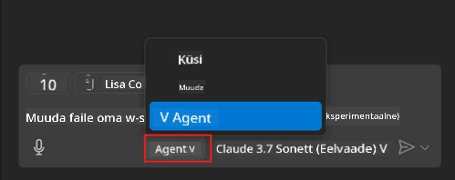
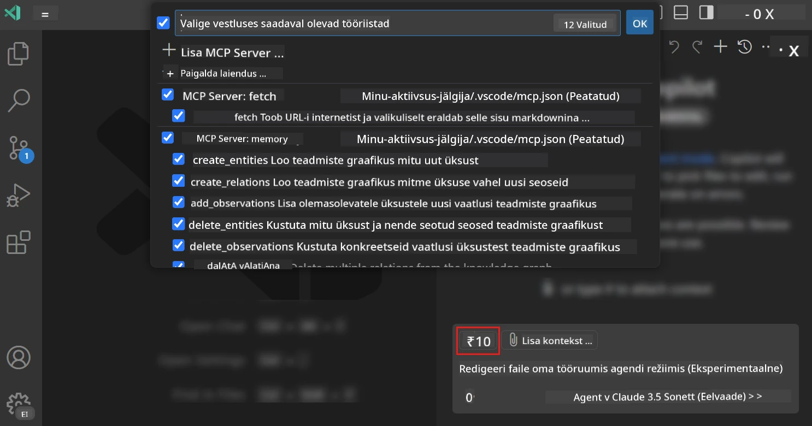
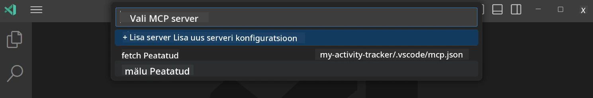
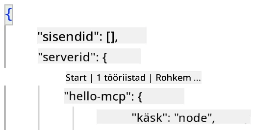
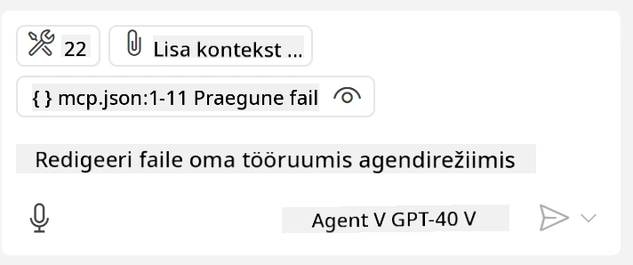
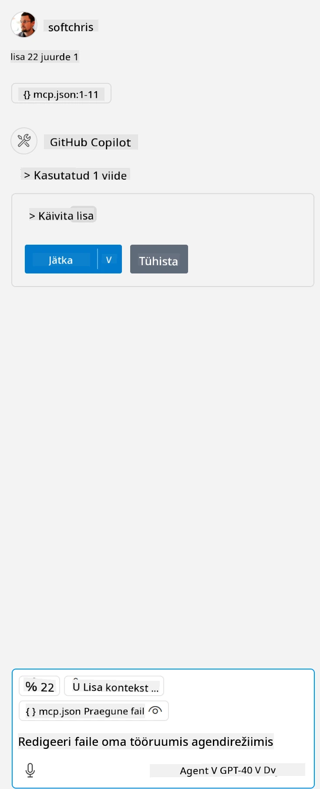

# GitHub Copilot Agendi režiimist serveri kasutamine

Visual Studio Code ja GitHub Copilot võivad toimida kliendina ja tarbida MCP-serverit. Võite küsida, miks me seda tahaksime? See tähendab, et kõik MCP-serveri funktsioonid saab nüüd kasutada otse teie IDE-st. Kujutage ette, et lisate näiteks GitHubi MCP-serveri — see võimaldaks GitHubi juhtimist promptide abil asemel spetsiifiliste käskude tippimisest terminali. Või kujutage ette mida iganes, mis võiks parandada teie arendajakogemust ja mida juhitakse loomuliku keelega. Nüüd hakkab kasu ilmselt selge olema, eks?

## Ülevaade

Selles õppetükis käsitletakse, kuidas kasutada Visual Studio Code'i ja GitHub Copiloti agendi režiimi kliendina teie MCP-serveri jaoks.

## Õpieesmärgid

Selle õppetüki lõpuks oskate:

- Kasutada MCP-serverit Visual Studio Code'i kaudu.
- Käivitada tööriistu ja muid võimekusi GitHub Copiloti kaudu.
- Konfigureerida Visual Studio Code leidma ja haldama teie MCP-serverit.

## Kasutamine

Te saate oma MCP-serverit juhtida kahel erineval viisil:

- Kasutajaliidese kaudu, näete, kuidas seda selles peatükis hiljem tehakse.
- Terminali kaudu, terminalist on võimalik juhtida asju, kasutades `code` käivitatavat programmi:

  MCP-serveri lisamiseks oma kasutajaprofiili kasutage käsureavalikut --add-mcp ja esitage serveri JSON-konfiguratsioon vormingus {\"name\":\"server-name\",\"command\":...}.

  ```
  code --add-mcp "{\"name\":\"my-server\",\"command\": \"uvx\",\"args\": [\"mcp-server-fetch\"]}"
  ```

### Ekraanipildid





Järgnevates jaotistes räägime rohkem, kuidas me visuaalset liidest kasutame.

## Lähenemine

Siin on kõrgetasemeline lähenemine:

- Konfigureerige fail, mis leiab meie MCP-serveri.
- Käivitage/ühenduge nimetatud serveriga, et see loetleks oma võimalused.
- Kasutage nimetatud võimalusi GitHub Copiloti vestlusliidese kaudu.

Suurepärane — nüüd, kui me mõistame voogu, proovime harjutuse käigus MCP-serverit kasutada Visual Studio Code'i kaudu.

## Harjutus: serveri kasutamine

Selles harjutuses konfigureerime Visual Studio Code'i nii, et see leiaks teie MCP-serveri, võimaldades seda kasutada GitHub Copiloti vestlusliidesest.

### -0- Eeltingimus: lubage MCP-serveri avastamine

Võib-olla peate lubama MCP-serverite avastamise.

1. Avage Visual Studio Code'is `File -> Preferences -> Settings`.

1. Otsige "MCP" ja lubage settings.json failis `chat.mcp.discovery.enabled`.

### -1- Loo konfiguratsioonifail

Alustage, luues oma projekti juurkausta konfiguratsioonifaili; teil peab olema fail nimega MCP.json ja see tuleb paigutada kausta .vscode. See peaks välja nägema nii:

```text
.vscode
|-- mcp.json
```

Järgnevalt vaatame, kuidas lisada serverikirjet.

### -2- Konfigureeri server

Lisage järgmine sisu faili *mcp.json*:

```json
{
    "inputs": [],
    "servers": {
       "hello-mcp": {
           "command": "node",
           "args": [
               "build/index.js"
           ]
       }
    }
}
```

Siin on lihtne näide, kuidas alustada Node.js-is kirjutatud serverit; teiste käituskeskkondade puhul näidake sobiv käsk serveri käivitamiseks, kasutades `command` ja `args`.

### -3- Käivitage server

Nüüd, kui olete kirje lisanud, käivitame serveri:

1. Leidke oma kirje failis *mcp.json* ja veenduge, et leiate "esitus" ikooni:

    

1. Klõpsake "esitus" ikooni — peaksite nägema, et tööriistaikoon GitHub Copiloti vestluses suurendab saadaolevate tööriistade arvu. Kui klõpsate nimetatud tööriistaikooni, näete registreeritud tööriistade loendit. Saate iga tööriista märgistada või tühistada sõltuvalt sellest, kas soovite, et GitHub Copilot neid kontekstina kasutaks:

  

1. Tööriista käivitamiseks tippige prompt, mis vastab ühe teie tööriista kirjeldusele; näiteks prompt "liida 22 ja 1":

  

  Te peaksite nägema vastust, mis ütleb 23.

## Ülesanne

Proovige lisada serverikirje faili *mcp.json* ja veenduge, et saate serverit käivitada/peatada. Veenduge ka, et saate suhelda serveri tööriistadega GitHub Copiloti vestlusliidese kaudu.

## Lahendus

[Lahendus](./solution/README.md)

## Peamised järeldused

Selle peatüki peamised järeldused on järgmised:

- Visual Studio Code on suurepärane klient, mis võimaldab teil kasutada mitut MCP-serverit ja nende tööriistu.
- GitHub Copiloti vestlusliides on viis, kuidas serveritega suhelda.
- Võite kasutajalt küsida sisendeid, nagu API-võtmed, mida saab edastada MCP-serverile serverikirjet konfigureerides faili *mcp.json*.

## Näited

- [Java kalkulaator](../samples/java/calculator/README.md)
- [.NET kalkulaator](../../../../03-GettingStarted/samples/csharp)
- [JavaScript kalkulaator](../samples/javascript/README.md)
- [TypeScript kalkulaator](../samples/typescript/README.md)
- [Python kalkulaator](../../../../03-GettingStarted/samples/python)

## Lisamaterjalid

- [Visual Studio dokumentatsioon](https://code.visualstudio.com/docs/copilot/chat/mcp-servers)

## Mis järgmiseks

- Järgmisena: [stdio-serveri loomine](../05-stdio-server/README.md)

---

<!-- CO-OP TRANSLATOR DISCLAIMER START -->
**Lahtiütlus**:
See dokument on tõlgitud kasutades AI tõlketeenust [Co-op Translator](https://github.com/Azure/co-op-translator). Kuigi me püüdleme täpsuse poole, palun pange tähele, et automatiseeritud tõlgetes võib esineda vigu või ebatäpsusi. Originaaldokument selle emakeeles tuleks pidada autoriteetseks allikaks. Olulise teabe puhul soovitatakse kasutada professionaalset inimtõlget. Me ei vastuta selle tõlkega seotud eksimustest või valesti mõistmistest.
<!-- CO-OP TRANSLATOR DISCLAIMER END -->