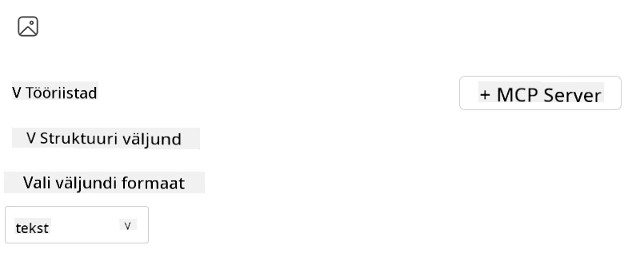
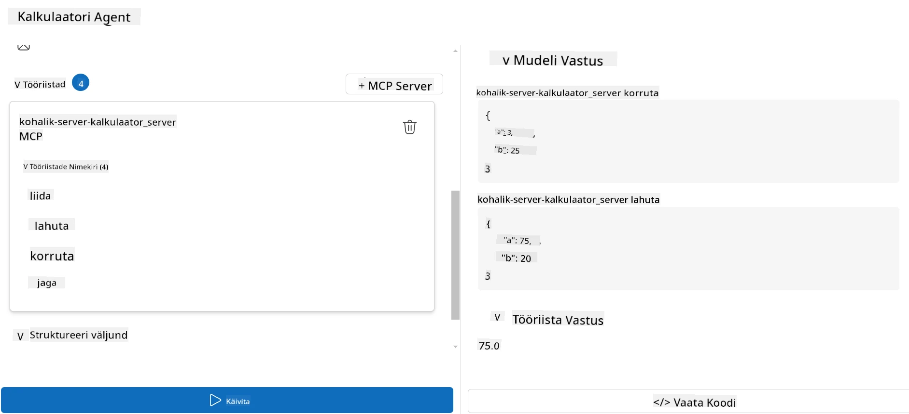

# Serveri kasutamine Microsoft Foundry Toolkit for Visual Studio Code abil

Kui ehitate tehisintellekti agenti, siis ei ole asi ainult nutikate vastuste genereerimises; oluline on ka anda oma agentidele võimalus tegutseda. Selle jaoks on Model Context Protocol (MCP). MCP muudab agentidel väliste tööriistade ja teenuste järjepideva kasutamise lihtsaks. Mõelge sellele nagu agenti ühendamine tööriistakasti, mida ta *tõeliselt* kasutada suudab.

Oletame, et ühendate agendi oma kalkulaatori MCP-serveriga. Äkitselt suudab teie agent teha matemaatilisi tehteid lihtsalt sellise prompti saamisel nagu “What’s 47 times 89?” — pole vaja kõvakoodeerida loogikat ega ehitada kohandatud API-sid.

## Ülevaade

Selles õppetükis käsitletakse, kuidas ühendada kalkulaatori MCP-server agendiga kasutades
[Microsoft Foundry Toolkit for Visual Studio Code](https://aka.ms/AIToolkit),
võimaldades teie agendil sooritada matemaatilisi operatsioone loomuliku keele kaudu.

Microsoft Foundry Toolkit lihtsustab generatiivsete
tehisintellekti rakenduste arendamist ja testimist lokaalsete ja pilves hostitud mudelitega.

*Märkus*: Toolkit toetab praegu Pythoni ja TypeScripti MCP-malle.

## Õpitulemused

Selle õppetüki lõpuks suudate:

- Tarbida MCP-serverit Microsoft Foundry Toolkitiga.
- Konfigureerida agendi seadistust, et võimaldada tal leida ja kasutada MCP-serveri pakutavaid tööriistu.
- Kasutada MCP-tööriistu loomuliku keele abil.

## Lähenemine

Siin on, kuidas me sellele kõrgel tasemel läheneda:

- Loo agent ja määra selle süsteemne prompt.
- Loo MCP-server kalkulaatori tööriistadega.
- Ühenda Agent Builder MCP-serveriga.
- Testi agendi tööriistade kutsumist loomuliku keele kaudu.

Suurepärane — nüüd, kui mõistame protsessi, seadistame tehisintellekti agendi kasutama väliseid tööriistu MCP kaudu, et täiustada selle võimekust!

## Eeltingimused

- [Visual Studio Code](https://code.visualstudio.com/)
- [Microsoft Foundry Toolkit for Visual Studio Code](https://aka.ms/AIToolkit)

## Harjutus: serveri kasutamine

> [!WARNING]
> Märkus macOS-i kasutajatele. Hetkel uurime probleemi, mis mõjutab sõltuvuste paigaldamist macOS-is. Seetõttu ei saa macOS-i kasutajad seda õpetust praegu lõpule viia. Uuendame juhiseid niipea, kui parandus on saadaval. Täname kannatlikkuse ja mõistmise eest!

Selles harjutuses ehitate, käivitate ja täiustate tehisintellekti agenti tööriistade abil
MCP-serverit Visual Studio Code'is, kasutades Microsoft Foundry Toolkiti.

### -0- Eelne samm, lisa Microsoft Foundry GPT-5.1 juurutus

Loo Microsoft Foundry ressurss, juuruta **GPT-5.1** ja lisa juurutus
lisage **My Models**-sse. Vaadake üle
[mudeli eemaldamise ajakava](https://learn.microsoft.com/azure/foundry/openai/concepts/model-retirement-schedule)
juurutuse valimisel.

1. Avage **Microsoft Foundry Toolkit** **Activity Bar**ist.
1. **Catalog** jaotisest valige **Models**, et avada **Model Catalog**. Kui valite **Models**, avatakse **Model Catalog** uues redaktori vahekaardil.
1. Ühendage oma Microsoft Foundry projekt ja valige oma **GPT-5.1** juurutus.
1. Klõpsake **+ Add**, et lisada juurutus oma **My Models** loendisse.
1. Veenduge **Activity Bar**-is, et juurutus kuvatakse loendis.

### -1- Loo agent

**Agent (Prompt) Builder** võimaldab teil luua ja kohandada oma tehisintellekti abil töötavaid agente. Selles jaotises loote uue agendi ja määrate mudeli, mis juhib vestlust.

1. Avage **Microsoft Foundry Toolkit** **Activity Bar**ist.
1. **Tools** jaotisest valige **Agent (Prompt) Builder**. **Agent (Prompt) Builder** valimisel avatakse **Agent (Prompt) Builder** uues redaktori vahekaardil.
1. Klõpsake nuppu **+ New Agent**. Laiend käivitab seadistamisviisardi läbi **Command Palette**.
1. Sisestage nimi **Calculator Agent** ja vajutage **Enter**.
1. **Agent (Prompt) Builder**-is valige oma **GPT-5.1** Foundry juurutus.

### -2- Loo süsteemiprompt agentile

Kui agent on üles seatud, on aeg määratleda selle isiksus ja eesmärk. Selles jaotises kasutate funktsiooni **Generate system prompt**, et kirjeldada agendi kavandatud käitumist — antud juhul kalkulaatoriagent — ja lasta mudelil süsteemprompt teie eest kirjutada.

1. Prompts jaotise jaoks klõpsake nuppu **Generate system prompt**. See nupp avab prompti ehitaja, mis kasutab tehisintellekti agendi jaoks süsteemprompti genereerimiseks.
1. **Generate a prompt** aknas sisestage järgmine: `You are a helpful and efficient math assistant. When given a problem involving basic arithmetic, you respond with the correct result.`
1. Klõpsake nuppu **Generate**. Alumises paremas nurgas kuvatakse teade, mis kinnitab, et süsteemprompti genereeritakse. Kui prompti genereerimine on lõpetatud, ilmub prompt **System prompt** väljale **Agent (Prompt) Builder**-is.
1. Vaadake üle **System prompt** ja muutke vajadusel.

### -3- Loo MCP server

Nüüd, kui olete määratlenud agendi süsteemprompti — mis juhib selle käitumist ja vastuseid — on aeg varustada agent praktiliste võimetega. Selles jaotises loote kalkulaatori MCP-serveri tööriistadega, mis sooritavad liitmise, lahutamise, korrutamise ja jagamise arvutusi. See server võimaldab teie agendil teha reaalajas matemaatilisi operatsioone loodusliku keele sisenditele vastates.



Microsoft Foundry Toolkit sisaldab malle MCP-serverite loomiseks. Me kasutame
Pythoni malli kalkulaatori MCP-serveri jaoks.

*Märkus*: Toolkit toetab praegu Pythonit ja TypeScripti MCP-malle.

1. **Agent (Prompt) Builder**-i **Tools** jaotises klõpsake nuppu **+ MCP Server**. Laiend käivitab seadistamisviisardi läbi **Command Palette**.
1. Valige **+ Add Server**.
1. Valige **Create a New MCP Server**.
1. Valige malliks **python-weather**.
1. Valige salvestamiseks **Default folder** MCP-serveri malli.
1. Sisestage serverile järgmine nimi: **Calculator**
1. Avaneb uus Visual Studio Code'i aken. Valige **Yes, I trust the authors**.
1. Terminalis (**Terminal** > **New Terminal**) looge virtuaalne keskkond: `python -m venv .venv`
1. Terminalis aktiveerige virtuaalne keskkond:
    1. Windows - `.venv\Scripts\activate`
    1. macOS/Linux - `source .venv/bin/activate`
1. Terminalis installige sõltuvused: `pip install -e .[dev]`
1. Activity Bar'i **Explorer** vaates avage **src** kataloog ja valige **server.py**, et avada fail redaktoris.
1. Asendage **server.py** faili kood järgmisega ja salvestage:

    ```python
    """
    Sample MCP Calculator Server implementation in Python.

    
    This module demonstrates how to create a simple MCP server with calculator tools
    that can perform basic arithmetic operations (add, subtract, multiply, divide).
    """
    
    from mcp.server.fastmcp import FastMCP
    
    server = FastMCP("calculator")
    
    @server.tool()
    def add(a: float, b: float) -> float:
        """Add two numbers together and return the result."""
        return a + b
    
    @server.tool()
    def subtract(a: float, b: float) -> float:
        """Subtract b from a and return the result."""
        return a - b
    
    @server.tool()
    def multiply(a: float, b: float) -> float:
        """Multiply two numbers together and return the result."""
        return a * b
    
    @server.tool()
    def divide(a: float, b: float) -> float:
        """
        Divide a by b and return the result.
        
        Raises:
            ValueError: If b is zero
        """
        if b == 0:
            raise ValueError("Cannot divide by zero")
        return a / b
    ```

### -4- Käivitage agent kalkulaatori MCP-serveriga

Nüüd, kui teie agendil on tööriistad, on aeg neid kasutada! Selles jaotises esitate agendile promptid, et testida ja kinnitada, kas agent kasutab sobivat tööriista kalkulaatori MCP-serverist.



Te käivitate kalkulaatori MCP-serveri oma lokaalses arendusmasinas, kasutades **Agent Builder**-it MCP-kliendina.

1. Vajutage `F5`, et alustada MCP-serveri silumist. **Agent (Prompt) Builder** avatakse uues redaktori vahekaardil. Serveri olek on nähtav terminalis.
1. Sisestage **Kasutaja viip** välja **Agendi (Prompt) koostaja** järgmine viip: `I bought 3 items priced at $25 each, and then used a $20 discount. How much did I pay?`
1. Klõpsake **Käivita** nuppu, et genereerida agendi vastus.
1. Vaadake üle agendi väljund. Mudel peaks järeldama, et maksisite **$55**.
1. Siin on ülevaade sellest, mis peaks toimuma:
    - Agent valib arvutuse abistamiseks tööriistad **multiply** ja **subtract**.
    - Vastavad `a` ja `b` väärtused määratakse **multiply** tööriistale.
    - Vastavad `a` ja `b` väärtused on määratud **subtract** tööriistale.
    - Iga tööriista vastus on esitatud vastavas **Tööriista vastus**.
    - Mudeli lõplik väljund on esitatud lõplikus **Mudeli vastus**.
1. Esitage täiendavaid viipasid agendi edasiseks testimiseks. Võite muuta olemasolevat viipa väljale **Kasutaja viip** klõpsates ja asendades olemasoleva viiba.
1. Kui olete agendi testimise lõpetanud, saate serveri peatada **terminalis** sisestades **CTRL/CMD+C**, et väljuda.

## Ülesanne

Proovi lisada oma **server.py** faili täiendav tööriista kirje (nt: tagastada arvu ruutjuur). Esita täiendavad päringud, mis nõuaksid agendilt sinu uue tööriista (või olemasolevate tööriistade) kasutamist. Kindlasti taaskäivita server, et laadida äsja lisatud tööriistad.

## Lahendus

[Lahendus](./solution/README.md)

## Peamised järeldused

Selle peatüki peamised järeldused on järgmised:

- Microsoft Foundry Toolkit saab kasutada MCP-servereid ja nende tööriistu.
- Saate lisada MCP-serveritele uusi tööriistu, laiendades agendi võimekust vastamaks muutuvatele nõuetele.
- Microsoft Foundry Toolkit sisaldab MCP-serveri malle kohandatud tööriistade loomiseks.

## Täiendavad ressursid

- [Microsoft Foundry Toolkit dokumentatsioon](https://aka.ms/AIToolkit/doc)

## Mis järgmiseks
- Järgmiseks: [Testimine ja silumine](../08-testing/README.md)

---

<!-- CO-OP TRANSLATOR DISCLAIMER START -->
**Lahtiütlus**:
See dokument on tõlgitud kasutades AI tõlketeenust [Co-op Translator](https://github.com/Azure/co-op-translator). Kuigi me püüdleme täpsuse poole, palun pange tähele, et automatiseeritud tõlgetes võib esineda vigu või ebatäpsusi. Originaaldokument selle emakeeles tuleks pidada autoriteetseks allikaks. Olulise teabe puhul soovitatakse kasutada professionaalset inimtõlget. Me ei vastuta selle tõlkega seotud eksimustest või valesti mõistmistest.
<!-- CO-OP TRANSLATOR DISCLAIMER END -->