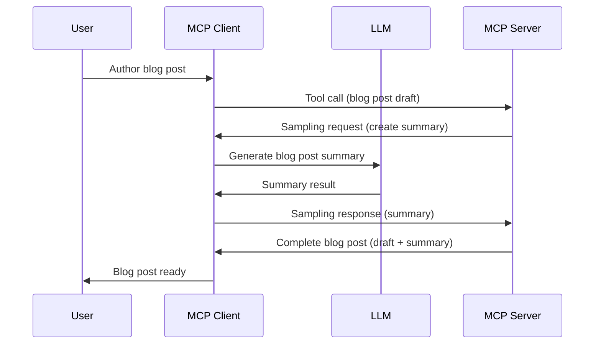

> [!WARNING]
> Sampling on aegunud MCP `2026-07-28`s. See õppetund on säilitatud
> kliendi poolt hallatavalt LLM-ilt. Uued serverid peaksid integreerima otse LLM-iga
> pakkuja API-ga.

# Sampling - delegeeri funktsioonid kliendile

> Sampling on jäänud `2026-07-28` spetsifikatsiooni ühilduvuse säilitamiseks ja on
> eemaldamiseks esimesele muudatusele, mis avaldatakse 28. juulil või hiljem,
> 2027. Selle õppetunni näited võivad kasutada SDK API-sid, mis rakendavad `2025-11-25`.
> Vaata [Mis muutus MCP-s: 2026-07-28 spetsifikatsioon](../../01-CoreConcepts/mcp-2026-07-28.md).

Pärandrakendustes võimaldab Sampling MCP serveril paluda abi kliendi poolt hallatavalt LLM-ilt.
Uute rakenduste puhul kutsuge valitud LLM-pakkujat
otse.

Uurime mõningaid kasutusjuhtumeid ja kuidas ehitada lahendust, mis hõlmab Samplingut.

## Ülevaade

Selles õppetükis keskendume selgitamisele, millal ja kus kasutada Samplingut ning kuidas seda konfigureerida.

## Õpitulemused

Selles peatükis me:

- Selgitame, mis on Sampling ja millal seda kasutada.
- Näitame, kuidas MCP-s Samplingut konfigureerida.
- Anname näiteid, kuidas Sampling töötab praktikas.

## Mis on Sampling ja miks seda kasutada?

Sampling on täiustatud funktsioon, mis töötab järgmiselt:



### Samplingu päring

Nüüd, kui meil on ülevaade usutavast stsenaariumist, räägime serveri kliendile tagasi saadetavast samplingu päringust. Selline päring võib JSON-RPC formaadis välja näha järgmiselt:

```json
{
  "jsonrpc": "2.0",
  "id": 1,
  "method": "sampling/createMessage",
  "params": {
    "messages": [
      {
        "role": "user",
        "content": {
          "type": "text",
          "text": "Create a blog post summary of the following blog post: <BLOG POST>"
        }
      }
    ],
    "modelPreferences": {
      "hints": [
        {
          "name": "gpt-5.1"
        }
      ],
      "intelligencePriority": 0.8,
      "speedPriority": 0.5
    },
    "systemPrompt": "You are a helpful assistant.",
    "maxTokens": 100
  }
}
```

Siin on mõned tähelepanuväärsed punktid:

- Prompt (content -> text) on meie prompt, mis on juhis LLM-ile blogipostituse sisu kokkuvõtmiseks.

- **modelPreferences**. See jaotis on lihtsalt eelistus, soovitus, millist konfiguratsiooni LLM-iga kasutada. Kasutaja võib otsustada, kas järgida neid soovitusi või muuta neid. Selles näites on soovitused mudeli, kiiruse ja intelligentsuse prioriteedi kohta.
- **systemPrompt** — see on tavapärane süsteemi prompt, mis annab teie LLM-ile isikupära ja sisaldab juhiseid.
- **maxTokens** — see on veel üks atribuut, mis määrab, mitut tokenit selle ülesande jaoks soovitatakse kasutada.

### Samplingu vastus

See vastus on see, mida MCP klient lõpuks MCP serverile tagasi saadab ning see on kliendi LLM-ile pöördumise tulemus — klient ootab seda vastust ja koostab seejärel selle sõnumi. JSON-RPC-s võib see välja näha nii:

```json
{
  "jsonrpc": "2.0",
  "id": 1,
  "result": {
    "role": "assistant",
    "content": {
      "type": "text",
      "text": "Here's your abstract <ABSTRACT>"
    },
    "model": "gpt-5.1",
    "stopReason": "endTurn"
  }
}
```

Vastus on blogipostituse kokkuvõte, nagu palutud. Klient
valis serveri mudelieelistusest aktiivse `gpt-5.1` juurutuse;
mudeli-eelistused on soovitused, nii et klient võib valida teise aktiivse
juurutuse, kui vaja.

Nüüd kui mõistame peamist voogu ja kasulikku ülesannet, mille jaoks seda kasutada (blogipostituse loomine + kokkuvõte), vaatame, mida tuleb teha, et see töötaks.

### Sõnumitüübid

Samplingu sõnumid ei piirdu ainult tekstiga — saate saata ka pilte ja heli. JSON-RPC näeb selle jaoks välja järgmiselt:

**Tekst**

```json
{
  "type": "text",
  "text": "The message content"
}
```

**Pildisisu**

```json
{
  "type": "image",
  "data": "base64-encoded-image-data",
  "mimeType": "image/jpeg"
}
```

**Helisisu**

```json
{
  "type": "audio",
  "data": "base64-encoded-audio-data",
  "mimeType": "audio/wav"
}
```

> MÄRKUS: Praeguse staatuse ja migratsiooni juhiste kohta vaata
> [aegunud Samplingu dokumentatsioon](https://modelcontextprotocol.io/specification/2026-07-28/client/sampling).

## Kuidas kliendis Samplingut konfigureerida

> Märkus: kui ehitad ainult serverit, pole siin palju vaja teha.

Kliendis tuleb määratleda järgmine funktsioon järgmiselt:

```json
{
  "capabilities": {
    "sampling": {}
  }
}
```

See võetakse kasutusele, kui valitud klient serveriga initsialiseerub.

## Näide Samplingu kasutamisest - Blogipostituse loomine

Koodime koos sampling-serveri; peame tegema järgmised sammud:

1. Loo serverisse tööriist.
1. See tööriist peaks looma samplingu päringu
1. Tööriist peaks ootama, kuni kliendi samplingu päringule vastatakse.
1. Seejärel toodetakse tööriista tulemus.

Vaatame koodi samm-sammult:

### -1- Loo tööriist

**python**

```python
@mcp.tool()
async def create_blog(title: str, content: str, ctx: Context[ServerSession, None]) -> str:
    """Create a blog post and generate a summary"""

```

### -2- Loo samplingu päring

Täienda oma tööriista järgmise koodiga:

**python**

```python
post = BlogPost(
        id=len(posts) + 1,
        title=title,
        content=content,
        abstract=""
    )

prompt = f"Create an abstract of the following blog post: title: {title} and draft: {content} "

result = await ctx.session.create_message(
        messages=[
            SamplingMessage(
                role="user",
                content=TextContent(type="text", text=prompt),
            )
        ],
        max_tokens=100,
)

```

### -3- Oota vastust ja tagasta vastus

**python**

```python
post.abstract = result.content.text

posts.append(post)

# return the complete product
return json.dumps({
    "id": post.title,
    "abstract": post.abstract
})
```

### -4- Täiskood

**python**

```python
from starlette.applications import Starlette
from starlette.routing import Mount, Host

from mcp.server.fastmcp import Context, FastMCP

from mcp.server.session import ServerSession
from mcp.types import SamplingMessage, TextContent

import json


from uuid import uuid4
from typing import List
from pydantic import BaseModel


mcp = FastMCP("Blog post generator")

# app = FastAPI()

posts = []

class BlogPost(BaseModel):
    id: int
    title: str
    content: str
    abstract: str

posts: List[BlogPost] = []

@mcp.tool()
async def create_blog(title: str, content: str, ctx: Context[ServerSession, None]) -> str:
    """Create a blog post and generate a summary"""

    post = BlogPost(
        id=len(posts) + 1,
        title=title,
        content=content,
        abstract=""
    )

    prompt = f"Create an abstract of the following blog post: title: {title} and draft: {content} "

    result = await ctx.session.create_message(
        messages=[
            SamplingMessage(
                role="user",
                content=TextContent(type="text", text=prompt),
            )
        ],
        max_tokens=100,
    )

    post.abstract = result.content.text

    posts.append(post)

    # return the complete blog post
    return json.dumps({
        "id": post.title,
        "abstract": post.abstract
    })

if __name__ == "__main__":
    print("Starting server...")
    # mcp.run()
    mcp.run(transport="streamable-http")

# run app with: python server.py
```

### -5- Testimine Visual Studio Code'is

Selle testimiseks Visual Studio Code'is tee järgmist:

1. Käivita terminalis server
1. Lisa see faili *mcp.json* (ja veendu, et see on käivitatud), näiteks midagi sellist:

   ```json
   "servers": {
      "blog-server": {
        "type": "http",
        "url": "http://localhost:8000/mcp"
      }
   }
   ```

1. Sisesta prompt:

   ```text
   create a blog post named "Where Python comes from", the content is "Python is actually named after Monty Python Flying Circus"
   ```

1. Luba samplingu toimimine. Kui testid seda esimest korda, kuvatakse lisadialoog, mille pead aktsepteerima; seejärel näed tavalist dialoogi, mis palub tööriista käivitada

1. Kontrolli tulemusi. Näed tulemusi ilusti renderdatuna GitHub Copilot Chatis, aga võid ka vaadata toorest JSON-vastust.

**Boonus**. Visual Studio Code tööriistadel on suurepärane tugi samplingule.  Saad oma installitud serveri Samplingu ligipääsu konfigureerida, minnes sinna järgmiselt:

1. Liigu laienduste jaotisse.
1. Vali jaotises "MCP SERVERS - INSTALLED" oma installitud serveri hammasrattaikoon.
1 Valige "Configure Model Access", siin saate valida, milliseid mudeleid GitHub Copilot võib samplingu tegemisel kasutada. Samuti saate näha kõiki hiljuti toimunud samplingu päringuid, valides "Show Sampling requests".

## Ülesanne

Selles ülesandes ehitate veidi teistsuguse Samplingu, nimelt samplingu integratsiooni, mis toetab tootekirjelduse genereerimist. Siin on teie stsenaarium:

**Scenario**: E-kaubanduse back office töötaja vajab abi — tootekirjelduste genereerimine võtab liiga palju aega. Seetõttu peate ehitama lahenduse, kus kutsutakse tööriista "create_product" argumentidega "title" ja "keywords" ning see peaks tootma täieliku toote, mis sisaldab välja "description", mille peab täitma kliendi LLM.

TIP: kasuta eelnevalt õpitut, et konstrukteerida see server ja selle tööriist samplingu päringu abil.

## Lahendus

[Lahendus](./solution/README.md)

## Peamised järeldused

Sampling on võimas funktsioon, mis võimaldab serveril delegeerida ülesandeid kliendile, kui vaja on LLM-i abi.

## Mis edasi

- [Peatükk 4 - Praktiline rakendamine](../../04-PracticalImplementation/README.md)

---

<!-- CO-OP TRANSLATOR DISCLAIMER START -->
**Lahtiütlus**:
See dokument on tõlgitud kasutades AI tõlketeenust [Co-op Translator](https://github.com/Azure/co-op-translator). Kuigi me püüdleme täpsuse poole, palun pange tähele, et automatiseeritud tõlgetes võib esineda vigu või ebatäpsusi. Originaaldokument selle emakeeles tuleks pidada autoriteetseks allikaks. Olulise teabe puhul soovitatakse kasutada professionaalset inimtõlget. Me ei vastuta selle tõlkega seotud eksimustest või valesti mõistmistest.
<!-- CO-OP TRANSLATOR DISCLAIMER END -->