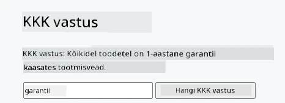
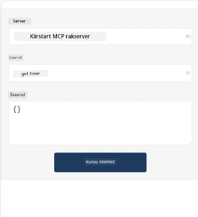
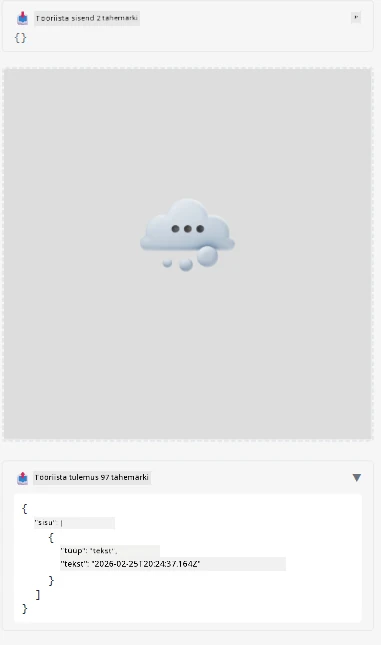

Siin on näide, mis demonstreerib MCP-rakendust

## Paigaldus 

1. Navigeerige kausta *mcp-app*
1. Käivitage `npm install`, see peaks installima frontend- ja backend-sõltuvused

Kinnitage, et backend kompileerub, käivitades:

```sh
npx tsc --noEmit
```

Kui kõik on korras, ei tohiks mingit väljundit olla.

## Käivita backend

> Selleks kulub natuke lisatööd, kui töötate Windowsi masinal, kuna MCP Apps lahendus kasutab käitamiseks `concurrently` teeki, mille jaoks peate leidma asendaja. Siin on problemaatiline rida *package.json*-s MCP rakenduses:

```json
"start": "concurrently \"cross-env NODE_ENV=development INPUT=mcp-app.html vite build --watch\" \"tsx watch main.ts\""
```

Sellel rakendusel on kaks osa: backend-osa ja host-osa.

Käivitage backend, kutsudes:

```sh
npm start
```

See peaks käivitama backendi aadressil `http://localhost:3001/mcp`. 

> Märkus: kui olete Codespace'is, võib teil olla vaja seada pordi nähtavus avalikuks. Kontrollige, et pääsete brauseris lõpp-punktile kaudu https://<name of Codespace>.app.github.dev/mcp

## Valik -1 Testi rakendust Visual Studio Code'is

Lahenduse testimiseks Visual Studio Code'is tehke järgmist:

- Lisage serveri kirje faili `mcp.json` järgmiselt:

    ```json
    {
        "servers": {
            "my-mcp-server-7178eca7": {
                "url": "http://localhost:3001/mcp",
                "type": "http"
            }
        },
        "inputs": []
    }
    ```

1. Klõpsake *mcp.json*-s nuppu "start"
1. Veenduge, et vestlusaken on avatud ja tippige `get-faq`, näete tulemust umbes nii:

    

## Valik -2- Testi rakendust hostiga

Repo <https://github.com/modelcontextprotocol/ext-apps> sisaldab mitmeid erinevaid hoste, mida saate kasutada oma MVP-rakenduste testimiseks. 

Siin esitame teile kaks erinevat võimalust:

### Kohalik masin

- Navigeerige kausta *ext-apps* pärast repo kloonimist.

- Paigaldage sõltuvused

   ```sh
   npm install
   ```

- Teises terminali aknas navigeerige kausta *ext-apps/examples/basic-host*

    > kui olete Codespace'is, peate navigeerima failile serve.ts real 27 ja asendama http://localhost:3001/mcp oma Codespace'i backend'i URL-iga, näiteks https://psychic-xylophone-657rpjgvxpc5g64-3001.app.github.dev/mcp

- Käivitage host:

    ```sh
    npm start
    ```

    See peaks ühendama hosti backendiga ja te peaksite nägema rakendust töötamas umbes nii:

    

### Codespace

Codespace'i keskkonna tööle saamine nõuab veidi lisatööd. Host'i kasutamiseks läbi Codespace'i: 

- Vaadake kataloogi *ext-apps* ja navigeerige *examples/basic-host*. 
- Käivitage `npm install`, et installida sõltuvused
- Käivitage `npm start`, et käivitada host.

## Katsetage rakendust

Proovige rakendust järgmisel viisil:

- Valige nupp "Call Tool" ja peaksite nägema tulemusi järgmiselt:

    

Suurepärane, kõik töötab.

---

<!-- CO-OP TRANSLATOR DISCLAIMER START -->
**Lahtiütlus**:
See dokument on tõlgitud kasutades AI tõlketeenust [Co-op Translator](https://github.com/Azure/co-op-translator). Kuigi me püüdleme täpsuse poole, palun pange tähele, et automatiseeritud tõlgetes võib esineda vigu või ebatäpsusi. Originaaldokument selle emakeeles tuleks pidada autoriteetseks allikaks. Olulise teabe puhul soovitatakse kasutada professionaalset inimtõlget. Me ei vastuta selle tõlkega seotud eksimustest või valesti mõistmistest.
<!-- CO-OP TRANSLATOR DISCLAIMER END -->