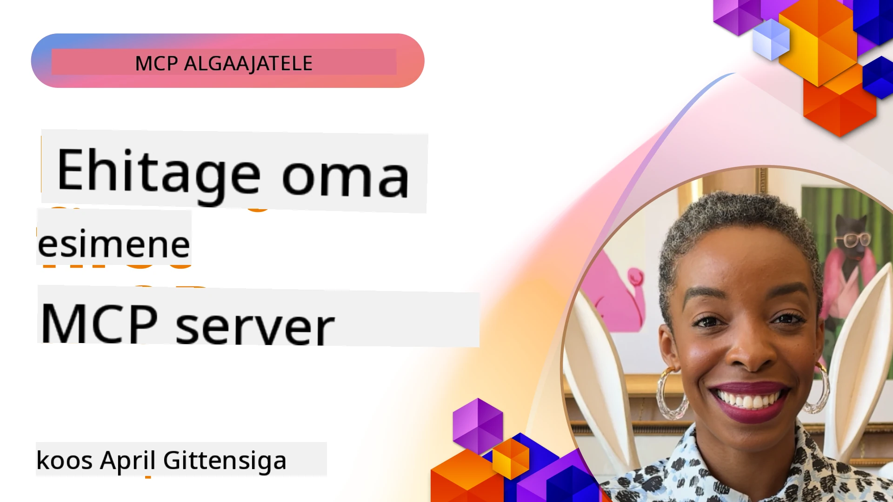

## Alustamine  

_(Klõpsa ülaloleval pildil, et vaadata selle õppetunni videot)_

See jaotis koosneb mitmest õppetükist:

- **1 Sinu esimene server**, selles esimeses õppetükis õpid, kuidas luua oma esimene server ja uurida seda inspector-tööriistaga, mis on väärtuslik viis serveri testimiseks ja silumiseks, [õppetükile](01-first-server/README.md)

- **2 Klient**, selles õppetükis õpid, kuidas kirjutada klienti, mis saab serveriga ühenduda, [õppetükile](02-client/README.md)

- **3 Klient koos LLM-iga**, veel parem viis kliendi kirjutamiseks on lisada sinna LLM, et see saaks serveriga "läbirääkimisi" pidada, mida teha, [õppetükile](03-llm-client/README.md)

- **4 Serveri kasutamine GitHub Copilot Agent režiimis Visual Studio Code'is**. Siin vaatame, kuidas käivitada meie MCP-serverit Visual Studio Code'i sees, [õppetükile](04-vscode/README.md)

- **5 stdio Transport Server** stdio transport on soovitatav standard kohaliku MCP serveri ja kliendi vaheliseks suhtluseks, pakkudes turvalist alamprotsessi-põhist suhtlust sisseehitatud protsessi isolatsiooniga [õppetükile](05-stdio-server/README.md)

- **6 HTTP-voogedastus MCP-iga (Streamable HTTP)**. Õpi standardse
	kaugtransporti in [MCP Specification 2026-07-28](https://modelcontextprotocol.io/specification/2026-07-28/basic/transports/streamable-http),
	n ning õppetükis säilitatud pärandseansipõhist teostust.
	[õppetükile](06-http-streaming/README.md)

- **7 Microsoft Foundry Toolkiti kasutamine Visual Studio Code'is** et tarbida ja testida oma MCP kliente ja servereid [selles õppetükis](07-aitk/README.md)

- **8 Testimine**. Siin keskendume eriti sellele, kuidas saame oma serverit ja klienti erinevatel viisidel testida, [õppetükile](08-testing/README.md)

- **9 Juurutamine**. See peatükk vaatleb erinevaid võimalusi oma MCP lahenduste juurutamiseks, [õppetükile](09-deployment/README.md)

- **10 Täiustatud serverikasutus**. See peatükk käsitleb serveri täiustatud kasutamist, [õppetükile](./10-advanced/README.md)

- **11 Autentimine**. See peatükk selgitab, kuidas lisada lihtsat autentimist, alates Basic Authist kuni JWT ja RBAC kasutamiseni. Soovitame alustada siit ja seejärel vaadata edasi Täiustatud teemasid peatükis 5 ning rakendada täiendavat turvalisuse tugevdamist peatüki 2 soovituste järgi, [õppetükile](./11-simple-auth/README.md)

- **12 MCP Hostid**. Konfigureeri ja kasuta populaarseid MCP host-kliente nagu Claude Desktop, Cursor, Cline ja Windsurf. Õpi transporditüüpe ja tõrkeotsingut, [õppetükile](./12-mcp-hosts/README.md)

- **13 MCP Inspector**. Silu ja testi oma MCP servereid interaktiivselt MCP Inspector tööriista abil. Õpi tõrkeotsingut tööriistade, ressursside ja protokollisõnumite osas, [õppetükile](./13-mcp-inspector/README.md)

- **14 Sampling**. Tutvu pärandilise Sampling-primitiiviga `2025-11-25` ja
	kuidas migreerida uued disainid otse LLM-teenuse pakkuja integratsiooni. Sampling is
	deprecated in MCP `2026-07-28`. [õppetükile](./14-sampling/README.md)

- **15 MCP Apps**. Ehita MCP-servereid, mis vastavad ka UI-juhistega, [õppetükile](./15-mcp-apps/README.md)

Model Context Protocol (MCP) on avatud protokoll, mis standardiseerib, kuidas rakendused edastavad konteksti LLM-idele. Mõelge MCP-le nagu USB-C pistikule AI-rakendustele - see annab standardiseeritud viisi AI-mudelite ühendamiseks erinevate andmeallikate ja tööriistadega.

## Õpieesmärgid

Selle õppetunni lõpuks oskad:

- Seada üles MCP arenduskeskkonnad C#, Java, Pythoni, TypeScripti ja JavaScripti jaoks
- Luua ja juurutada põhitasemel MCP-servereid kohandatud funktsioonidega (ressursid, prompt'id ja tööriistad)
- Loo host-rakendusi, mis ühenduvad MCP-serveritega
- Testida ja siluda MCP-implementatsioone
- Mõista levinud seadistamisprobleeme ja nende lahendusi
- Ühendada oma MCP-implementatsioonid populaarsete LLM-teenustega

## MCP-keskkonna seadistamine

Enne MCP-ga töötamise alustamist on oluline ette valmistada arenduskeskkond ja mõista põhilist töövoogu. See jaotis juhendab sind algseadistuse sammude kaudu, et tagada sujuv algus MCP-iga.

### Eeltingimused

Enne MCP-arendusse süvenemist veendu, et sul on olemas:

- **Arenduskeskkond**: valitud keele jaoks (C#, Java, Python, TypeScript või JavaScript)
- **IDE/redaktor**: Visual Studio, Visual Studio Code, IntelliJ, Eclipse, PyCharm või mõni kaasaegne koodiredaktor
- **Pakihaldurid**: NuGet, Maven/Gradle, pip või npm/yarn
- **API-võtmed**: mistahes AI-teenuste jaoks, mida plaanid kasutada oma host-rakendustes

### Ametlikud SDK-d

Järgnevatel peatükkidel näed lahendusi, mis on ehitatud Pythoniga, TypeScriptiga,
Java ja .NET-iga. Siin on ametlikud SDK-d.

SDK-tugi MCP `2026-07-28` jaoks rakendub keele kaupa sõltumatult.
Enne näite käivitamist kontrolli selle paketi versiooni ja SDK väljalaske märkmeid
toetatud protokolli revisioonide osas. Vaata
[ametlike SDK-de nimekiri](https://modelcontextprotocol.io/docs/sdk):
- [C# SDK](https://github.com/modelcontextprotocol/csharp-sdk) - Hooldatakse koostöös Microsoftiga
- [Java SDK](https://github.com/modelcontextprotocol/java-sdk) - Hooldatakse koostöös Spring AI-ga
- [TypeScript SDK](https://github.com/modelcontextprotocol/typescript-sdk) - Ametlik TypeScripti teostus
- [Python SDK](https://github.com/modelcontextprotocol/python-sdk) - Ametlik Pythoni teostus (FastMCP)
- [Kotlin SDK](https://github.com/modelcontextprotocol/kotlin-sdk) - Ametlik Kotlini teostus
- [Swift SDK](https://github.com/modelcontextprotocol/swift-sdk) - Hooldatakse koostöös Loopwork AI-ga
- [Rust SDK](https://github.com/modelcontextprotocol/rust-sdk) - Ametlik Rusti teostus
- [Go SDK](https://github.com/modelcontextprotocol/go-sdk) - Ametlik Go teostus

## Peamised järeldused

- MCP-arenduskeskkonna seadistamine on lihtne, kasutades keele-spetsiifilisi SDK-sid
- MCP-serverite ehitamine hõlmab tööriistade loomist ja registreerimist selgete skeemidega
- MCP-kliendid ühenduvad serverite ja mudelitega, et kasutada täiendatud võimalusi
- Testimine ja silumine on usaldusväärsete MCP-implementatsioonide jaoks hädavajalikud
- Juurutamise võimalused ulatuvad kohalikust arendusest pilvepõhiste lahendusteni

## Praktika

Meil on komplekt näiteprojekte, mis täiendab harjutusi, mida näed selle jaotise kõigis peatükkides. Lisaks on igal peatükil ka oma harjutused ja ülesanded

- [Java Calculator](./samples/java/calculator/README.md)
- [.NET Calculator](../../../03-GettingStarted/samples/csharp)
- [JavaScript Calculator](./samples/javascript/README.md)
- [TypeScript Calculator](./samples/typescript/README.md)
- [Python Calculator](../../../03-GettingStarted/samples/python)

## Täiendavad ressursid

- [Build Agents using Model Context Protocol on Azure](https://learn.microsoft.com/azure/developer/ai/intro-agents-mcp)
- [Remote MCP with Azure Container Apps (Node.js/TypeScript/JavaScript)](https://learn.microsoft.com/samples/azure-samples/mcp-container-ts/mcp-container-ts/)
- [.NET OpenAI MCP Agent](https://learn.microsoft.com/samples/azure-samples/openai-mcp-agent-dotnet/openai-mcp-agent-dotnet/)

## Mis järgmiseks

Alusta esimesest õppetükist: [Loo oma esimene MCP-server](01-first-server/README.md)

Kui oled selle mooduli lõpetanud, liigu edasi: [Moodul 4: Praktiline rakendamine](../04-PracticalImplementation/README.md)

---

<!-- CO-OP TRANSLATOR DISCLAIMER START -->
**Lahtiütlus**:
See dokument on tõlgitud kasutades AI tõlketeenust [Co-op Translator](https://github.com/Azure/co-op-translator). Kuigi me püüdleme täpsuse poole, palun pange tähele, et automatiseeritud tõlgetes võib esineda vigu või ebatäpsusi. Originaaldokument selle emakeeles tuleks pidada autoriteetseks allikaks. Olulise teabe puhul soovitatakse kasutada professionaalset inimtõlget. Me ei vastuta selle tõlkega seotud eksimustest või valesti mõistmistest.
<!-- CO-OP TRANSLATOR DISCLAIMER END -->