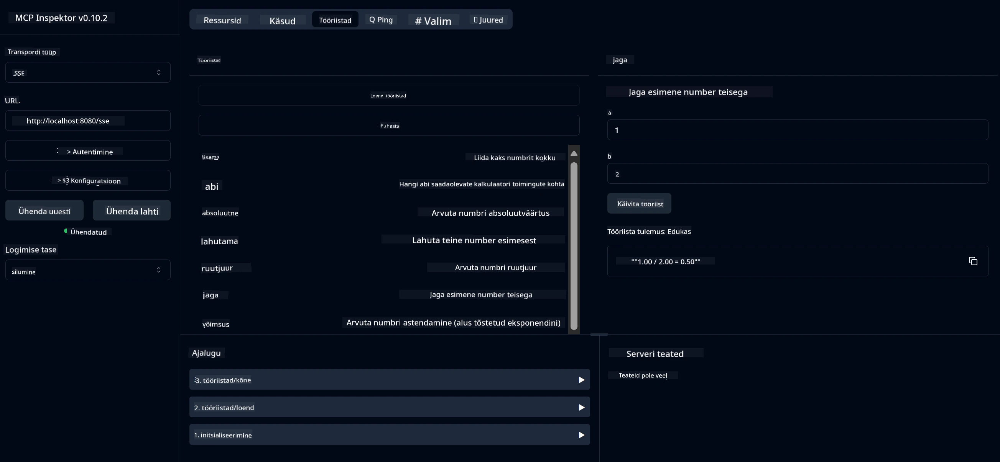

# Põhiline kalkulaatori MCP-teenus

> [!NOTE]
> See näidis kasutab pärandilist HTTP+SSE transporti ja sihib SDK-d, mis on
> MCP `2025-11-25`-ga ühilduv. Uued kaugserverid peaksid kasutama `2026-07-28` Streamable
> HTTP-tuge.

See teenus pakub põhilisi kalkulaatori toiminguid Model Context Protocol (MCP) kaudu, kasutades Spring Booti WebFlux-transporti. See on mõeldud lihtsaks näiteks algajatele, kes õpivad MCP-i rakendusi.

Lisateabe saamiseks vaadake [MCP Server Boot Starter](https://docs.spring.io/spring-ai/reference/api/mcp/mcp-server-boot-starter-docs.html) viitedokumentatsiooni.

## Ülevaade

Teenus demonstreerib:
- Tugi SSE (Server-Sent Events)
- Automaatne tööriistade registreerimine, kasutades Spring AI `@Tool` annotatsiooni
- Põhilised kalkulaatori funktsioonid:
  - Liitmine, lahutamine, korrutamine, jagamine
  - Astendamine ja ruutjuure arvutamine
  - Modulus (jääk) ja absoluutväärtus
  - Abi funktsioon operatsioonide kirjeldamiseks

## Omadused

See kalkulaatori teenus pakub järgmisi võimalusi:

1. **Põhilised aritmeetilised toimingud**:
   - Kaks arvu liitmine
   - Ühe arvu lahutamine teisest
   - Kaks arvu korrutamine
   - Ühe arvu jagamine teisega (kontroll nulliga jagamise jaoks)

2. **Täpsemad toimingud**:
   - Astendamine (aluse tõstmine astendajale)
   - Ruutjuure arvutamine (negatiivsete arvude kontrolliga)
   - Mooduli (jäägi) arvutamine
   - Absoluutväärtuse arvutamine

3. **Abi süsteem**:
   - Sisseehitatud abifunktsioon, mis selgitab kõiki saadaolevaid toiminguid

## Teenuse kasutamine

Teenus avaldab järgmised API lõpp-punktid MCP-protokolli kaudu:

- `add(a, b)`: Lisab kaks arvu kokku
- `subtract(a, b)`: Lahutab teise arvu esimesest
- `multiply(a, b)`: Korrutab kahte arvu
- `divide(a, b)`: Jagab esimest arvu teisega (kontrollib nulliga jagamist)
- `power(base, exponent)`: Arvutab arvu astendamisel saadud väärtuse
- `squareRoot(number)`: Arvutab ruutjuure (negatiivsete arvude kontrolliga)
- `modulus(a, b)`: Arvutab jagamisel jäägi
- `absolute(number)`: Arvutab absoluutväärtuse
- `help()`: Saab teavet saadaolevate toimingute kohta

## Testiklient

Lihtne testiklient on kaasatud paketti `com.microsoft.mcp.sample.client`. Klass `SampleCalculatorClient` demonstreerib kalkulaatori teenuse saadaolevaid toiminguid.

## LangChain4j kliendi kasutamine

Projekt sisaldab LangChain4j näidisklienti kaustas
`com.microsoft.mcp.sample.client.LangChain4jClient`, mis näitab, kuidas
integreerida kalkulaatori teenust Microsoft Foundry mudeliga.

### Eeltingimused

1. Looge Microsoft Foundry ressurss ja juurutage aktiivne mudel, näiteks
   `gpt-5.1`.
2. Määrake mudeli lõpp-punkt, API-võti ja juurutuse nimi:

   ```bash
   export AZURE_OPENAI_ENDPOINT="https://<resource-name>.openai.azure.com"
   export AZURE_OPENAI_API_KEY="<api-key>"
   export AZURE_OPENAI_DEPLOYMENT="gpt-5.1"
   ```

3. Kontrollige
   [Microsoft Foundry mudeli pensioneerimise ajakava](https://learn.microsoft.com/azure/foundry/openai/concepts/model-retirement-schedule)
   enne juurutuse valimist.
4. Veenduge, et kalkulaatori server töötab aadressil `localhost:8080`.

### LangChain4j kliendi käivitamine

See näide demonstreerib:
- Ühendamine kalkulaatori MCP-serveriga SSE-transpordi kaudu
- LangChain4j kasutamine vestlusroboti loomiseks, mis kasutab kalkulaatori toiminguid
- Integreerimine juurutatud Microsoft Foundry mudeliga

Klient saadab järgmised näidispäringud, et demonstreerida funktsionaalsust:
1. Kahe arvu summa arvutamine
2. Arvu ruutjuure leidmine
3. Abiinfo saamine saadaolevate kalkulaatori toimingute kohta

Käivitage näide ja kontrollige konsooli väljundit, et näha, kuidas AI-mudel kasutab kalkulaatori tööriistu päringutele vastamiseks.

### Microsoft Foundry mudeli konfiguratsioon

LangChain4j klient kasutab Azure OpenAI v1-ühilduvat lõpp-punkti, mida eksponeerib
Microsoft Foundry:

```java
String endpoint = System.getenv("AZURE_OPENAI_ENDPOINT");
ChatLanguageModel model = OpenAiOfficialChatModel.builder()
   .baseUrl(endpoint.replaceAll("/+$", "") + "/openai/v1/")
   .apiKey(System.getenv("AZURE_OPENAI_API_KEY"))
   .isAzure(true)
   .modelName(System.getenv().getOrDefault("AZURE_OPENAI_DEPLOYMENT", "gpt-5.1"))
    .timeout(Duration.ofSeconds(60))
    .build();
```

`AZURE_OPENAI_DEPLOYMENT` peab vastama nimele, mis määrati mudeli juurutamisel,
mis võib erineda alusmudeli nimest.

## Sõltuvused

Projekt nõuab järgmisi peamisi sõltuvusi:

```xml
<!-- For MCP Server -->
<dependency>
    <groupId>org.springframework.ai</groupId>
    <artifactId>spring-ai-starter-mcp-server-webflux</artifactId>
</dependency>

<!-- For LangChain4j integration -->
<dependency>
    <groupId>dev.langchain4j</groupId>
    <artifactId>langchain4j-mcp</artifactId>
    <version>${langchain4j.version}</version>
</dependency>

<!-- For Microsoft Foundry's OpenAI-compatible endpoint -->
<dependency>
    <groupId>dev.langchain4j</groupId>
   <artifactId>langchain4j-open-ai-official</artifactId>
    <version>${langchain4j.version}</version>
</dependency>
```

## Projekti koostamine

Ehitage projekt Maveni abil:
```bash
./mvnw clean install -DskipTests
```

## Serveri käivitamine

### Java kasutamine

```bash
java -jar target/calculator-server-0.0.1-SNAPSHOT.jar
```

### MCP Inspectori kasutamine

MCP Inspector on kasulik tööriist MCP-teenustega suhtlemiseks. Selle kasutamiseks selle kalkulaatori teenusega:

1. **Paigaldage ja käivitage MCP Inspector** uues terminaliaknas:
   ```bash
   npx @modelcontextprotocol/inspector
   ```

2. **Avage veebiliides** klõpsates rakenduse poolt kuvamisel kuvatud URL-il (tavaliselt http://localhost:6274)

3. **Konfigureerige ühendus**:
   - Määrake transpordi tüübiks "SSE"
   - Määrake URL oma serveri tööle pandud SSE-lõpp-punktile: `http://localhost:8080/sse`
   - Klõpsake "Connect"

4. **Kasutage tööriistu**:
   - Klõpsake "List Tools", et näha saadaolevaid kalkulaatori toiminguid
   - Valige tööriist ja klõpsake "Run Tool", et teostada toimingut



### Dockeri kasutamine

Projekt sisaldab Dockerfile'i konteineripõhiseks juurutamiseks:

1. **Koostage Dockeri pilt**:
   ```bash
   docker build -t calculator-mcp-service .
   ```

2. **Käivitage Dockeri konteiner**:
   ```bash
   docker run -p 8080:8080 calculator-mcp-service
   ```

See sooritab:
- Koostab mitmeastmelise Dockeri pildi kasutades Maven 3.9.9 ja Eclipse Temurin 24 JDK
- Loob optimeeritud konteineripildi
- Avalikustab teenuse pordil 8080
- Käivitab konteineris MCP kalkulaatori teenuse

Saate teenusele juurde pääseda aadressil `http://localhost:8080`, kui konteiner töötab.

## Tõrkeotsing

### Levinumad mudeli ühenduse probleemid

1. **Autentimisvead**: Kinnitage, et `AZURE_OPENAI_API_KEY` kuulub
   ressursile, mida identifitseerib `AZURE_OPENAI_ENDPOINT`.
2. **Juurutust ei leitud**: Kinnitage, et `AZURE_OPENAI_DEPLOYMENT` täpselt vastab
   Microsoft Foundry'is oleva juurutuse nimele.
3. **Taotluste piiramine**: Kontrollige juurutuse kvotat ja proovige uuesti pärast ajavahemikku
   mida teenus tagastab.

Lisaks abi saamiseks vaadake
[LangChain4j dokumentatsioon](https://github.com/langchain4j/langchain4j) ja
[Microsoft Foundry dokumentatsioon](https://learn.microsoft.com/azure/ai-foundry/).

---

<!-- CO-OP TRANSLATOR DISCLAIMER START -->
**Lahtiütlus**:
See dokument on tõlgitud kasutades AI tõlketeenust [Co-op Translator](https://github.com/Azure/co-op-translator). Kuigi me püüdleme täpsuse poole, palun pange tähele, et automatiseeritud tõlgetes võib esineda vigu või ebatäpsusi. Originaaldokument selle emakeeles tuleks pidada autoriteetseks allikaks. Olulise teabe puhul soovitatakse kasutada professionaalset inimtõlget. Me ei vastuta selle tõlkega seotud eksimustest või valesti mõistmistest.
<!-- CO-OP TRANSLATOR DISCLAIMER END -->