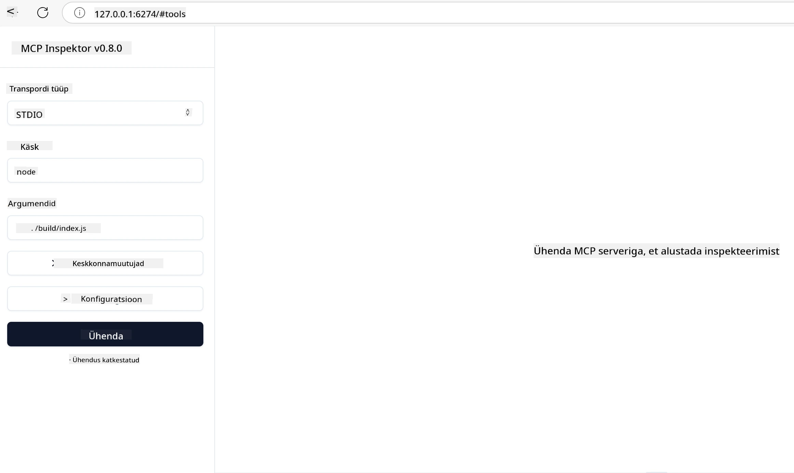

# Praktiline rakendamine

[](https://youtu.be/vCN9-mKBDfQ)

_(Klõpsake ülaloleval pildil, et vaadata selle õppetunni videot)_

Praktiline rakendamine on koht, kus Model Context Protocoli (MCP) jõud muutub käegakatsutavaks. Kuigi MCP teooria ja arhitektuuri mõistmine on oluline, ilmneb tõeline väärtus siis, kui rakendate neid põhimõtteid lahenduste ehitamiseks, testimiseks ja juurutamiseks, mis lahendavad reaalse maailma probleeme. See peatükk ühendab kontseptuaalse teadmise ja praktilise arenduse, juhendades teid läbi protsessi, kuidas MCP-põhiseid rakendusi ellu viia.

Ükskõik, kas arendate nutikaid assistente, integreerite tehisintellekti äriprotsessidesse või loote kohandatud andmetöötlustööriistu, MCP pakub paindlikku alust. Selle keele-agnostiline disain ja ametlikud SDK-d populaarsetele programmeerimiskeeltele teevad selle kättesaadavaks paljudele arendajatele. Nende SDK-de kasutamine võimaldab teil kiiresti luua prototüüpe, iteratsiooni läbi viia ja lahendusi erinevatel platvormidel ning keskkondades skaleerida.

Järgnevas osas leiate praktilisi näiteid, näidiskoodi ja juurutusstrateegiaid, mis demonstreerivad, kuidas rakendada MCP-i C#, Java Springiga, TypeScripti, JavaScripti ja Pythoni abil. Samuti õpite, kuidas siluda ja testida oma MCP servereid, hallata API-sid ning juurutada lahendusi pilve Azure'i kaudu. Need praktilised ressursid on mõeldud teie õppimist kiirendama ja aitama teil enesekindlalt luua tugevaid, tootmiskõlblikke MCP-rakendusi.

## Ülevaade

Selles õppetükis keskendutakse MCP-rakenduse praktilistele aspektidele mitmes programmeerimiskeeles. Uurime, kuidas kasutada MCP SDK-sid C#, Java Springiga, TypeScripti, JavaScripti ja Pythoni jaoks, et ehitada tugevaid rakendusi, siluda ja testida MCP-servereid ning luua taaskasutatavaid ressursse, Prompts ja tööriistu.

## Õpieesmärgid

Selle õppetüki lõpuks suudate:

- Rakendada MCP-lahendusi ametlike SDK-de abil erinevates programmeerimiskeeltes
- Süsteemselt siluda ja testida MCP-servereid
- Luua ja kasutada serveri funktsioone (Resources, Prompts ja Tools)
- Kavandada tõhusaid MCP-töövooge keerukate ülesannete jaoks
- Optimeerida MCP-rakendusi jõudluse ja töökindluse jaoks

## Ametlikud SDK-ressursid

Model Context Protocol pakub ametlikke SDK-sid mitmele keeltele. SDK
tugi MCP `2026-07-28` jaoks laieneb sõltumatult, seega kontrollige iga SDK
väljaandmismärkusi ja näidise paketi versiooni enne, kui eeldada protokolli
ühilduvust. Vaadake [ametlikku SDK-loendit](https://modelcontextprotocol.io/docs/sdk):

- [C# SDK](https://github.com/modelcontextprotocol/csharp-sdk)
- [Java with Spring SDK](https://github.com/modelcontextprotocol/java-sdk) **Märkus:** nõuab sõltuvust [Project Reactor](https://projectreactor.io). (Vaata [arutelu issue 246](https://github.com/orgs/modelcontextprotocol/discussions/246).)
- [TypeScript SDK](https://github.com/modelcontextprotocol/typescript-sdk)
- [Python SDK](https://github.com/modelcontextprotocol/python-sdk)
- [Kotlin SDK](https://github.com/modelcontextprotocol/kotlin-sdk)
- [Go SDK](https://github.com/modelcontextprotocol/go-sdk)

## Töö MCP SDK-dega

See jaotis sisaldab praktilisi näiteid MCP-i rakendamisest mitmes programmeerimiskeeles. Näidiskoodi leiate kaustast `samples`, mis on korraldatud keele järgi.

### Saadaval olevad näited

Repositoorium sisaldab [näidisrakendusi](../../../04-PracticalImplementation/samples) järgmistes keeltes:

- [C#](./samples/csharp/README.md)
- [Java with Spring](./samples/java/containerapp/README.md)
- [TypeScript](./samples/typescript/README.md)
- [JavaScript](./samples/javascript/README.md)
- [Python](./samples/python/README.md)

Iga näidis demonstreerib selle konkreetse keele ja ökosüsteemi jaoks olulisi MCP kontseptsioone ja rakenduse mustreid.

### Praktilised juhendid

Täiendavad juhendid MCP praktiliseks rakendamiseks:

- [Pagination and Large Result Sets](./pagination/README.md) - Haldage kursori-põhist lehekülgedevahetust tööriistade, ressursside ja suurte andmekogumite jaoks

## Põhilised serverifunktsioonid

MCP serverid võivad rakendada ükskõik millist nende funktsioonide kombinatsiooni:

### Ressursid

Ressursid pakuvad konteksti ja andmeid kasutaja või tehisintellekti mudeli kasutamiseks:

- Dokumendikogud
- Teadmistebaasid
- Struktureeritud andmeallikad
- Failisüsteemid

### Promptid

Promptid on malli põhised sõnumid ja töövood kasutajatele:

- Eelmääratud vestlusmallid
- Juhendatud interaktsioonimustrid
- Spetsialiseeritud dialoogistruktuurid

### Tööriistad

Tööriistad on funktsioonid, mida tehisintellekti mudel saab täita:

- Andmetöötluse tööriistad
- Väliste API-de integratsioonid
- Arvutusvõimekused
- Otsingufunktsionaalsus

## Näidisrakendused: C# rakendus

Ametlik C# SDK repositoorium sisaldab mitmeid näidisrakendusi, mis demonstreerivad MCP erinevaid aspekte:

- **Basic MCP Client**: Lihtne näide, mis näitab, kuidas luua MCP klient ja kutsuda tööriistu
- **Basic MCP Server**: Minimaalne serveri rakendus koos lihtsa tööriistade registreerimisega
- **Advanced MCP Server**: Täisfunktsionaalne server tööriistade registreerimise, autentimise ja veahaldusega
- **ASP.NET Integration**: Näited, mis demonstreerivad integratsiooni ASP.NET Core'iga
- **Tool Implementation Patterns**: Erinevad mustrid tööriistade rakendamiseks erineval keerukuse tasemel

MCP C# SDK on eelvaates ja API-d võivad muutuda. Uuendame seda blogiposti pidevalt, kui SDK areneb.

### Põhijooned

- [C# MCP Nuget ModelContextProtocol](https://www.nuget.org/packages/ModelContextProtocol)
- Ehita oma [esimene MCP-server](https://devblogs.microsoft.com/dotnet/build-a-model-context-protocol-mcp-server-in-csharp/).

Täielike C# rakenduse näidete jaoks külastage [ametlikku C# SDK näidiste repositooriumi](https://github.com/modelcontextprotocol/csharp-sdk)

## Näidisrakendus: Java Springiga

Java Springiga SDK pakub tugevaid MCP-rakenduse võimalusi ettevõtte tasemel funktsioonidega.

### Põhijooned

- Integratsioon Spring Frameworkiga
- Tugev tüübikindlus
- Reaktiivne programmeerimise tugi
- Põhjalik veahaldus

Täieliku Java Springiga rakenduse näite jaoks vaadake [Java with Spring sample](samples/java/containerapp/README.md) näidiste kataloogist.

## Näidisrakendus: JavaScripti rakendus

JavaScripti SDK pakub MCP-rakenduseks kerget ja paindlikku lähenemist.

### Põhijooned

- Toetus Node.js-ile ja brauserile
- Lubaduspõhine API
- Lihtne integratsioon Expressi ja teiste raamistikudega
- WebSocket-tugi voogedastuseks

Täieliku JavaScripti näidise jaoks vaadake [JavaScript sample](samples/javascript/README.md) näidiste kataloogist.

## Näidisrakendus: Pythoni rakendus

Pythoni SDK pakub Pythonilikku lähenemist MCP-i rakendamisele koos suurepärase masinõppe raamistikute integratsiooniga.

### Põhijooned

- Async/await tugi asyncio'ga
- FastAPI integratsioon``
- Lihtne tööriistade registreerimine
- Looduslik integratsioon populaarsete ML-teekidega

Täieliku Pythoni näidise jaoks vaadake [Python sample](samples/python/README.md) näidiste kataloogist.

## API haldus

Azure API Management on suurepärane viis, kuidas MCP servereid turvata. Idee on paigutada Azure API Managementi eksemplar oma MCP serveri ette ja lasta tal hallata funktsioone, mida soovite, näiteks:

- Taotluste sageduse piiramine
- Tokenite haldus
- Jälgimine
- Koormuse tasakaalustamine
- Turvalisus

### Azure'i näidis

Siin on Azure'i näidis, mis teeb täpselt seda, nt [MCP-serveri loomine ja selle turvamine Azure API Managementiga](https://github.com/Azure-Samples/remote-mcp-apim-functions-python).

Vaadake, kuidas autoriseerimisvoog alloleval pildil toimub:


Eelneval pildil toimub järgnevalt:

- Autentimine/autorisatsioon toimub Microsoft Entra abil.
- Azure API Management toimib väravana ja kasutab poliitikaid, et suunata ja hallata liiklust.
- Azure Monitor logib kõik päringud edasiseks analüüsiks.

#### Autoriseerimisvoog

Vaatame autoriseerimisvoogu lähemalt:


#### MCP autoriseerimise spetsifikatsioon

Lisateavet leiate
[MCP autoriseerimise spetsifikatsioon](https://modelcontextprotocol.io/specification/2026-07-28/basic/authorization/).

## Kaug-MCP serveri juurutamine Azure'i

Vaatame, kas saame varasemalt mainitud näidise juurutada:

1. Klooni repositoorium

    ```bash
    git clone https://github.com/Azure-Samples/remote-mcp-apim-functions-python.git
    cd remote-mcp-apim-functions-python
    ```

1. Registreerige `Microsoft.App` ressursipakkuja.

   - Kui kasutate Azure CLI-d, käivitage `az provider register --namespace Microsoft.App --wait`.
   - Kui kasutate Azure PowerShelli, käivitage `Register-AzResourceProvider -ProviderNamespace Microsoft.App`. Seejärel käivitage mõne aja pärast `(Get-AzResourceProvider -ProviderNamespace Microsoft.App).RegistrationState`, et kontrollida, kas registreerimine on lõpetatud.

1. Käivitage see [azd](https://aka.ms/azd) käsk, et hankida API halduse teenus, funktsioonirakendus (koos koodiga) ja kõik teised vajalikud Azure'i ressursid

    ```shell
    azd up
    ```

    See käsk peaks juurutama kõik pilveressursid Azure'is

### Oma serveri testimine MCP Inspectoriga

1. Uues **terminali aknas**, installige ja käivitage MCP Inspector

    ```shell
    npx @modelcontextprotocol/inspector
    ```

    Peaksite nägema sarnast liidest:

    

1. CTRL-klõpsake, et laadida MCP Inspector veebirakendus rakenduse poolt kuvatud URL-ilt (nt [http://127.0.0.1:6274/#resources](http://127.0.0.1:6274/#resources))
1. Set the transport type to `SSE`
1. Määrake URL oma käivitatud API Management SSE lõpp-punktile, mis kuvatakse pärast `azd up`, ja klõpsake **Ühenda**:

    ```shell
    https://<apim-servicename-from-azd-output>.azure-api.net/mcp/sse
    ```

1. **Loetle tööriistad**.  Klõpsake tööriistal ja **Käivita tööriist**.  

Kui kõik sammud õnnestusid, peaksite nüüd olema ühendatud MCP serveriga ja suutnud tööriista kutsuda.

## MCP-serverid Azure'i jaoks

[Remote-mcp-functions](https://github.com/Azure-Samples/remote-mcp-functions-dotnet): See repositooriumide komplekt on kiire stardi mall kohandatud kaug-MCP (Model Context Protocol) serverite ehitamiseks ja juurutamiseks Azure Functions'i abil Pythoni, C# .NETi või Node/TypeScripti puhul.

Näidised pakuvad täielikku lahendust, mis võimaldab arendajatel:

- Ehita ja käivita lokaalselt: arendage ja siluge MCP-serverit kohalikus arvutis
- Juuruta Azure'i: hõlpsasti juurutatav pilve käsuga azd up
- Ühendu klientidest: ühenduge MCP-serveriga erinevatest klientidest, sealhulgas VS Code'i Copilot agentirežiimi ja MCP Inspector tööriista kaudu

### Põhijooned

- Turvalisus algusest peale: MCP-server on kaitstud võtmete ja HTTPS-iga
- Autentimise valikud: toetab OAuth-i, kasutades sisseehitatud autentimist ja/või API Managementi
- Võrgu isoleerimine: võimaldab võrgu isoleerimist Azure Virtual Networks (VNET) abil
- Serverless-arkitektuur: kasutab Azure Functions'i skaleeritava, sündmuspõhise täitmise jaoks
- Kohalik arendus: põhjalik kohaliku arenduse ja silumise tugi
- Lihtne juurutus: sujuv juurutusprotsess Azure'i

Repositoorium sisaldab kõiki vajalikke konfiguratsioonifaile, lähtekoodi ja infrastruktuuri definitsioone, et kiiresti alustada tootmiskõlbuliku MCP-serveri rakendusega.

- [Azure Remote MCP Functions Python](https://github.com/Azure-Samples/remote-mcp-functions-python) - MCP näidisrakendus, kasutades Azure Functions'i Pythoni abil

- [Azure Remote MCP Functions .NET](https://github.com/Azure-Samples/remote-mcp-functions-dotnet) - MCP näidisrakendus, kasutades Azure Functions'i C# .NET-iga

- [Azure Remote MCP Functions Node/Typescript](https://github.com/Azure-Samples/remote-mcp-functions-typescript) - MCP näidisrakendus, kasutades Azure Functions'i Node/TypeScriptiga.

## Peamised järeldused

- MCP SDK-d pakuvad keele-spetsiifilisi vahendeid MCP-lahenduste rakendamiseks
- Silumise ja testimise protsess on usaldusväärsete MCP-rakenduste jaoks kriitilise tähtsusega
- Taaskasutatavad prompti mallid võimaldavad järjepidevaid AI-interaktsioone
- Hästi kujundatud töövood suudavad orkestreerida keerukaid ülesandeid, kasutades mitut tööriista
- MCP-lahenduste rakendamisel tuleb arvestada turvalisuse, jõudluse ja veahaldusega

## Harjutus

Kavandage praktiline MCP-töövoog, mis lahendab teie valdkonna reaalse probleemi:

1. Määrake 3–4 tööriista, mis oleksid selle probleemi lahendamisel kasulikud
2. Looge töövoo diagramm, mis näitab, kuidas need tööriistad omavahel suhtlevad
3. Rakendage ühe tööriista lihtne versioon, kasutades oma eelistatud keelt
4. Looge prompti mall, mis aitaks mudelil teie tööriista tõhusalt kasutada

## Täiendavad ressursid

---

## Mis järgmiseks

Järgmine: [Täpsemad teemad](../05-AdvancedTopics/README.md)

---

<!-- CO-OP TRANSLATOR DISCLAIMER START -->
**Lahtiütlus**:
See dokument on tõlgitud kasutades AI tõlketeenust [Co-op Translator](https://github.com/Azure/co-op-translator). Kuigi me püüdleme täpsuse poole, palun pange tähele, et automatiseeritud tõlgetes võib esineda vigu või ebatäpsusi. Originaaldokument selle emakeeles tuleks pidada autoriteetseks allikaks. Olulise teabe puhul soovitatakse kasutada professionaalset inimtõlget. Me ei vastuta selle tõlkega seotud eksimustest või valesti mõistmistest.
<!-- CO-OP TRANSLATOR DISCLAIMER END -->