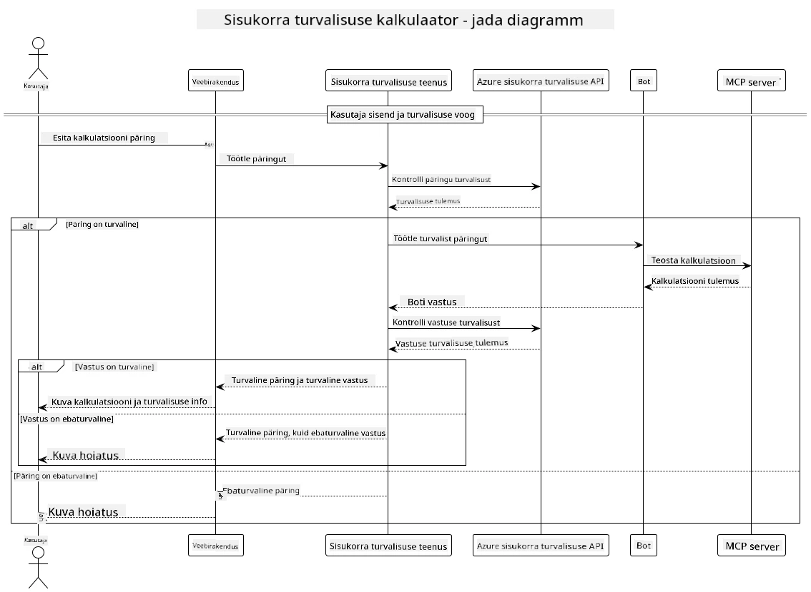

## Süsteemi arhitektuur

See projekt demonstreerib veebirakendust, mis kasutab sisuturbe kontrolli enne kasutajapäringute edastamist kalkulaatoriteenusele Model Context Protocoli (MCP) kaudu.



### Kuidas see töötab

1. **Kasutaja sisend**: Kasutaja sisestab veebiliidesesse kalkulatsiooni päringu
2. **Sisu turvalisuse sõelumine (sisend)**: Päringut analüüsib Azure Content Safety API
3. **Turvalisuse otsus (sisend)**:
   - Kui sisu on ohutu (raskusaste < 2 kõikides kategooriates), see liigub edasi kalkulaatorisse
   - Kui sisu märgitakse potentsiaalselt kahjulikuks, protsess peatub ja tagastatakse hoiatus
4. **Kalkulaatori integratsioon**: Ohutut sisu töötleb LangChain4j, mis suhtleb MCP kalkulaatoriserveriga
5. **Sisu turvalisuse sõelumine (väljund)**: Boti vastust analüüsib Azure Content Safety API
6. **Turvalisuse otsus (väljund)**:
   - Kui boti vastus on ohutu, kuvatakse see kasutajale
   - Kui boti vastus märgitakse potentsiaalselt kahjulikuks, asendatakse see hoiatusega
7. **Vastus**: Tulemused (kui need on ohutud) kuvatakse kasutajale koos mõlema turvalisuse analüüsiga

## Model Context Protocoli (MCP) kasutamine kalkulaatoriteenustega

See projekt demonstreerib, kuidas LangChain4j-ist kutsuda kalkulaatori MCP-teenuseid Model Context Protocoli (MCP) abil. Rakenduses kasutatakse kohalikku MCP serverit, mis töötab pordil 8080 ja pakub kalkulaatori toiminguid.

### Azure Content Safety teenuse seadistamine

Enne sisu turvalisuse funktsioonide kasutamist peate looma Azure Content Safety teenuse ressursi:

1. Logi sisse [Azure'i portaali](https://portal.azure.com)
2. Klõpsake "Create a resource" ja otsige "Content Safety"
3. Valige "Content Safety" ja klõpsake "Create"
4. Sisestage oma ressursile unikaalne nimi
5. Valige oma tellimus ja ressursirühm (või looge uus)
6. Valige toetatud piirkond (vaadake üksikasju [Regiooni saadavus](https://azure.microsoft.com/en-us/global-infrastructure/services/?products=cognitive-services) kohta)
7. Valige sobiv hinnaklass
8. Klõpsake "Loo", et juurutada ressurss
9. Kui juurutamine on lõpule jõudnud, klõpsake "Minge ressursile"
10. Vasakpoolses paanis, jaotises "Ressursside haldus", valige "Võtmed ja lõpp-punkt"
11. Kopeerige üks võtmetest ja lõpp-punkti URL järgmises sammus kasutamiseks

### Configuring Environment Variables

Set the Microsoft Foundry model endpoint, API key, and deployment name:
```sh
export AZURE_OPENAI_ENDPOINT="https://<resource-name>.openai.azure.com"
export AZURE_OPENAI_API_KEY="<api-key>"
export AZURE_OPENAI_DEPLOYMENT="gpt-5.1"
```

For content safety features, set:
```sh
export CONTENT_SAFETY_ENDPOINT=<your_content_safety_endpoint>
export CONTENT_SAFETY_KEY=<your_content_safety_key>
```

These environment variables are used by the application to authenticate with the Azure Content Safety service. If these variables are not set, the application will use placeholder values for demonstration purposes, but the content safety features will not work properly.

### Starting the Calculator MCP Server

Before running the client, you need to start the calculator MCP server in SSE mode on localhost:8080.

## Project Description

This project demonstrates the integration of Model Context Protocol (MCP) with LangChain4j to call calculator services. Key features include:

- Using MCP to connect to a calculator service for basic math operations
- Dual-layer content safety checking on both user prompts and bot responses
- Integration with a deployed Microsoft Foundry model via LangChain4j
- Using Server-Sent Events (SSE) for MCP transport

## Content Safety Integration

The project includes comprehensive content safety features to ensure that both user inputs and system responses are free from harmful content:

1. **Input Screening**: All user prompts are analyzed for harmful content categories such as hate speech, violence, self-harm, and sexual content before processing.

2. **Output Screening**: Even when using potentially uncensored models, the system checks all generated responses through the same content safety filters before displaying them to the user.

This dual-layer approach ensures that the system remains safe regardless of which AI model is being used, protecting users from both harmful inputs and potentially problematic AI-generated outputs.

## Web Client

The application includes a user-friendly web interface that allows users to interact with the Content Safety Calculator system:

### Web Interface Features

- Simple, intuitive form for entering calculation prompts
- Dual-layer content safety validation (input and output)
- Real-time feedback on prompt and response safety
- Color-coded safety indicators for easy interpretation
- Clean, responsive design that works on various devices
- Example safe prompts to guide users

### Using the Web Client

1. Start the application:
   ```sh
   mvn spring-boot:run
   ```

2. Open your browser and navigate to `http://localhost:8087`

3. Enter a calculation prompt in the provided text area (e.g., "Calculate the sum of 24.5 and 17.3")

4. Click "Submit" to process your request

5. View the results, which will include:
   - Content safety analysis of your prompt
   - The calculated result (if prompt was safe)
   - Content safety analysis of the bot's response
   - Any safety warnings if either the input or output was flagged

The web client automatically handles both content safety verification processes, ensuring all interactions are safe and appropriate regardless of which AI model is being used.

---

<!-- CO-OP TRANSLATOR DISCLAIMER START -->
**Lahtiütlus**:
See dokument on tõlgitud kasutades AI tõlketeenust [Co-op Translator](https://github.com/Azure/co-op-translator). Kuigi me püüdleme täpsuse poole, palun pange tähele, et automatiseeritud tõlgetes võib esineda vigu või ebatäpsusi. Originaaldokument selle emakeeles tuleks pidada autoriteetseks allikaks. Olulise teabe puhul soovitatakse kasutada professionaalset inimtõlget. Me ei vastuta selle tõlkega seotud eksimustest või valesti mõistmistest.
<!-- CO-OP TRANSLATOR DISCLAIMER END -->