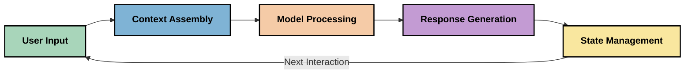
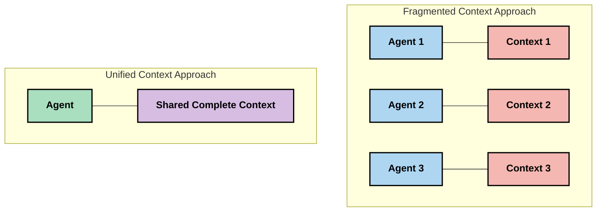
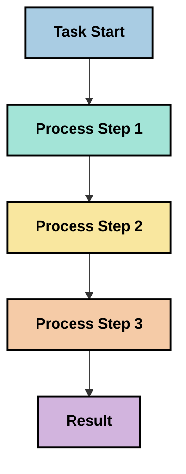
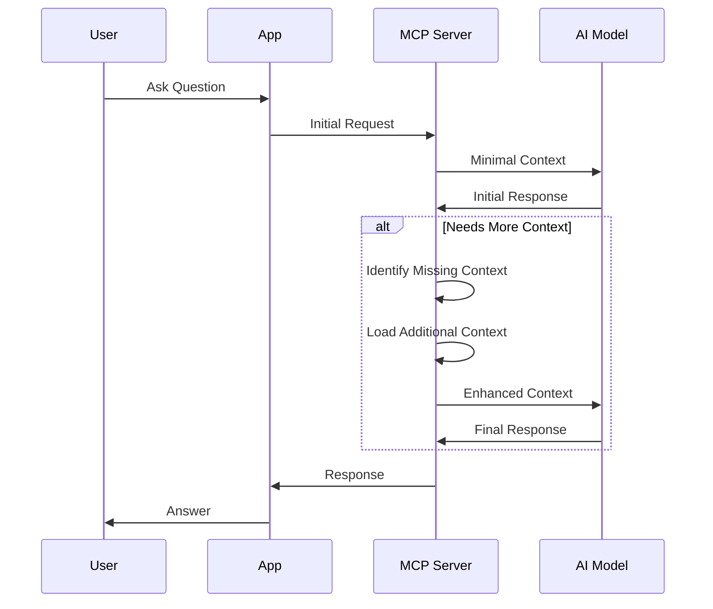
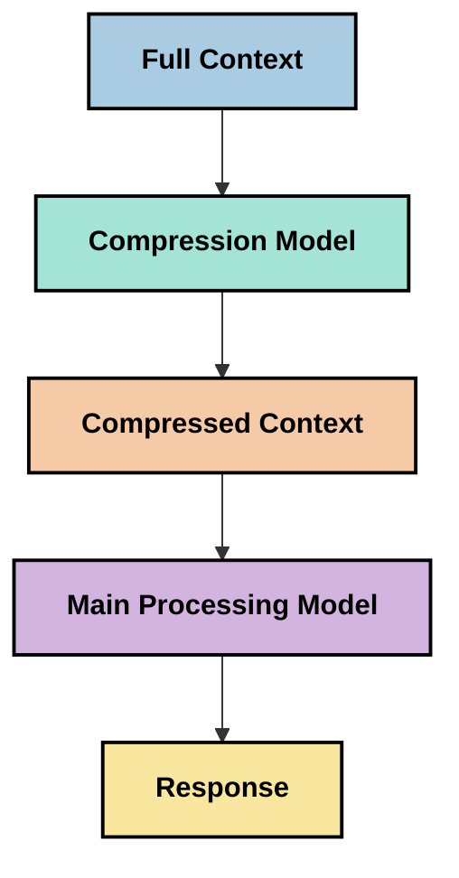
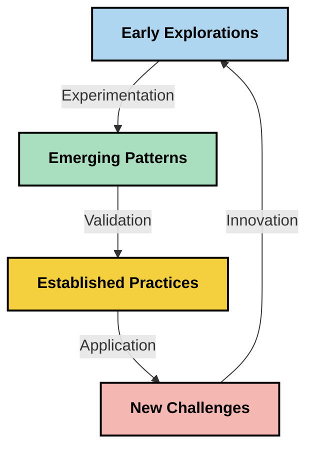

# Kontekstiinsenerlus: tekkiv mõiste MCP ökosüsteemis

## Ülevaade

Kontekstiinsenerlus on tehisintellekti valdkonnas tekkiv kontseptsioon, mis uurib, kuidas teave struktureeritakse, edastatakse ja säilitatakse klientide ja AI-teenuste vaheliste interaktsioonide jooksul. Kuna Model Context Protocol (MCP) ökosüsteem areneb, muutub konteksti tõhus haldamine üha olulisemaks. See moodul tutvustab kontekstiinsenerluse kontseptsiooni ja uurib selle võimalikke rakendusi MCP teostustes.

## Õpieesmärgid

Selle mooduli lõpuks suudate:

- Mõista tekkivat kontekstiinsenerluse kontseptsiooni ja selle potentsiaalset rolli MCP rakendustes
- Tuvastada peamised konteksti haldamise väljakutsed, millele MCP protokolli kujundus vastab
- Uurida tehnikaid mudeli jõudluse parandamiseks parema konteksti käsitlemise kaudu
- Mõelda lähenemistele konteksti tõhususe mõõtmiseks ja hindamiseks
- Rakendada neid tekkivaid kontseptsioone tehisintellekti kogemuste parandamiseks MCP raamistikus

## Sissejuhatus kontekstiinsenerlusse

Kontekstiinsenerlus on tekkiv valdkond, mis keskendub teadlikule teabevoo kavandamisele ja haldamisele kasutajate, rakenduste ja AI-mudelite vahel. Erinevalt väljakujunenud valdkondadest nagu promptide insenerlus on kontekstiinsenerlus veel praktikute poolt defineerimisel, kui nad töötavad unikaalsete väljakutsete lahendamise kallal, et anda AI-mudelitele õiget teavet õigel ajal.

Kuna suured keelemudelid (LLM-id) on arenenud, on konteksti olulisus muutunud üha ilmsemaks. Kvaliteet, asjakohasus ja konteksti struktuur, mida me pakume, mõjutavad otseselt mudeli väljundeid. Kontekstiinsenerlus uurib seda seost ja püüab välja töötada põhimõtteid efektiivseks konteksti haldamiseks.

> "Aastal 2025 on väljas olevad mudelid äärmiselt targad. Kuid isegi kõige nutikam inimene ei suuda oma tööd tõhusalt teha ilma kontekstita sellest, mida neilt nõutakse... 'Kontekstiinsenerlus' on järgmine tase promptide insenerlusest. See seisneb selle automaatseks tegemises dünaamilises süsteemis." — Walden Yan, Cognition AI

Kontekstiinsenerlus võib hõlmata:

1. **Konteksti valik**: Määratlemine, milline teave on antud ülesande jaoks asjakohane
2. **Konteksti struktureerimine**: Teabe korraldamine mudeli arusaamise maksimeerimiseks
3. **Konteksti edastamine**: Optimeerimine, kuidas ja millal teave mudelitele saadetakse
4. **Konteksti hooldus**: Konteksti oleku ja evolutsiooni haldamine aja jooksul
5. **Konteksti hindamine**: Konteksti tõhususe mõõtmine ja parandamine

Need fookusvaldkonnad on eriti olulised MCP ökosüsteemile, mis pakub standardiseeritud viisi, kuidas rakendused saavad LLM-idele konteksti anda.


## Konteksti teekonna vaatenurk

Üks viis kontekstiinsenerlust visualiseerida on jälgida teabe teekonda läbi MCP süsteemi:



### Peamised etapid konteksti teekonnas:

1. **Kasutaja sisend**: Kasutajalt pärinev toorandmed (tekst, pildid, dokumendid)
2. **Konteksti koostamine**: Kasutaja sisendi kombineerimine süsteemi konteksti, vestluse ajaloo ja muu hangitud teabega
3. **Mudeli töötlemine**: AI-mudel töötleb koostatud konteksti
4. **Vastuse genereerimine**: Mudel toodab väljundeid antud konteksti põhjal
5. **Oleku haldus**: Süsteem uuendab oma sisemist olekut interaktsiooni põhjal

See vaatenurk toob esile konteksti dünaamilise olemuse AI-süsteemides ja tekitab olulisi küsimusi selle kohta, kuidas igas etapis kõige paremini teavet hallata.

## Tekkivad põhimõtted kontekstiinsenerluses

Kui kontekstiinsenerluse valdkond kujuneb, hakkavad praktikute seas ilmuma mõned esialgsed põhimõtted. Need põhimõtted võivad aidata suunata MCP rakenduse valikuid:

### Põhimõte 1: Jagage konteksti täielikult

Kontekst tuleks jagada täielikult süsteemi kõigi komponentide vahel, mitte lõigata mitme agendi või protsessi vahel fragmentideks. Kui kontekst on jaotatud, võivad otsused, mis tehakse ühes süsteemi osas, olla vastuolus teiste osadega tehtud otsustega.



MCP rakendustes tähendab see süsteemide kujundamist nii, et kontekst voolaks sujuvalt kogu töövoo kaudu, selle asemel et see oleks lahutatud.

### Põhimõte 2: Tunnistage, et tegevused kannavad endas implitsiitseid otsuseid

Iga mudeli tegevus sisaldab endas implitsiitseid otsuseid selle kohta, kuidas konteksti tõlgendada. Kui mitu komponenti tegutsevad erinevate kontekstide alusel, võivad need implitsiitsed otsused konflikti sattuda, põhjustades ebajärjekindlaid tulemusi.

Sellel põhimõttel on MCP rakenduste jaoks olulised tagajärjed:
- Eelistada keerukate ülesannete lineaarset töötlemist paralleelsele täitmisele fragmenteeritud kontekstiga
- Tagada, et kõigil otsustuspunktidel oleks juurdepääs samale kontekstuaalsele teabele
- Kujundada süsteeme nii, et hilisemad sammud näeksid varasemate otsuste kogu konteksti

### Põhimõte 3: Tasakaalustage konteksti sügavust kontekstiakna piirangutega

Kui vestlused ja protsessid venivad pikemaks, siis kontekstiaknad lõpuks täituvad. Tõhus kontekstiinsenerlus uurib lähenemisviise selle pinge haldamiseks põhjaliku konteksti ja tehniliste piirangute vahel.

Uuritavad võimalikud lähenemised hõlmavad:
- Konteksti tihendamine, mis säilitab olulise teabe, vähendades samal ajal tokenite kasutust
- Konteksti progressiivne laadimine vastavalt selle tähtsusele praegustele vajadustele
- Varasemate interaktsioonide kokkuvõtete tegemine säilitades samal ajal olulised otsused ja faktid

## Konteksti väljakutsed ja MCP protokolli kujundus

Model Context Protocol (MCP) loodi, arvestades konteksti haldamise ainulaadseid väljakutseid. Nende väljakutsete mõistmine aitab selgitada MCP protokolli kujunduse peamisi aspekte:


### Väljakutse 1: kontekstiakna piirangud
Enamik AI-mudeleid omab fikseeritud kontekstiakna suurust, mis piirab, kui palju teavet nad suudavad korraga töödelda.

**MCP kujunduse vastus:** 
- Protokoll toetab struktureeritud, ressursipõhist konteksti, millele saab viidata tõhusalt
- Ressursse saab leheküljestada ja laadida progressiivselt

### Väljakutse 2: asjakohasuse määramine
Otsustada, milline teave on konteksti kaasamiseks kõige asjakohasem, on keeruline.

**MCP kujunduse vastus:**
- Paindlikud tööriistad võimaldavad teabe dünaamilist päringut vastavalt vajadusele
- Struktureeritud promptid võimaldavad järjepidevat konteksti organiseerimist

### Väljakutse 3: konteksti püsivus
Olekute haldamine interaktsioonide vahel nõuab konteksti hoolikat jälgimist.

**MCP kujunduse vastus:**
- Standardiseeritud sessioonihaldus
- Selgelt määratletud interaktsioonimustrid konteksti arenguks

### Väljakutse 4: multimodaalne kontekst
Erinevat tüüpi andmed (tekst, pildid, struktureeritud andmed) nõuavad erinevat käsitlemist.

**MCP kujunduse vastus:**
- Protokolli kujundus toetab erinevaid sisutüüpe
- Mitmemodaalse info standardiseeritud esitus

### Väljakutse 5: turvalisus ja privaatsus
Kontekst sisaldab sageli tundlikku teavet, mida tuleb kaitsta.

**MCP kujunduse vastus:**
- Selged piirid kliendi ja serveri vastutuste vahel
- Kohalikud töötlemisvõimalused andmete avalikustamise minimeerimiseks

Nende väljakutsete ja MCP lahenduste mõistmine annab aluse keerukamate kontekstiinsenerluse tehnikaid uurida.

## Tekkivad kontekstiinsenerluse lähenemisviisid

Kuna kontekstiinsenerluse valdkond areneb, ilmub välja mitmeid paljutõotavaid lähenemisviise. Need peegeldavad praegust mõtlemist, mitte väljakujunenud parimaid tavasid, ja tõenäoliselt arenevad edasi, kui meil tekib rohkem kogemusi MCP rakendustega.

### 1. Üksikult järjestikune lineaarne töötlemine

Erinevalt mitmeagendilistest arhitektuuridest, mis jaotavad konteksti, leiavad mõned praktikud, et üksikult järjestikune lineaarne töötlemine annab järjekindlamad tulemused. See on kooskõlas põhimõttega hoida kontekst ühtsena.



Kuigi see lähenemine võib tunduda vähem tõhus kui paralleelne töötlemine, annab see sageli koherentsemad ja usaldusväärsemad tulemused, sest iga samm tugineb eelnevate otsuste täielikul mõistmisel.

### 2. Konteksti killustamine ja prioriseerimine

Suure konteksti jagamine hallatavatesse osadesse ja kõige olulisema prioriseerimine.

```python
# Conceptual Example: Context Chunking and Prioritization
def process_with_chunked_context(documents, query):
    # 1. Break documents into smaller chunks
    chunks = chunk_documents(documents)
    
    # 2. Calculate relevance scores for each chunk
    scored_chunks = [(chunk, calculate_relevance(chunk, query)) for chunk in chunks]
    
    # 3. Sort chunks by relevance score
    sorted_chunks = sorted(scored_chunks, key=lambda x: x[1], reverse=True)
    
    # 4. Use the most relevant chunks as context
    context = create_context_from_chunks([chunk for chunk, score in sorted_chunks[:5]])
    
    # 5. Process with the prioritized context
    return generate_response(context, query)
```

Ülaltoodud kontseptsioon illustreerib, kuidas me võiksime jagada suuri dokumente hallatavatesse osadesse ja valida konteksti jaoks ainult kõige asjakohasemad osad. See lähenemine aitab tegutseda kontekstiakna piirangute raames, samal ajal kasutades ära suuri teadmistebaase.

### 3. Progressiivne konteksti laadimine

Konteksti laadimine progressiivselt vastavalt vajadusele, mitte kõike korraga.



Progressiivne konteksti laadimine algab minimaalse kontekstiga ja laieneb ainult siis, kui see on vajalik. See võib oluliselt vähendada tokenite kasutust lihtsate päringute puhul, säilitades samal ajal võime käsitleda keerukaid küsimusi.

### 4. Konteksti tihendamine ja kokkuvõtete tegemine

Konteksti suuruse vähendamine, säilitades samal ajal olulise teabe.



Konteksti tihendamine keskendub:
- Korduva teabe eemaldamine
- Pikkade sisude kokkuvõtete tegemine
- Oluliste faktide ja detailide eraldamine
- Kriitiliste konteksti elementide säilitamine
- Tokenite kasutamise optimeerimine

See lähenemine võib olla eriti väärtuslik pikkade vestluste säilitamiseks kontekstiakendes või suurte dokumentide efektiivseks töötlemiseks. Mõned praktikud kasutavad spetsialiseeritud mudeleid konteksti tihendamiseks ja vestluse ajaloo kokkuvõtete tegemiseks.


## Uurivad kaalutlused kontekstiinsenerluses

Uurides kontekstiinsenerluse tekkivat valdkonda, on mitmeid kaalutlusi, mida tasub MCP rakendustega töötades silmas pidada. Need ei ole ettekirjutavad parimad tavad, vaid pigem uuritavad valdkonnad, mis võivad teie konkreetse kasutusjuhtumi puhul parandusi anda.

### Mõelge oma konteksti eesmärkidele

Enne keerukate konteksti haldamise lahenduste rakendamist sõnastage selgelt, mida te üritate saavutada:
- Millist konkreetset teavet mudel vajab, et olla edukas?
- Milline teave on oluline ja milline täiendav?
- Millised on teie jõudluse piirangud (latentsus, tokenite piirid, kulud)?

### Uurige kihilisi konteksti lähenemisviise

Mõned praktikud on leidnud edu konteksti korraldamisel kontseptuaalsetesse kihtidesse:
- **Põhikiht**: Oluline teave, mida mudel alati vajab
- **Situatsioonikiht**: Kontekst, mis on spetsiifiline praegusele interaktsioonile
- **Toetav kiht**: Lisateave, mis võib olla kasulik
- **Varukiht**: Teave, millele pöördutakse ainult vajaduse korral

### Uurige päringustrateegiaid

Konteksti tõhusus sõltub sageli sellest, kuidas teavet pärite:
- Semantiline otsing ja embeddings kontseptuaalselt asjakohase teabe leidmiseks
- Märksõnapõhine otsing konkreetsete faktide leidmiseks
- Hübriidlähenemised, mis kombineerivad mitut päringumeetodit
- Metaandmete filtrimine ulatuse kitsendamiseks kategooriate, kuupäevade või allikate põhjal

### Katsetage konteksti koherentsust

Teie konteksti struktuur ja voog võivad mõjutada mudeli mõistmist:
- Seotud teabe grupeerimine kokku
- Järjepideva vorminduse ja organiseerimise kasutamine
- Loogilise või kronoloogilise järjestuse säilitamine, kus see on asjakohane
- Vastuolulise teabe vältimine

### Hinnake mitmeagendiliste arhitektuuride kompromisse

Kuigi mitmeagendilised arhitektuurid on paljude AI raamistikute hulgas populaarsed, kaasnevad nendega konteksti haldamisega märkimisväärsed väljakutsed:
- Konteksti killustatus võib viia ebajärjekindlate otsusteni agentide vahel
- Paralleeltöötlus võib tekitada konflikte, mida on raske lahendada
- Agentide vaheline kommunikatsioonikoormus võib tühistada jõudluse kasud
- Koherentsuse säilitamiseks on vajalik keeruline oleku haldus

Paljudel juhtudel võib üheagendiline lähenemine koos kõikehõlmava konteksti haldamisega anda usaldusväärsemaid tulemusi kui mitu spetsialiseeritud agenti fragmenteeritud kontekstiga.

### Töötage välja hindamismeetodid

Et kontekstiinsenerlust ajas parendada, kaaluge, kuidas te mõõdate edu:
- A/B testimine erinevate kontekstistruktuuride puhul
- Tokenite kasutuse ja vastuseaegade jälgimine
- Kasutajate rahulolu ja ülesannete lõpetamise määrade jälgimine
- Konteksti strateegiate ebaõnnestumise aegade ja põhjuste analüüsimine

Need kaalutlused esindavad aktiivseid uurimisvaldkondi kontekstiinsenerluse alal. Kui valdkond küpseb, ilmuvad tõenäoliselt välja selgemad mustrid ja praktikad.

## Konteksti tõhususe mõõtmine: arenev raamistik

Kuna kontekstiinsenerlus tekib kontseptsioonina, hakkavad praktikud uurima, kuidas me võiksime mõõta selle tõhusust. Ükski väljakujunenud raamistik pole veel olemas, kuid kaalumisele on võetud mitmeid mõõdikuid, mis võiksid aidata suunata tulevast tööd.

### Võimalikud mõõtmisdimensioonid


#### 1. Sisendi efektiivsuse kaalutlused

- **Konteksti–vastuse suhe**: Kui palju konteksti on vaja võrreldes vastuse mahuga?
- **Tokenite kasutamine**: Mis protsent pakutud konteksti tokenitest tundub mõjutavat vastust?
- **Konteksti vähendamine**: Kui tõhusalt saame toorinfo tihendada?

#### 2. Jõudluse kaalutlused

- **Latentsuse mõju**: Kuidas konteksti haldamine mõjutab vastuse aega?
- **Tokenite ökonoomia**: Kas me optimeerime tokenite kasutust tõhusalt?
- **Päringu täpsus**: Kui asjakohane on hangitud teave?
- **Ressursside kasutus**: Milliseid arvutusressursse on vaja?

#### 3. Kvaliteedi kaalutlused

- **Vastuse asjakohasus**: Kui hästi vastus adresseerib päringut?
- **Faktide täpsus**: Kas konteksti haldamine parandab faktilist õigsust?
- **Järjepidevus**: Kas vastused on sarnaste päringute puhul järjekindlad?
- **Hallutsinatsioonide sagedus**: Kas parem kontekst vähendab mudeli hallutsinatsioone?

#### 4. Kasutajakogemuse kaalutlused

- **Järgimise sagedus**: Kui sageli kasutajad vajavad täpsustusi?
- **Ülesannete täitmine**: Kas kasutajad saavutavad edukalt oma eesmärgid?
- **Rahulolu näitajad**: Kuidas kasutajad hindavad oma kogemust?

### Uurivad mõõtmislähenemised

MCP rakendustes kontekstiinsenerlusega katsetades kaaluge neid uurivaid lähenemisviise:

1. **Võrdlusalus**: Looge baas lihtsate kontekstilähenemistega enne keerukamate meetodite testimist

2. **Järkjärgulised muutused**: Muutke korraga vaid ühte konteksti haldamise aspekti, et isoleerida selle mõju

3. **Kasutajakeskne hindamine**: Ühendage kvantitatiivsed mõõdikud kvalitatiivse kasutajate tagasisidega

4. **Rikkeanalüüs**: Uurige juhtumeid, kus konteksti strateegiad ebaõnnestuvad, et mõista võimalikke parandusi

5. **Mitmemõõtmeline hindamine**: Arvestage kompromisse efektiivsuse, kvaliteedi ja kasutajakogemuse vahel

See eksperimentaalne, mitmekülgne mõõtmislähenemine sobib kokku kontekstiinsenerluse tekkiva olemusega.

## Lõpumõtted

Kontekstiinsenerlus on tekkiv uurimisvaldkond, mis võib osutuda keskseks tõhusate MCP rakenduste puhul. Mõeldes hoolikalt läbi, kuidas teave teie süsteemis voolab, võite luua tehisintellekti kogemusi, mis on kasutajatele tõhusamad, täpsemad ja väärtuslikumad.

Siin kirjeldatud tehnikad ja lähenemised esindavad valdkonna varajast mõtlemist, mitte väljakujunenud praktikaid. Kontekstiinsenerlus võib areneda selgemaks distsipliiniks, kui AI võimekused arenevad ja meie arusaam süveneb. Praegu tundub katsetamine, kombineerituna hoolika mõõtmisega, olevat kõige produktiivsem lähenemine.

## Võimalikud tuleviku suunad

Kontekstiinsenerluse valdkond on endiselt algjärgus, kuid ilmneb mitu paljutõotavat suunda:

- Kontekstiinsenerluse põhimõtted võivad oluliselt mõjutada mudelite jõudlust, tõhusust, kasutajakogemust ja töökindlust
- Üheahelalised lähenemised koos kõikehõlmava konteksti haldusega võivad paljudes kasutusjuhtumites ületada mitmeagendilisi arhitektuure
- Spetsialiseeritud konteksti tihendamise mudelid võivad saada tavapärasteks komponentideks AI töövoogudes
- Konteksti täielikkuse ja tokenipiirangute vaheline pinge tõenäoliselt ajendab innovatsiooni konteksti käsitlemisel
- Kuna mudelid muutuvad võimekamaks efektiivseks inimlaadseks suhtluseks, võib tõeline mitmeagendiline koostöö muutuda elujõulisemaks
- MCP rakendused võivad areneda, et standardiseerida konteksti haldamise mustreid, mis tekivad praegusest katsetamisest



## Ressursid

### Ametlikud MCP ressursid
- [Model Context Protocol veebisait](https://modelcontextprotocol.io/)
- [Model Context Protocoli spetsifikatsioon](https://github.com/modelcontextprotocol/modelcontextprotocol)
- [MCP dokumentatsioon](https://modelcontextprotocol.io/docs)
- [MCP C# SDK](https://github.com/modelcontextprotocol/csharp-sdk)
- [MCP Python SDK](https://github.com/modelcontextprotocol/python-sdk)
- [MCP TypeScript SDK](https://github.com/modelcontextprotocol/typescript-sdk)
- [MCP Inspector](https://github.com/modelcontextprotocol/inspector) - Visuaalne testimise tööriist MCP-serveritele

### Kontekstiinsenerluse artiklid
- [Ärge looge mitmeagente: kontekstiinsenerluse põhimõtted](https://cognition.ai/blog/dont-build-multi-agents) - Walden Yani vaated kontekstiinsenerluse põhimõtetele
- [Praktiline juhend agentide ehitamiseks](https://cdn.openai.com/business-guides-and-resources/a-practical-guide-to-building-agents.pdf) - OpenAI juhend tõhusa agentide kujundamise kohta
- [Tõhusate agentide loomine](https://www.anthropic.com/engineering/building-effective-agents) - Anthropic lähenemine agentide arendamisele

### Seotud uuringud
- [Dünaamiline päringute täiendus suurtele keelemudelitele](https://arxiv.org/abs/2310.01487) - Uuringud dünaamiliste päringulähenemiste kohta
- [Kadunud keskel: kuidas keelemudelid kasutavad pikki kontekste](https://arxiv.org/abs/2307.03172) - Oluline uurimus konteksti töötlemise mustrite kohta
- [Hierarhiline teksti-konditsioneeritud piltide genereerimine CLIP-latentidega](https://arxiv.org/abs/2204.06125) - DALL-E 2 artikkel, mis annab teadmisi konteksti struktureerimisest
- [Konteksti rolli uurimine suurte keelemudeli arhitektuurides](https://aclanthology.org/2023.findings-emnlp.124/) - Hiljutine uurimus konteksti käsitlemisest
- [Mitmeagendi koostöö: ülevaade](https://arxiv.org/abs/2304.03442) - Uuring mitmeagendi süsteemide ja nende väljakutsete kohta

### Täiendavad ressursid
- [Kontekstiakna optimeerimise tehnikad](https://learn.microsoft.com/en-us/azure/ai-services/openai/concepts/context-window)
- [Täiustatud RAG-tehnikad](https://www.microsoft.com/en-us/research/blog/retrieval-augmented-generation-rag-and-frontier-models/)
- [Semantic Kerneli dokumentatsioon](https://github.com/microsoft/semantic-kernel)
- [Microsoft Foundry Toolkit Visual Studio Code'i jaoks](https://github.com/microsoft/vscode-ai-toolkit)

## Mis järgmiseks 

- [5.15 MCP kohandatud transport](../mcp-transport/README.md)

---

<!-- CO-OP TRANSLATOR DISCLAIMER START -->
**Lahtiütlus**:
See dokument on tõlgitud kasutades AI tõlketeenust [Co-op Translator](https://github.com/Azure/co-op-translator). Kuigi me püüdleme täpsuse poole, palun pange tähele, et automatiseeritud tõlgetes võib esineda vigu või ebatäpsusi. Originaaldokument selle emakeeles tuleks pidada autoriteetseks allikaks. Olulise teabe puhul soovitatakse kasutada professionaalset inimtõlget. Me ei vastuta selle tõlkega seotud eksimustest või valesti mõistmistest.
<!-- CO-OP TRANSLATOR DISCLAIMER END -->