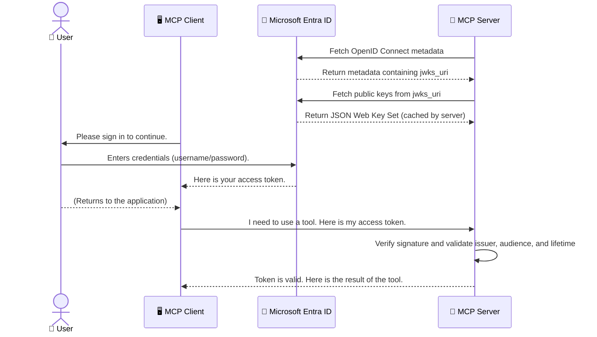

# AI-töövoogude kaitsmine: Entra ID autentimine Model Context Protocoli serverite jaoks

> [!NOTE]
> Kaugserveri kood selles õppetükis kaitseb pärand-`/sse` ja `/message`
> lõpp-punkte ja sihib MCP `2025-11-25`. Säilitage selle identiteedi- ja tokeni valideerimise
> tavasid, kuid uute rakenduste jaoks kasutage `2026-07-28`-ühilduvat Streamable HTTP transporti.
> rakendustes.

## Sissejuhatus
Model Context Protocoli (MCP) serveri kaitsmine on sama oluline kui oma maja eesukse lukustamine. Kui jätta MCP-server avatud, saavad volitamata isikud juurde pääseda teie tööriistadele ja andmetele, mis võib viia turvaintsidentideni. Microsoft Entra ID pakub usaldusväärset pilvepõhist identiteedi- ja juurdepääsuhalduse lahendust, mis aitab tagada, et teie MCP-serveriga suhtlevad ainult volitatud kasutajad ja rakendused. Selles jaotises õpite, kuidas kaitsta oma AI-töövooge, kasutades Entra ID autentimist.

## Õpieesmärgid
Selle jaotise lõpuks suudate:

- Mõista MCP-serverite turvamise olulisust.
- Selgitada Microsoft Entra ID ja OAuth 2.0 autentimise põhitõdesid.
- Tuvastada erinevus avalike ja konfidentsiaalsete klientide vahel.
- Rakendada Entra ID autentimist nii lokaalses (avalik klient) kui ka kaugserveri (konfidentsiaalne klient) MCP-serveri stsenaariumis.
- Rakendada turvapraktikaid AI-töövoogude arendamisel.

## Turvalisus ja MCP

Nii nagu te ei jäta oma maja esiust lahtiseks, ei tohiks te jätta oma MCP-serverit kõigile ligipääsetavaks. AI-töövoogude turvamine on hädavajalik vastupidavate, usaldusväärsete ja turvaliste rakenduste loomiseks. See peatükk tutvustab teile Microsoft Entra ID kasutamist MCP-serverite kaitsmiseks, tagades, et ainult volitatud kasutajad ja rakendused saavad teie tööriistade ja andmetega suhelda.

## Miks turvalisus on MCP-serverite puhul oluline

Kujutage ette, et teie MCP-serveril on tööriist, mis suudab saata e-kirju või pääseda kliendiandmebaasi. Kaitseta server tähendaks, et igaüks võiks seda tööriista kasutada, mis võib viia volitamata andmetele juurdepääsuni, rämpsposti või muude pahatahtlike tegevusteni.

Autentimise rakendamisega tagate, et iga serverile suunatud päring kontrollitakse, kinnitades päringu teinud kasutaja või rakenduse identiteeti. See on esimene ja kõige kriitilisem samm teie AI-töövoogude turvamisel.

## Sissejuhatus Microsoft Entra ID-sse

[**Microsoft Entra ID**](https://adoption.microsoft.com/microsoft-security/entra/) on pilvepõhine identiteedi- ja juurdepääsuhalduse teenus. Mõelge sellele kui universaalsele turvatöötajale teie rakenduste jaoks. See tegeleb kasutaja identiteetide (autentimine) kontrollimise ja otsustab, mida neil lubatud teha on (autoriseerimine).

Entra ID kasutamisel saate:

- Võimaldada kasutajatele turvalist sisselogimist.
- Kaitsta API-sid ja teenuseid.
- Hallata juurdepääsupoliitikaid ühest keskpunktist.

MCP-serverite puhul pakub Entra ID tugevat ja laialdaselt usaldatud lahendust, et hallata, kes saavad teie serveri võimalustele ligi pääseda.

---

## Mõistmine: kuidas Entra ID autentimine töötab

Entra ID kasutab autentimiseks avatud standardeid nagu **OAuth 2.0**. Kuigi üksikasjad võivad olla keerulised, on põhikontseptsioon lihtne ja seda saab mõista võrdluse abil.

### Õrn sissejuhatus OAuth 2.0: parkimisvõti

Mõelge OAuth 2.0-ile nagu parkimisteenusele teie autole. Kui jõuate restorani, ei anna te parkimisest vastutavale isikule oma peavõtit. Selle asemel annate talle **parkimisvõtme**, millel on piiratud õigused—see saab käivitada auto ja lukustada uksi, kuid ei saa avada pagasiruumi ega kindalaegast.

Selles analoogias:

- **Teie** olete **kasutaja**.
- **Teie auto** on **MCP-server** oma väärtuslike tööriistade ja andmetega.
- **Parkimisteenindaja** on **Microsoft Entra ID**.
- **Parkimisabiline** on **MCP Client** (rakendus, mis proovib serverile ligi pääseda).
- **Parkimisvõti** on **juurdepääsu token**.

Juurdepääsu token on turvaline tekstijada, mille MCP klient saab Entra ID-lt pärast teie sisselogimist. Klient esitab selle tokeni iga päringu puhul MCP-serverile. Server saab tokeni kontrollida, et veenduda päringu seaduslikkuses ja selles, et kliendil on vajalikud õigused, seda kõike ilma teie tegelike volitustega (nt parooliga) kunagi tegelemata.

### Autentimisvoog

Siin on, kuidas protsess praktikas töötab:



MCP-server ei helista Entra ID-le iga juurdepääsu tokeni valideerimiseks. See
krüptograafiliselt kontrollib JWT allkirja Entra ID vahemällu salvestatud avaliku võtmega
ja valideerib tokeni väited, sh selle väljastaja, sihtrühm ja kehtivusaeg.
Server loeb OpenID Connect metaandmetest `jwks_uri`, hangib avaliku
võtmed sellest URI-st ja värskendab neid perioodiliselt võtmete rotatsiooni käsitlemiseks. Kasutage
toetatud tokeni valideerimise teeki selle loogika ise rakendamise asemel.
oma poolt. Lisateabe saamiseks vaadake
[Tokenite valideerimine Microsofti identiteediplatvormis](https://learn.microsoft.com/entra/identity-platform/access-tokens#validate-tokens).

### Microsoft Authentication Library (MSAL) tutvustus

Enne kui sukeldume koodi, on oluline tutvustada üht võtmekomponenti, mida näete näidetes: **Microsoft Authentication Library (MSAL)**.

MSAL on Microsofti loodud teek, mis muudab arendajatel autentimise haldamise palju lihtsamaks. Selle asemel, et teil peaks olema vaja kirjutada kogu keeruline kood turbetokenite haldamiseks, sisselogimiste korraldamiseks ja sessioonide värskendamiseks, kannab MSAL suurema osa raskest tööst.

MSAL-i-laadse teegi kasutamine on väga soovitatav, sest:

- **See on turvaline:** see rakendab tööstusharu standardseid protokolle ja turvalisuse parimaid tavasid, vähendades haavatavuste riski teie koodis.
- **See lihtsustab arendust:** see varjab OAuth 2.0 ja OpenID Connect protokollide keerukuse, võimaldades teil lisada tugeva autentimise oma rakendusse vaid mõne koodireaga.
- **See on hooldatud:** Microsoft hooldab ja uuendab MSAL-i aktiivselt, et tegeleda uute turvaohtude ja platvormimuutustega.

MSAL toetab paljusid keeli ja rakenduste raamistikke, sealhulgas .NET-i, JavaScript/TypeScript-i, Pythonit, Javat, Got ja mobiiliplatvorme nagu iOS ja Android. See tähendab, et saate kasutada samu järjepidevaid autentimismustreid üle kogu teie tehnoloogiapinu.

Lisateabe saamiseks võite vaadata ametlikku [MSAL ülevaatedokumentatsiooni](https://learn.microsoft.com/entra/identity-platform/msal-overview).

---

## MCP-serveri kaitsmine Entra ID-ga: samm-sammult juhend

Nüüd vaatame, kuidas kaitsta kohalikku MCP-serverit (mis suhtleb üle `stdio`) Entra ID abil. See näide kasutab **avalikku klienti**, mis sobib rakendustele, mis töötavad kasutaja masinal, nagu lauaarvutirakendus või kohalik arendusserver.

### Stsenaarium 1: kohaliku MCP-serveri kaitsmine (avaliku kliendiga)

Selles stsenaariumis vaatleme kohalikku MCP-serverit, mis töötab lokaalselt, suhtleb üle `stdio` ja kasutab Entra ID-d kasutaja autentimiseks enne tööriistadele ligi lubamist. Serveril on üks tööriist, mis hangib kasutaja profiiliandmed Microsoft Graph API-st.

#### 1. Rakenduse seadistamine Entra ID-s

Enne koodi kirjutamist peate registreerima oma rakenduse Microsoft Entra ID-s. See annab Entra ID-le teada teie rakendusest ja annab sellele loa kasutada autentimisteenust.

1. Minge **[Microsoft Entra portaali](https://entra.microsoft.com/)**.
2. Avage **App registrations** ja klõpsake **New registration**.
3. Andke oma rakendusele nimi (nt "My Local MCP Server").
4. Valige **Supported account types** ja valige **Accounts in this organizational directory only**.
5. Selle näite puhul võite jätta **Redirect URI** tühjaks.
6. Klõpsake **Register**.

Kui registreerimine on tehtud, pange tähele **Application (client) ID** ja **Directory (tenant) ID**. Teil on neid vaja oma koodis.

#### 2. Kood: ülevaade

Vaatame koodi peamisi osi, mis käsitlevad autentimist. Selle näite täielik kood on saadaval kaustas [Entra ID - Local - WAM](https://github.com/Azure-Samples/mcp-auth-servers/tree/main/src/entra-id-local-wam) hoidlas [mcp-auth-servers GitHubi hoidla](https://github.com/Azure-Samples/mcp-auth-servers).

**`AuthenticationService.cs`**

See klass haldab suhtlust Entra ID-ga.

- **`CreateAsync`**: See meetod initsialiseerib `PublicClientApplication` MSAL-ist (Microsoft Authentication Library). See on konfigureeritud teie rakenduse `clientId` ja `tenantId`.
- **`WithBroker`**: See võimaldab brokeri (näiteks Windows Web Account Manager) kasutamist, mis pakub turvalisemat ja sujuvamat ühekordset sisselogimist.
- **`AcquireTokenAsync`**: See on põhimeetod. Esiteks üritab see vaikimisi saada tokenit (mis tähendab, et kasutajal ei ole vaja uuesti sisse logida, kui tal on juba kehtiv sessioon). Kui vaikimisi tokenit ei õnnestu hankida, palutakse kasutajal interaktiivselt sisse logida.

```csharp
// Simplified for clarity
public static async Task<AuthenticationService> CreateAsync(ILogger<AuthenticationService> logger)
{
    var msalClient = PublicClientApplicationBuilder
        .Create(_clientId) // Your Application (client) ID
        .WithAuthority(AadAuthorityAudience.AzureAdMyOrg)
        .WithTenantId(_tenantId) // Your Directory (tenant) ID
        .WithBroker(new BrokerOptions(BrokerOptions.OperatingSystems.Windows))
        .Build();

    // ... cache registration ...

    return new AuthenticationService(logger, msalClient);
}

public async Task<string> AcquireTokenAsync()
{
    try
    {
        // Try silent authentication first
        var accounts = await _msalClient.GetAccountsAsync();
        var account = accounts.FirstOrDefault();

        AuthenticationResult? result = null;

        if (account != null)
        {
            result = await _msalClient.AcquireTokenSilent(_scopes, account).ExecuteAsync();
        }
        else
        {
            // If no account, or silent fails, go interactive
            result = await _msalClient.AcquireTokenInteractive(_scopes).ExecuteAsync();
        }

        return result.AccessToken;
    }
    catch (Exception ex)
    {
        _logger.LogError(ex, "An error occurred while acquiring the token.");
        throw; // Optionally rethrow the exception for higher-level handling
    }
}
```

**`Program.cs`**

Siin seadistatakse MCP-server ja integreeritakse autentimisteenus.

- **`AddSingleton<AuthenticationService>`**: See registreerib `AuthenticationService` sõltuvuste süstimise konteineris, nii et seda saab kasutada rakenduse teistes osades (näiteks meie tööriist).
- **`GetUserDetailsFromGraph` tool**: See tööriist nõuab `AuthenticationService` instantsi. Enne kui see midagi teeb, kutsub see `authService.AcquireTokenAsync()`, et saada kehtiv ligipääsutoken. Kui autentimine õnnestub, kasutab see tokenit Microsoft Graph API kutsumiseks ja toob kasutaja andmed.

```csharp
// Simplified for clarity
[McpServerTool(Name = "GetUserDetailsFromGraph")]
public static async Task<string> GetUserDetailsFromGraph(
    AuthenticationService authService)
{
    try
    {
        // This will trigger the authentication flow
        var accessToken = await authService.AcquireTokenAsync();

        // Use the token to create a GraphServiceClient
        var graphClient = new GraphServiceClient(
            new BaseBearerTokenAuthenticationProvider(new TokenProvider(authService)));

        var user = await graphClient.Me.GetAsync();

        return System.Text.Json.JsonSerializer.Serialize(user);
    }
    catch (Exception ex)
    {
        return $"Error: {ex.Message}";
    }
}
```

#### 3. Kuidas see kõik koos töötab

1. Kui MCP klient proovib kasutada `GetUserDetailsFromGraph` tööriista, kutsub tööriist esmalt `AcquireTokenAsync`.
2. `AcquireTokenAsync` käsib MSAL-teegil kontrollida, kas token on kehtiv.
3. Kui tokenit ei leita, palub MSAL brokeri kaudu kasutajal sisse logida oma Entra ID kontoga.
4. Kui kasutaja sisse logib, väljastab Entra ID ligipääsutokeni.
5. Tööriist saab tokeni ja kasutab seda turvalise päringu tegemiseks Microsoft Graph API-le.
6. Kasutaja andmed tagastatakse MCP kliendile.

See protsess tagab, et tööriista saavad kasutada ainult autentitud kasutajad, muutes teie kohaliku MCP-serveri turvaliseks.

### Stsenaarium 2: Kaug-MCP-serveri turvamine (konfidentsiaalne klient)

Kui teie MCP-server töötab kaugarvutis (näiteks pilveserveris) ja suhtleb sellise protokolli kaudu nagu HTTP Streaming, on turvanõuded erinevad. Sellisel juhul peaksite kasutama **konfidentsiaalset klienti** ja **Authorization Code Flow**. See on turvalisem meetod, sest rakenduse saladusi ei avaldata kunagi brauserile.

See näide kasutab TypeScripti-põhist MCP-serverit, mis kasutab Express.js-i HTTP-päringute käsitlemiseks.

#### 1. Rakenduse seadistamine Entra ID-s

Entra ID-s on seadistus sarnane avaliku kliendiga, kuid ühe olulise erinevusega: peate looma **client secret**.

1. Minge lehele **[Microsoft Entra portaal](https://entra.microsoft.com/)**.
2. Oma rakenduse registreeringus minge vahekaardile **Certificates & secrets**.
3. Klõpsake **New client secret**, andke sellele kirjeldus ning klõpsake **Add**.
4. **Oluline:** Kopeerige salajane väärtus kohe. Te ei näe seda enam uuesti.
5. Teil tuleb ka konfigureerida **Redirect URI**. Minge vahekaardile **Authentication**, klõpsake **Add a platform**, valige **Web** ja sisestage oma rakenduse ümbersuunamise URI (nt `http://localhost:3001/auth/callback`).

> **⚠️ Oluline turvateade:** Tootmiskeskkonna rakenduste puhul soovitab Microsoft tungivalt kasutada **secretless authentication** meetodeid nagu **Managed Identity** või **Workload Identity Federation** kliendi-saladuste asemel. Klient-saladused kujutavad endast turvariske, kuna neid võib avalikuks saada või kompromiteerida. Managed identities pakuvad turvalisemat lähenemist, eemaldades vajaduse salvestada autentimisandmeid teie koodis või konfiguratsioonis.
>
> Lisateabe saamiseks hallatud identiteetide ja nende rakendamise kohta vaadake [Ülevaade hallatud identiteetidest Azure'i ressursside jaoks](https://learn.microsoft.com/entra/identity/managed-identities-azure-resources/overview).

#### 2. Kood: Ülevaade

See näide kasutab sessioonipõhist lähenemist. Kui kasutaja autentib, salvestab server juurdepääsu- ja värskendusmärkendi sessiooni ning annab kasutajale sessioonimärgendi. Seda sessioonimärgenti kasutatakse seejärel järgnevatel päringutel. Selle näite kogu kood on saadaval [Entra ID - Confidential client](https://github.com/Azure-Samples/mcp-auth-servers/tree/main/src/entra-id-cca-session) kaustas [mcp-auth-servers GitHub repository](https://github.com/Azure-Samples/mcp-auth-servers).

**`Server.ts`**

See fail seab üles Expressi serveri ja MCP transpordikihi.

- **`requireBearerAuth`**: See on middleware, mis kaitseb `/sse` ja `/message` lõpp-punkte. See kontrollib päringu `Authorization` päises kehtivat bearer-märgistit.
- **`EntraIdServerAuthProvider`**: See on kohandatud klass, mis rakendab `McpServerAuthorizationProvider` liidest. See vastutab OAuth 2.0 voo haldamise eest.
- **`/auth/callback`**: See lõpp-punkt käsitleb Entra ID ümbersuunamist pärast kasutaja autentimist. See vahetab autoriseerimiskoodi juurdepääsu-märgendi ja värskendusmärgendi vastu.

```typescript
// Simplified for clarity
const app = express();
const { server } = createServer();
const provider = new EntraIdServerAuthProvider();

// Protect the SSE endpoint
app.get("/sse", requireBearerAuth({
  provider,
  requiredScopes: ["User.Read"]
}), async (req, res) => {
  // ... connect to the transport ...
});

// Protect the message endpoint
app.post("/message", requireBearerAuth({
  provider,
  requiredScopes: ["User.Read"]
}), async (req, res) => {
  // ... handle the message ...
});

// Handle the OAuth 2.0 callback
app.get("/auth/callback", (req, res) => {
  provider.handleCallback(req.query.code, req.query.state)
    .then(result => {
      // ... handle success or failure ...
    });
});
```

**`Tools.ts`**

See fail määratleb tööriistad, mida MCP server pakub. The `getUserDetails` tool on sarnane eelmise näitega, kuid see hangib juurdepääsu tokeni sessioonist.

```typescript
// Simplified for clarity
server.setRequestHandler(CallToolRequestSchema, async (request) => {
  const { name } = request.params;
  const context = request.params?.context as { token?: string } | undefined;
  const sessionToken = context?.token;

  if (name === ToolName.GET_USER_DETAILS) {
    if (!sessionToken) {
      throw new AuthenticationError("Authentication token is missing or invalid. Ensure the token is provided in the request context.");
    }

    // Get the Entra ID token from the session store
    const tokenData = tokenStore.getToken(sessionToken);
    const entraIdToken = tokenData.accessToken;

    const graphClient = Client.init({
      authProvider: (done) => {
        done(null, entraIdToken);
      }
    });

    const user = await graphClient.api('/me').get();

    // ... return user details ...
  }
});
```

**`auth/EntraIdServerAuthProvider.ts`**

See klass käsitleb järgmist loogikat:

- Kasutaja suunamine Entra ID sisselogimislehele.
- Autoriseerimiskoodi vahetamine juurdepääsutokeni.
- Tokenite salvestamine `tokenStore`.
- Juurdepääsutokeni värskendamine, kui see aegub.

#### 3. Kuidas see kõik koos töötab

1. Kui kasutaja üritab esmakordselt ühenduda MCP serveriga, näeb `requireBearerAuth` vaheprogramm, et tal pole kehtivat seanssi, ja suunab ta Entra ID sisselogimislehele.
2. Kasutaja logib sisse oma Entra ID kontoga.
3. Entra ID suunab kasutaja autoriseerimiskoodiga tagasi `/auth/callback` lõpp-punkti.
4. Server vahetab koodi juurdepääsu- ja värskendustokeni vastu, salvestab need ning loob seansi tokeni, mis saadetakse kliendile.
5. Klient saab nüüd kasutada seda seansi tokenit päises `Authorization` kõigi tulevaste MCP serveri päringute jaoks.
6. Kui kutsutakse `getUserDetails` tööriista, kasutab see seansi tokenit Entra ID juurdepääsutokeni leidmiseks ja seejärel kasutab seda Microsoft Graphi API pärimiseks.

See voog on keerukam kui avaliku kliendi voog, kuid on vajalik interneti‑suunaliste lõpp-punktide puhul. Kuna kaug-MCP serverid on juurdepääsetavad avaliku interneti kaudu, vajavad need tugevamaid turvameetmeid, et kaitsta volitamata juurdepääsu ja võimalike rünnakute eest.


## Turvalisuse parimad tavad

- **Alati kasuta HTTPS-i**: Krüpteeri side kliendi ja serveri vahel, et kaitsta tokeneid pealtkuulamise eest.
- **Rakenda rollipõhine juurdepääsukontroll (RBAC)**: Ära lihtsalt kontrolli *kas* kasutaja on autentitud; kontrolli *mida* tal on õigus teha. Saate määratleda rolle Entra ID‑s ja kontrollida neid oma MCP serveris.
- **Jälgi ja auditeeri**: Logi kõik autentimisüritused, et tuvastada ja reageerida kahtlasele tegevusele.
- **Käsitle päringute piiramist ja tõkestamist**: Microsoft Graph ja muud API‑d rakendavad päringute piiranguid kuritarvitamise vältimiseks. Rakenda oma MCP serveris eksponentsiaalset tagasipõrget ja taaspüüdluse loogikat, et väärikalt käsitleda HTTP 429 (Too Many Requests) vastuseid. Kaalu sageli kasutatavate andmete vahemällu salvestamist API‑kõnede vähendamiseks.
- **Turvaline tokenite salvestamine**: Säilita juurdepääsu‑ ja värskendustokeneid turvaliselt. Kohalike rakenduste puhul kasuta süsteemi turvalahendusi. Serverirakenduste jaoks kaalu krüpteeritud salvestust või turvalisi võtmehaldusteenuseid nagu Azure Key Vault.
- **Tokenite aegumise käsitlemine**: Juurdepääsutokenitel on piiratud kehtivusaeg. Rakenda automaatne tokeni värskendamine, kasutades värskendustokeneid, et säilitada sujuv kasutajakogemus ilma uuesti autentimiseta.
- **Kaalu Azure API Managementi kasutamist**: Kuigi turvalisuse otsene rakendamine teie MCP serveris annab peenhäälestatud kontrolli, võivad API Gatewayd nagu Azure API Management automaatselt lahendada paljusid neist turvaküsimustest, sealhulgas autentimist, autoriseerimist, päringute piirangut ja jälgimist. Need pakuvad tsentraliseeritud turvakihi, mis asub teie klientide ja MCP serverite vahel. Lisateabe saamiseks API Gatewayde kasutamise kohta MCP‑ga vaadake meie [Azure API Management Your Auth Gateway For MCP Servers](https://techcommunity.microsoft.com/blog/integrationsonazureblog/azure-api-management-your-auth-gateway-for-mcp-servers/4402690).


##  Peamised järeldused

- Teie MCP serveri turvamine on kriitilise tähtsusega teie andmete ja tööriistade kaitsmiseks.
- Microsoft Entra ID pakub tugevat ja skaleeritavat lahendust autentimiseks ja autoriseerimiseks.
- Kasutage kohalike rakenduste jaoks **avalikku klienti** ja kaugserverite jaoks **konfidentsiaalset klienti**.
- **Autoriseerimiskoodi voog** on veebirakenduste jaoks kõige turvalisem valik.


## Harjutus

1. Mõelge MCP serverile, mille võiksite üles ehitada. Kas see oleks kohalik server või kaugserver?
2. Vastuse põhjal, kas kasutaksite avalikku või konfidentsiaalset klienti?
3. Milliseid õigusi teie MCP server nõuaks Microsoft Graphi vastu toimingute tegemiseks?


## Praktilised harjutused

### Harjutus 1: Registreeri rakendus Entra ID-s
Avage Microsoft Entra portaal.
Registreerige oma MCP serveri jaoks uus rakendus.
Salvestage rakenduse (client) ID ja kataloogi (tenant) ID.

### Harjutus 2: Turvake kohalik MCP server (avalik klient)
- Järgige koodi näidet MSALi (Microsoft Authentication Library) integreerimiseks kasutaja autentimiseks.
- Testige autentimisvoogu, kutsudes MCP tööriista, mis hangib kasutaja andmed Microsoft Graphist.

### Harjutus 3: Turvake kaug-MCP server (konfidentsiaalne klient)
- Registreerige Entra ID‑s konfidentsiaalne klient ja looge client secret.
- Konfigureerige oma Express.js MCP server kasutama Authorization Code Flow'i.
- Testige kaitstud lõpp-punkte ja kinnitage tokenipõhine juurdepääs.

### Harjutus 4: Rakendage turvalisuse parimaid tavasid
- Lubage HTTPS oma kohaliku või kaugserveri jaoks.
- Rakendage rollipõhine juurdepääsukontroll (RBAC) oma serveri loogikas.
- Lisage tokenite aegumise käsitlemine ja turvaline tokenite salvestamine.

## Ressursid

1. **MSAL ülevaate dokumentatsioon**  
   Lisateave selle kohta, kuidas Microsoft Authentication Library (MSAL) võimaldab turvalist tokenite hankimist platvormide vahel:  
   [MSAL ülevaade Microsoft Learn'is](https://learn.microsoft.com/en-gb/entra/msal/overview)

2. **Azure-Samples/mcp-auth-servers GitHubi hoidla**  
   Viite‑rakendused MCP serveritest, mis demonstreerivad autentimisvooge:  
   [Azure-Samples/mcp-auth-servers GitHubis](https://github.com/Azure-Samples/mcp-auth-servers)

3. **Haldatud identiteedid Azure'i ressursside jaoks — ülevaade**  
   Saage aru, kuidas eemaldada salasõnu, kasutades süsteemi‑ või kasutajamääratud hallatud identiteete:  
   [Haldatud identiteetide ülevaade Microsoft Learn'is](https://learn.microsoft.com/en-us/entra/identity/managed-identities-azure-resources/)

4. **Azure API Management: teie autentimisvärav MCP serveritele**  
   Põhjalik ülevaade APIMi kasutamisest kui turvalisest OAuth2 väravast MCP serveritele:  
   [Azure API Management — teie autentimisvärav MCP serveritele](https://techcommunity.microsoft.com/blog/integrationsonazureblog/azure-api-management-your-auth-gateway-for-mcp-servers/4402690)

5. **Microsoft Graphi õiguste viide**  
   Põhjalik nimekiri delegeeritud ja rakenduse õigustest Microsoft Graphi jaoks:  
   [Microsoft Graphi õiguste viide](https://learn.microsoft.com/zh-tw/graph/permissions-reference)


## Õpitulemused
Pärast selle jaotise läbimist suudate:

- Selgitada, miks autentimine on MCP serverite ja tehisintellekti töövoogude jaoks kriitilise tähtsusega.
- Seadistada ja konfigureerida Entra ID autentimist nii kohalike kui ka kaug‑MCP serverite stsenaariumide jaoks.
- Valida sobiv klienditüüp (avalik või konfidentsiaalne) vastavalt teie serveri juurutusele.
- Rakendada turvalisi koodimispraktikaid, sealhulgas tokenite salvestamist ja rollipõhist autoriseerimist.
- Kaitsta enesekindlalt oma MCP serverit ja selle tööriistu volitamata juurdepääsu eest.

## Mis järgmiseks 

- [5.13 Mudelikonteksti protokolli (MCP) integreerimine Microsoft Foundry'ga](../mcp-foundry-agent-integration/README.md)

---

<!-- CO-OP TRANSLATOR DISCLAIMER START -->
**Lahtiütlus**:
See dokument on tõlgitud kasutades AI tõlketeenust [Co-op Translator](https://github.com/Azure/co-op-translator). Kuigi me püüdleme täpsuse poole, palun pange tähele, et automatiseeritud tõlgetes võib esineda vigu või ebatäpsusi. Originaaldokument selle emakeeles tuleks pidada autoriteetseks allikaks. Olulise teabe puhul soovitatakse kasutada professionaalset inimtõlget. Me ei vastuta selle tõlkega seotud eksimustest või valesti mõistmistest.
<!-- CO-OP TRANSLATOR DISCLAIMER END -->