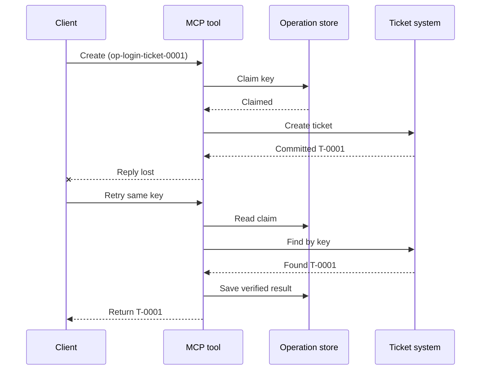
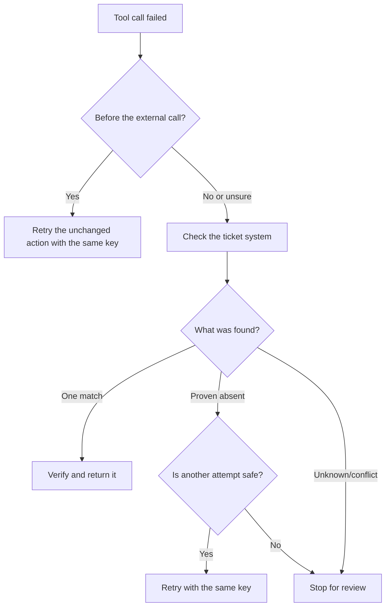

# MCP tööriistade turvalised taaskatsetused: töökindluse sidecar-muster

Puuduv vastus ei tähenda, et toiming puudub. Tugipiletitööriist
võib luua pileti `T-0001` ja seejärel kaotada ühenduse enne, kui klient näeb
tulemust. Kui klient proovib pimesi uuesti, võib see luua `T-0002`.

See õppetund näitab, kuidas tuvastada seda ebakindlat tulemust, säilitada üks stabiilne
identiteet kavandatud toimingu jaoks ning kontrollida piletisüsteemi enne uuesti proovimist.
Kaasnev Python-harjutus töötab lokaalselt standardteegiga
ja SQLite'iga.

## Why a Timeout Means "Outcome Unknown"

Oletame, et klient kutsub `create_support_ticket` toiminguvõtmega
`op-login-ticket-0001`:



Ühendus katkeb pärast pileti kinnitamist, kuid enne tulemuse saabumist.
Klient teab ainult, et vastus puudub. Ta ei tea, kas
pilet puudub. Toiminguvõtme uuesti kasutamine võimaldab tööriistal leida ja tagastada
`T-0001` selle asemel, et luua `T-0002`.

## What a Reliability Sidecar Does

Töökindluse sidecar on rakenduskood, mis hoiab taastumise olekut tööriista ümber.
See võib olla teek, vahendustarkvara, andmebaasipõhine teenus või lihtsalt
osa tööriista rakendusest. See ei pea olema eraldi protsess,
ja see ei ole MCP-protokolli funktsioon.

The sidecar has four jobs:

1. salvestada kavandatud toiming enne välissüsteemi kutsumist;
2. lubada ainult ühel tööprotsessil selle toimingu enda omaks võtta;
3. säilitada piisavalt olekut, et pärast krahhi taastuda; ja
4. kontrollida välissüsteemi, kui tulemus on ebakindel.

This lesson targets the final MCP specification `2026-07-28`. MCP-l ei ole
protokolli tasemel seanssi, seega on toiminguvõti tavaline tööriista argument
mida toetab püsiv rakenduse olek. Sama muster töötab ka varasemate
MCP versioonidega.

## Four IDs That Solve Different Problems

Need identifikaatorid on omavahel seotud, kuid need ei ole omavahel asendatavad:

| Identifikaator | Mida see identifitseerib | Kas see säilib taaskatsetusel? |
| --- | --- | --- |
| JSON-RPC ID | Üks päring ja vastus | Ei; kasuta uut päringu ID-d |
| MCP Task ID | Üks pikaajaline ülesanne | Jah; säilita seda pärimiseks |
| Toiminguvõti | Üks kavandatud toiming | Jah; kasuta seda uuesti selle toimingu jaoks |
| Pileti ID | Salvestatud tulemus | Jah; tagasta see pärast kontrollimist |

Edenemise teavitused ja jälgimiskontekst aitavad päringut jälgida.
Tühistamine palub töö peatada. Ükski neist ei takista dubleeritud pileti tekkimist.

## Build the Guard

Loo toiminguvõti enne esimest tööriista kõnet ja salvesta see töövooga.
Iga katse luua sama kavandatud pilet kasutab sama võtit:

```json
{
  "operation_key": "op-login-ticket-0001",
  "title": "Cannot sign in"
}
```

Teistsugune kavandatud pilet saab uue võtme. Tootmises genereeri opaatne,
ära-arvatav väärtus selle asemel, et panna kliendiandmeid võtmesse.

Here is the complete MCP tool schema used in this lesson:

```json
{
  "name": "create_support_ticket",
  "title": "Create support ticket",
  "description": "Creates or recovers one support ticket for an operation key.",
  "inputSchema": {
    "$schema": "https://json-schema.org/draft/2020-12/schema",
    "type": "object",
    "properties": {
      "operation_key": {
        "type": "string",
        "minLength": 16,
        "maxLength": 128,
        "description": "Stable key reused for the same intended action."
      },
      "title": {
        "type": "string",
        "minLength": 1,
        "maxLength": 200
      }
    },
    "required": ["operation_key", "title"],
    "additionalProperties": false
  },
  "outputSchema": {
    "$schema": "https://json-schema.org/draft/2020-12/schema",
    "type": "object",
    "properties": {
      "ticket_id": {
        "type": "string"
      },
      "operation_key": {
        "type": "string"
      },
      "status": {
        "type": "string",
        "const": "verified"
      }
    },
    "required": ["ticket_id", "operation_key", "status"],
    "additionalProperties": false
  }
}
```

Autentitud kutsuja identiteet pärineb serveri kontekstist, mitte
mudeli antud tööriista sisendist. Piira iga salvestatud toiming:

- seda kutsujat, üürnikku või teenuse kontot;
- tööriista nimi ja versioon; ja
- normaliseeritud sisendite räsi, mis määratleb välise toimingu.

Sisendi räsi vastab lihtsale küsimusele: "Kas see taaskatse küsib sama
piletti?" Kui võti juba kuulub teisele pealkirjale, keela kõne.
Varasema tulemuse tagastamine muudetud sisendi korral varjaks lepingulist viga.

Salvesta nõue ühe atomaarse andmebaasioperatsiooniga. "Atomaarne" tähendab, et kaks tööprotsessi
ei saa mõlemad märgata tühja kirjet ja mõlemad omaks saada. Protsessisisene
lukustus ei ole piisav, kui teine serveri instants võib saada taaskatsetuse.

Töövoog loob võtme samal ajal, kui toiming on `planned`. Näidis seejärel
säilitab need olekud:

- `claimed`: üks tööprotsess on reserveerinud toimingu;
- `completed`: piletisüsteem tagastas tulemuse; ja
- `verified`: piletisüsteemi lugemine kinnitab tulemust.

Krahh võib jätta salvestatud oleku olekusse `claimed` isegi pärast seda, kui pilet oli
loodud. Käsitle iga mittetäielikku nõuet ebakindlana, kuni väline tõend selle
lahendab. Ära eelda, et `claimed` tähendab "midagi ei juhtunud."

## Recover Before You Retry

Kui tööriistakõne ebaõnnestub, otsusta, mis on teada enne järgmise välise
kirjutamise saatmist:



Valideerimine, mis ebaõnnestub enne pileti API kutsumist, on teadaolev viga.
Proovi uuesti muutmata toimingut sama toiminguvõtmega. Kui sisendi parandamine
muudab kavandatud piletit, loo selle uue toimingu jaoks uus võti.

Kui päring võis jõuda piletisüsteemi, tee esmalt kokkuviimine.
Kokkuviimine tähendab salvestatud nõude võrdlemist autoriteetse piletikirjega.
Tagasta olemasolev pilet, kui leitakse täpselt üks sobiv kirje.
Taaskäivita ainult siis, kui pilet on otsustavalt puuduv ja alluv leping
teeb uue katse ohutuks.

"Ei leitud" ei ole alati veenev. Pakkuja, kelle otsing on lõpuks järjepidev,
võib vajada piiratud ootamist ja veel üht kontrolli. Kui süsteem ei suuda olla
otsitakse, annab vastuolulisi tulemusi või ei suuda teist katset turvaliselt topeltarvest ära tunda
katset, peatage ja teavitage `outcome unknown`. Siin peatumist nimetatakse mõnikord
"failing closed": töövoog keeldub oletamast.

## Tõendid, ülesanded ja tühistamine

Tööriista vastus ütleb, mida tööriist teatas. Salvestatud kontrollpunkt ütleb, mida
töövoog salvestas. Kõige tugevam tõend pärineb süsteemist, mis omab
tulemust: selles näites päring piletisüsteemist, mis leiab täpselt ühe
sobiva pileti.

Sobita tõendid riskiga. Teenusepakkuja sõnumi ID võib olla piisav
madala riskiga teavitus. Maksete, juurutuste ja hävitavad toimingud võivad
vajada teenusepakkuja oleku, pearaamatu või käsitsi ülevaatuse tõendit.

MCP Tasks laiendus täiendab seda mustrit pikaajaliste tööde jaoks. Ülesande
ID võimaldab kliendil pärast ühenduse katkestust päringut jätkata, kuid see ei
identifitseeri ega dublikaateeri piletit ennast. Kui Tasks'i kasutatakse, ühenduvad identiteedid
nagu järgmiselt:

```text
operation key -> Task ID -> ticket ID -> verification evidence
```

Tühistamine on koostööline, mitte tagasipööramine. Pilet võidakse siiski luua
pärast tühistamise kinnitamist, seega ebakindel tulemus vajab endiselt
kokkusobitamist.

## Käivita rikesüstimise harjutus

Näide kasutab kahte SQLite-faili: üks esindab operatsioonide hoidlat ja
teine esindab välis-pileti süsteemi. Tehingut, mis hõlmaks mõlemat faili, ei ole.
Rike süstitakse pärast piletikinnitust, kuid enne, kui
sidecar salvestab lõpetamise.

Otse Python-meetod aktsepteerib `caller_id` kui asendit autentitud
serveri konteksti. Ärge lisage `caller_id` mudeli-kontrollitud MCP sisendi
skeemi.

Ennustage tulemus enne testide käivitamist:

| Tee | Tulemus pärast taaskatset | Piletite arv |
| --- | --- | --- |
| Pime taaskatsetus | Loob `T-0002` pärast vastuse kaotust `T-0001` | 2 |
| Kontrollitud taaskatsetus | Leiab ja tagastab `T-0001` | 1 |

Käivita:

```bash
cd 08-BestPractices/reliability-sidecars/python
python -m unittest discover -p "test_*.py" -v
```

Kuus testi näitavad, et:

1. pime taaskatsetus loob duplikaadi;
2. vastuse kadumine ja taaskäivitamine taastab ühe pileti püsivast nõudest;
3. kinnitatud taaskatsetus taaskasutab salvestatud tulemust;
4. muudetud sisend või vastuolulised välised tõendid lükatakse tagasi;
5. olemasolev nõue ilma väliste tõenditeta peatub turvaliselt;
6. samaaegsete nõuete korral saab omanik olla ainult üks ning kinnitatud tulemus ei tagane.

Ava näidis:

- [Pythoni teostus](../../../../08-BestPractices/reliability-sidecars/python/reliability_sidecar.py)
- [Deterministlikud testid](../../../../08-BestPractices/reliability-sidecars/python/test_reliability_sidecar.py)

Näidis jätab tahtlikult välja aegunud nõuete lepingud. Tootmisülevõtmise
poliitika vajab piiratud lepingut, atomaarset omaniku ülekandmist ja teist välist
kontrolli enne täitmist.

## Valikuline kogukonna teostus

Agent Enhancer Utilities on üks selle rakendustasandi mustri kogukonna teostustest.
Selle planeerija valib taastumismeetodi, samal ajal kui selle
kontrollpunkt salvestab nõude ja ebakindla tulemuse olekud. Domeeni tööriist või MCP
server siiski sooritab ja kinnitab reaalse toimingu. See teenus ei kuulu MCP spetsifikatsiooni
osaks ega ole selle õppetunni jaoks nõutav.

| Õppetunni mõiste | Agent Enhanceri komponent | Oluline piirang |
| --- | --- | --- |
| Taastamiskava | `workflow-guard-planner` | Ei kutsu domeenitööriista |
| Nõue ja taastamine | `workflow-checkpoint` | `external_proof` jääb `false` |
| Täpne sidecar-taasesitus | `lab.invoke_tool` | Kasutab eraldi idempotentsusvõtit |
| Kontrolli tegelikku toimingut | Sihtkoha otsimine/loetamine | Domeeni MCP seda omab |

Ühe sidecar-kõne täpseks kordamiseks aktsepteerib `lab.invoke_tool` välist
`idempotency_key`. See võti identifitseerib sidecar-kutse; see ei ole
äri `operation_key`, mida kasutatakse pileti jaoks.

Sildistatud avalik leping ja valikuline võrgunäide on saadaval
siin:

- [Usaldusväärsuse sidecar-leping v1](https://github.com/artiehinz/Agent-Enhancer-Utilities/blob/v1.6.0/docs/RELIABILITY_SIDECAR_CONTRACT_V1.md)
- [Planeerija ja näidisdomeeni näide](https://github.com/artiehinz/Agent-Enhancer-Utilities/tree/v1.6.0/examples/reliability-sidecar)

Need lingid illustreerivad rakenduse mustrit. Need ei väida, et
hostitud teenus vastab MCP `2026-07-28`, ja kontrollpunkti olek ei ole kunagi
väliseks tõendiks pileti kohta.

## Tootmise kontrollnimekiri

- [ ] Loo ja salvesta operatsiooni võti enne esimest välist katset.
- [ ] Seosta võti kutsuja, tööriista versiooni ja normaliseeritud sisendiräsi külge.
- [ ] Keeldu aktsepteerimast muudetud sisendit olemasoleva võtme all.
- [ ] Luba üks omanik atomilise jagatud salvestuse operatsiooniga.
- [ ] Edasta võti allapoole olevale pakkujale, kui see toetab idempotentsust.
- [ ] Lahenda ebakindlad tulemused enne uut kirjutamist.
- [ ] Hoia kinnitatud tulemusi ja tõendeid kogu kordusakna jooksul.
- [ ] Peatu ülevaatuseks, kui välist tulemust ei saa turvaliselt kindlaks teha.

## Viited

- [MCP spetsifikatsioon `2026-07-28`](https://modelcontextprotocol.io/specification/2026-07-28)
- [MCP `2026-07-28` tööriista juhised](https://modelcontextprotocol.io/specification/2026-07-28/server/tools)
- [MCP Tasks laiendus](https://modelcontextprotocol.io/extensions/tasks/overview)
- [JSON-RPC 2.0 spetsifikatsioon](https://www.jsonrpc.org/specification)

---

<!-- CO-OP TRANSLATOR DISCLAIMER START -->
**Lahtiütlus**:
See dokument on tõlgitud kasutades AI tõlketeenust [Co-op Translator](https://github.com/Azure/co-op-translator). Kuigi me püüdleme täpsuse poole, palun pange tähele, et automatiseeritud tõlgetes võib esineda vigu või ebatäpsusi. Originaaldokument selle emakeeles tuleks pidada autoriteetseks allikaks. Olulise teabe puhul soovitatakse kasutada professionaalset inimtõlget. Me ei vastuta selle tõlkega seotud eksimustest või valesti mõistmistest.
<!-- CO-OP TRANSLATOR DISCLAIMER END -->