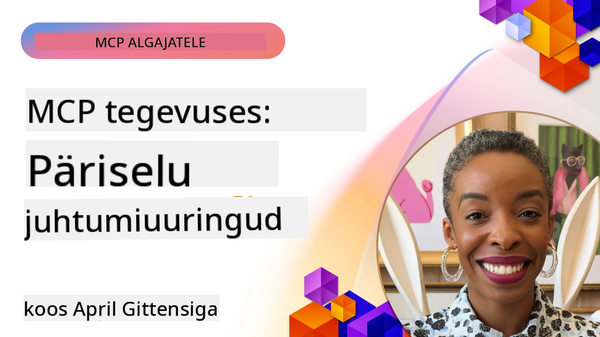

# MCP tegevuses: Reaalmaailma juhtumiuuringud

_(Klõpsake ülaloleval pildil, et vaadata selle õppetunni videot)_

Model Context Protocol (MCP) muudab seda, kuidas tehisintellekti rakendused suhtlevad andmete, tööriistade ja teenustega. See jaotis esitleb reaalse maailma juhtumiuuringuid, mis demonstreerivad MCP praktilisi rakendusi erinevates ettevõtte stsenaariumites.

## Ülevaade

See jaotis tutvustab konkreetseid MCP rakenduste näiteid, tuues välja, kuidas organisatsioonid kasutavad seda protokolli keeruliste äriliste väljakutsete lahendamiseks. Juhtumiuuringute uurimise kaudu saate ülevaate MCP mitmekülgsusest, skaleeritavusest ja praktilistest eelistest reaalse maailma olukordades.

## Peamised õpieesmärgid

Nende juhtumiuuringute läbi töötades saate:

- Mõista, kuidas MCP-i saab rakendada konkreetsete äriprobleemide lahendamiseks
- Õppida erinevaid integratsioonimustreid ja arhitektuurilisi lähenemisviise
- Tuvastada parimaid tavasid MCP rakendamiseks ettevõtte keskkondades
- Saada ülevaate reaalse maailma rakenduste käigus tekkinud väljakutsetest ja lahendustest
- Tuvastada võimalusi sarnaste mustrite rakendamiseks oma projektides

## Esiletõstetud juhtumiuuringud

### 1. [Azure AI reisibürood – viitenäidisrakendus](./travelagentsample.md)

See juhtumiuuring vaatleb Microsofti põhjalikku viitenäidislahendust, mis demonstreerib, kuidas ehitada MCP, Azure OpenAI ja Azure AI Searchi abil mitmeagendi-tehisintellektil põhinev reisiplaneerimise rakendus. Projekt näitab:

- Mitmeagendi orkestreerimine MCP kaudu
- Ettevõtte andmete integreerimine Azure AI Searchiga
- Turvaline ja skaleeritav arhitektuur Azure'i teenuste abil
- Laiendatavad tööriistad taaskasutatavate MCP komponentidega
- Vestluslik kasutajakogemus Azure OpenAI toel

Arhitektuur ja rakenduse üksikasjad annavad väärtuslikku teavet keeruliste mitmeagendi süsteemide ehitamiseks, kus MCP toimib koordineerimiskihina.

### 2. [Azure DevOpsi üksuste värskendamine YouTube'i andmete põhjal](./UpdateADOItemsFromYT.md)

See juhtumiuuring demonstreerib MCP praktilist rakendust töövoogude protsesside automatiseerimiseks. See näitab, kuidas MCP tööriistu saab kasutada:

- Andmete väljavõtmine veebiplatvormidelt (YouTube'ist)
- Tööüksuste värskendamine Azure DevOpsi süsteemides
- Korduvate automatiseeritud töövoogude loomine
- Andmete integreerimine erinevate süsteemide vahel

See näide illustreerib, kuidas isegi suhteliselt lihtsad MCP rakendused võivad tuua märkimisväärseid efektiivsuse parandusi rutiinsete ülesannete automatiseerimise ja andmete järjepidevuse parandamise kaudu süsteemide vahel.

### 3. [Reaalajas dokumentatsiooni hankimine MCP abil](./docs-mcp/README.md)

See juhtumiuuring juhendab, kuidas ühendada Python-konsooliklient Model Context Protocol (MCP) serveriga reaalajas, kontekstiteadliku Microsofti dokumentatsiooni hankimiseks ja logimiseks. Õpite, kuidas:

- Ühenduda MCP serveriga, kasutades Python-kliendi ja ametliku MCP SDK-d
- Kasutada voogedastust toetavaid HTTP-kliente tõhusaks reaalajas andmete hankimiseks
- Käivitada serveris dokumentatsioonitööriistu ja logida vastused otse konsooli
- Integreerida ajakohast Microsofti dokumentatsiooni oma töövoogu, ilma terminalist lahkumata

Lõik sisaldab praktilist ülesannet, minimaalset töötavat koodinäidet ja linke täiendavatele ressurssidele sügavamaks õppimiseks. Täieliku juhendi ja koodi leiate lingitud peatükist, et mõista, kuidas MCP võib muuta dokumentatsiooni kättesaadavust ja arendaja produktiivsust konsoolipõhistes keskkondades.

### 4. [Interaktiivne õppekava generaatori veebirakendus MCP abil](./docs-mcp/README.md)

See juhtumiuuring näitab, kuidas ehitada interaktiivne veebirakendus, kasutades Chainlit ja Model Context Protocoli (MCP), et genereerida isikupärastatud õppekavasid mistahes teemal. Kasutajad saavad määrata aine (nt "AI-900 sertifikaat") ja õppimise kestuse (nt 8 nädalat), ning rakendus annab soovitatava sisu nädala kaupa. Chainlit võimaldab vestluslikku chat-liidest, muutes kogemuse kaasahaaravaks ja adaptiivseks.

- Chainlit'i toetatud vestluslik veebirakendus
- Kasutajapõhised sisendid teema ja kestuse jaoks
- Nädala kaupa sisu soovitused MCP abil
- Reaalajas adaptiivsed vastused vestlusliideses

Projekt illustreerib, kuidas vestluslikku tehisintellekti ja MCP-i saab kombineerida dünaamiliste, kasutajakesksete õppevahendite loomiseks kaasaegses veebikeskkonnas.

### 5. [Redaktorisisesed dokumendid MCP serveriga VS Code'is](./docs-mcp/README.md)

See juhtumiuuring demonstreerib, kuidas tuua Microsoft Learni dokumendid otse oma VS Code'i keskkonda, kasutades MCP serverit — ei mingit brauserivahetust! Näete, kuidas:

- Otsida ja lugeda dokumente VS Code'is kohe, kasutades MCP paneeli või käsupaletti
- Viidata dokumentatsioonile ja sisestada linke otse oma README või kursuse markdown-failidesse
- Kasutada GitHub Copilotit ja MCP-i koos sujuvate, tehisintellekti toetatud dokumentatsiooni- ja kooditöövoogude jaoks
- Kinnitada ja täiustada oma dokumentatsiooni reaalajas tagasiside ja Microsofti allikapõhise täpsuse abil
- Integreerida MCP GitHubi töövoogudega pidevaks dokumentatsiooni valideerimiseks

The implementation includes:

- Näide `.vscode/mcp.json` konfiguratsioonist lihtsaks seadistamiseks
- Kuvatõmmistega samm-sammulised juhendid redaktoris toimuvast
- Nõuanded Copiloti ja MCP kombineerimiseks maksimaalse tootlikkuse saavutamiseks

See stsenaarium sobib ideaalselt kursuse autoritele, dokumentatsiooni kirjutajatele ja arendajatele, kes soovivad redaktoris keskendunult töötada dokumentide, Copiloti ja valideerimistööriistadega — kõik MCP poolt toetatud.

### 6. [APIM MCP serveri loomine](./apimsample.md)

See juhtumiuuring annab samm-sammulise juhendi, kuidas luua MCP server Azure API Managementi (APIM) abil. See hõlmab:

- MCP serveri seadistamine Azure API Managementis
- API operatsioonide avalikustamine MCP tööriistadena
- Kiirusepiirangute ja turvalisuse poliitikate konfigureerimine
- MCP serveri testimine Visual Studio Code'i ja GitHub Copiloti abil

See näide illustreerib, kuidas ära kasutada Azure'i võimalusi tugeva MCP serveri loomiseks, mida saab kasutada erinevates rakendustes, parandades tehisintellekti süsteemide integreeritust ettevõtte API-dega.

### 7. [GitHub MCP register — agendi integratsiooni kiirendamine](https://github.com/mcp)

See juhtumiuuring uurib, kuidas GitHubi MCP register, mis käivitus 2025. aasta septembris, lahendab kriitilise probleemi tehisintellekti ökosüsteemis: MCP serverite killustunud avastamise ja juurutamise.

#### Ülevaade
The **MCP Register** lahendab kasvava probleemi MCP serverite laialdase hajutuse tõttu repositooriumites ja registrites, mis varem muutis integratsiooni aeglaseks ja vigaderohkeks. Need serverid võimaldavad AI agentidel suhelda väliste süsteemidega nagu API-d, andmebaasid ja dokumentatsiooniallikad.

#### Probleemi kirjeldus
Agentsete töövoogude loomisel seisid arendajad silmitsi mitmete väljakutsetega:
- **Halb leitavus** MCP serverite osas erinevatel platvormidel
- **Ülekattuvad seadistusküsimused** laiali hajutatud foorumites ja dokumentatsioonis
- **Turvariskid** mittetõestatud ja ebausaldusväärsetest allikatest
- **Standardiseerimise puudumine** serveri kvaliteedis ja ühilduvuses

#### Lahenduse arhitektuur
GitHubi MCP register keskendab usaldusväärseid MCP servereid järgmiste põhifunktsioonidega:
- **Ühe klõpsuga paigaldus** integratsioon VS Code'i kaudu lihtsustatud seadistuse jaoks
- **Signaali-müra eraldamine** tähtede, aktiivsuse ja kogukonnakinnituse alusel
- **Otsene integratsioon** GitHub Copilotiga ja teiste MCP-ühilduvate tööriistadega
- **Avatud panuse mudel** võimaldab nii kogukonnal kui ettevõttepartneritel panustada

#### Äriline mõju
Register on toonud mõõdetavaid parandusi:
- **Kiirem juurutus** arendajatele, kes kasutavad selliseid tööriistu nagu Microsoft Learn MCP Server, mis voogedastab ametlikku dokumentatsiooni otse agentidesse
- **Paranenud tootlikkus** spetsialiseeritud serverite, nagu `github-mcp-server`, kaudu, võimaldades GitHubi automatiseerimist loomulikus keeles (PR loomine, CI taaskäivitused, koodi skannimine)
- **Tugevam ökosüsteemi usaldus** kureeritud nimekirjade ja läbipaistvate konfiguratsioonistandardite kaudu

#### Strateegiline väärtus
Agentide elutsükli haldamisele ja reprodutseeritavatele töövoogudele spetsialiseerunud praktikutele pakub MCP register:
- **Moodulipõhine agendi juurutamine** võimalused standardiseeritud komponentidega
- **Registri toetatud hindamisliinid** ühtseks testimiseks ja valideerimiseks
- **Tööriistadevaheline koostalitlus** võimaldades sujuvat integratsiooni erinevate AI platvormide vahel

See juhtumiuuring näitab, et MCP register on rohkem kui lihtsalt kataloog — see on alustala skaleeritavate, reaalse maailma mudelite integreerimiseks ja agentsete süsteemide juurutamiseks.

### 8. [Agendilt sotsiaalvõrgustikele postitamine](./publora-social-publishing.md)

See juhtumiuuring käsitleb **kirjutusvõimelist kaug-MCP-serverit** — serverit, mille tööriistad võtavad kasutaja nimel pöördumatuid toiminguid — kasutades näitena sotsiaalmeedias avaldamist. Agent koostab postituse, inimene kinnitab selle ja server ajastab selle erinevatele võrkudele.

Huvitav osa on avaldamisest tulenevad disainipiirangud, mis kehtivad iga serveri puhul, mis kirjutab, mitte ei loe:

- **Avatud avastamine, autentitud täitmine** — `tools/list` vastatakse ilma tõenditeta, nii et registrid ja kliendid saavad seda uurida, samas kui iga `tools/call` nõuab tokenit ja muidu tagastab `401` koos `WWW-Authenticate` päisega
- **OAuth-i registreerimine ilma välise sammuta** — dünaamiline kliendi registreerimine täna, kus Client ID Metadata Documents on suund, kuhu `2026-07-28` spetsifikatsioon osutab
- **Tööriista annotatsioonid** (`readOnlyHint`, `destructiveHint`, `idempotentHint`), mida kliendid kasutavad otsustamaks, mida kinnitada — vihjed, mitte sundimine, ja midagi, mida konnektorite kataloogid nüüd vaatlusel ootavad
- **Väljamõeldamatud identifikaatorid**, nii et väljamõeldud väärtus ebaõnnestub selgelt selle asemel, et tegutseda näiliselt plausibilsena
- **Idempotentsuse võtmed postitust loovatel tööriistadel**, nii et agendi käituskeskkonna korduskatse ei muutu duplikaatpostituseks
- **Tööriistaskeemas kirjeldatud no-op sihtmärk**, mis kasutab kogu kirjutamisteed ja ei avalda midagi, ülevaatajate ja CI jaoks

Peatükk lõpeb lühikese kontrollnimekirjaga, mida saate rakendada serveri ehitamisel.

## Kokkuvõte

Need kaheksa põhjalikku juhtumiuuringut demonstreerivad Model Context Protocoli märkimisväärset mitmekülgsust ja praktilisi rakendusi eriolukordades. Alates keerukatest mitmeagendi reisiplaneerimise süsteemidest ja ettevõtte API haldusest kuni optimeeritud dokumentatsiooni töövoogude ja revolutsioonilise GitHubi MCP registrini — need näited näitavad, kuidas MCP pakub standardiseeritud, skaleeritavat viisi AI süsteemide ühendamiseks vajalike tööriistade, andmete ja teenustega, et pakkuda erakordset väärtust.

Juhtumiuuringud hõlmavad MCP rakenduse mitmeid mõõtmeid:
- **Ettevõtte integratsioon**: Azure API Management ja Azure DevOpsi automatiseerimine
- **Mitmeagendi orkestreerimine**: reisiplaneerimine koordineeritud AI agentidega
- **Arendaja tootlikkus**: VS Code integratsioon ja reaalajas dokumentatsiooni ligipääs
- **Ökosüsteemi areng**: GitHubi MCP register kui aluseks olev platvorm
- **Hariduslikud rakendused**: interaktiivsed õppekava generaatorid ja vestlusliidesed

Nende rakenduste uurimisel saate olulisi teadmisi järgmistes valdkondades:
- **Arhitektuurimustrid** erinevate skaalade ja kasutusjuhtude jaoks
- **Rakendusstrateegiad**, mis tasakaalustavad funktsionaalsust ja hooldatavust
- **Turvalisuse ja skaleeritavuse** kaalutlused tootmiskeskkonna juurutustel
- **Parimad tavad** MCP serveri arendamiseks ja kliendi integratsiooniks
- **Ökosüsteemiline mõtlemine** ühendatud AI-toega lahenduste ehitamiseks

Need näited näitavad ühiselt, et MCP ei ole pelgalt teoreetiline raamistik, vaid küps, tootmiskõlbulik protokoll, mis võimaldab praktilisi lahendusi keerulistele ärilistele väljakutsetele. Olenemata sellest, kas loote lihtsaid automatiseerimistööriistu või keerukaid mitmeagendi süsteeme, annavad siin esitatud mustrid ja lähenemised tugeva aluse teie enda MCP projektidele.

## Täiendavad ressursid

- [Azure AI reisibüroode GitHubi repositoorium](https://github.com/Azure-Samples/azure-ai-travel-agents)
- [Azure DevOps MCP tööriist](https://github.com/microsoft/azure-devops-mcp)
- [Playwright MCP tööriist](https://github.com/microsoft/playwright-mcp)
- [Microsoft Docs MCP server](https://github.com/MicrosoftDocs/mcp)
- [GitHub MCP register — agendi integratsiooni kiirendamine](https://github.com/mcp)
- [MCP kogukonna näited](https://github.com/microsoft/mcp)

## Mis edasi

- Eelmine: [Moodul 8: Parimad tavad](../08-BestPractices/README.md)
- Järgmine: [Moodul 10: AI töövoogude sujuvamaks muutmine: MCP serveri ehitamine Microsoft Foundry tööriistakomplektiga](../10-StreamliningAIWorkflowsBuildingAnMCPServerWithAIToolkit/README.md)

---

<!-- CO-OP TRANSLATOR DISCLAIMER START -->
**Lahtiütlus**:
See dokument on tõlgitud kasutades AI tõlketeenust [Co-op Translator](https://github.com/Azure/co-op-translator). Kuigi me püüdleme täpsuse poole, palun pange tähele, et automatiseeritud tõlgetes võib esineda vigu või ebatäpsusi. Originaaldokument selle emakeeles tuleks pidada autoriteetseks allikaks. Olulise teabe puhul soovitatakse kasutada professionaalset inimtõlget. Me ei vastuta selle tõlkega seotud eksimustest või valesti mõistmistest.
<!-- CO-OP TRANSLATOR DISCLAIMER END -->