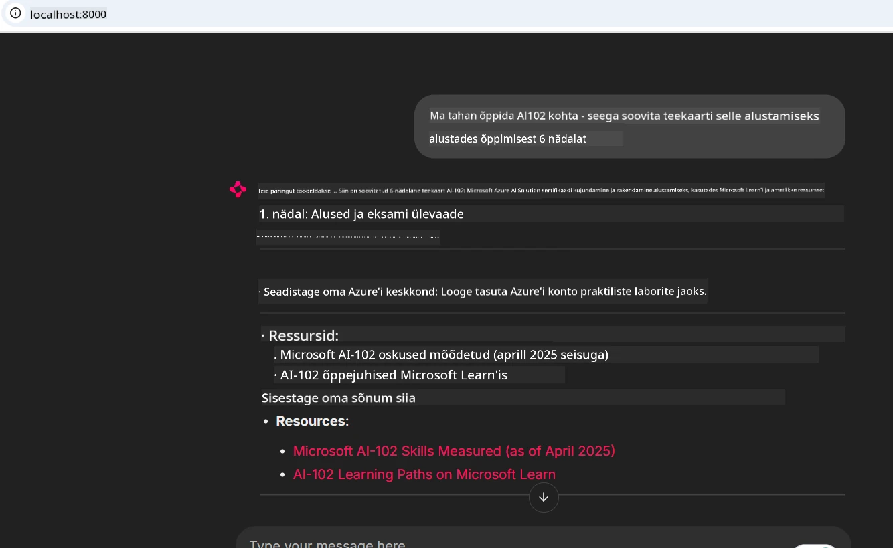
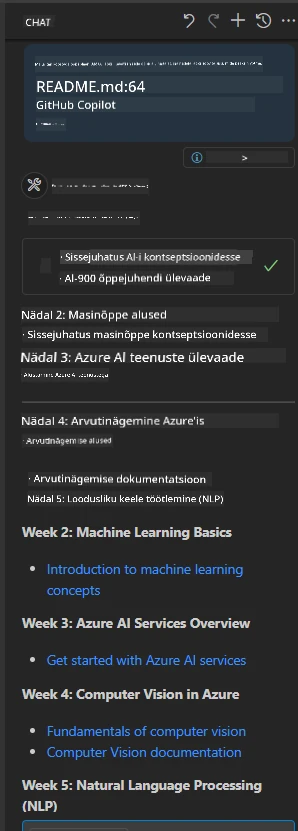

# Juhtumiuuring: ühendamine Microsoft Learn Docs MCP-serveriga kliendilt

Kas olete kunagi leidnud end dokumentatsioonilehtede, Stack Overflow ja lõputute otsingumootori vahele hüplemas, püüdes samal ajal lahendada probleemi oma koodis? Võib-olla hoiate teist monitori ainult dokumentatsiooni jaoks või vahetate pidevalt IDE ja brauseri vahel. Kas poleks parem, kui saaksite dokumentatsiooni oma töövoogu tuua — integreerituna oma rakendustesse, IDE-sse või isegi teie enda kohandatud tööriistadesse? Selles juhtumiuuringus uurime, kuidas teha täpselt seda, ühendades oma kliendirakenduse otse Microsoft Learn Docs MCP-serveriga.

## Ülevaade

Kaasaegne arendus ei ole lihtsalt koodi kirjutamine — see on õige teabe leidmine õigeaegselt. Dokumentatsioon on kõikjal, kuid harva seal, kus seda kõige enam vajatakse: teie tööriistades ja töövoogudes. Integreerides dokumentatsiooni hankimise otse oma rakendustesse, saate säästa aega, vähendada konteksti vahetamist ja suurendada tootlikkust. Selles jaotises näitame, kuidas ühendada klient Microsoft Learn Docs MCP-serveriga, et pääseda juurde reaalajas, kontekstiteadlikule dokumentatsioonile ilma oma rakendusest lahkumata.

Läbime protsessi, kuidas luua ühendus, saata päring ja töödelda voogedastatud vastuseid tõhusalt. See lähenemine mitte ainult ei sujuvenda teie töövoogu, vaid avab võimaluse luua nutikamaid ja abivalmimaid arendajatööriistu.

## Õpieesmärgid

Miks me seda teeme? Sest parimad arendajakogemused eemaldavad hõõrdumist. Kujutage maailma, kus teie koodiredaktor, vestlusrobot või veebiäppi suudab teie dokumentatsiooniküsimustele vastata kohe, kasutades Microsoft Learning uusimat sisu. Selle peatüki lõpuks oskate:

- Mõista MCP serveri-kliendi suhtluse aluseid dokumentatsiooni jaoks
- Rakendada konsooli- või veebirakendust, mis ühendub Microsoft Learn Docs MCP-serveriga
- Kasutada voogedastust toetavaid HTTP-kliente reaalajas dokumentatsiooni hankimiseks
- Logida ja tõlgendada dokumentatsioonivastuseid oma rakenduses

Näete, kuidas need oskused aitavad teil luua tööriistu, mis ei ole mitte ainult reaktiivsed, vaid tõeliselt interaktiivsed ja kontekstiteadlikud.

## Scenario 1 - Real-Time Documentation Retrieval with MCP

Selles stsenaariumis näitame, kuidas ühendada klient Microsoft Learn Docs MCP-serveriga, et pääseda juurde reaalajas, kontekstiteadlikule dokumentatsioonile ilma oma rakendusest lahkumata.

Paneme selle praktikasse. Teie ülesanne on kirjutada rakendus, mis ühendub Microsoft Learn Docs MCP-serveriga, kutsub välja tööriista `microsoft_docs_search` ja logib voogedastatud vastuse konsooli.

### Miks selline lähenemine?
Sest see on alus keerukamate integratsioonide ehitamiseks — olgu selleks vestlusrobot, IDE-laiendus või veebipaneel.

Leiate selle stsenaariumi koodi ja juhised [`solution`](./solution/README.md) kaustast selles juhtumiuuringus. Sammud juhendavad teid ühenduse seadistamisel:
- Kasutada ametlikku MCP SDK-d ja voogedastust toetavat HTTP-kliendiühendust
- Kutsuda tööriista `microsoft_docs_search` koos päringupõhise parameetriga dokumentatsiooni toomiseks
- Rakendada nõuetekohane logimine ja veahaldus
- Luua interaktiivne konsooliliides, mis võimaldab kasutajatel sisestada mitu otsingupäringut

See stsenaarium demonstreerib, kuidas:
- Ühenduda Docs MCP-serveriga
- Saata päring
- Analüüsida ja väljastada tulemused

Nii võib lahenduse käivitamine välja näha:

```
Prompt> What is Azure Key Vault?
Answer> Azure Key Vault is a cloud service for securely storing and accessing secrets. ...
```

Allpool on minimaalne näidislahendus. Täielik kood ja üksikasjad on saadaval lahenduse kaustas.

<details>
<summary>Python</summary>

```python
import asyncio
from mcp.client.streamable_http import streamablehttp_client
from mcp import ClientSession

async def main():
    async with streamablehttp_client("https://learn.microsoft.com/api/mcp") as (read_stream, write_stream, _):
        async with ClientSession(read_stream, write_stream) as session:
            await session.initialize()
            result = await session.call_tool("microsoft_docs_search", {"query": "Azure Functions best practices"})
            print(result.content)

if __name__ == "__main__":
    asyncio.run(main())
```

- Täieliku implementatsiooni ja logimise jaoks vaata [`scenario1.py`](../../../../09-CaseStudy/docs-mcp/solution/python/scenario1.py).
- Paigaldamise ja kasutusjuhiste jaoks vaata faili [`README.md`](./solution/python/README.md) samas kaustas.
</details>


## Scenario 2 - Interactive Study Plan Generator Web App with MCP

Selles stsenaariumis õpite, kuidas integreerida Docs MCP veebiarendusprojekti. Eesmärk on võimaldada kasutajatel otsida Microsoft Learn dokumentatsiooni otse veebiliidesest, muutes dokumentatsiooni koheselt kättesaadavaks teie rakenduses või saidil.

Sa õpid, kuidas:
- Seadistada veebirakendus
- Ühenduda Docs MCP-serveriga
- Käsitleda kasutaja sisendit ja kuvada tulemusi

Nii võib lahenduse käivitamine välja näha:

```
User> I want to learn about AI102 - so suggest the roadmap to get it started from learn for 6 weeks

Assistant> Here’s a detailed 6-week roadmap to start your preparation for the AI-102: Designing and Implementing a Microsoft Azure AI Solution certification, using official Microsoft resources and focusing on exam skills areas:

---
## Week 1: Introduction & Fundamentals
- **Understand the Exam**: Review the [AI-102 exam skills outline](https://learn.microsoft.com/en-us/credentials/certifications/exams/ai-102/).
- **Set up Azure**: Sign up for a free Azure account if you don't have one.
- **Learning Path**: [Introduction to Azure AI services](https://learn.microsoft.com/en-us/training/modules/intro-to-azure-ai/)
- **Focus**: Get familiar with Azure portal, AI capabilities, and necessary tools.

....more weeks of the roadmap...

Let me know if you want module-specific recommendations or need more customized weekly tasks!
```

Allpool on minimaalne näidislahendus. Täielik kood ja üksikasjad on saadaval lahenduse kaustas.



<details>
<summary>Python (Chainlit)</summary>

Chainlit on raamistik vestluslikke tehisintellekti veebirakendusi ehitamiseks. See muudab lihtsaks interaktiivsete vestlusrobotite ja assistentide loomise, mis suudavad kutsuda MCP tööriistu ja kuvada tulemusi reaalajas. See sobib suurepäraselt kiireks prototüüpimiseks ja kasutajasõbralikeks liidesteks.

```python
import chainlit as cl
import requests

MCP_URL = "https://learn.microsoft.com/api/mcp"

@cl.on_message
def handle_message(message):
    query = {"question": message}
    response = requests.post(MCP_URL, json=query)
    if response.ok:
        result = response.json()
        cl.Message(content=result.get("answer", "No answer found.")).send()
    else:
        cl.Message(content="Error: " + response.text).send()
```

- Täieliku implementatsiooni jaoks vaata [`scenario2.py`](../../../../09-CaseStudy/docs-mcp/solution/python/scenario2.py).
- Seadistamise ja käivitamise juhiste jaoks vaata [`README.md`](./solution/python/README.md).
</details>


## Scenario 3: In-Editor Docs with MCP Server in VS Code

Kui soovite saada Microsoft Learn docse otse oma VS Code’i sisse (brauseri vahekaarte vahetamata), saate kasutada MCP-serverit oma redaktoris. See võimaldab teil:
- Otsida ja lugeda dokumentatsiooni VS Code'is ilma oma koodimis keskkonnast lahkumata.
- Viidata dokumentatsioonile ja lisada linke otse oma README või kursusefailidesse.
- Kasutada GitHub Copilot'i ja MCP-d koos sujuva, AI-toega dokumentatsiooni töövoo jaoks.

**Sa õpid, kuidas:**
- Lisada kehtiv `.vscode/mcp.json` fail oma tööruumi juurkataloogi (vaata allolevat näidet).
- Avada MCP paneel või kasutada käskude paletti VS Code'is, et otsida ja lisada dokumente.
- Viidata dokumentatsioonile otse oma markdown-failides tööd tehes.
- Kombineerida see töövoog GitHub Copilot'iga veelgi suurema tootlikkuse saavutamiseks.

Siin on näide, kuidas seadistada MCP-server VS Code'is:

```json
{
  "servers": {
    "LearnDocsMCP": {
      "url": "https://learn.microsoft.com/api/mcp"
    }
  }
}
```

</details>

> Üksikasjaliku samm-sammult juhendi, ekraanipiltide ja sammude jaoks vaata [`README.md`](./solution/scenario3/README.md).



See lähenemine sobib ideaalselt kõigile, kes loovad tehnilisi kursusi, kirjutavad dokumentatsiooni või arendavad koodi, mis nõuab sagedast viitamist.

## Peamised järeldused

Dokumentatsiooni integreerimine otse teie tööriistadesse ei ole vaid mugavus — see muudab tootlikkuse mängureegleid. Ühendades oma kliendist Microsoft Learn Docs MCP-serveriga, saate:

- Vähendada konteksti vahetamist koodi ja dokumentatsiooni vahel
- Hankida ajakohast, kontekstiteadlikku dokumentatsiooni reaalajas
- Luua nutikamaid, interaktiivsemaid arendajatööriistu

Need oskused aitavad teil luua lahendusi, mis on mitte ainult tõhusad, vaid ka meeldivad kasutada.

## Lisamaterjalid

Oma arusaama süvendamiseks uurige neid ametlikke ressursse:

- [Microsoft Learn Docs MCP-server (GitHub)](https://github.com/MicrosoftDocs/mcp)
- [Alustamine Azure MCP-serveriga (mcp-python)](https://learn.microsoft.com/en-us/azure/developer/azure-mcp-server/get-started#create-the-python-app)
- [Mis on Azure MCP-server?](https://learn.microsoft.com/en-us/azure/developer/azure-mcp-server/)
- [Model Context Protocol (MCP) sissejuhatus](https://modelcontextprotocol.io/introduction)
- [Lisa pistikprogrammid MCP-serverist (Python)](https://learn.microsoft.com/en-us/semantic-kernel/concepts/plugins/adding-mcp-plugins)

## Järgmiseks

- Tagasi: [Juhtumiuuringute ülevaade](../README.md)
- Jätka: [Moodul 10: tehisintellekti töövoogude sujuvamaks muutmine Microsoft Foundry tööriistakomplektiga](../../10-StreamliningAIWorkflowsBuildingAnMCPServerWithAIToolkit/README.md)

---

<!-- CO-OP TRANSLATOR DISCLAIMER START -->
**Lahtiütlus**:
See dokument on tõlgitud kasutades AI tõlketeenust [Co-op Translator](https://github.com/Azure/co-op-translator). Kuigi me püüdleme täpsuse poole, palun pange tähele, et automatiseeritud tõlgetes võib esineda vigu või ebatäpsusi. Originaaldokument selle emakeeles tuleks pidada autoriteetseks allikaks. Olulise teabe puhul soovitatakse kasutada professionaalset inimtõlget. Me ei vastuta selle tõlkega seotud eksimustest või valesti mõistmistest.
<!-- CO-OP TRANSLATOR DISCLAIMER END -->