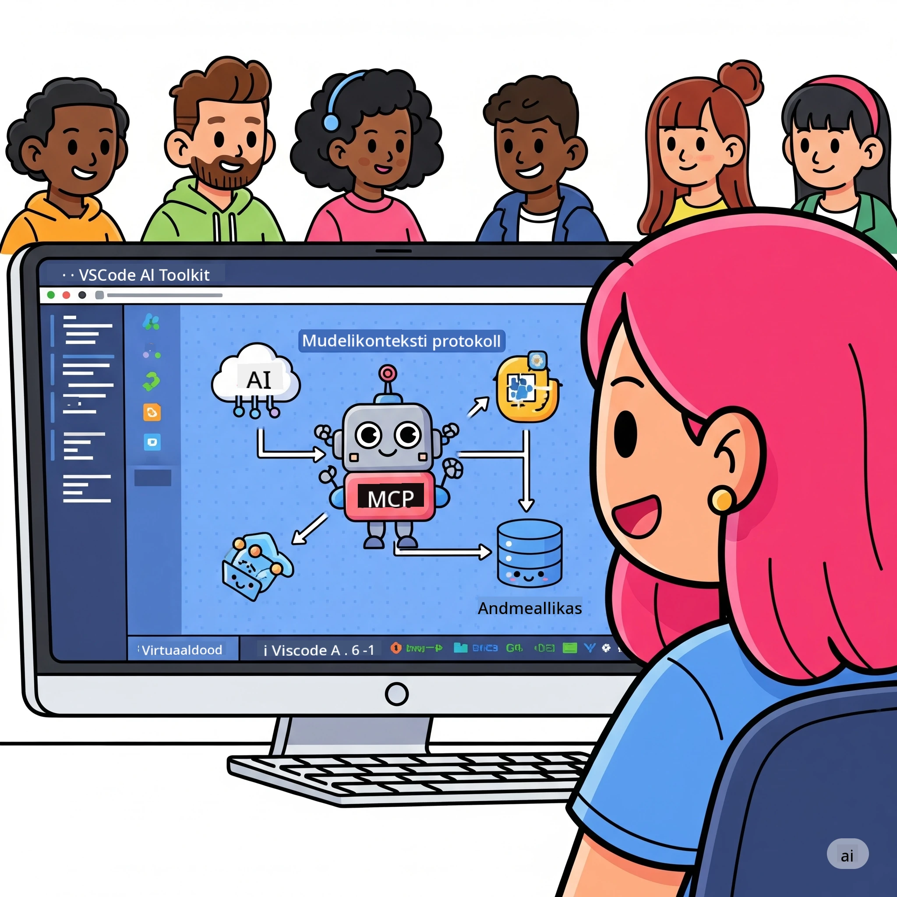
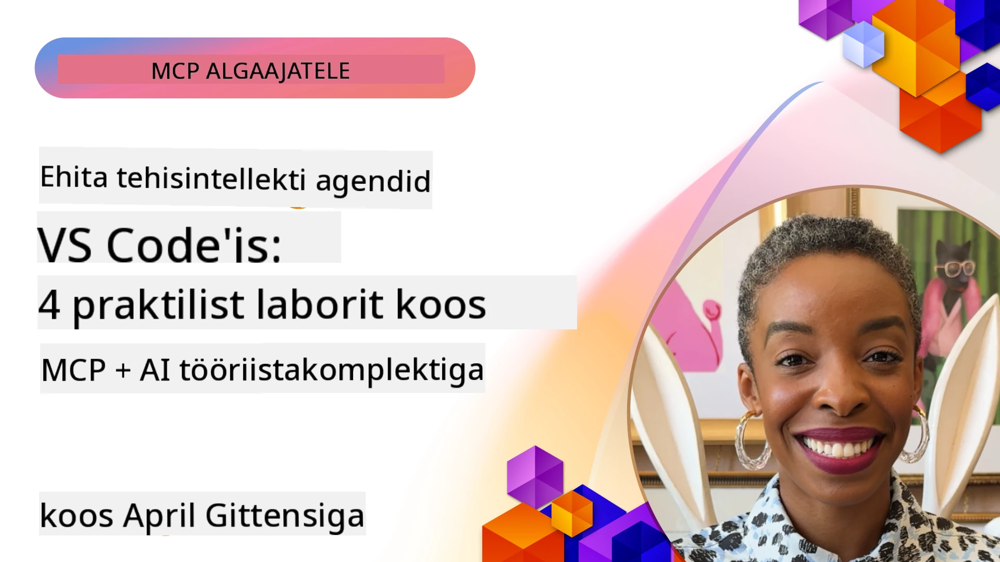

# AI töövoogude lihtsustamine: MCP-serveri ehitamine Microsoft Foundry Toolkitiga

## 🎯  Ülevaade

_(Klõpsa ülaloleval pildil, et vaadata selle tunni videot)_

Tere tulemast **Model Context Protocol (MCP) töötuppa**! See põhjalik praktiline töötuba ühendab kaks tipptasemel tehnoloogiat, et revolutsioneerida AI-rakenduste arendamist:

> **Ühilduvusmärkus:** töötoa kood ehitati ja testiti MCP
> `2025-11-25`, nagu on näidatud ülaloleval nupul. Kasuta
> [praegust `2026-07-28` spetsifikatsiooni](https://modelcontextprotocol.io/specification/2026-07-28/)
> uute protokolli rakenduste jaoks ja vaata üle SDK väljaannete märkmed enne
> laborite migratsiooni.

- **🔗 Model Context Protocol (MCP)**: Avatud standard sujuvaks AI-tööriistade integreerimiseks
- **🛠️ Microsoft Foundry Toolkit Extension for VS Code**: Microsofti võimas AI-arenduse laiendus

### 🎓 Mida õpid

Kui töötuba on lõppenud, valdad oskusi intelligentsete rakenduste loomisel, mis ühendavad AI-mudeleid reaalse maailma tööriistade ja teenustega. Automaattestimisest kohandatud API-integratsioonideni saad praktilisi oskusi keerukate äriliste väljakutsete lahendamiseks.

## 🏗️ Tehnoloogiline virn

### 🔌 Model Context Protocol (MCP)

MCP on **"USB-C tehisintellektile"** – universaalne standard, mis ühendab AI-mudeleid väliste tööriistade ja andmeallikatega.

**✨ Põhifunktsioonid:**

- 🔄 **Standardiseeritud integreerimine**: Universaalne liides AI-tööriistade ühendamiseks
- 🏛️ **Paindlik arhitektuur**: lokaalsed ja kaugserverid stdio/SSE-transporti kaudu
- 🧰 **Rikas ökosüsteem**: tööriistad, promptid ja ressursid ühes protokollis
- 🔒 **Ettevõttevalmis**: sisseehitatud turvalisus ja töökindlus

**🎯 Miks MCP on oluline:**
Nii nagu USB-C likvideeris kaablikaose, vähendab MCP AI-integratsioonide keerukust. Üks protokoll, lõputud võimalused.

### 🤖 Microsoft Foundry Toolkit laiendus VS Code'ile

Microsofti lipulaeva AI-arenduse laiendus, mis muudab VS Code'i võimsaks AI-arendusplatvormiks.

**🚀 Põhivõimekused:**

- 📦 **Mudelite kataloog**: juurdepääs mudelitele Azure AI-st, GitHubist, Hugging Face'ist, Ollama'st
- ⚡ **Lokaalne inferents**: ONNX-iga optimeeritud CPU/GPU/NPU käitamine
- 🏗️ **Agent Builder**: visuaalne AI-agendi arendamine MCP-integratsiooniga
- 🎭 **Mitmemodaalne**: tekst, pilditöötlus ja struktureeritud väljundi tugi

**💡 Arenduse eelised:**

- Nullkonfiguratsiooniga mudelite juurutus
- Visuaalne promptide koostamine
- Reaalajas testimisruum
- Sujuv MCP-serveri integratsioon

## 📚 Õppeteekond

### [🚀 Moodul 1: Microsoft Foundry Toolkit põhialused](./lab1/README.md)

**Kestus**: 15 minutit

- 🛠️ Paigalda ja konfigureeri Microsoft Foundry Toolkit VS Code'i jaoks
- 🗂️ Uuri mudelike kataloogi (100+ mudelit GitHubist, ONNX-ist, OpenAI-st, Anthropic-ist, Google'ist)
- 🎮 Valda interaktiivset testikeskkonda reaalajas mudelite testimiseks
- 🤖 Loo oma esimene AI-agent Agent Builderiga
- 📊 Hinda mudeli jõudlust sisseehitatud mõõdikute abil (F1, asjakohasus, sarnasus, koherentsus)
- ⚡ Õpi partiitöötlust ja mitmemodaalse toe võimalusi

**🎯 Õpitulemus**: Loo funktsionaalne AI-agent, omades põhjalikku arusaama Microsoft Foundry Toolkiti võimekusest

### [🌐 Moodul 2: MCP koos Microsoft Foundry Toolkiti põhialustega](./lab2/README.md)

**Kestus**: 20 minutit

- 🧠 Valda Model Context Protocol (MCP) arhitektuuri ja kontseptsioone
- 🌐 Uuri Microsofti MCP-serverite ökosüsteemi
- 🤖 Loo brauseri automatiseerimise agent, kasutades Playwright MCP-serverit
- 🔧 Integreeri MCP-serverid Microsoft Foundry Toolkit Agent Builderiga
- 📊 Konfigureeri ja testi MCP-tööriistu oma agentides
- 🚀 Ekspordi ja juuruta MCP-toega agente tootmiskasutuseks

**🎯 Õpitulemus**: Juuruta AI-agent, mis on väliste tööriistade kaudu MCP-ga võimendatud

### [🔧 Moodul 3: Täiustatud MCP-arendus Microsoft Foundry Toolkitiga](./lab3/README.md)

**Kestus**: 20 minutit

- 💻 Loo kohandatud MCP-serverid Microsoft Foundry Toolkitiga
- 🐍 Konfigureeri ja kasuta uusimat MCP Python SDK-d (v1.9.3)
- 🔍 Sea üles ja kasuta MCP Inspectorit silumiseks
- 🛠️ Ehita ilmaprognoosi MCP-server koos professionaalsete silumisvoogudega
- 🧪 Silu MCP-servereid nii Agent Builderi kui ka Inspectori keskkondades

**🎯 Õpitulemus**: Arenda ja silu kohandatud MCP-servereid kaasaegsete tööriistadega

### [🐙 Moodul 4: Praktiline MCP-arendus - kohandatud GitHub-klooniserver](./lab4/README.md)

**Kestus**: 30 minutit

- 🏗️ Ehita reaalmaailma GitHub-klooniserver MCP arendusvoogude jaoks
- 🔄 Rakenda nutikas repositooriumi kloonimine valideerimise ja veakäsitlusega
- 📁 Loo intelligentne kataloogihaldus ja VS Code'i integratsioon
- 🤖 Kasuta GitHub Copilot Agent Mode'i kohandatud MCP-tööriistadega
- 🛡️ Rakenda tootmiskõlbulik töökindlus ja platvormideülene ühilduvus

**🎯 Õpitulemus**: Juuruta tootmiskõlblik MCP-server, mis lihtsustab reaalseid arendusvooge

## 💡 Reaalsed rakendused ja mõju

### 🏢 Ettevõtete kasutusjuhtumid

#### 🔄 DevOpsi automatiseerimine

Muuda oma arendusvoogu intelligentse automatiseerimisega:

- **Nutikas repositooriumi haldus**: AI-põhine koodi ülevaatus ja ühendamise otsused
- **Intelligentne CI/CD**: automaatne torujuhtme optimeerimine koodimuudatuste põhjal
- **Probleemide triage**: automaatne vigade klassifitseerimine ja määramine

#### 🧪 Kvaliteedi tagamise revolutsioon

Tõsta testimist AI-põhise automatiseerimise abil:

- **Nutikas testide genereerimine**: loo automaatselt põhjalikke testikomplekte
- **Visuaalne regressioonitestimine**: AI-põhine UI muudatuste tuvastamine
- **Jõudluse jälgimine**: proaktiivne probleemide tuvastamine ja lahendamine

#### 📊 Andmevoogude intelligentsus

Loo nutikamad andmetöötlusvood:

- **Adaptiivsed ETL-protsessid**: iseoptimeeruvad andmete transformatsioonid
- **Anomaaliate tuvastamine**: reaalajas andmekvaliteedi jälgimine
- **Nutikas marsruutimine**: tark andmevoo haldus

#### 🎧 Kliendikogemuse parandamine

Loo erakordsed kliendisuhtlused:

- **Kontekstiteadlik tugi**: AI-agendid, kellel on ligipääs kliendi ajaloole
- **Proaktiivne probleemilahendus**: ennustav klienditeenindus
- **Mitmekanaline integratsioon**: ühtne AI-kogemus platvormide lõikes

## 🛠️ Eeltingimused ja seadistamine

### 💻 Süsteeminõuded

| Komponent | Nõue | Märkused |
|-----------|-------------|-------|
| **Operatsioonisüsteem** | Windows 10+, macOS 10.15+, Linux | Ükskõik milline kaasaegne OS |
| **Visual Studio Code** | Viimane stabiilne versioon | Nõutud Microsoft Foundry Toolkiti jaoks |
| **Node.js** | v18.0+ and npm | MCP-serveri arendamiseks |
| **Python** | 3.10+ | Valikuline Python MCP-serverite jaoks |
| **Mälu** | Vähemalt 8GB RAM | 16GB soovitatav lokaalsete mudelite jaoks |

### 🔧 Arenduskeskkond

#### Soovitatud VS Code'i laiendused

- **Microsoft Foundry Toolkit** (ms-windows-ai-studio.windows-ai-studio)
- **Python** (ms-python.python)
- **Python Debugger** (ms-python.debugpy)
- **GitHub Copilot** (GitHub.copilot) - Valikuline, kuid kasulik

#### Valikulised tööriistad

- **uv**: Moodne Python-pakihaldur
- **MCP Inspector**: visuaalne silumisvahend MCP-serveritele
- **Playwright**: veebiautomaadi näidete jaoks

## 🎖️ Õpitulemused ja sertifitseerimise rada

### 🏆 Oskuste valdamise kontrollnimekiri

Selle töötoa läbimisel saavutad järgmiste oskuste valdamise:

#### 🎯 Põhioskused

- [ ] **MCP-protokolli valdamine**: sügav arusaam arhitektuurist ja rakenduse mustritest
- [ ] **Microsoft Foundry Toolkiti vilumus**: eksperttase Microsoft Foundry Toolkiti kasutamises kiireks arenduseks
- [ ] **Kohandatud serverite arendus**: ehita, juuruta ja halda tootmiskõlblikke MCP-servereid
- [ ] **Tööriistade integratsiooni tipptase**: ühenda AI sujuvalt olemasolevate arendusvoogudega
- [ ] **Probleemilahenduse rakendamine**: rakenda õpitud oskusi reaalse äri väljakutsete lahendamiseks

#### 🔧 Tehnilised oskused

- [ ] Sea üles ja konfigureeri Microsoft Foundry Toolkit VS Code'is
- [ ] Kujunda ja rakenda kohandatud MCP-servereid
- [ ] Integreeri Microsoft Foundry mudelid MCP-arhitektuuriga
- [ ] Loo automatiseeritud testimisvood Playwright'iga
- [ ] Juuruta AI-agendid tootmiskasutuseks
- [ ] Silu ja optimeeri MCP-serverite jõudlust

#### 🚀 Täiustatud võimekused

- [ ] Arhitekteeri ettevõtte mõõtu AI-integratsioonid
- [ ] Rakenda turvalisuse parimaid tavasid AI-rakendustele
- [ ] Kujunda skaleeritavaid MCP-serveri arhitektuure
- [ ] Loo kohandatud tööriistaketid konkreetsetele domeenidele
- [ ] Juhenda teisi AI-põhises arenduses

## 📖 Lisamaterjalid

- [MCP spetsifikatsioon (2026-07-28)](https://modelcontextprotocol.io/specification/2026-07-28/)
- [Microsoft Foundry Toolkiti GitHub-hoidla](https://github.com/microsoft/vscode-ai-toolkit)
- [NäidismCP-serverite kogu](https://github.com/modelcontextprotocol/servers)
- [Parimate tavade juhend](https://modelcontextprotocol.io/docs/best-practices)
- [OWASP MCP Top 10](https://microsoft.github.io/mcp-azure-security-guide/mcp/) - Turvalisuse parimad tavad

---

**🚀 Valmis revolutsioneerima oma AI arendusvoogu?**

Loome koos MCP ja Microsoft Foundry Toolkitiga intelligentsete rakenduste tuleviku!

## Järgmised sammud

Jätka: [Moodul 11: MCP-serveri praktilised laborid](../11-MCPServerHandsOnLabs/README.md)

---

<!-- CO-OP TRANSLATOR DISCLAIMER START -->
**Lahtiütlus**:
See dokument on tõlgitud kasutades AI tõlketeenust [Co-op Translator](https://github.com/Azure/co-op-translator). Kuigi me püüdleme täpsuse poole, palun pange tähele, et automatiseeritud tõlgetes võib esineda vigu või ebatäpsusi. Originaaldokument selle emakeeles tuleks pidada autoriteetseks allikaks. Olulise teabe puhul soovitatakse kasutada professionaalset inimtõlget. Me ei vastuta selle tõlkega seotud eksimustest või valesti mõistmistest.
<!-- CO-OP TRANSLATOR DISCLAIMER END -->