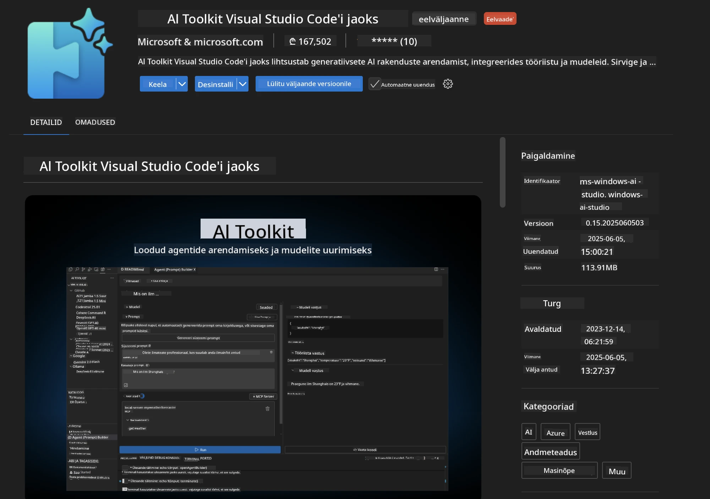
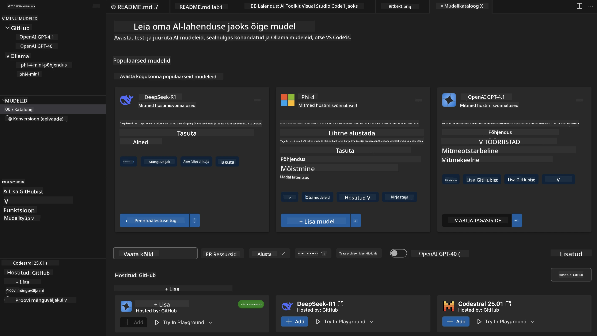
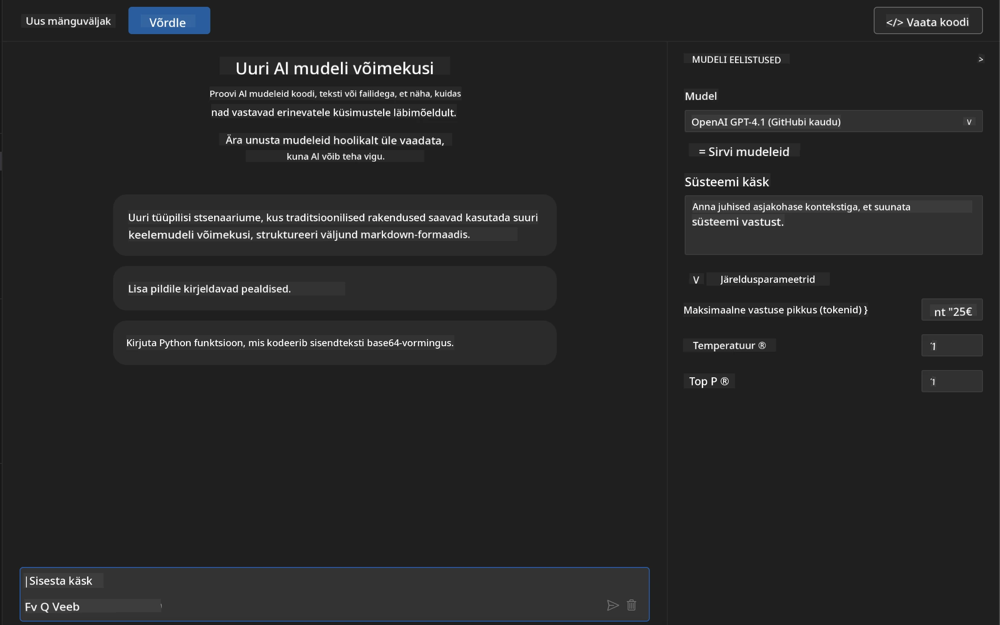
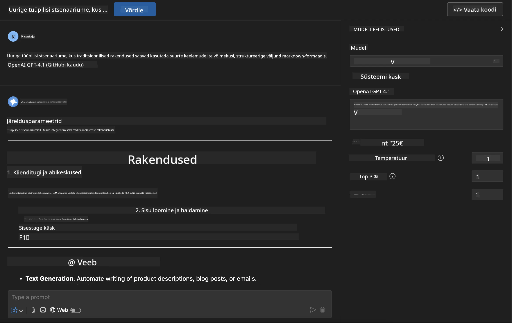
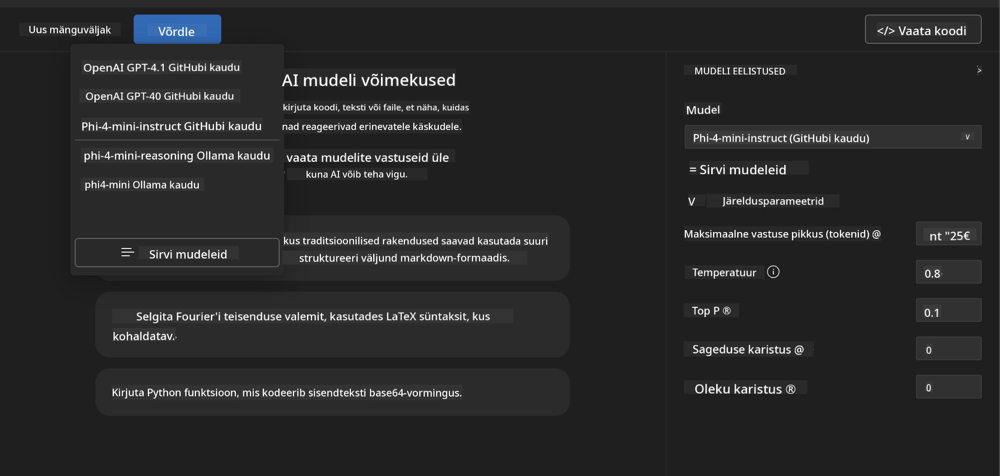
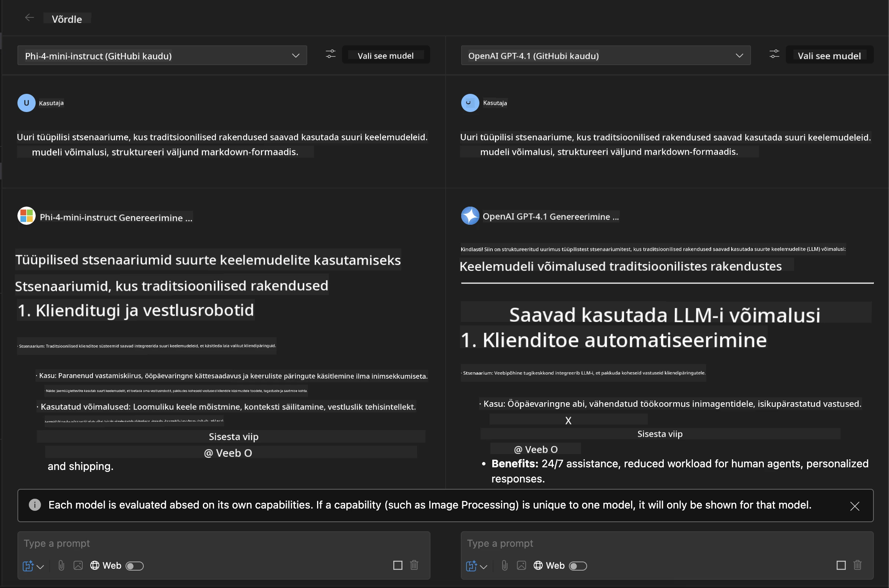
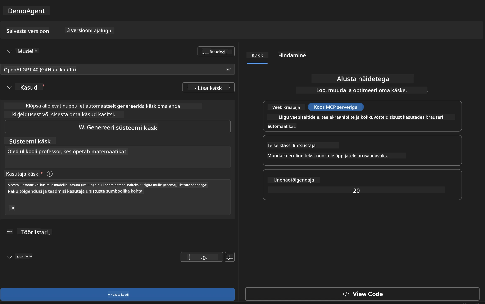
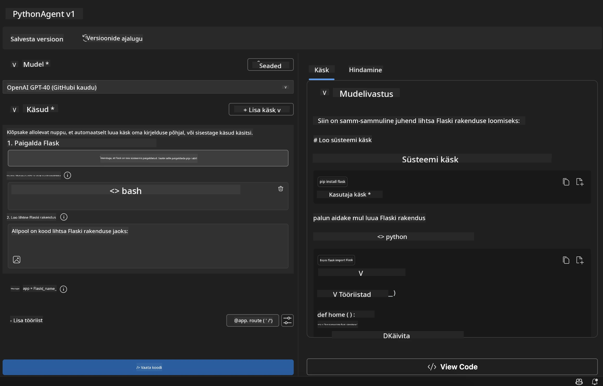

# 🚀 Moodul 1: Microsoft Foundry Toolkiti põhialused

[]()
[]()
[]()

## 📋 Õpieesmärgid

Selle mooduli lõppedes suudate:
- ✅ Installida ja seadistada Microsoft Foundry Toolkiti laienduse VS Code jaoks
- ✅ Navigeerida mudeli kataloogis ja mõista erinevaid mudeli allikaid
- ✅ Kasutada Playgroundi mudelite testimiseks ja katsetamiseks
- ✅ Luua kohandatud tehisintellekti agente Agent Builderiga
- ✅ Võrrelda mudelite jõudlust erinevate pakkujatega
- ✅ Rakendada parimaid tavasid promptide koostamisel

## 🧠 Sissejuhatus Microsoft Foundry Toolkiti

Microsofti **Microsoft Foundry Toolkit Extension for VS Code** on Microsofti lipulaeva laiendus, mis muudab VS Code'i kõikehõlmavaks AI arendusmooduliks. See ühendab AI uurimistöö ja praktilise rakenduste arendamise, muutes generatiivse AI arendamise kättesaadavaks arendajatele kõikidel oskustasemetel.

### 🌟 Põhivõimekused

| Funktsioon | Kirjeldus | Kasutusjuhtum |
|---------|-------------|----------|
| **🗂️ Mudeli kataloog** | Üle 100 mudeli juurdepääs GitHubist, ONNX-ist, OpenAI-st, Anthropic-ist, Google'ist | Mudelite avastamine ja valimine |
| **🔌 BYOM-tugi** | Integreeri oma mudeleid (kohalik/kaug) | Kohandatud mudeli juurutus |
| **🎮 Interaktiivne Playground** | Reaalajas mudelite testimine vestlusesisendiga | Kiire prototüüpimine ja testimine |
| **📎 Mitme-modalne tugi** | Töötle teksti, pilte ja manuseid | Keerukad tehisintellekti rakendused |
| **⚡ Partii töötlemine** | Käivita mitu päringut samaaegselt | Efektiivsed testitöövood |
| **📊 Mudelite hindamine** | Sisseehitatud mõõdikud (F1, asjakohasus, sarnasus, koherentus) | Jõudluse hindamine |

### 🎯 Miks Microsoft Foundry Toolkit on oluline

- **🚀 Kiirendatud arendus**: Ideest prototüübini minutitega
- **🔄 Ühtne töövoog**: Üks liides mitme AI pakkuja jaoks
- **🧪 Lihtne katsetamine**: Võrrelge mudeleid ilma keeruka seadistuseta
- **📈 Tootmiskõlbulik**: Sujuv üleminek prototüübist juurutusse

## 🛠️ Eeltingimused ja seadistamine

### 📦 Microsoft Foundry Toolkiti laienduse installimine

**1. samm: Ava Extensions Marketplace**
1. Ava Visual Studio Code
2. Mine laienduste vaatesse (`Ctrl+Shift+X` või `Cmd+Shift+X`)
3. Otsi "Microsoft Foundry Toolkit"

**2. samm: Vali versioon**
- **🟢 Release**: Soovitatav tootmiskasutuseks
- **🔶 Pre-release**: Varajane juurdepääs uusimatele funktsioonidele

**3. samm: Installi ja aktiveeri**



### ✅ Kontrollnimekiri
- [ ] Microsoft Foundry Toolkiti ikoon ilmub VS Code küljeribale
- [ ] Laiendus on lubatud ja aktiveeritud
- [ ] Output-paneelis puuduvad installatsioonivead

## 🧪 Praktiline ülesanne 1: Microsoft Foundry mudelite uurimine

**🎯 Eesmärk**: Valdada mudeli kataloogi ja testida oma esimest AI mudelit

### 📊 1. samm: Navigeeri mudeli kataloogis

Mudeli kataloog on sinu pääs AI-ökosüsteemi. See koondab mudeleid mitmelt pakkujalt, muutes nende avastamise ja võrdlemise lihtsaks.

**🔍 Navigeerimise juhend:**

Klõpsa Microsoft Foundry Toolkiti küljeribal **MODELS - Catalog**



**💡 Näpunäide**: Otsi mudeleid, millel on spetsiifilised võimekused, mis sobivad sinu kasutusjuhtumiga (nt koodi genereerimine, loominguline kirjutamine, analüüs).

> [!NOTE]
> GitHub Models pensionile võeti 30. juulil 2026. Kasuta Microsoft Foundry mudeli
> juurutust ja autentimiseks Microsoft Entra ID-d või Azure API võtit.

### 🚀 2. samm: Lisa ja konfigureeri oma esimene mudel

**Mudelivaliku strateegia:**
- **GPT-5.1**: Soovitatav üldotstarbeline mudel tööriistade kasutuseks ja loogilisteks järeldusteks
- **Phi-4-mini**: Kerge, kiire vastamine lihtsate ülesannete jaoks

**🔧 Konfiguratsiooni protsess:**
1. Vali kataloogist **OpenAI GPT-5.1**
2. Klõpsa **Add to My Models** - see registreerib mudeli kasutamiseks
3. Vali **Try in Playground** testi keskkonna käivitamiseks
4. Oota mudeli initsialiseerimist (esmakordne seadistus võib hetk aega võtta)



**⚙️ Mudeli parameetrite mõistmine:**
- **Temperature**: Kontrollib loovust (0 = deterministlik, 1 = loov)
- **Max Tokens**: Maksimaalne vastuse pikkus
- **Top-p**: Nucleus-proovimine vastuse mitmekesisuse jaoks

### 🎯 3. samm: Õpi Playgroundi liidest kasutama

Playground on sinu AI katsetuslabor. Siin on, kuidas seda maksimaalselt ära kasutada:

**🎨 Promptide koostamise parimad tavad:**
1. **Ole konkreetne**: Selged, detailirohked juhised annavad paremaid tulemusi
2. **Anna kontekst**: Lisa asjakohast taustainfot
3. **Kasuta näiteid**: Näita mudelile, mida soovid, näidete abil
4. **Itereeri**: Täienda prompt'e esialgsete tulemuste põhjal

**🧪 Teststsenaariumid:**
```markdown
# Example 1: Code Generation
"Write a Python function that calculates the factorial of a number using recursion. Include error handling and docstrings."

# Example 2: Creative Writing
"Write a professional email to a client explaining a project delay, maintaining a positive tone while being transparent about challenges."

# Example 3: Data Analysis
"Analyze this sales data and provide insights: [paste your data]. Focus on trends, anomalies, and actionable recommendations."
```



### 🏆 Väljakutse: Mudelite jõudluse võrdlus

**🎯 Eesmärk**: Võrrelda erinevaid mudeleid, kasutades identsed prompt'e, et mõista nende tugevusi

**📋 Juhised:**
1. Lisa oma tööruumi **Phi-4-mini**
2. Kasuta sama prompt'i nii GPT-5.1 kui Phi-4-mini jaoks



3. Võrrelge vastuste kvaliteeti, kiirust ja täpsust
4. Dokumenteerige oma leiud tulemuste sektsioonis



**💡 Olulised tähelepanekud, mida avastada:**
- Millal kasutada LLM-i vs SLM-i
- Kulu vs jõudlus - kompromissid
- Eripõhised võimekused erinevatel mudelitel

## 🤖 Praktiline ülesanne 2: Kohandatud agendide loomine Agent Builderiga

**🎯 Eesmärk**: Luua spetsialiseerunud AI agente, mis on kohandatud konkreetsete ülesannete ja töövoogude jaoks

### 🏗️ 1. samm: Agent Builderi mõistmine

Agent Builder on koht, kus Microsoft Foundry Toolkit tõeliselt särab. See võimaldab teil luua sihipäraseid AI-assistente, mis ühendavad suurte keelemudelite jõu kohandatud juhiste, spetsiifiliste parameetrite ja eriteadmistega.

**🧠 Agendi arhitektuuri komponendid:**
- **Põhimudel**: Alus-LLM (GPT-5.1, Phi jne.)
- **Süsteemprompt**: Määratleb agendi isiksuse ja käitumise
- **Parameetrid**: Hoolikalt häälestatud seaded optimaalseks jõudluseks
- **Tööriistade integratsioon**: Ühenda väliste API-de ja MCP teenustega
- **Mälu**: Vestluse kontekst ja sessiooni püsivus



### ⚙️ 2. samm: Agendi konfiguratsiooni süvauurimus

**🎨 Tõhusate süsteempromptide loomine:**
```markdown
# Template Structure:
## Role Definition
You are a [specific role] with expertise in [domain].

## Capabilities
- List specific abilities
- Define scope of knowledge
- Clarify limitations

## Behavior Guidelines
- Response style (formal, casual, technical)
- Output format preferences
- Error handling approach

## Examples
Provide 2-3 examples of ideal interactions
```

*Muidugi võid kasutada ka Generate System Prompt'i, et lasta AI-l aidata sul prompt'e genereerida ja optimeerida*

**🔧 Parameetrite optimeerimine:**
| Parameeter | Soovitatav vahemik | Kasutusjuhtum |
|-----------|------------------|----------|
| **Temperature** | 0.1-0.3 | Tehnilised/faktipõhised vastused |
| **Temperature** | 0.7-0.9 | Loovad/ideede genereerimise ülesanded |
| **Max Tokens** | 500-1000 | Lühikesed vastused |
| **Max Tokens** | 2000-4000 | Põhjalikud selgitused |

### 🐍 3. samm: Praktiline ülesanne - Pythoni programmeerimise agent

**🎯 Missioon**: Loo spetsialiseerunud Pythoni kodeerimisassistent

**📋 Konfiguratsiooni sammud:**

1. **Mudelivalik**: Vali **Claude 3.5 Sonnet** (suurepärane koodi jaoks)

2. **Süsteemprompti kujundus**:
```markdown
# Python Programming Expert Agent

## Role
You are a senior Python developer with 10+ years of experience. You excel at writing clean, efficient, and well-documented Python code.

## Capabilities
- Write production-ready Python code
- Debug complex issues
- Explain code concepts clearly
- Suggest best practices and optimizations
- Provide complete working examples

## Response Format
- Always include docstrings
- Add inline comments for complex logic
- Suggest testing approaches
- Mention relevant libraries when applicable

## Code Quality Standards
- Follow PEP 8 style guidelines
- Use type hints where appropriate
- Handle exceptions gracefully
- Write readable, maintainable code
```

3. **Parameetrite konfiguratsioon**:
   - Temperature: 0.2 (konsistentse, usaldusväärse koodi jaoks)
   - Max Tokens: 2000 (põhjalikud selgitused)
   - Top-p: 0.9 (tasakaalustatud loovus)



### 🧪 4. samm: Testi oma Pythoni agenti

**Teststsenaariumid:**
1. **Põhiline funktsioon**: "Loo funktsioon algarvude leidmiseks"
2. **Keeruline algoritm**: "Rakenda binaarse otsingupuu, millel on insert-, delete- ja search-meetodid"
3. **Reaalmaailu probleem**: "Ehita veebikraaper, mis käsitleb taotlejate piiramist ja kordusi"
4. **Silumine**: "Paranda see kood [kleebi rikkuv kood siia]"

**🏆 Edu kriteeriumid:**
- ✅ Kood töötab ilma vigadeta
- ✅ Sisaldab nõuetekohast dokumentatsiooni
- ✅ Järgib Pythoni parimaid tavasid
- ✅ Annab selged selgitused
- ✅ Soovitab täiustusi

## 🎓 Moodul 1 kokkuvõte ja järgmised sammud

### 📊 Teadmiste kontroll

Kontrolli oma arusaamist:
- [ ] Kas suudad selgitada erinevusi kataloogis olevate mudelite vahel?
- [ ] Kas oled edukalt loonud ja testinud kohandatud agenti?
- [ ] Kas mõistad, kuidas parameetreid erinevate kasutusjuhtumite jaoks optimeerida?
- [ ] Kas suudad kujundada tõhusaid süsteemprompt'e?

### 📚 Lisamaterjalid

- **Microsoft Foundry Toolkiti dokumentatsioon**: [Ametlik Microsofti dokumentatsioon](https://github.com/microsoft/vscode-ai-toolkit)
- **Promptide koostamise juhend**: [Parimad tavad](https://platform.openai.com/docs/guides/prompt-engineering)
- **Microsoft Foundry Toolkiti mudelid**: [Arenduses olevad mudelid](https://github.com/microsoft/vscode-ai-toolkit/blob/main/doc/models.md)

**🎉 Palju õnne!** Oled valdanud Microsoft Foundry Toolkiti põhialused ja oled valmis looma keerukamaid AI rakendusi!

### 🔜 Jätka järgmise mooduliga

Valmis edasijõudnumate võimekuste jaoks? Jätka **[Moodul 2: MCP Microsoft Foundry Toolkiti põhialustega](../lab2/README.md)**, kus õpid, kuidas:
- Ühendada oma agendid väliste tööriistadega, kasutades Model Context Protocol (MCP)
- Luua brauseri automatiseerimisagente Playwrightiga
- Integreerida MCP servereid oma Microsoft Foundry Toolkiti agentidega
- Tõhustada oma agente välise andme- ja funktsionaalsusega

---

<!-- CO-OP TRANSLATOR DISCLAIMER START -->
**Lahtiütlus**:
See dokument on tõlgitud kasutades AI tõlketeenust [Co-op Translator](https://github.com/Azure/co-op-translator). Kuigi me püüdleme täpsuse poole, palun pange tähele, et automatiseeritud tõlgetes võib esineda vigu või ebatäpsusi. Originaaldokument selle emakeeles tuleks pidada autoriteetseks allikaks. Olulise teabe puhul soovitatakse kasutada professionaalset inimtõlget. Me ei vastuta selle tõlkega seotud eksimustest või valesti mõistmistest.
<!-- CO-OP TRANSLATOR DISCLAIMER END -->