# 🌐 Moodul 2: MCP ja Microsoft Foundry Toolkiti alused


## 📋 Õpieesmärgid

Selle mooduli lõpuks oskad:

- ✅ Mõista Model Context Protocoli (MCP) arhitektuuri ja eeliseid
- ✅ Uurida Microsofti MCP-serverite ökosüsteemi
- ✅ Integreerida MCP-servereid Microsoft Foundry Toolkiti Agent Builderiga
- ✅ Luua funktsionaalne brauseri automatiseerimisagent, kasutades Playwright MCP-d
- ✅ Konfigureerida ja testida MCP-tööriistu oma agentides
- ✅ Ekspordida ja juurutada MCP-iga varustatud agente tootmiskasutuseks

## 🎯 Ehitades eelmisest moodulist

Moodulis 1 omandasime Microsoft Foundry Toolkiti põhiteadmised ja lõime oma
esimese Python-agendi. Nüüd me **tõhustame** teie agente, ühendades need
välistööriistade ja -teenustega läbi revolutsioonilise
**Model Context Protocoli (MCP)**.

Mõelge sellele nagu lihtsast kalkulaatorist täisarvuti poole üleminekuna. Teie AI
agendid saavad võimekused:

- 🌐 Sirvida ja suhelda veebisaitidega
- 📁 Juurdepääs ja failide töötlemine
- 🔧 Integreeruda ettevõttesüsteemidega
- 📊 Töödelda reaalajas andmeid API-dest

## 🧠 Model Context Protocoli (MCP) mõistmine

### 🔍 Mis on MCP?

Model Context Protocol (MCP) on **„USB-C tehisintellekti rakendustele”**: avatud
standard, mis ühendab suurkeelemudelid (LLM-id) väliste tööriistade, andme-
allikate ja teenustega. Nagu USB-C pakub ühtset pistikut, vähendab MCP
tehisintellekti integratsiooni keerukust ühe standardiseeritud protokolli kaudu.

### 🎯 Probleem, mida MCP lahendab

**Enne MCP-d:**

- 🔧 Iga tööriista jaoks eraldi kohandatud integratsioonid
- 🔄 Tarnijalukustus proprietaarsete lahendustega  
- 🔒 Turvanõrkused juhuslike ühenduste tõttu
- ⏱️ Põhifunktsioonide integreerimiseks kuluvad kuud

**MCP-ga:**

- ⚡ Plug-and-play tööriistade integratsioon
- 🔄 Tarnijast sõltumatu arhitektuur
- 🛡️ Sisseehitatud turvalisuse parimad tavad
- 🚀 Minutitega uute võimete lisamine

### 🏗️ MCP arhitektuuri süvaülevaade

MCP järgib a **klient-serveri arhitektuuri**, mis loob turvalise ja skaleeritava ökosüsteemi:

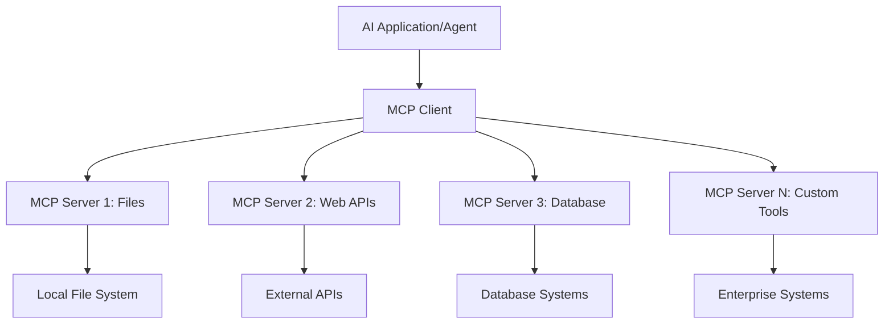

**🔧 Põhikomponendid:**

| Komponent | Roll | Näited |
| --------- | ---- | -------- |
| **MCP-hostid** | Tarvitavad MCP-teenuseid | VS Code, Foundry Toolkit |
| **MCP-kliendid** | Haldavad protokolliühendusi | Hostidesse integreeritud |
| **MCP-serverid** | Pakuvad võimekust | Playwright, Files, Azure, GitHub |
| **Transpordikiht** | Ühendab kliendid ja serverid | stdio, HTTP, WebSockets |

## 🏢 Microsofti MCP-serverite ökosüsteem

Microsoft juhib MCP-ökosüsteemi ulatusliku äriklassi serverite komplektiga, mis
lahendavad tegeliku maailma ärivajadusi.

### 🌟 Esiletõstetud Microsofti MCP-serverid

#### 1. ☁️ Azure MCP-server

**🔗 Hoidla**: [azure/azure-mcp](https://github.com/azure/azure-mcp)
**🎯 Eesmärk**: Põhjalik Azure'i ressursside haldamine koos AI-integratsiooniga

**✨ Peamised omadused:**

- Infrastruktuuri deklaratiivne loomine
- Ressursside reaalajas jälgimine
- Kuluoptimeerimise soovitused
- Turvalisuse nõuetele vastavuse kontroll

**🚀 Kasutusjuhtumid:**

- Infrastruktuur kui kood koos AI-abil
- Automatiseeritud ressursside skaleerimine
- Pilvekulude optimeerimine
- DevOps töövoogude automatiseerimine

#### 2. 📊 Microsoft Dataverse MCP

**📚 Dokumentatsioon**: [Microsoft Dataverse Integration](https://go.microsoft.com/fwlink/?linkid=2320176)
**🎯 Eesmärk**: Loomuliku keele liides ärilistele andmetele

**✨ Peamised omadused:**

- Andmebaasi päringud loomulikus keeles
- Ärikonteksti mõistmine
- Kohandatud promptide mallid
- Ettevõtte andmehaldus

**🚀 Kasutusjuhtumid:**

- Ärianalüüsi aruandlus
- Kliendiandmete analüüs
- Müügitoru ülevaated
- Vastavuspäringud andmetele

#### 3. 🌐 Playwright MCP-server

**🔗 Hoidla**: [microsoft/playwright-mcp](https://github.com/microsoft/playwright-mcp)
**🎯 Eesmärk**: Brauseri automatiseerimise ja veebisuhtluse võimalused

**✨ Peamised omadused:**

- Ristbrauseri automatiseerimine (Chrome, Firefox, Safari)
- Intelligentne elementide tuvastus
- Ekraanipiltide ja PDF-ide genereerimine
- Võrgu liikluse jälgimine

**🚀 Kasutusjuhtumid:**

- Automatiseeritud testimise töövood
- Veebikraapimine ja andmete ekstraktimine
- UI/UX jälgimine
- Konkurentsianalüüsi automatiseerimine

#### 4. 📁 Files MCP-server

**🔗 Hoidla**: [microsoft/files-mcp-server](https://github.com/microsoft/files-mcp-server)
**🎯 Eesmärk**: Intelligentsed failisüsteemi toimingud

**✨ Peamised omadused:**

- Deklaratiivne failihaldus
- Sisu sünkroonimine
- Versioonihalduse integratsioon
- Metaandmete ekstraktimine

**🚀 Kasutusjuhtumid:**

- Dokumentatsiooni haldus
- Koodihoidlate organiseerimine
- Sisu avaldamise töövood
- Andmevoogude failide käsitlemine

#### 5. 📝 MarkItDown MCP-server

**🔗 Hoidla**: [microsoft/markitdown](https://github.com/microsoft/markitdown)
**🎯 Eesmärk**: Täiustatud Markdowni töötlemine ja manipuleerimine

**✨ Peamised omadused:**

- Rikas Markdowni parsimine
- Vorminduskonversioon (MD ↔ HTML ↔ PDF)
- Sisu struktuuri analüüs
- Mallide töötlemine

**🚀 Kasutusjuhtumid:**

- Tehnilise dokumentatsiooni töövood
- Sisuhaldussüsteemid
- Aruannete genereerimine
- Teadmistebaasi automatiseerimine

#### 6. 📈 Clarity MCP-server

**📦 Pakett**: [@microsoft/clarity-mcp-server](https://www.npmjs.com/package/@microsoft/clarity-mcp-server)
**🎯 Eesmärk**: Veebianalüütika ja kasutajakäitumise ülevaated

**✨ Peamised omadused:**

- Soojuskaardi andmeanalüüs
- Kasutajaseansside salvestused
- Tulemuslikkuse mõõdikud
- Konversioonitunneli analüüs

**🚀 Kasutusjuhtumid:**

- Veebisaidi optimeerimine
- Kasutajakogemuse uurimine
- A/B-testide analüüs
- Ärianalüüsi armatuurlaud

### 🌍 Kogukonna ökosüsteem

Lisaks Microsofti serveritele sisaldab MCP-ökosüsteem:

- **🐙 GitHub MCP**: Hoidlate haldus ja koodi analüüs
- **🗄️ Andmebaasi MCP-d**: PostgreSQL, MySQL, MongoDB integratsioonid
- **☁️ Pilveteenusepakkujate MCP-d**: AWS, GCP, Digital Ocean tööriistad
- **📧 Kommunikatsiooni MCP-d**: Slack, Teams, e-posti integratsioonid

## 🛠️ Praktiline labor: brauseri automatiseerimisagendi loomine

**🎯 Projekti eesmärk**: Loo intelligentne brauseri automatiseerimisagent, kasutades
Playwright MCP-serverit, mis suudab veebisaite navigeerida, teavet ekstraheerida ja
teostada keerukaid veebisuhtlusi.

### 🚀 Etapp 1: Agendi aluse seadistamine

#### Samm 1: Initsialiseeri oma agent

1. **Ava Microsoft Foundry Toolkiti Agent Builder**
2. **Loo uus agent** järgmise konfiguratsiooniga:
   - **Nimi**: `BrowserAgent`
   - **Mudel**: Vali GPT-5.1. Vaata
      [Microsoft Foundry model retirement schedule](https://learn.microsoft.com/azure/foundry/openai/concepts/model-retirement-schedule)
      praeguse mudeli elutsükli teabe saamiseks.

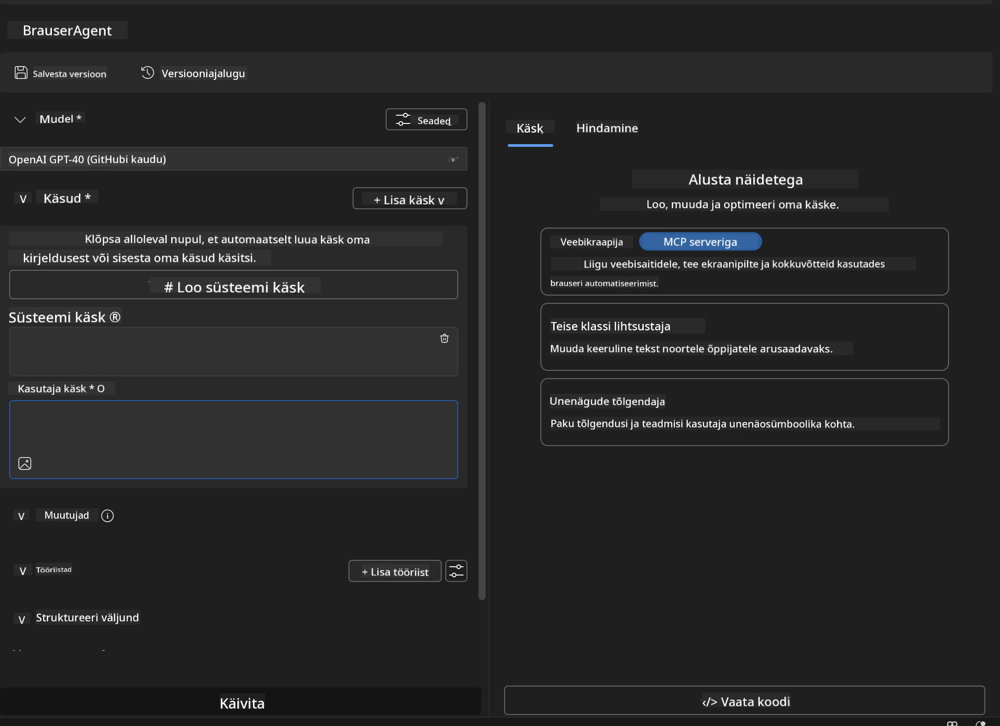

### 🔧 Etapp 2: MCP integratsiooni töövoog

#### Samm 3: Lisa MCP-serveri integratsioon

1. **Mine Agent Builderi tööriistade sektsiooni**
2. **Klõpsa "Add Tool"** integratsioonimenüü avamiseks
3. **Vali "MCP Server"** saadaolevate valikute hulgast

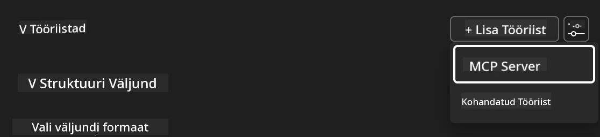

**🔍 Tööriistade tüüpide mõistmine:**

- **Sisseehitatud tööriistad**: Eelkonfigureeritud Microsoft Foundry Toolkiti funktsioonid
- **MCP-serverid**: Väliste teenuste integratsioonid
- **Kohandatud API-d**: Teie enda teenuse lõpp-punktid
- **Funktsiooni kutsumine**: Otsene juurdepääs mudeli funktsioonidele

#### Samm 4: MCP-serveri valik

1. **Vali "MCP Server"** jätkamiseks
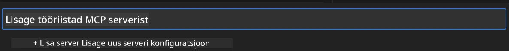

2. **Sirvi MCP kataloogi** saadaolevate integratsioonide uurimiseks
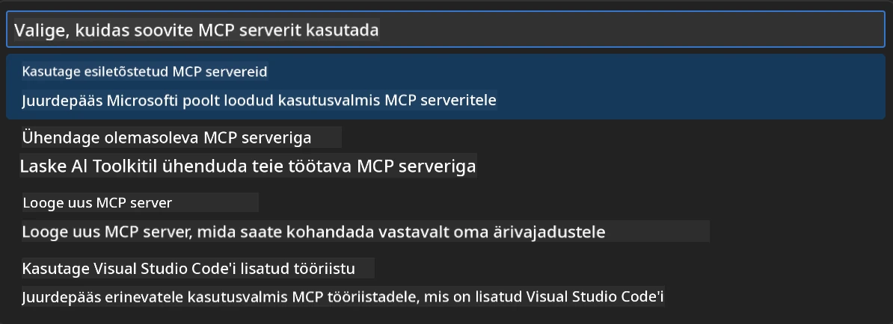

### 🎮 Etapp 3: Playwright MCP konfiguratsioon

#### Samm 5: Vali ja konfigureeri Playwright

1. **Klõpsa "Use Featured MCP Servers"** Microsofti kinnitatud serverite avamiseks
2. **Vali "Playwright"** esiletõstetud nimekirjast
3. **Nõustu vaikimisi MCP ID-ga** või kohanda seda oma keskkonna jaoks

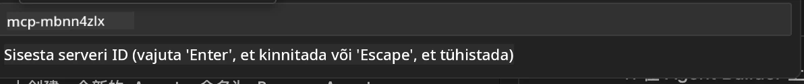

#### Samm 6: Luba Playwrighti võimekused

**🔑 Kriitiline samm**: Vali KÕIK saadaolevad Playwright-meetodid maksimaalse funktsionaalsuse saamiseks

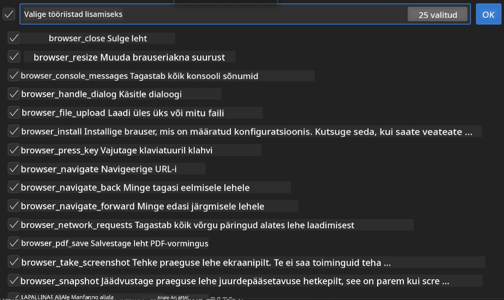

**🛠️ Olulised Playwrighti tööriistad:**

- **Navigeerimine**: `goto`, `goBack`, `goForward`, `reload`
- **Interaktsioon**: `click`, `fill`, `press`, `hover`, `drag`
- **Andmete väljavõte**: `textContent`, `innerHTML`, `getAttribute`
- **Valideerimine**: `isVisible`, `isEnabled`, `waitForSelector`
- **Pildistamine**: `screenshot`, `pdf`, `video`
- **Võrk**: `setExtraHTTPHeaders`, `route`, `waitForResponse`

#### Samm 7: Kontrolli integratsiooni õnnestumist

**✅ Edu näitajad:**

- Kõik tööriistad kuvatakse Agent Builderi liideses
- Integratsioonipaneelis puuduvad veateated
- Playwrighti serveri olek näitab 'Ühendatud'

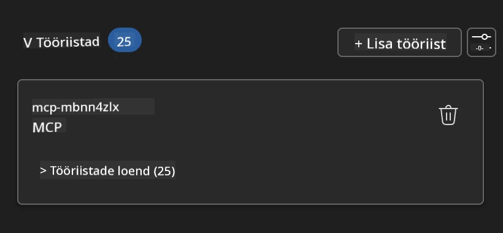

**🔧 Levinud probleemide lahendamine:**

- **Ühendus ebaõnnestus**: Kontrolli internetiühendust ja tulemüüri seadeid
- **Puuduvad tööriistad**: Veendu, et kõik võimekused olid seadistamisel valitud
- **Õiguste vead**: Kontrolli, et VS Code'il on vajalikud süsteemiload

### 🎯 Etapp 4: Täiustatud promptide loomine

#### Samm 8: Kujunda intelligentsed süsteemi-promptid

Loo keerukad promptid, mis kasutavad Playwrighti täielikku võimekust:

```markdown
# Web Automation Expert System Prompt

## Core Identity
You are an advanced web automation specialist with deep expertise in browser
automation, web scraping, and user experience analysis. You have access to
Playwright tools for comprehensive browser control.

## Capabilities & Approach
### Navigation Strategy
- Always start with screenshots to understand page layout
- Use semantic selectors (text content, labels) when possible
- Implement wait strategies for dynamic content
- Handle single-page applications (SPAs) effectively

### Error Handling
- Retry failed operations with exponential backoff
- Provide clear error descriptions and solutions
- Suggest alternative approaches when primary methods fail
- Always capture diagnostic screenshots on errors

### Data Extraction
- Extract structured data in JSON format when possible
- Provide confidence scores for extracted information
- Validate data completeness and accuracy
- Handle pagination and infinite scroll scenarios

### Reporting
- Include step-by-step execution logs
- Provide before/after screenshots for verification
- Suggest optimizations and alternative approaches
- Document any limitations or edge cases encountered

## Ethical Guidelines
- Respect robots.txt and rate limiting
- Avoid overloading target servers
- Only extract publicly available information
- Follow website terms of service
```

#### Samm 9: Loo dünaamilised kasutajapromptid

Kujunda promptid, mis demonstreerivad erinevaid võimekusi:

**🌐 Veebianalüüsi näide:**

```markdown
Navigate to github.com/kinfey and provide a comprehensive analysis including:
1. Repository structure and organization
2. Recent activity and contribution patterns  
3. Documentation quality assessment
4. Technology stack identification
5. Community engagement metrics
6. Notable projects and their purposes

Include screenshots at key steps and provide actionable insights.
```

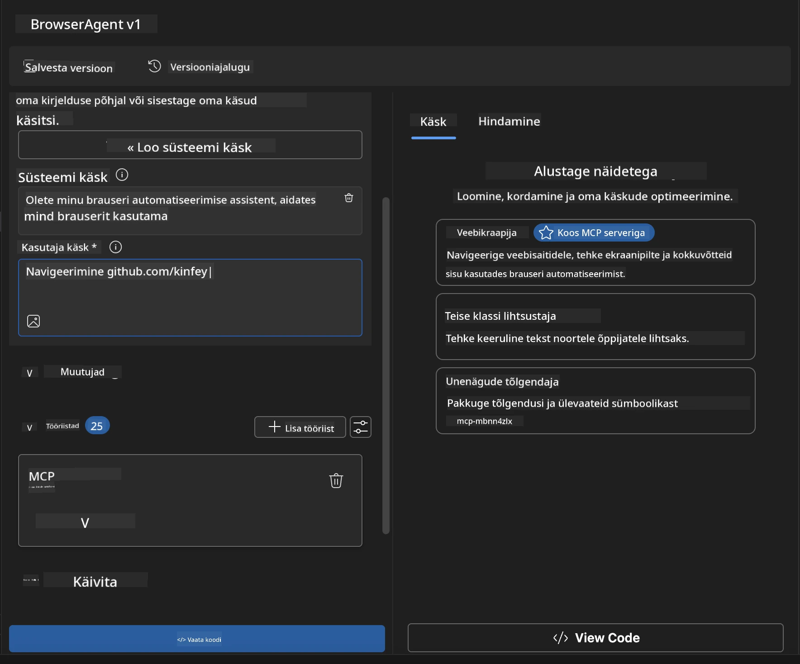

### 🚀 Etapp 5: Käivitamine ja testimine

#### Samm 10: Käivita oma esimene automatiseerimine

1. **Klõpsa "Run"** automatiseerimise jada käivitamiseks
2. **Jälgi reaalajas täitmist**:
   - Chrome'i brauser käivitub automaatselt
   - Agent navigeerib sihtveebile
   - Ekraanipildid salvestavad iga peamise sammu
   - Analüüsi tulemused voogavad reaalajas

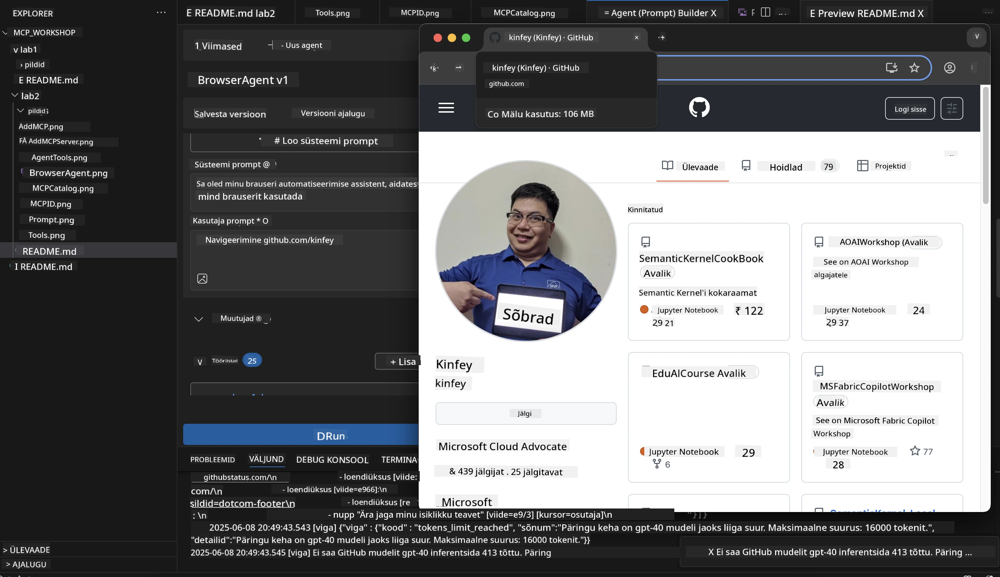

#### Samm 11: Analüüsi tulemusi ja ülevaateid

Vaata põhjalikku analüüsi Agent Builderi liideses:

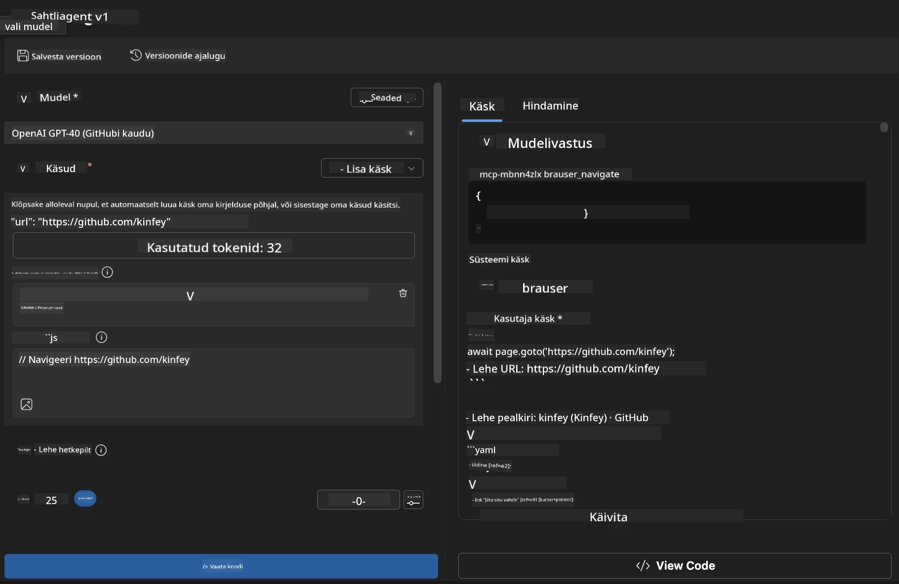

### 🌟 Etapp 6: Täiustatud võimekused ja juurutamine

#### Samm 12: Eksport ja tootmiskasutusse juurutamine

Agent Builder toetab mitmeid juurutusvalikuid:

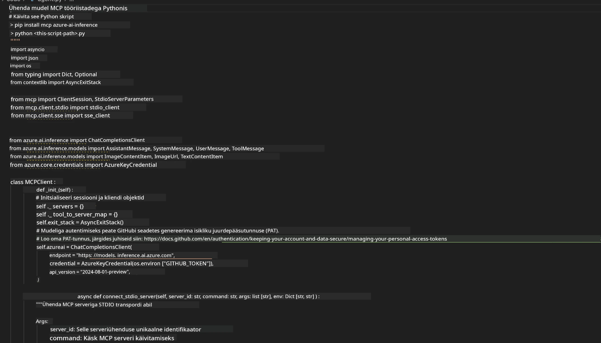

## 🎓 Moodul 2 kokkuvõte ja järgmised sammud

### 🏆 Saavutus: MCP-integratsiooni meister

**✅ Omandatud oskused:**

- [ ] MCP arhitektuuri ja eeliste mõistmine
- [ ] Microsofti MCP-serverite ökosüsteemis orienteerumine
- [ ] Playwright MCP integreerimine Microsoft Foundry Toolkitiga
- [ ] Keerukate brauseri automatiseerimisagentide loomine
- [ ] Täiustatud promptide kujundamine veebiautomaatika jaoks

### 📚 Lisamaterjalid

- **🔗 MCP-spetsifikatsioon**: [Official Protocol Documentation](https://modelcontextprotocol.io/)
- **🛠️ Playwright API**: [Complete Method Reference](https://playwright.dev/docs/api/class-playwright)
- **🏢 Microsofti MCP-serverid**:
   [Enterprise Integration Guide](https://github.com/microsoft/mcp-servers)
- **🌍 Kogukonna näited**: [MCP Server Gallery](https://github.com/modelcontextprotocol/servers)

**🎉 Palju õnne!** Olete edukalt valdanud MCP-integratsiooni ja saate
nüüd luua tootmiskõlblikke AI-agente, millel on väliste tööriistade võimekused!

### 🔜 Jätka järgmise mooduliga

Valmis viima oma MCP-oskused järgmisele tasemele? Jätka
**[Module 3: Advanced MCP Development with Microsoft Foundry Toolkit](../lab3/README.md)**
kus õpite, kuidas:

- Luua oma kohandatud MCP-serverid
- Konfigureerida ja kasutada uusimat MCP Python SDK-d
- Seadistada MCP Inspectorit silumiseks
- Valdada täiustatud MCP-serveri arendusvooge
- Ehitada ilmaprognoosi MCP-server nullist

---

<!-- CO-OP TRANSLATOR DISCLAIMER START -->
**Lahtiütlus**:
See dokument on tõlgitud kasutades AI tõlketeenust [Co-op Translator](https://github.com/Azure/co-op-translator). Kuigi me püüdleme täpsuse poole, palun pange tähele, et automatiseeritud tõlgetes võib esineda vigu või ebatäpsusi. Originaaldokument selle emakeeles tuleks pidada autoriteetseks allikaks. Olulise teabe puhul soovitatakse kasutada professionaalset inimtõlget. Me ei vastuta selle tõlkega seotud eksimustest või valesti mõistmistest.
<!-- CO-OP TRANSLATOR DISCLAIMER END -->