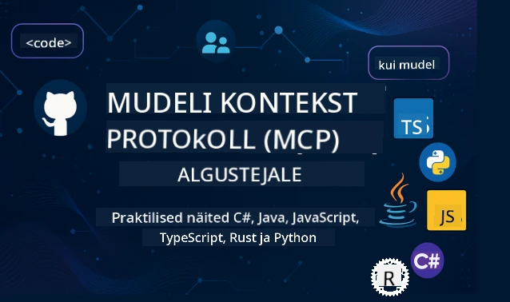

 

[](https://GitHub.com/microsoft/mcp-for-beginners/graphs/contributors)
[](https://GitHub.com/microsoft/mcp-for-beginners/issues)
[](https://GitHub.com/microsoft/mcp-for-beginners/pulls)
[](http://makeapullrequest.com)
[](https://mcptoplist.com/server/mcp.so%2Fmcp-for-beginners%2Fmicrosoft)

[](https://GitHub.com/microsoft/mcp-for-beginners/watchers)
[](https://GitHub.com/microsoft/mcp-for-beginners/fork)
[](https://GitHub.com/microsoft/mcp-for-beginners/stargazers)


[](https://discord.gg/nTYy5BXMWG)

Järgige neid samme, et alustada nende ressursside kasutamist:
1. **Forki hoidla**: Klõpsa [](https://GitHub.com/microsoft/mcp-for-beginners/fork)
2. **Klooni hoidla**:   `git clone https://github.com/microsoft/mcp-for-beginners.git`
3. **Liitu** [](https://discord.gg/nTYy5BXMWG)


### 🌐 Mitmekeelne tugi

#### Tõlked hooldatud [Co-op Translator](https://github.com/Azure/co-op-translator)

<!-- CO-OP TRANSLATOR LANGUAGES TABLE START -->
[Araabia](../ar/README.md) | [Bengali](../bn/README.md) | [Bulgaaria](../bg/README.md) | [Birmani (Myanmar)](../my/README.md) | [Hiina (lihtsustatud)](../zh-CN/README.md) | [Hiina (traditsiooniline, Hongkong)](../zh-HK/README.md) | [Hiina (traditsiooniline, Macau)](../zh-MO/README.md) | [Hiina (traditsiooniline, Taiwan)](../zh-TW/README.md) | [Horvaadi](../hr/README.md) | [Tšehhi](../cs/README.md) | [Taani](../da/README.md) | [Hollandi](../nl/README.md) | [Eesti](./README.md) | [Soome](../fi/README.md) | [Prantsuse](../fr/README.md) | [Saksa](../de/README.md) | [Kreeka](../el/README.md) | [Heebrea](../he/README.md) | [Hindi](../hi/README.md) | [Ungari](../hu/README.md) | [Indoneesia](../id/README.md) | [Itaalia](../it/README.md) | [Jaapani](../ja/README.md) | [Kannada](../kn/README.md) | [Khmeeri](../km/README.md) | [Korea](../ko/README.md) | [Leedu](../lt/README.md) | [Malai](../ms/README.md) | [Malayalam](../ml/README.md) | [Manipuri (Meitei Mayek)](../mni/README.md) | [Marathi](../mr/README.md) | [Nepali](../ne/README.md) | [Nigeeria Pidgin](../pcm/README.md) | [Norra](../no/README.md) | [Pärsia (Farsi)](../fa/README.md) | [Poola](../pl/README.md) | [Portugali (Brasiilia)](../pt-BR/README.md) | [Portugali (Portugal)](../pt-PT/README.md) | [Punjabi (Gurmukhi)](../pa/README.md) | [Rumeenia](../ro/README.md) | [Vene](../ru/README.md) | [Serbia (kirillitsa)](../sr/README.md) | [Slovaki](../sk/README.md) | [Sloveeni](../sl/README.md) | [Hispaania](../es/README.md) | [Svahili](../sw/README.md) | [Rootsi](../sv/README.md) | [Tagalogi (Filipino)](../tl/README.md) | [Tamili](../ta/README.md) | [Telugu](../te/README.md) | [Tai](../th/README.md) | [Türgi](../tr/README.md) | [Ukraina](../uk/README.md) | [Urdu](../ur/README.md) | [Vietnami](../vi/README.md)

> **Eelistad kloonida lokaalselt?**
>
> See hoidla sisaldab üle 50 keele tõlget, mis suurendab oluliselt allalaadimise mahtu. Kui soovid kloonida ilma tõlgeteta, kasuta sparse checkout'i:
>
> **Bash / macOS / Linux:**
> ```bash
> git clone --filter=blob:none --sparse https://github.com/microsoft/mcp-for-beginners.git
> cd mcp-for-beginners
> git sparse-checkout set --no-cone '/*' '!translations' '!translated_images'
> ```
>
> **CMD (Windows):**
> ```cmd
> git clone --filter=blob:none --sparse https://github.com/microsoft/mcp-for-beginners.git
> cd mcp-for-beginners
> git sparse-checkout set --no-cone "/*" "!translations" "!translated_images"
> ```
>
> See annab sulle kõik vajaliku kursuse läbimiseks ning võimaldab palju kiiremat allalaadimist.
<!-- CO-OP TRANSLATOR LANGUAGES TABLE END -->

# 🚀 Model Context Protocol (MCP) õppekava algajatele

## **Õpi MCP praktiliste koodinäidete kaudu C#, Java, JavaScripti, Rusti, Pythoni ja TypeScripti keeles**

## 🧠 Model Context Protocoli õppekava ülevaade
Tere tulemast Model Context Protocoli õppimise teekonnale! Kui oled kunagi mõelnud, kuidas tehisintellekti rakendused suhtlevad erinevate tööriistade ja teenustega, siis hakkad nüüd avastama elegantset lahendust, mis muudab arendajate viisi nutikate süsteemide loomisel.

Mõtle MCP-i kui universaalse tõlkijana AI-rakendustele – nagu USB-pordid võimaldavad ühendada mis tahes seadme arvutiga, nii võimaldab MCP AI-mudelitel standardiseeritud viisil ühenduda mis tahes tööriista või teenusega. Olgu sul esimene vestlusrobot või keeruliste AI-töövoogudega tegeled, MCP mõistmine annab sulle võime luua võimekamaid ja paindlikumaid rakendusi.

See õppekava on loodud kannatlikult ja hoolivalt sinu õppeteekonna jaoks. Alustame lihtsatest kontseptsioonidest, mida sa juba mõistad, ja ehitame järk-järgult oskusi praktiliste harjutuste kaudu sinu eelistatud programmeerimiskeeles. Iga samm sisaldab selgeid selgitusi, praktilisi näiteid ja palju julgustust.

Kui oled selle teekonna läbinud, tunned end enesekindlalt oma MCP-serverite ehitamisel, nende integreerimisel populaarsete AI-platvormidega ning mõistmisel, kuidas see tehnoloogia kujundab tehisintellekti arenduse tulevikku. Alustame seda põnevat seiklust koos!

### Ametlik dokumentatsioon ja spetsifikatsioonid

Praegune protokolli revisjon on **MCP Specification 2026-07-28**. MCP
spetsifikatsioon kasutab kuupõhist versioonihaldust (YYYY-MM-DD vorming), et teha protokolli
ühilduvus selgeks.

> **Versiooni märkus:** see õppekava õpetab praeguseid `2026-07-28`
> kontseptsioone, sealhulgas riigivabu päringuid, Extensions raamistikku ja
> Roots, Sampling ja Logging deprekeerimist. Mõned praktilised näited jäävad
> selgelt versioonitud `2025-11-25` ajal, kuni SDK tugi jõuab järele. Vaata
> [Mis on MCP-s muutunud: 2026-07-28 spetsifikatsioon](./01-CoreConcepts/mcp-2026-07-28.md)
> muudatuste ja üleviimise juhiste kohta.

Need ressursid muutuvad väärtuslikumaks, kui sinu arusaam kasvab, kuid ära tunne survet kõike kohe läbi lugeda. Alusta nendest teemadest, mis sind enim huvitavad!
- 📘 [MCP Documentation](https://modelcontextprotocol.io/) – See on sinu peamine allikas samm-sammuliste juhendite ja kasutusjuhendite jaoks. Dokumentatsioon on kirjutatud algajaid silmas pidades, pakkudes selgeid näiteid, mida saad oma tempos järgida.
- 📜 [MCP Specification](https://modelcontextprotocol.io/specification/2026-07-28) – Võta seda kui põhjalikku viiteraamatut. Õppekava läbides tuled siia tagasi, et otsida konkreetseid üksikasju ja uurida edasijõudnutele mõeldud funktsioone.
- 📜 [MCP Specification Versioning](https://modelcontextprotocol.io/specification/versioning) – Siit leiad teavet protokolli versiooniajaloo ja selle kohta, kuidas MCP kasutab kuupõhist versioonihaldust (YYYY-MM-DD vorming).
- 🧑‍💻 [MCP GitHub Repository](https://github.com/modelcontextprotocol) – Siit leiad SDK-sid, tööriistu ja koodinäiteid mitmes programmeerimiskeeles. See on nagu aare praktiliste näidete ja kohe kasutatavate komponentide jaoks.
- 🌐 [MCP Community](https://github.com/orgs/modelcontextprotocol/discussions) – Liitu teiste õppijate ja kogenud arendajatega MCP teemalistes aruteludes. See on toetav kogukond, kus küsimused on oodatud ja teadmisi jagatakse vabalt.
  
## Õpieesmärgid

Õppekava lõppedes tunned end kindlalt ja põnevil oma uute oskuste üle. Siin on, mida saavutad:

• **Mõista MCP põhialuseid**: Sa saad aru, mis on Model Context Protocol ja miks see muudab tehisintellekti rakenduste omavahelist koostööd, kasutades selgitavaid analoogiaid ja arusaadavaid näiteid.

• **Loo oma esimene MCP-server**: Sa ehitad töötava MCP-serveri oma eelistatud programmeerimiskeeles, alustades lihtsatest näidetest ja arendades oskusi samm-sammult.

• **Ühenda AI-mudelid reaalsete tööriistadega**: Sa õpid, kuidas siduda AI-mudeleid tegelike teenustega, andes oma rakendustele võimsaid uusi funktsioone.

• **Rakenda turvalisuse parimaid tavasid**: Sa mõistad, kuidas hoida oma MCP-implementatsioone turvalisena, kaitstes nii oma rakendusi kui ka kasutajaid.

• **Paigalda enesekindlalt**: Sa tead, kuidas viia oma MCP-projektid arendusest tootmisesse, kasutades praktilisi paigaldusstrateegiaid, mis toimivad reaalses maailmas.

• **Liitu MCP kogukonnaga**: Sa saad osaks kasvavast arendajate kogukonnast, kes kujundavad tehisintellekti rakenduste arendamise tulevikku. 

## Oluline taustteave

Enne kui süveneme MCP-i spetsiifikasse, veendume, et tunned end mugavalt mõnede põhimõistetega. Ära muretse, kui sa pole nendes valdkondades ekspert — me selgitame kõike vajalikku, kui läheme edasi!

### Protokollide mõistmine (alus)

Mõtle protokollile kui vestlusreeglitele. Kui helistad sõbrale, tead mõlemad, et tuleb öelda "tere" vastamisel, vahetada kõnepalle ja öelda lõpuks "nägemist". Arvutiprogrammid vajavad sarnaseid reegleid, et tõhusalt suhelda.

MCP on protokoll — hulk kokkulepitud reegleid, mis aitavad AI-mudelitest ja rakendustel pidada tulemuslikke "vestlusi" tööriistade ja teenustega. Nii nagu vestlusreeglid muudavad inimestevahelise suhtluse ladusamaks, muudab MCP AI-rakenduste suhtluse palju usaldusväärsemaks ja võimsamaks.

### Klient-serveri suhted (kuidas programmid koos töötavad)

Sa kasutad klient-server suhteid juba iga päev! Kui kasutad veebibrauserit (klient) veebisaidi külastamiseks, ühendud veebiserveriga, mis saadab sulle lehe sisu. Brauser teab, kuidas teavet küsida, ja server teab, kuidas vastata.

MCP-s on meil sarnane suhe: AI-mudelid toimivad klientidena, kes taotlevad teavet või tegevusi, samal ajal kui MCP-serverid pakuvad neid võimekusi. See on nagu abivalmis assistent (server), kelle poole AI saab pöörduda konkreetsete ülesannete täitmiseks.

### Miks standardimine loeb (asjade koos töötamise hõlbustamine)

Kujuta ette, kui iga autotootja kasutaks erineva kujuga bensiinipumpasid — vajaksid iga auto jaoks erinevat adapterit! Standardimine tähendab ühiste lähenemisviiside kokkuleppimist, et asjad töötaksid sujuvalt koos.

MCP pakub selle standardimise AI-rakenduste jaoks. Selle asemel, et iga AI-mudel vajaks iga tööriistaga töötamiseks kohandatud koodi, loob MCP universaalse viisi nendevaheliseks suhtluseks. See tähendab, et arendajad võivad tööriistu ehitada üks kord ning need töötavad paljude erinevate AI-süsteemidega.

## 🧭 Ülevaade sinu õppeteest

Sinu MCP-teekond on hoolikalt üles ehitatud, et järk-järgult kasvatada sinu enesekindlust ja oskusi. Iga faas tutvustab uusi kontseptsioone, samal ajal tugevdades juba omandatut.

### 🌱 Alusfaas: Põhitõdede mõistmine (moodulid 0-2)

Siit algab sinu seiklus! Tutvustame MCP kontseptsioone tuntud analoogiate ja lihtsate näidete abil. Sa saad aru, mis on MCP, miks see eksisteerib ja kuidas see sobitub laiemasse AI-arenduse konteksti.

• **Moodul 0 - Sissejuhatus MCP-i**: Alustame, uurides, mis on MCP ja miks see on nii oluline kaasaegsete AI-rakenduste jaoks. Sa näed MCP-d tegevuses reaalsetes näidetes ning mõistad, kuidas see lahendab arendajate tavapäraseid probleeme.

• **Moodul 1 - Põhikontseptsioonide selgitus**: Siin õpid MCP-i olulised aluskomponendid. Kasutame palju analooge ja visuaalseid näiteid, et need kontseptsioonid tunduksid loomulikud ja arusaadavad.

• **Moodul 2 - Turvalisus MCP-is**: Turvalisus võib tunduda hirmutav, kuid me näitame, kuidas MCP sisaldab sisseehitatud turvafunktsioone ning õpetame parimaid tavasid, mis kaitsevad sinu rakendusi juba algusest peale.

### 🔨 Ehituse faas: oma esimeste rakenduste loomine (Moodul 3)

Nüüd algab tõeline lõbu! Sa saad praktilise kogemuse, ehitades tegelikke MCP-servereid ja kliente. Ära muretse — alustame lihtsalt ja juhendame sind iga sammu juures.

See moodul sisaldab mitut praktilist juhendit, mis võimaldavad sul harjutada eelistatud programmeerimiskeeles. Sa lood oma esimese serveri, ehitad kliendi selle ühendamiseks ning integreerid isegi populaarsete arendustööriistadega nagu VS Code.

Iga juhend sisaldab täielikke koodinäiteid, tõrkeotsingu näpunäiteid ja selgitusi, miks me teatud disainivalikuid teeme. Selle etapi lõpuks on sul töökorras MCP-implementatsioonid, mille üle võid uhke olla!

### 🚀 Kasvufaas: Täiustatud kontseptsioonid ja reaalmaailma rakendused (Moodulid 4–5)

Kui põhitõed on selged, oled valmis uurima keerukamaid MCP-omadusi. Käsitleme praktilisi rakendamisstrateegiaid, silumise tehnikaid ja edasijõudnud teemasid, nagu mitmemodaalne tehisintellekti integratsioon.

Sa õpid ka, kuidas skaleerida oma MCP-implementatsioone tootmiskasutuseks ja integreerida pilveplatvormidega nagu Azure. Need moodulid valmistavad sind ette ehitama MCP-lahendusi, mis suudavad toime tulla reaalmaailma nõudmistega.

### 🌟 Meistriklassi faas: Kogukond ja spetsialiseerumine (Moodulid 6–11)

Viimane etapp keskendub MCP-kogukonnaga liitumisele ja spetsialiseerumisele teemasideni, mis sind enim huvitavad. Sa õpid, kuidas panustada avatud lähtekoodiga MCP-projektidesse, rakendada täiustatud autentimismustriteid ja luua laiahaardelisi andmebaasidega integreeritud lahendusi.

Moodulit 11 väärib eraldi mainimist — see on täielik 13-laboriline praktiline õpieesmärk, mis õpetab sind ehitama tootmiseks valmis MCP-servereid PostgreSQL-i integreerimisega. See on nagu lõputööprojekt, mis koondab kokku kõik, mida oled õppinud!

### 📚 Täielik õppekava struktuur

| Moodul | Teema | Kirjeldus | Link |
|--------|-------|-------------|------|
| **Moodul 0-3: Põhitõed** | | | |
| 00 | Sissejuhatus MCP-sse | Ülevaade Model Context Protocolist ja selle tähtsusest tehisintellekti torustikes | [Loe lisaks](./00-Introduction/README.md) |
| 01 | Põhikontseptsioonid selgitatud | Süvitsi uurimus põhilistest MCP-kontseptsioonidest | [Loe lisaks](./01-CoreConcepts/README.md) |
| 1.1 | Mis on MCP-s muutunud (2026-07-28) | Seisundivaba protokoll, laienduste raamistik ja funktsioonide eemaldamised praeguses spetsifikatsioonis | [Juhend](./01-CoreConcepts/mcp-2026-07-28.md) |
| 02 | Turvalisus MCP-s | Turvaohtud ja parimad tavad | [Loe lisaks](./02-Security/README.md) |
| 2.1 | CIMD ja DCR autoriseerimine | Võrdle eelistatud CIMD-registreerimist deprekeeritud DCR-tagavara meetodiga, kasutades kaitstud MCP-serverit | [Näide](./02-Security/samples/cimd-dcr-auth/README.md) |
| 03 | MCP-ga alustamine | Keskkonna seadistamine, põhiserverid/kliendid, integratsioon | [Loe lisaks](./03-GettingStarted/README.md) |
| **Moodul 3: Oma esimese serveri ja kliendi ehitamine** | | | |
| 3.1 | Esimene server | Loo oma esimene MCP-server | [Juhend](./03-GettingStarted/01-first-server/README.md) |
| 3.2 | Esimene klient | Arenda põhiline MCP-klient | [Juhend](./03-GettingStarted/02-client/README.md) |
| 3.3 | Klient koos LLM-iga | Integreeri suured keelemudelid | [Juhend](./03-GettingStarted/03-llm-client/README.md) |
| 3.4 | VS Code integratsioon | Kasuta MCP-servereid VS Code'is | [Juhend](./03-GettingStarted/04-vscode/README.md) |
| 3.5 | stdio-server | Loo servereid, kasutades stdio-transporti | [Juhend](./03-GettingStarted/05-stdio-server/README.md) |
| 3.6 | HTTP-voogedastus | Rakenda HTTP-voogedastust MCP-s | [Juhend](./03-GettingStarted/06-http-streaming/README.md) |
| 3.7 | Microsoft Foundry tööriistakomplekt | Kasuta Microsoft Foundry tööriistakomplekti koos MCP-ga | [Juhend](./03-GettingStarted/07-aitk/README.md) |
| 3.8 | Testimine | Testi oma MCP-serveri implementatsiooni | [Juhend](./03-GettingStarted/08-testing/README.md) |
| 3.9 | Juurutamine | Juuruta MCP-serverid tootmiskeskkonda | [Juhend](./03-GettingStarted/09-deployment/README.md) |
| 3.10 | Täiustatud serveri kasutus | Kasuta täiustatud servereid edasijõudnud funktsioonide jaoks ja paremaks arhitektuuriks | [Juhend](./03-GettingStarted/10-advanced/README.md) |
| 3.11 | Lihtne autentimine | Peatükk, mis näitab autentimist algusest peale ja RBAC-i | [Juhend](./03-GettingStarted/11-simple-auth/README.md) |
| 3.12 | MCP-hostid | Konfigureeri Claude Desktop, Cursor, Cline ja teisi MCP-hoste | [Juhend](./03-GettingStarted/12-mcp-hosts/README.md) |
| 3.13 | MCP Inspector | Silumine ja testimine MCP-servereid Inspector-tööriistaga | [Juhend](./03-GettingStarted/13-mcp-inspector/README.md) |
| 3.14 | Proovivõtt | Kasuta proovivõttu koostööks kliendiga | [Juhend](./03-GettingStarted/14-sampling/README.md) |
| 3.15 | MCP-rakendused | Ehita MCP-rakendusi | [Juhend](./03-GettingStarted/15-mcp-apps/README.md) |
| **Moodul 4–5: Praktiline ja täiustatud** | | | |
| 04 | Praktiline rakendamine | SDK-d, silumine, testimine, taaskasutatavad prompti mallid | [Loe lisaks](./04-PracticalImplementation/README.md) |
| 4.1 | Leheküljestamine | Töötle suuri tulemuste komplekte kursori-põhise leheküljestamise abil | [Juhend](./04-PracticalImplementation/pagination/README.md) |
| 05 | Täiustatud teemad MCP-s | Mitmemodaalne tehisintellekt, skaalautuvus, ettevõtte kasutus | [Loe lisaks](./05-AdvancedTopics/README.md) |
| 5.1 | Azure'i integratsioon | MCP integratsioon Azure'iga | [Juhend](./05-AdvancedTopics/mcp-integration/README.md) |
| 5.2 | Mitmemodaalsus | Töö mitme modaliteediga | [Juhend](./05-AdvancedTopics/mcp-multi-modality/README.md) |
| 5.3 | OAuth2 demo | Rakenda OAuth2-autentimist | [Juhend](./05-AdvancedTopics/mcp-oauth2-demo/README.md) |
| 5.4 | Juurekontekstid | Mõista ja implementeeri juurekontekste | [Juhend](./05-AdvancedTopics/mcp-root-contexts/README.md) |
| 5.5 | Reitamine | MCP reitimise strateegiad | [Juhend](./05-AdvancedTopics/mcp-routing/README.md) |
| 5.6 | Proovivõtt | Proovivõtu tehnikaid MCP-s | [Juhend](./05-AdvancedTopics/mcp-sampling/README.md) |
| 5.7 | Skaalumine | Skaleeri MCP-implementatsioone | [Juhend](./05-AdvancedTopics/mcp-scaling/README.md) |
| 5.8 | Turvalisus | Täiustatud turvaküsimused | [Juhend](./05-AdvancedTopics/mcp-security/README.md) |
| 5.9 | Veebiotsing | Rakenda veebipõhise otsingu võimekust | [Juhend](./05-AdvancedTopics/web-search-mcp/README.md) |
| 5.10 | Reaalaja voogedastus | Ehita reaalaja voogedastuse funktsionaalsus | [Juhend](./05-AdvancedTopics/mcp-realtimestreaming/README.md) |
| 5.11 | Reaalaja otsing | Rakenda reaalaja otsingut | [Juhend](./05-AdvancedTopics/mcp-realtimesearch/README.md) |
| 5.12 | Entra ID autentimine | Autentimine Microsoft Entra ID abil | [Juhend](./05-AdvancedTopics/mcp-security-entra/README.md) |
| 5.13 | Foundry integratsioon | Integreeru Microsoft Foundry'ga | [Juhend](./05-AdvancedTopics/mcp-foundry-agent-integration/README.md) |
| 5.14 | Kontekstiinseneritöö | Tõhusad kontekstiinsenerimise tehnikad | [Juhend](./05-AdvancedTopics/mcp-contextengineering/README.md) |
| 5.15 | MCP kohandatud transport | Kohandatud transporti implementeerimine | [Juhend](./05-AdvancedTopics/mcp-transport/README.md) |
| 5.16 | Protokolli omadused | Edusammute teavitused, tühistamine, ressursimallid | [Juhend](./05-AdvancedTopics/mcp-protocol-features/README.md) |
| 5.17 | Vihjevastane mitmeagendiline mõtlemine | Kaks agenti väidlevad vastandlike seisukohtade üle, kasutades jagatud MCP-tööriistu, mida hindab kohtunik-agent | [Juhend](./05-AdvancedTopics/mcp-adversarial-agents/README.md) |
| **Moodul 6–10: Kogukond ja parimad tavad** | | | |
| 06 | Kogukonna panused | Kuidas panustada MCP-ökosüsteemi | [Juhend](./06-CommunityContributions/README.md) |
| 07 | Esialgsest kasutuselevõtust saadud teadmised | Reaalsete rakenduste lood | [Juhend](./07-LessonsfromEarlyAdoption/README.md) |
| 08 | Parimad tavad MCP jaoks | Jõudlus, riketaluvus, vastupidavus | [Juhend](./08-BestPractices/README.md) |
| 09 | MCP juhtumiuuringud | Praktilised rakenduse näited | [Juhend](./09-CaseStudy/README.md) |
| 10 | Praktiline töötuba | MCP-serveri ehitamine Microsoft Foundry tööriistakomplektiga | [Labor](./10-StreamliningAIWorkflowsBuildingAnMCPServerWithAIToolkit/README.md) |
| **Moodul 11: MCP-serveri praktiline labor** | | | |
| 11 | MCP-serveri andmebaasi integreerimine | Kõikehõlmav 13-laboriline praktiline õpiplaan PostgreSQL-i integreerimiseks | [Laborid](./11-MCPServerHandsOnLabs/README.md) |
| 11.1 | Sissejuhatus | Ülevaade MCP-st andmebaasiintegratsiooniga ja jaekaubanduse analüütika kasutusjuhtumiga | [Labor 00](./11-MCPServerHandsOnLabs/00-Introduction/README.md) |
| 11.2 | Põhiarhitektuur | MCP-serveri arhitektuuri, andmebaasikihtide ja turvamustrite mõistmine | [Labor 01](./11-MCPServerHandsOnLabs/01-Architecture/README.md) |
| 11.3 | Turvalisus ja mitme rentniku toetamine | Rea tasemel turvalisus, autentimine ja mitme rentnikuga andmete juurdepääs | [Labor 02](./11-MCPServerHandsOnLabs/02-Security/README.md) |
| 11.4 | Keskkonna seadistamine | Arenduskeskkonna seadistamine, Docker, Azure ressursid | [Labor 03](./11-MCPServerHandsOnLabs/03-Setup/README.md) |
| 11.5 | Andmebaasi kujundus | PostgreSQL-i seadistus, jaekaubanduse skeemi kujundus ja näidisandmed | [Labor 04](./11-MCPServerHandsOnLabs/04-Database/README.md) |
| 11.6 | MCP-serveri implementatsioon | FastMCP-serveri ehitamine andmebaasiintegratsiooniga | [Labor 05](./11-MCPServerHandsOnLabs/05-MCP-Server/README.md) |
| 11.7 | Tööriistade arendus | Andmebaasi päringutööriistade ja skeemi introspektsiooni loomine | [Labor 06](./11-MCPServerHandsOnLabs/06-Tools/README.md) |
| 11.8 | Semantiline otsing | Vektori embedimiste rakendamine Azure OpenAI ja pgvectoriga | [Labor 07](./11-MCPServerHandsOnLabs/07-Semantic-Search/README.md) |
| 11.9 | Testimine ja silumine | Testimisstrateegiad, silumistööriistad ja valideerimise lähenemised | [Labor 08](./11-MCPServerHandsOnLabs/08-Testing/README.md) |
| 11.10 | VS Code integratsioon | VS Code MCP-integratsiooni ja AI Chat'i kasutuse seadistamine | [Labor 09](./11-MCPServerHandsOnLabs/09-VS-Code/README.md) |
| 11.11 | Juurutamisstrateegiad | Dockeri juurutus, Azure Container Apps ja skaleerimise kaalutlused | [Labor 10](./11-MCPServerHandsOnLabs/10-Deployment/README.md) |
| 11.12 | Monitooring | Application Insights, logimine, jõudluse jälgimine | [Labor 11](./11-MCPServerHandsOnLabs/11-Monitoring/README.md) |
| 11.13 | Parimad tavad | Jõudluse optimeerimine, turvakõvendamine ja tootmise näpunäited | [Labor 12](./11-MCPServerHandsOnLabs/12-Best-Practices/README.md) |
| **Moodul 12: MCP tööriistad** | | | |
| 12.1 | Tööriistad | MCP kasutamine Copilot-rakenduses | [ Juhend ](./12-tooling/README.md) |

### 💻 Näidiskoodiprojektid

Üks põnevamaid osi MCP õppimisel on näha oma koodioskuste järkjärgulist arengut. Oleme kavandanud koodinäited nii, et need algavad lihtsatena ja muutuvad mõistuse kasvades keerukamaks. Nii me tutvustame kontseptsioone — koodiga, mis on lihtne mõista, kuid illustreerib tõelisi MCP-põhimõtteid, saad aru mitte ainult sellest, mida see kood teeb, vaid ka sellest, miks see on nii üles ehitatud ja kuidas see sobitub suurematesse MCP-rakendustesse.

#### Lihtsad MCP kalkulaatori näited

| Keel | Kirjeldus | Link |
|----------|-------------|------|
| C# | MCP-serveri näide | [Vaata koodi](./03-GettingStarted/samples/csharp/README.md) |
| Java | MCP-kalkulaator | [Vaata koodi](./03-GettingStarted/samples/java/calculator/README.md) |
| JavaScript | MCP-demo | [Vaata koodi](./03-GettingStarted/samples/javascript/README.md) |
| Python | MCP-server | [Vaata koodi](../../03-GettingStarted/samples/python/mcp_calculator_server.py) |
| TypeScript | MCP-näide | [Vaata koodi](./03-GettingStarted/samples/typescript/README.md) |
| Rust | MCP-näide | [Vaata koodi](./03-GettingStarted/samples/rust/README.md) |

#### Täiustatud MCP-implementatsioonid

| Keel | Kirjeldus | Link |
|----------|-------------|------|
| C# | Täiustatud näide | [Vaata koodi](./04-PracticalImplementation/samples/csharp/README.md) |
| Java with Spring | Konteinerirakenduse näide | [Vaata koodi](./04-PracticalImplementation/samples/java/containerapp/README.md) |
| JavaScript | Täiustatud näide | [Vaata koodi](./04-PracticalImplementation/samples/javascript/README.md) |
| Python | Keeruline implementatsioon | [Vaata koodi](./04-PracticalImplementation/samples/python/README.md) |
| TypeScript | Konteineri näide | [Vaata koodi](./04-PracticalImplementation/samples/typescript/README.md) |


## 🎯 Eeldused MCP õppimiseks

Selle õppekava maksimaalseks kasutamiseks võiks sul olla:

- Põhilised programmeerimisoskused vähemalt ühes järgmistest keeltest: C#, Java, JavaScript, Python või TypeScript
- Arusaam kliendi-serveri mudelist ja API-dest
- Tuttavus RESTi ja HTTP kontseptsioonidega
- (Valikuline) taust tehisintellekti/masinõppe kontseptsioonides

- Liitumine meie kogukonna aruteludega toe saamiseks

## 📚 Õpijuhend ja ressursid

See hoidla sisaldab mitmeid ressursse, mis aitavad sul tõhusalt navigeerida ja õppida:

### Õpijuhend

Üksikasjalik [Õpijuhend](./study_guide.md) on saadaval, et aidata sul seda hoidlat tõhusalt läbi töötada. See visuaalne õppekava kaart näitab, kuidas kõik teemad omavahel seonduvad, ja annab juhiseid näidiskoodiprojektide tõhusaks kasutamiseks. See on eriti kasulik, kui oled visuaalne õppija ja tahad näha suurt pilti.

Juhend sisaldab:
- Visuaalne õppekava kaart, mis näitab kõiki kaetud teemasid
- Üksikasjalik jaotus iga hoidla osa kohta
- Juhised, kuidas kasutada näidiseprojekte
- Soovitatud õppeteed erinevate oskustasemete jaoks
- Täiendavad ressursid, mis toetavad sinu õpiteekonda

### Muudatuste ajalugu

Hoiame üksikasjalikku [Muudatuste ajalugu](./changelog.md), mis jälgib kõiki olulisi värskendusi õppekavade materjalides, et saaksid olla kursis viimaste täiustuste ja lisandustega.
- Uue sisu lisamised
- Struktuurimuudatused
- Funktsioonide täiustused
- Dokumentatsiooni uuendused

## 🛠️ Kuidas seda õppekava efektiivselt kasutada

Iga õppetund selles juhendis sisaldab:

1. Selged selgitused MCP kontseptsioonidest  
2. Reaalajas koodinäited mitmes programmeerimiskeeles  
3. Harjutused tõeliste MCP rakenduste loomiseks  
4. Lisamaterjalid edasijõudnutele

## 🎓 Sinu MCP teekond algab

Palju õnne! Oled just astunud esimese sammu põneval teekonnal, mis laiendab sinu programmeerimisvõimekust ja ühendab sind tehisintellekti arenduse tipptasemega.

### Mida sa oled juba saavutanud

Sellest sissejuhatuse läbi lugemisest oled juba alustanud oma MCP teadmiste vundamendi loomist. Sa mõistad, mis on MCP, miks see on oluline ja kuidas see õppekava toetab sinu õpiteekonda. See on märkimisväärne saavutus ja sinu ekspertiisi algus selles olulises tehnoloogias.

### Eesootav seiklus

As sa edened moodulite kaupa, pea meeles, et iga ekspert on olnud kord algaja. Kontseptsioonid, mis praegu võivad tunduda keerulised, muutuvad rutiinseks, kui sa neid harjutad ja rakendad. Iga väike samm ehitab võimsate oskuste suunas, mis teenivad sind kogu sinu arendajakarjääri jooksul.

### Sinu tugivõrgustik

Oled liitumas õppijate ja ekspertide kogukonnaga, kes on kirglikud MCP vastu ja valmis aitama teisi edu saavutada. Olenemata sellest, kas oled jäänud kinni koodimisülesandes või tahad jagada läbimurret, on kogukond sinu teekonna toetaja.

Kui sa jään kinni või sul on küsimusi AI-rakenduste ehitamise kohta, liitu teiste õppijate ja kogenud arendajatega MCP-ga seotud aruteludes. See on toetav kogukond, kus küsimused on teretulnud ja teadmisi jagatakse vabalt.

[](https://discord.gg/nTYy5BXMWG)

Kui sul on toodete tagasisidet või ehitamise ajal ilmnenud vigu, külasta:

[](https://aka.ms/foundry/forum)

### Valmis alustama?

Sinu MCP seiklus algab nüüd! Alusta moodulist 0, et sukelduda oma esimestesse käed-külge MCP kogemustesse, või uuri näidisprojekte, et näha, mida hakkad ehitama. Pea meeles - iga ekspert alustas täpselt samast kohast, kus sa oled nüüd, ja kannatlikkuse ning harjutamisega oled hämmastunud sellest, mida suudad saavutada.

Tere tulemast Model Context Protocol arenduse maailma. Loome koos midagi suurepärast!

## 🤝 Panustamine õppekogukonda

See õppekava muutub tugevamaks tänu selliste õppijate panustele nagu sina! Olgu see trükiviga parandamine, selgema selgituse soovitamine või uue näite lisamine — sinu panused aitavad teistel algajatel edu saavutada.

Täname Microsoft Valued Professional [Shivam Goyal](https://www.linkedin.com/in/shivam2003/) koodinäidiste panustamise eest.

Panustamisprotsess on loodud olema sõbralik ja toetav. Enamik panustusi nõuab Contributor License Agreement (CLA) allkirjastamist, kuid automatiseeritud tööriistad juhendavad sind protsessi käigus sujuvalt.

## 📜 Avatud lähtekoodiga õppimine

Kogu see õppekava on kättesaadav MIT [LICENSE](../../LICENSE) alusel, mis tähendab, et võid seda vabalt kasutada, muuta ja jagada. See toetab meie missiooni teha MCP teadmised arendajatele kõikjal ligipääsetavaks.
## 🤝 Panustamise juhised

See projekt tervitab panuseid ja ettepanekuid. Enamik panustusi nõuab, et sa nõustuksid
Contributor License Agreement (CLA), mis kinnitab, et sul on õigus ja sa tegelikult annad meile
õigused kasutada sinu panust. Lisainfo saamiseks külasta <https://cla.opensource.microsoft.com>.

Kui esitad pull requesti, otsustab CLA-bot automaatselt, kas sul tuleb esitada
CLA ja märgistab PR vastavalt (nt olekukontroll, kommentaar). Lihtsalt järgi boti juhiseid
mida bot annab. Seda tuleb teha ainult üks kord kõigis hoidlates, mis kasutavad meie CLA-d.

See projekt on vastu võtnud [Microsoft Open Source Code of Conduct](https://opensource.microsoft.com/codeofconduct/).
Lisainfo saamiseks vaata [Code of Conduct FAQ](https://opensource.microsoft.com/codeofconduct/faq/) või
võta ühendust aadressil [opencode@microsoft.com](mailto:opencode@microsoft.com) täiendavate küsimuste või kommentaaride korral.

---

*Valmis alustama oma MCP teekonda? Alusta [Moodul 00 - Sissejuhatus MCP-sse](./00-Introduction/README.md) ja astu oma esimesed sammud Model Context Protocol arenduse maailma!*


## 🎒 Teised kursused
Meie meeskond toodab ka teisi kursuseid! Vaata:

<!-- CO-OP TRANSLATOR OTHER COURSES START -->
### LangChain
[](https://aka.ms/langchain4j-for-beginners)
[](https://aka.ms/langchainjs-for-beginners?WT.mc_id=m365-94501-dwahlin)
[](https://github.com/microsoft/langchain-for-beginners?WT.mc_id=m365-94501-dwahlin)
---

### Azure / Edge / MCP / Agendid
[](https://github.com/microsoft/AZD-for-beginners?WT.mc_id=academic-105485-koreyst)
[](https://github.com/microsoft/edgeai-for-beginners?WT.mc_id=academic-105485-koreyst)
[](https://github.com/microsoft/mcp-for-beginners?WT.mc_id=academic-105485-koreyst)
[](https://github.com/microsoft/ai-agents-for-beginners?WT.mc_id=academic-105485-koreyst)

---
 
### Generatiivse AI sari
[](https://github.com/microsoft/generative-ai-for-beginners?WT.mc_id=academic-105485-koreyst)
[-9333EA?style=for-the-badge&labelColor=E5E7EB&color=9333EA)](https://github.com/microsoft/Generative-AI-for-beginners-dotnet?WT.mc_id=academic-105485-koreyst)
[-C084FC?style=for-the-badge&labelColor=E5E7EB&color=C084FC)](https://github.com/microsoft/generative-ai-for-beginners-java?WT.mc_id=academic-105485-koreyst)
[-E879F9?style=for-the-badge&labelColor=E5E7EB&color=E879F9)](https://github.com/microsoft/generative-ai-with-javascript?WT.mc_id=academic-105485-koreyst)

---
 
### Põhiõpe
[](https://aka.ms/ml-beginners?WT.mc_id=academic-105485-koreyst)
[](https://aka.ms/datascience-beginners?WT.mc_id=academic-105485-koreyst)
[](https://aka.ms/ai-beginners?WT.mc_id=academic-105485-koreyst)
[](https://github.com/microsoft/Security-101?WT.mc_id=academic-96948-sayoung)
[](https://aka.ms/webdev-beginners?WT.mc_id=academic-105485-koreyst)
[](https://aka.ms/iot-beginners?WT.mc_id=academic-105485-koreyst)
[](https://github.com/microsoft/xr-development-for-beginners?WT.mc_id=academic-105485-koreyst)

---
 
### Copilot-seeria
[](https://aka.ms/GitHubCopilotAI?WT.mc_id=academic-105485-koreyst)
[](https://github.com/microsoft/mastering-github-copilot-for-dotnet-csharp-developers?WT.mc_id=academic-105485-koreyst)
[](https://github.com/microsoft/CopilotAdventures?WT.mc_id=academic-105485-koreyst)
<!-- CO-OP TRANSLATOR OTHER COURSES END -->

---

<!-- CO-OP TRANSLATOR DISCLAIMER START -->
**Lahtiütlus**:
See dokument on tõlgitud kasutades AI tõlketeenust [Co-op Translator](https://github.com/Azure/co-op-translator). Kuigi me püüdleme täpsuse poole, palun pange tähele, et automatiseeritud tõlgetes võib esineda vigu või ebatäpsusi. Originaaldokument selle emakeeles tuleks pidada autoriteetseks allikaks. Olulise teabe puhul soovitatakse kasutada professionaalset inimtõlget. Me ei vastuta selle tõlkega seotud eksimustest või valesti mõistmistest.
<!-- CO-OP TRANSLATOR DISCLAIMER END -->