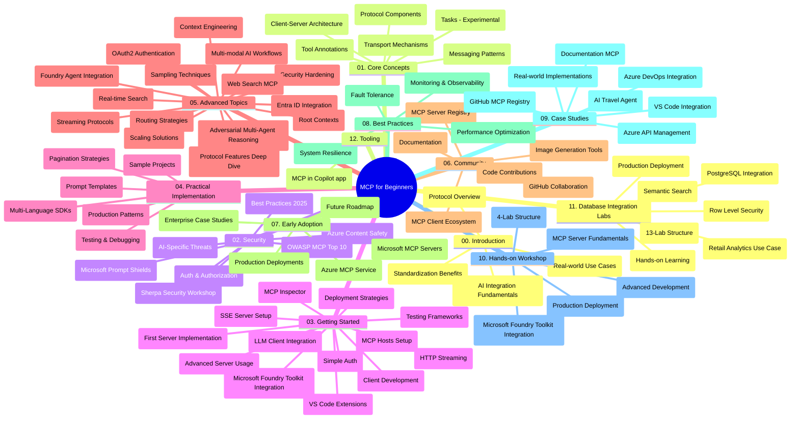

# Mudeli konteksti protokoll (MCP) algajatele - õpi juhend

See õpi juhend annab ülevaate hoidla struktuurist ja sisust kursuse "Model Context Protocol (MCP) for Beginners" jaoks. Kasuta seda juhendit, et hoidlas tõhusalt navigeerida ja maksimaalselt ära kasutada olemasolevaid ressursse.

## Hoidla ülevaade

Mudeli konteksti protokoll (MCP) on standardiseeritud raamistik AI mudelite ja kliendirakenduste vahelisteks interaktsioonideks. Algse loojana oli Anthropic, kuid MCP-d haldab nüüd laiem MCP kogukond ametliku GitHub organisatsiooni kaudu. See hoidla pakub põhjalikku õppekava praktiliste koodinäidete jaotistega C#, Java, JavaScripti, Pythoni ja TypeScripti jaoks, mis on mõeldud AI arendajatele, süsteemi arhitektidele ja tarkvarainseneridele.

## Visuaalne õppekava kaart

## Hoidla struktuur

Hoidla on jaotatud kaheteistkümne põhiosasse, millest igaüks keskendub MCP erinevatele aspektidele:

1. **Sissejuhatus (00-Introduction/)**
   - Mudeli konteksti protokolli ülevaade
   - Miks standardiseerimine on oluline AI töövoogudes
   - Praktilised kasutusjuhud ja eelised

2. **Põhikontseptsioonid (01-CoreConcepts/)**
   - Klient-server arhitektuur
   - Põhiproto kolli komponendid
   - Sõnumivahetuse mustrid MCP-s
   - Praegune spetsifikatsioon: [Mida MCP-s muudeti: 2026-07-28 spetsifikatsioon](./01-CoreConcepts/mcp-2026-07-28.md) — olekuta protokolli tuum, Extensions raamistik ja Roots/Sampling/Logging deprekeerimised

3. **Turvalisus (02-Security/)**
   - Turbeohud MCP-põhistes süsteemides
   - Parimad praktikad turvaliste rakenduste loomiseks
   - Autentimise ja autoriseerimise strateegiad
   - Praktiline [CIMD- ja DCR-autoriseerimise näide](./02-Security/samples/cimd-dcr-auth/README.md)
   - **Terviklik turbe dokumentatsioon**:
     - MCP turbe parimad praktikad
     - Azure Content Safety rakendamise juhend
     - MCP turbekontrollid ja -tehnikad
     - MCP parimate tavade kiire viide
   - **Olulised turvateemad**:
     - Prompt-injektsiooni ja tööriistamürgituse ründed
     - Sessiooni kaaperdamine ja "confused deputy" probleemid
     - Tokenite läbilaskmise haavatavused
     - Ülemäärased õigused ja juurdepääsukontroll
     - Tarnetoru turvalisus AI komponentide jaoks
     - Microsoft Prompt Shields integratsioon

4. **Alustamine (03-GettingStarted/)**
   - Keskkonna seadistamine ja konfiguratsioon
   - Põhiliste MCP serverite ja klientide loomine
   - Integratsioon olemasolevate rakendustega
   - Sisaldab jaotisi:
     - Esimene serveri implementatsioon
     - Kliendi arendus
     - LLM kliendi integratsioon
     - VS Code integratsioon
     - Server-Sent Events (SSE) server
     - Täiustatud serveri kasutusvõimalused
     - HTTP voogedastus
    - Microsoft Foundry Toolkit integratsioon
     - Testimise strateegiad
     - Deployment juhised

5. **Praktiline rakendamine (04-PracticalImplementation/)**
   - SDK-de kasutamine erinevates programmeerimiskeeltes
   - Silumine, testimine ja valideerimise tehnikad
   - Taaskasutatavate prompt-mallide ja töövoogude loomine
   - Näidete projektid koos implementeerimise näidetega

6. **Edasijõudnud teemad (05-AdvancedTopics/)**
   - Konteksti insenerimise tehnikad
   - Foundry agendi integratsioon
   - Mitmemodaalsed AI töövood
   - OAuth2 autentimise näited
   - Reaalajas otsingu võimalused
   - Reaalajas voogedastus
   - Root kontekstide implementeerimine
   - Suunamisstrateegiad
   - Valimi (sampling) tehnikad
   - Skaleerimislähenemised
   - Turbe kaalutlused
   - Entra ID turbe integreerimine
   - Veebiotsingu integratsioon
   - Vastanduv mitmeagendi arutluskäik (vaidlusmustrid)

7. **Kogukonna panused (06-CommunityContributions/)**
   - Kuidas panustada koodi ja dokumentatsiooni
   - Koostöö GitHubi kaudu
   - Kogukonnapõhised täiustused ja tagasiside
   - Erinevate MCP klientide kasutamine (Claude Desktop, Cline, VSCode)
   - Töötamine populaarsete MCP serveritega, sealhulgas pildigeneratsiooniga

8. **Varajase kasutuse õppetunnid (07-LessonsfromEarlyAdoption/)**
   - Reaalmaailma implementatsioonid ja edulood
   - MCP-põhiste lahenduste ehitamine ja juurutamine
   - Trendid ja tuleviku teekaart
   - **Microsoft MCP Serverite juhend**: Põhjalik juhend 10 tootmiskõlbuliku Microsoft MCP serveri kohta, sh:
     - Microsoft Learn Docs MCP Server
     - Azure MCP Server (15+ spetsialiseeritud pistikut)
     - GitHub MCP Server
     - Azure DevOps MCP Server
     - MarkItDown MCP Server
     - SQL Server MCP Server
     - Playwright MCP Server
     - Dev Box MCP Server
     - Microsoft Foundry MCP Server
     - Microsoft 365 Agents Toolkit MCP Server

9. **Parimad tavad (08-BestPractices/)**
   - Jõudluse häälestus ja optimeerimine
   - Vea taluvate MCP süsteemide disain
   - Testimise ja vastupidavuse strateegiad

10. **Juhtumiuuringud (09-CaseStudy/)**
    - **Seitse põhjalikku juhtumiuuringut**, mis demonstreerivad MCP mitmekülgsust erinevates stsenaariumites:
    - **Azure AI Travel Agents**: Mitmeagendi orkestreerimine Azure OpenAI ja AI Search abil
    - **Azure DevOps Integration**: Töövooprotsesside automatiseerimine YouTube'i andmete uuenduste abil
    - **Real-Time Documentation Retrieval**: Python-konsooliklient voogedastava HTTP-iga
    - **Interactive Study Plan Generator**: Chainlit veebirakendus vestlusliku AI-ga
    - **In-Editor Documentation**: VS Code integratsioon GitHub Copilot töövoogudega
    - **Azure API Management**: Ettevõtte API integratsioon MCP serveri loomisega
    - **GitHub MCP Registry**: Ökosüsteemi arendus ja agentiline integratsiooniplatvorm
    - Implementeerimise näited hõlmavad ettevõtte integratsiooni, arendaja tootlikkuse ja ökosüsteemi arengut

11. **Käed-külge töötuba (10-StreamliningAIWorkflowsBuildingAnMCPServerWithAIToolkit/)**
    - Põhjalik praktiline töötuba, mis ühendab MCP Microsoft Foundry Toolkitiga
    - Intelligentsed rakendused, mis ühendavad AI mudelid reaalse maailma tööriistadega
    - Praktilised moodulid, mis käsitlevad alustõdesid, kohandatud serveri arendust ja tootmisse juurutamise strateegiaid
    - **Labori struktuur**:
      - Lab 1: MCP serveri alused
      - Lab 2: Täiustatud MCP serveri arendus
      - Lab 3: Microsoft Foundry Toolkit integreerimine
      - Lab 4: Tootmisse juurutamine ja skaleerimine
    - Laboripõhine õppemeetod koos samm-sammuliste juhistega

12. **MCP serveri andmebaasi integreerimise laborid (11-MCPServerHandsOnLabs/)**
    - **Põhjalik 13-laboriline õppekava** tootmiskõlbulike MCP serverite ehitamiseks PostgreSQL integratsiooniga
    - **Reaalmaailma jaemüügi analüütika rakendamine Zava Retail kasutusjuhtumi abil**
    - **Ettevõttekvaliteediga mustrid**, sh Row Level Security (RLS), semantiline otsing ja mitme-üürniku andmete juurdepääs
    - **Täielik laborite struktuur**:
      - **Labs 00-03: Alused** - Sissejuhatus, arhitektuur, turvalisus, keskkonna seadistamine
      - **Labs 04-06: MCP serveri ehitamine** - Andmebaasi disain, MCP serveri implementatsioon, tööriistade arendus
      - **Labs 07-09: Täiustatud funktsioonid** - Semantiline otsing, testimine ja silumine, VS Code integratsioon
      - **Labs 10-12: Tootmine & parimad tavad** - Juurutamine, jälgimine, optimeerimine
    - **Käsitletud tehnoloogiad**: FastMCP raamistik, PostgreSQL, Azure OpenAI, Azure Container Apps, Application Insights
    - **Õppe tulemused**: Tootmiskõlbulikud MCP serverid, andmebaasi integratsiooni mustrid, AI-põhine analüütika, ettevõtte tase turvalisus

13. **Tööriistad (12-tooling/)**
    - Õpi, kuidas MCP-i kasutada Copilot rakenduses ja teistes tööriistades

## Täiendavad ressursid

Hoidla sisaldab abistavaid ressursse:

- **Pildikaust**: Sisaldab skeeme ja illustratsioone, mida kasutatakse kogu õppekavas
- **Tõlked**: Mitmekeelne tugi dokumentatsiooni automatiseeritud tõlgetega
- **Ametlikud MCP ressursid**:
  - [MCP dokumentatsioon](https://modelcontextprotocol.io/)
  - [MCP spetsifikatsioon](https://modelcontextprotocol.io/specification/2026-07-28/)
  - [MCP GitHub hoidla](https://github.com/modelcontextprotocol)

## Kuidas seda hoidlat kasutada

1. **Järjestikune õppimine**: Järgi peatükke järjekorras (00 kuni 11) struktureeritud õppimiskogemuse jaoks.
2. **Keelepõhine fookus**: Kui oled huvitatud konkreetsest programmeerimiskeelest, vaata samples kataloogi, et leida oma eelistatud keeles implementeeringud.
3. **Praktiline rakendamine**: Alusta jaotisest "Alustamine", et seadistada oma keskkond ning luua oma esimene MCP server ja klient.
4. **Edasine uurimine**: Kui oled põhitõdedega mugav, süvene edasijõudnud teemadesse, et oma teadmisi laiendada.
5. **Kogukonna kaasamine**: Liitu MCP kogukonnaga GitHubi arutelude ja Discord kanalite kaudu, et ühenduda ekspertide ja teiste arendajatega.

## MCP kliendid ja tööriistad

Õppekava käsitleb erinevaid MCP kliente ja tööriistu:

1. **Ametlikud kliendid**:
   - Visual Studio Code 
   - MCP in Visual Studio Code
   - Claude Desktop
   - Claude in VSCode 
   - Claude API

2. **Kogukonna kliendid**:
   - Cline (terminalipõhine)
   - Cursor (koodiredaktor)
   - ChatMCP
   - Windsurf

3. **MCP haldustööriistad**:
   - MCP CLI
   - MCP Manager
   - MCP Linker
   - MCP Router

## Populaarsed MCP serverid

Hoidla tutvustab mitmesuguseid MCP servereid, sealhulgas:

1. **Ametlikud Microsofti MCP serverid**:
   - Microsoft Learn Docs MCP Server
   - Azure MCP Server (15+ spetsialiseeritud pistikut)
   - GitHub MCP Server
   - Azure DevOps MCP Server
   - MarkItDown MCP Server
   - SQL Server MCP Server
   - Playwright MCP Server
   - Dev Box MCP Server
   - Microsoft Foundry MCP Server
   - Microsoft 365 Agents Toolkit MCP Server

2. **Ametlikud viitekserverid**:
   - Filesystem
   - Fetch
   - Memory
   - Sequential Thinking

3. **Pildigeneratsioon**:
   - Azure OpenAI DALL-E 3
   - Stable Diffusion WebUI
   - Replicate

4. **Arendustööriistad**:
   - Git MCP
   - Terminal Control
   - Code Assistant

5. **Spetsialiseeritud serverid**:
   - Salesforce
   - Microsoft Teams
   - Jira & Confluence

## Panustamine

See hoidla tervitab kogukonna panuseid. Vaata jaotist Kogukonna panused, et saada juhiseid, kuidas MCP ökosüsteemi tõhusalt täiendada.

----

*Seda õppejuhendit uuendati viimati 9. septembril 2026. See kajastab MCP
spetsifikatsiooni `2026-07-28`, mis on praegune protokolli revisjon. Mõned praktilised
näited on endiselt selgesõnaliselt versioonitud `2025-11-25` jaoks, samal ajal kui nende SDK-id ja tööriistad
võtavad kasutusele olekvabad protokolli API-d.*

---

<!-- CO-OP TRANSLATOR DISCLAIMER START -->
**Lahtiütlus**:
See dokument on tõlgitud kasutades AI tõlketeenust [Co-op Translator](https://github.com/Azure/co-op-translator). Kuigi me püüdleme täpsuse poole, palun pange tähele, et automatiseeritud tõlgetes võib esineda vigu või ebatäpsusi. Originaaldokument selle emakeeles tuleks pidada autoriteetseks allikaks. Olulise teabe puhul soovitatakse kasutada professionaalset inimtõlget. Me ei vastuta selle tõlkega seotud eksimustest või valesti mõistmistest.
<!-- CO-OP TRANSLATOR DISCLAIMER END -->