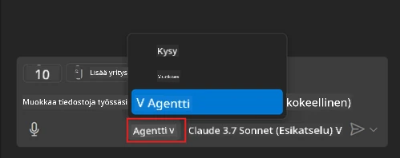
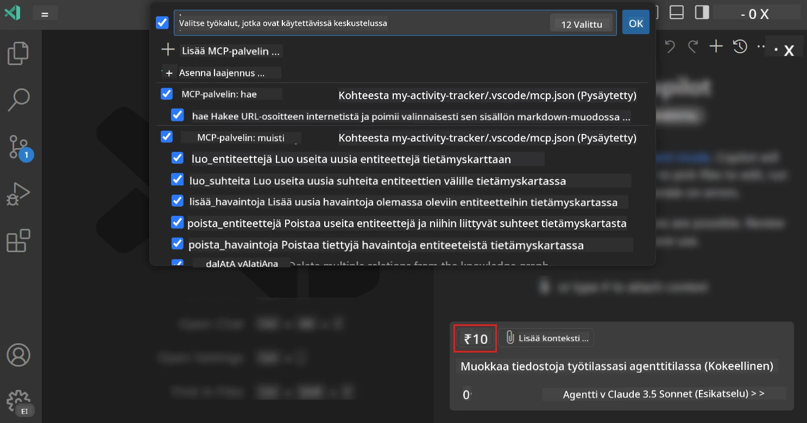
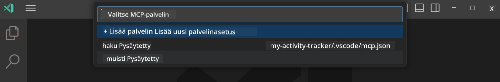
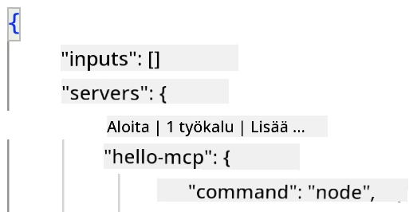
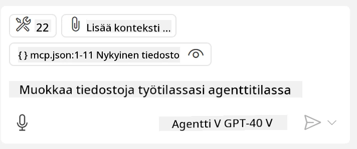
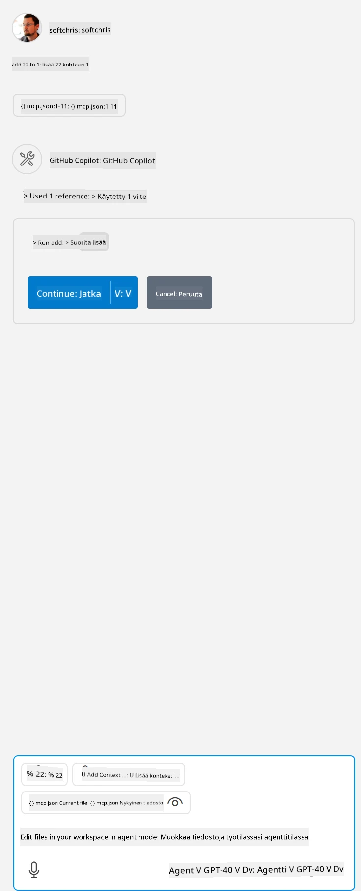

# Palvelimen käyttäminen GitHub Copilot Agent -tilassa

Visual Studio Code ja GitHub Copilot voivat toimia asiakkaana ja käyttää MCP-palvelinta. Saatat kysyä, miksi sitä haluaisimme tehdä? No, se tarkoittaa, että MCP-palvelimen kaikki ominaisuudet voidaan nyt käyttää suoraan IDE:stäsi. Kuvittele esimerkiksi, että lisäät GitHubin MCP-palvelimen, tämä mahdollistaisi GitHubin ohjaamisen kehotteiden avulla sen sijaan, että kirjoitat tiettyjä komentoja terminaaliin. Tai kuvittele ylipäätään mitä tahansa, mikä voisi parantaa kehittäjäkokemustasi, kaikki ohjattuna luonnollisella kielellä. Nyt alat nähdä hyödyn, eikö vain?

## Yleiskatsaus

Tässä oppitunnissa käydään läpi, miten käyttää Visual Studio Codea ja GitHub Copilotin Agent-tilaa asiakkaana MCP-palvelimellesi.

## Oppimistavoitteet

Oppitunnin lopuksi osaat:

- Käyttää MCP-palvelinta Visual Studio Coden kautta.
- Käyttää toiminnallisuuksia kuten työkaluja GitHub Copilotin kautta.
- Määrittää Visual Studio Coden löytämään ja hallitsemaan MCP-palvelintasi.

## Käyttö

Voit ohjata MCP-palvelintasi kahdella eri tavalla:

- Käyttöliittymä, näet myöhemmin tässä luvussa miten se tehdään.
- Terminaali, voit ohjata asioita terminaalin kautta käyttämällä `code` suoritettavaa tiedostoa:

  Lisätäksesi MCP-palvelimen käyttäjäprofiiliisi, käytä --add-mcp komentorivioptiota ja toimita JSON-muotoinen palvelinasetustiedosto muodossa {\"name\":\"palvelimen-nimi\",\"command\":...}.

  ```
  code --add-mcp "{\"name\":\"my-server\",\"command\": \"uvx\",\"args\": [\"mcp-server-fetch\"]}"
  ```

### Kuvakaappaukset





Keskustellaan seuraavaksi lisää siitä, miten käytämme visuaalista käyttöliittymää seuraavissa osioissa.

## Lähestymistapa

Näin meidän tulee lähestyä asiaa yleisellä tasolla:

- Määritä tiedosto MCP-palvelimen löytämiseksi.
- Käynnistä/Yhdistä kyseiseen palvelimeen, jotta palvelin listaa ominaisuutensa.
- Käytä näitä ominaisuuksia GitHub Copilot Chat -käyttöliittymän kautta.

Hienoa, nyt kun ymmärrämme työnkulun, kokeillaan MCP-palvelimen käyttöä Visual Studio Coden kautta harjoituksessa.

## Harjoitus: Palvelimen käyttäminen

Tässä harjoituksessa määritämme Visual Studio Coden löytämään MCP-palvelimesi, jotta sitä voi käyttää GitHub Copilot Chat -käyttöliittymässä.

### -0- Alkutoimenpide, ota MCP-palvelinten löytäminen käyttöön

Saatat joutua ottamaan MCP-palvelinten löytymisen käyttöön.

1. Siirry kohdassa `File -> Preferences -> Settings` Visual Studio Codessa.

1. Etsi "MCP" ja ota käyttöön asetus `chat.mcp.discovery.enabled` tiedostossa settings.json.

### -1- Luo määritystiedosto

Aloita luomalla määritystiedosto projektisi juureen, tarvitset MCP.json-tiedoston, joka sijoitetaan .vscode-kansioon. Sen pitäisi näyttää tältä:

```text
.vscode
|-- mcp.json
```

Seuraavaksi katsotaan, miten palvelinmerkintä lisätään.

### -2- Määritä palvelin

Lisää seuraava sisältö *mcp.json*-tiedostoon:

```json
{
    "inputs": [],
    "servers": {
       "hello-mcp": {
           "command": "node",
           "args": [
               "build/index.js"
           ]
       }
    }
}
```

Yllä on yksinkertainen esimerkki Node.js:llä kirjoitetun palvelimen käynnistämisestä, muille ajoympäristöille määritä oikea käynnistyskomento käyttäen `command` ja `args`.

### -3- Käynnistä palvelin

Nyt kun olet lisännyt merkinnän, käynnistä palvelin:

1. Etsi merkintäsi *mcp.json*-tiedostosta ja varmista, että löydät "toista" kuvakkeen:

    

1. Klikkaa "toista"-kuvaketta, näet, kuinka työkaluikoni GitHub Copilot Chatissa kasvaa saatavilla olevien työkalujen määrällä. Jos klikkaat työkalun kuvaketta, näet rekisteröityjen työkalujen listan. Voit valita työkalut, joita GitHub Copilot saa käyttää kontekstina:

  

1. Käyttääksesi työkalua, kirjoita kehotus, jonka tiedät vastaavan yhtä työkaluistasi, esimerkiksi kehotus "add 22 to 1":

  

  Näet vastauksen, joka sanoo 23.

## Tehtävä

Kokeile lisätä palvelinmerkintä *mcp.json*-tiedostoosi ja varmista, että voit käynnistää ja pysäyttää palvelimen. Varmista myös, että voit kommunikoida palvelimellesi rekisteröityjen työkalujen kanssa GitHub Copilot Chat -käyttöliittymän kautta.

## Ratkaisu

[Ratkaisu](./solution/README.md)

## Keskeiset opit

Tämän luvun keskeiset opit ovat seuraavat:

- Visual Studio Code on erinomainen asiakas, jonka kautta voit käyttää useita MCP-palvelimia ja niiden työkaluja.
- GitHub Copilot Chat -käyttöliittymä on tapa, jolla kommunikoit palvelimien kanssa.
- Voit pyytää käyttäjää antamaan syötteitä kuten API-avaimia, jotka voidaan välittää MCP-palvelimelle määritettäessä palvelinmerkintää *mcp.json*-tiedostossa.

## Esimerkit

- [Java Calculator](../samples/java/calculator/README.md)
- [.NET Calculator](../../../../03-GettingStarted/samples/csharp)
- [JavaScript Calculator](../samples/javascript/README.md)
- [TypeScript Calculator](../samples/typescript/README.md)
- [Python Calculator](../../../../03-GettingStarted/samples/python)

## Lisäresurssit

- [Visual Studio -dokumentaatio](https://code.visualstudio.com/docs/copilot/chat/mcp-servers)

## Mitä seuraavaksi

- Seuraavaksi: [Stdio-palvelimen luominen](../05-stdio-server/README.md)

---

<!-- CO-OP TRANSLATOR DISCLAIMER START -->
**Vastuuvapauslauseke**:
Tämä asiakirja on käännetty käyttämällä tekoälypohjaista käännöspalvelua [Co-op Translator](https://github.com/Azure/co-op-translator). Vaikka pyrimme tarkkuuteen, otathan huomioon, että automaattiset käännökset saattavat sisältää virheitä tai epätarkkuuksia. Alkuperäinen asiakirja sen alkuperäiskielellä on virallinen lähde. Tärkeissä asioissa suositellaan ammattimaista ihmiskäännöstä. Emme ole vastuussa tämän käännöksen käytöstä aiheutuvista väärinymmärryksistä tai tulkinnoista.
<!-- CO-OP TRANSLATOR DISCLAIMER END -->