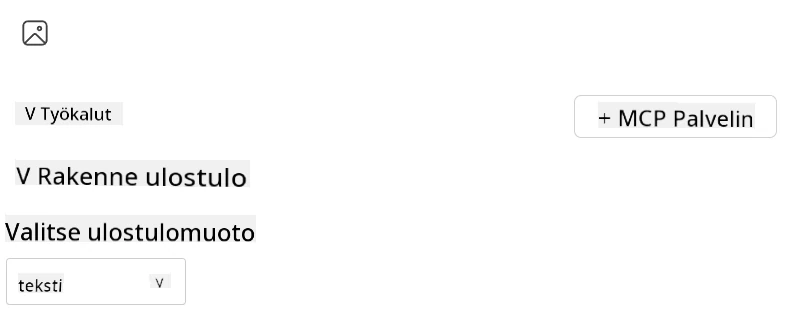
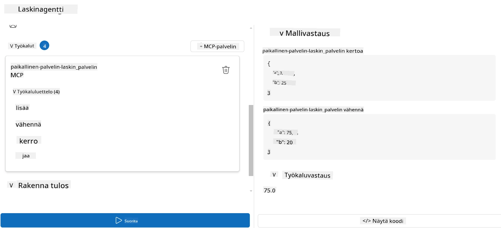

# Palvelimen käyttäminen Microsoft Foundry Toolkitilla Visual Studio Codeen

Kun rakennat tekoälyagenttia, kyse ei ole pelkästään älykkäiden vastausten luomisesta; kyse on myös siitä, että agentillasi on kyky toimia. Siinä astuu kuvaan Model Context Protocol (MCP). MCP tekee agenttien pääsyn ulkoisiin työkaluihin ja palveluihin helpoksi ja yhdenmukaiseksi. Ajattele sitä kuin agenttisi liittämistä työkalupakkiin, jota se *todella* osaa käyttää.

Sanotaan, että yhdistät agentin laskin-MCP-palvelimeesi. Yhtäkkiä agenttisi voi suorittaa matemaattisia laskutoimituksia vain vastaanottamalla kehotteen, kuten ”Mikä on 47 kertaa 89?” — ilman tarvetta kovakoodata logiikkaa tai rakentaa räätälöityjä rajapintoja.

## Yleiskatsaus

Tämä oppitunti kattaa, kuinka yhdistää laskin-MCP-palvelin agenttiin
[Microsoft Foundry Toolkit for Visual Studio Code](https://aka.ms/AIToolkit),
mahdollistaen agenttisi suorittaa matemaattisia operaatioita luonnollisen kielen kautta.

Microsoft Foundry Toolkit virtaviivaistaa generatiivisten
tekoälysovellusten kehittämistä ja testausta paikallisten ja pilvipohjaisten mallien kanssa.

*Huomautus*: Toolkit tukee tällä hetkellä Python- ja TypeScript MCP -malleja.

## Oppimistavoitteet

Tämän oppitunnin lopussa osaat:

- Kuluttaa MCP-palvelinta Microsoft Foundry Toolkitilla.
- Määrittää agentin kokoonpanon siten, että se löytää ja käyttää MCP-palvelimen tarjoamia työkaluja.
- Hyödyntää MCP-työkaluja luonnollisen kielen kautta.

## Lähestymistapa

Näin meidän tulee lähestyä tätä kokonaisuudessaan:

- Luoda agentti ja määrittää sen järjestelmäkehote.
- Luoda MCP-palvelin laskin-työkaluilla.
- Yhdistää Agent Builder MCP-palvelimeen.
- Testata agentin työkalujen kutsumista luonnollisen kielen kautta.

Hienoa, nyt kun ymmärrämme prosessin, määritetään tekoälyagentti hyödyntämään ulkoisia työkaluja MCP:n kautta, parantaen sen kyvykkyyksiä!

## Esivaatimukset

- [Visual Studio Code](https://code.visualstudio.com/)
- [Microsoft Foundry Toolkit for Visual Studio Code](https://aka.ms/AIToolkit)

## Harjoitus: Palvelimen kuluttaminen

> [!WARNING]
> Huomautus macOS-käyttäjille. Tutkimme parhaillaan ongelmaa, joka vaikuttaa riippuvuuksien asennukseen macOS:llä. Tästä johtuen macOS-käyttäjät eivät pysty tällä hetkellä suorittamaan tätä opasta loppuun. Päivitämme ohjeet heti, kun korjaus on saatavilla. Kiitos kärsivällisyydestäsi ja ymmärryksestäsi!

Tässä harjoituksessa rakennat, ajat ja parannat tekoälyagenttia työkalujen avulla
MCP-palvelimelta Visual Studio Codessa käyttäen Microsoft Foundry Toolkitia.

### -0- Ennen vaihetta, lisää Microsoft Foundry GPT-5.1 -käyttöönottosi

Luo Microsoft Foundry -resurssi, ota käyttöön **GPT-5.1**, ja lisää käyttöönotto
**Minun mallini** -listalle. Tarkista
[mallin eläkkeelle siirtymisen aikataulu](https://learn.microsoft.com/azure/foundry/openai/concepts/model-retirement-schedule)
valitessasi käyttöönottoa.

1. Avaa **Microsoft Foundry Toolkit** **Toimintopalkista**.
1. Valitse **Luettelosta** **Mallin** osio avataksesi **Malliluettelon**. Mallin valitseminen avaa **Malliluettelon** uuteen editori-välilehteen.
1. Yhdistä Microsoft Foundry -projektiisi ja valitse **GPT-5.1** käyttöönotto.
1. Klikkaa **+ Lisää** lisätäksesi käyttöönoton **Minun mallini** -listasii.
1. Toimintopalkissa varmista, että käyttöönotto näkyy listalla.

### -1- Luo agentti

**Agentti (Kehote) Rakentaja** mahdollistaa oman tekoälypohjaisen agenttisi luomisen ja mukauttamisen. Tässä osassa luot uuden agentin ja määrität mallin keskustelun käyttöön.

1. Avaa **Microsoft Foundry Toolkit** **Toimintopalkista**.
1. Työkalut-osiossa valitse **Agentti (Kehote) Rakentaja**. Valinta avaa **Agentti (Kehote) Rakentaja** -editorin uudessa välilehdessä.
1. Klikkaa **+ Uusi agentti** -painiketta. Laajennus käynnistää asennusohjatun toiminnon **Komentopaletti**- kautta.
1. Syötä nimi **Laskinagentti** ja paina **Enter**.
1. Valitse **Agentti (Kehote) Rakentajassa** Microsoft Foundryn **GPT-5.1** käyttöönotto.

### -2- Luo agentille järjestelmäkehote

Agentin luonnosteltuasi on aika määritellä sen persoonallisuus ja tarkoitus. Tässä osassa käytät **Luo järjestelmäkehote** -ominaisuutta kuvaamaan agentin halutun käyttäytymisen—tässä tapauksessa laskinagentti—ja mallin kirjoittavan järjestelmäkehote puolestasi.

1. Kehote-osiossa klikkaa **Luo järjestelmäkehote** -painiketta. Tämä avaa kehotteen rakennustyökalun, joka hyödyntää tekoälyä luomaan agentille sopivan järjestelmäkehoteen.
1. Ikunassa **Luo kehotetta** kirjoita seuraava: `You are a helpful and efficient math assistant. When given a problem involving basic arithmetic, you respond with the correct result.`
1. Klikkaa **Luo** -painiketta. Ilmoitus ilmestyy oikeaan alanurkkaan vahvistamaan, että järjestelmäkehote luodaan. Kun luonti on valmis, kehotteen sisältö näkyy **Järjestelmäkehote** kentässä **Agentti (Kehote) Rakentajassa**.
1. Tarkista **Järjestelmäkehote** ja muokkaa tarvittaessa.

### -3- Luo MCP-palvelin

Nyt kun olet määritellyt agenttisi järjestelmäkehoteen – joka ohjaa sen käyttäytymistä ja vastauksia – on aika varustaa agentti käytännön kyvyillä. Tässä osassa luot laskimen MCP-palvelimen työkaluilla, jotka suorittavat yhteen-, vähennys-, kerto- ja jakolaskuja. Tämä palvelin mahdollistaa agentin suorittaa reaaliaikaisia matemaattisia operaatioita luonnollisen kielen kehotteiden vastauksena.



Microsoft Foundry Toolkit sisältää mallipohjat MCP-palvelinten luomiseen. Käytämme
Python-mallipohjaa laskimen MCP-palvelimelle.

*Huomautus*: Toolkit tukee tällä hetkellä Python- ja TypeScript MCP -malleja.

1. **Agentti (Kehote) Rakentajan** Työkalut-osiossa klikkaa **+ MCP-serveri** -painiketta. Laajennus käynnistää asennusohjatun Komentopaletin kautta.
1. Valitse **+ Lisää palvelin**.
1. Valitse **Luo uusi MCP-palvelin**.
1. Valitse mallipohjaksi **python-weather**.
1. Valitse **Oletuskansio** tallentaaksesi MCP-palvelimen mallipohjan.
1. Anna palvelimelle nimi: **Laskin**
1. Uusi Visual Studio Code -ikkuna avautuu. Valitse **Kyllä, luotan kirjoittajiin**.
1. Käytä terminaalia (**Terminal** > **New Terminal**) luodaksesi virtuaaliympäristö: `python -m venv .venv`
1. Aktivoi virtuaaliympäristö terminaalissa:
    1. Windows - `.venv\Scripts\activate`
    1. macOS/Linux - `source .venv/bin/activate`
1. Asenna riippuvuudet terminaalissa: `pip install -e .[dev]`
1. Toimintopalkin **Explorer**-näkymässä laajenna **src**-hakemisto ja valitse **server.py** avataksesi tiedoston editorissa.
1. Korvaa **server.py** -tiedoston koodi seuraavalla ja tallenna:

    ```python
    """
    Sample MCP Calculator Server implementation in Python.

    
    This module demonstrates how to create a simple MCP server with calculator tools
    that can perform basic arithmetic operations (add, subtract, multiply, divide).
    """
    
    from mcp.server.fastmcp import FastMCP
    
    server = FastMCP("calculator")
    
    @server.tool()
    def add(a: float, b: float) -> float:
        """Add two numbers together and return the result."""
        return a + b
    
    @server.tool()
    def subtract(a: float, b: float) -> float:
        """Subtract b from a and return the result."""
        return a - b
    
    @server.tool()
    def multiply(a: float, b: float) -> float:
        """Multiply two numbers together and return the result."""
        return a * b
    
    @server.tool()
    def divide(a: float, b: float) -> float:
        """
        Divide a by b and return the result.
        
        Raises:
            ValueError: If b is zero
        """
        if b == 0:
            raise ValueError("Cannot divide by zero")
        return a / b
    ```

### -4- Aja agentti laskimen MCP-palvelimen kanssa

Nyt kun agentillasi on työkalut, on aika käyttää niitä! Tässä osassa teet pyyntöjä agentille testataksesi ja varmistaaksesi, että agentti käyttää oikeaa työkalua laskimen MCP-palvelimelta.



Ajetaan laskimen MCP-palvelin paikallisella kehityskoneellasi **Agent Builder** -työkalun kautta MCP-asiakkaana.

1. Paina `F5` käynnistääksesi MCP-palvelimen virheenkorjauksen. **Agentti (Kehote) Rakentaja** avautuu uuteen editorin välilehteen. Palvelimen tila näkyy terminaalissa.
1. Syötä **Käyttäjän kehote** -kenttään **Agentti (Kehote) Rakentajassa** seuraava kehotus: `I bought 3 items priced at $25 each, and then used a $20 discount. How much did I pay?`
1. Klikkaa **Aja** -painiketta generoimaan agentin vastaus.
1. Tarkista agentin tuloste. Mallin pitäisi päätellä, että maksoit **55 dollaria**.
1. Tässä erittely tapahtuvasta:
    - Agentti valitsee **kertolasku** ja **vähennys** työkalut laskun avuksi.
    - Vastaavat `a` ja `b` arvot annetaan **kertolasku** työkalulle.
    - Vastaavat `a` ja `b` arvot annetaan **vähennys** työkalulle.
    - Kunkin työkalun vastaus näkyy vastaavassa **Työkalun vastaus** -kentässä.
    - Mallin lopullinen vastaus näkyy lopullisessa **Mallin vastaus** -kentässä.
1. Lähetä lisää kehotteita testataksesi agenttia edelleen. Voit muokata nykyistä kehotetta **Käyttäjän kehote** -kentästä klikkaamalla kenttää ja korvaamalla olemassa olevan kehotteen.
1. Kun olet lopettanut agentin testaamisen, voit lopettaa palvelimen terminaalissa painamalla **CTRL/CMD+C**.

## Tehtävä

Kokeile lisätä uusi työkalumerkintä **server.py** -tiedostoosi (esim. neliöjuuren laskeminen). Lähetä lisää kehotteita, jotka vaativat agenttia hyödyntämään uutta tai olemassa olevaa työkalua. Muista käynnistää palvelin uudelleen, jotta uudet työkalut tulevat käyttöön.

## Ratkaisu

[Ratkaisu](./solution/README.md)

## Keskeiset opit

Tässä luvussa opitut asiat ovat seuraavat:

- Microsoft Foundry Toolkit voi kuluttaa MCP-palvelimia ja niiden työkaluja.
- Voit lisätä uusia työkaluja MCP-palvelimiin laajentaen agentin kyvykkyyttä muuttuviin tarpeisiin.
- Microsoft Foundry Toolkit sisältää MCP-palvelinmalleja mukautettujen työkalujen luomiseen.

## Lisäresurssit

- [Microsoft Foundry Toolkit dokumentaatio](https://aka.ms/AIToolkit/doc)

## Seuraavaksi
- Seuraava: [Testaus ja virheenkorjaus](../08-testing/README.md)

---

<!-- CO-OP TRANSLATOR DISCLAIMER START -->
**Vastuuvapauslauseke**:
Tämä asiakirja on käännetty käyttämällä tekoälypohjaista käännöspalvelua [Co-op Translator](https://github.com/Azure/co-op-translator). Vaikka pyrimme tarkkuuteen, otathan huomioon, että automaattiset käännökset saattavat sisältää virheitä tai epätarkkuuksia. Alkuperäinen asiakirja sen alkuperäiskielellä on virallinen lähde. Tärkeissä asioissa suositellaan ammattimaista ihmiskäännöstä. Emme ole vastuussa tämän käännöksen käytöstä aiheutuvista väärinymmärryksistä tai tulkinnoista.
<!-- CO-OP TRANSLATOR DISCLAIMER END -->