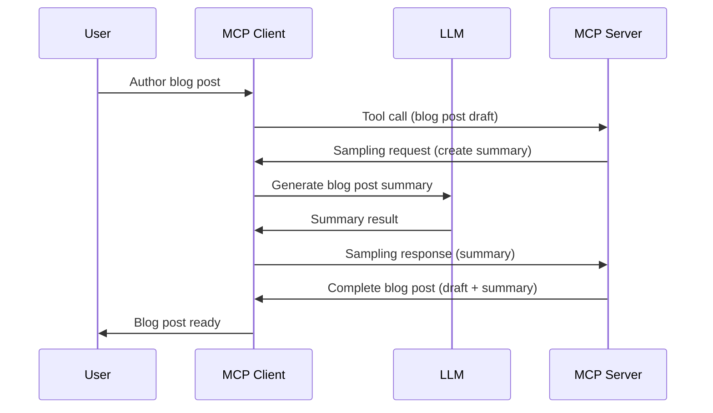

> [!WARNING]
> Näytteenotto on vanhentunut MCP:ssä `2026-07-28`. Tämä oppitunti on säilytetty
> perintöjärjestelmien vuoksi. Uusien palvelimien tulisi integroitua suoraan LLM
> -tarjoajan API:iin.

# Näytteenotto - delegoi ominaisuuksia asiakkaalle

> Näytteenotto säilyy `2026-07-28`-määritelmässä yhteensopivuuden vuoksi ja se voidaan
> poistaa ensimmäisessä 28.7.2027 tai sen jälkeen julkaistussa tarkistuksessa.
> Tämän oppitunnin esimerkeissä voidaan käyttää SDK-API:eita, jotka toteuttavat `2025-11-25`.
> Katso [Mitä MCP:ssä on muuttunut: 28.7.2026 määritelmä](../../01-CoreConcepts/mcp-2026-07-28.md).

Perintöjärjestelmissä Näytteenotto antaa MCP-palvelimelle mahdollisuuden pyytää apua
asiakkaan hallitsemalta LLM:ltä. Uusissa toteutuksissa kutsutaan valittua LLM-tarjoajaa
suoraan.

Tutkitaan muutamia käyttötapauksia ja kuinka rakentaa ratkaisu, joka käyttää näytteenottoa.

## Yleiskatsaus

Tässä oppitunnissa keskitymme selittämään, milloin ja missä Näytteenottoa käytetään ja kuinka se konfiguroidaan.

## Oppimistavoitteet

Tässä luvussa teemme seuraavaa:

- Selitämme, mitä Näytteenotto on ja milloin sitä käytetään.
- Näytämme, miten Näytteenotto konfiguroidaan MCP:ssä.
- Annamme esimerkkejä Näytteenotosta käytännössä.

## Mikä on Näytteenotto ja miksi sitä käytetään?

Näytteenotto on edistynyt ominaisuus, joka toimii seuraavasti:



### Näytteenottopyyntö

Hyvä, nyt kun meillä on kokonaiskuva uskottavasta skenaariosta, puhutaan palvelimen asiakkaalle lähettämästä näytteenottopyynnöstä. Tässä, miltä tällainen pyyntö JSON-RPC-muodossa voi näyttää:

```json
{
  "jsonrpc": "2.0",
  "id": 1,
  "method": "sampling/createMessage",
  "params": {
    "messages": [
      {
        "role": "user",
        "content": {
          "type": "text",
          "text": "Create a blog post summary of the following blog post: <BLOG POST>"
        }
      }
    ],
    "modelPreferences": {
      "hints": [
        {
          "name": "gpt-5.1"
        }
      ],
      "intelligencePriority": 0.8,
      "speedPriority": 0.5
    },
    "systemPrompt": "You are a helpful assistant.",
    "maxTokens": 100
  }
}
```

Tässä on muutama huomionarvoinen asia:

- Kysely, eli kohdassa content -> text, on käsky LLM:lle tiivistää blogikirjoituksen sisältö.

- **modelPreferences**. Tämä osa on juuri sitä, mieltymys, suositus siitä, mitä LLM:n konfiguraatiota käyttää. Käyttäjä voi valita, noudattaako näitä suosituksia vai muuttaako niitä. Tässä tapauksessa suositukset koskevat mallin valintaa sekä nopeus- ja älykkyysprioriteettia.
- **systemPrompt**, tämä on normaali järjestelmäkäsky, joka antaa LLM:lle persoonallisuuden ja ohjeet.
- **maxTokens**, tämä on toinen ominaisuus, jolla kerrotaan, kuinka monta tokenia suositellaan käytettäväksi tässä tehtävässä.

### Näytteenottovastaus

Tämä vastaus on se, minkä MCP-asiakas lopulta lähettää MCP-palvelimelle ja se on tulos asiakkaan kutsuttua LLM:ää, odotettua vastausta ja sitten rakennettua tätä viestiä varten. Tässä, miltä se voi näyttää JSON-RPC-muodossa:

```json
{
  "jsonrpc": "2.0",
  "id": 1,
  "result": {
    "role": "assistant",
    "content": {
      "type": "text",
      "text": "Here's your abstract <ABSTRACT>"
    },
    "model": "gpt-5.1",
    "stopReason": "endTurn"
  }
}
```

Vastaus on tiivistelmä blogikirjoituksesta juuri pyydetyllä tavalla. Asiakas
valitsi aktiivisen `gpt-5.1`-käytön palvelimen mallisuosituksesta;
mallisuositukset ovat suosituksia, joten asiakas voi valita toisen aktiivisen
käytön tarvittaessa.

Hyvä, nyt kun ymmärrämme pääprosessin, ja hyödyllisen tehtävän "blogikirjoituksen luonti + tiivistelmä", katsotaan mitä meidän pitää tehdä saadaksemme sen toimimaan.

### Viestityypit

Näytteenottoviestit eivät rajoitu pelkkään tekstiin, vaan voit myös lähettää kuvia ja ääntä. Tässä, miltä JSON-RPC näyttää eri tavoin:

**Teksti**

```json
{
  "type": "text",
  "text": "The message content"
}
```

**Kuvasisältö**

```json
{
  "type": "image",
  "data": "base64-encoded-image-data",
  "mimeType": "image/jpeg"
}
```

**Äänisisältö**

```json
{
  "type": "audio",
  "data": "base64-encoded-audio-data",
  "mimeType": "audio/wav"
}
```

> NOTE: Katso nykytilanne ja migraatio-ohjeet
> [vanhentuneesta Näytteenoton dokumentaatiosta](https://modelcontextprotocol.io/specification/2026-07-28/client/sampling).

## Kuinka konfiguroida Näytteenotto Asiakkaalle

> Huom: jos rakennat vain palvelinta, sinun ei tarvitse tehdä tässä paljon mitään.

Asiakkaassa sinun tulee määrittää seuraava ominaisuus näin:

```json
{
  "capabilities": {
    "sampling": {}
  }
}
```

Tämä otetaan käyttöön, kun valittu asiakas alustaa yhteyden palvelimeen.

## Esimerkki Näytteenotosta käytännössä - Luo blogikirjoitus

Koodataan yhdessä näytteenottopalvelin, meidän täytyy tehdä seuraavat:

1. Luo työkalu palvelimelle.
1. Työkalun tulee luoda näytteenottopyyntö.
1. Työkalun tulee odottaa asiakkaan vastausta näytteenottopyyntöön.
1. Sitten työkalun tulos tuodaan esiin.

Katsotaan koodi askel askeleelta:

### -1- Luo työkalu

**python**

```python
@mcp.tool()
async def create_blog(title: str, content: str, ctx: Context[ServerSession, None]) -> str:
    """Create a blog post and generate a summary"""

```

### -2- Luo näytteenottopyyntö

Laajenna työkalua seuraavalla koodilla:

**python**

```python
post = BlogPost(
        id=len(posts) + 1,
        title=title,
        content=content,
        abstract=""
    )

prompt = f"Create an abstract of the following blog post: title: {title} and draft: {content} "

result = await ctx.session.create_message(
        messages=[
            SamplingMessage(
                role="user",
                content=TextContent(type="text", text=prompt),
            )
        ],
        max_tokens=100,
)

```

### -3- Odota vastausta ja palauta vastaus

**python**

```python
post.abstract = result.content.text

posts.append(post)

# return the complete product
return json.dumps({
    "id": post.title,
    "abstract": post.abstract
})
```

### -4- Täysi koodi

**python**

```python
from starlette.applications import Starlette
from starlette.routing import Mount, Host

from mcp.server.fastmcp import Context, FastMCP

from mcp.server.session import ServerSession
from mcp.types import SamplingMessage, TextContent

import json


from uuid import uuid4
from typing import List
from pydantic import BaseModel


mcp = FastMCP("Blog post generator")

# app = FastAPI()

posts = []

class BlogPost(BaseModel):
    id: int
    title: str
    content: str
    abstract: str

posts: List[BlogPost] = []

@mcp.tool()
async def create_blog(title: str, content: str, ctx: Context[ServerSession, None]) -> str:
    """Create a blog post and generate a summary"""

    post = BlogPost(
        id=len(posts) + 1,
        title=title,
        content=content,
        abstract=""
    )

    prompt = f"Create an abstract of the following blog post: title: {title} and draft: {content} "

    result = await ctx.session.create_message(
        messages=[
            SamplingMessage(
                role="user",
                content=TextContent(type="text", text=prompt),
            )
        ],
        max_tokens=100,
    )

    post.abstract = result.content.text

    posts.append(post)

    # return the complete blog post
    return json.dumps({
        "id": post.title,
        "abstract": post.abstract
    })

if __name__ == "__main__":
    print("Starting server...")
    # mcp.run()
    mcp.run(transport="streamable-http")

# run app with: python server.py
```

### -5- Testaus Visual Studio Codessa

Testataksesi tätä Visual Studio Codessa, tee seuraavat:

1. Käynnistä palvelin terminaalista
1. Lisää se *mcp.json*-tiedostoon (ja varmista, että se on käynnissä), esim seuraavasti:

   ```json
   "servers": {
      "blog-server": {
        "type": "http",
        "url": "http://localhost:8000/mcp"
      }
   }
   ```

1. Kirjoita pyyntö:

   ```text
   create a blog post named "Where Python comes from", the content is "Python is actually named after Monty Python Flying Circus"
   ```

1. Salli näytteenoton tapahtuminen. Ensimmäisellä kerralla kun testaat tätä, sinulle avautuu lisävalintaikkuna, jonka hyväksyt, sitten näet tavallisen työkalun suoritusikkunan.

1. Tarkastele tuloksia. Näet tulokset sekä siististi esitettynä GitHub Copilot -keskustelussa että raakana JSON-vastauksena.

**Bonus**. Visual Studio Coden työkalut tukevat hyvin näytteenottoa. Voit konfiguroida pääsyn näytteenottoon asennetulla palvelimellasi seuraavasti:

1. Siirry laajennukset-osioon.
1. Valitse hammasratasikoni asennetun palvelimesi kohdalta kohdassa "MCP SERVERS - INSTALLED".
1 Valitse "Configure Model Access", täällä voit päättää, mitä malleja GitHub Copilot saa käyttää näytteenoton aikana. Voit myös nähdä kaikki viimeaikaiset näytteenottopyynnöt valitsemalla "Show Sampling requests".

## Tehtävä

Tässä tehtävässä rakennat hieman erilaisen Näytteenoton, nimittäin näytteenottointegraation, joka tukee tuotteen kuvauksen luomista. Tässä skenaario:

**Skenaario**: Verkkokaupan työntekijä tarvitsee apua, koska tuotekuvausten laatiminen vie liikaa aikaa. Sinun tehtäväsi on rakentaa ratkaisu, jossa kutsutaan "create_product"-työkalua argumenteilla "title" ja "keywords", ja sen tulee tuottaa täydellinen tuote sisältäen "description"-kentän, joka täytetään asiakkaan LLM:n avulla.

VINKKI: käytä aiemmin oppimaasi rakentaaksesi tämä palvelin ja sen työkalu käyttäen näytteenottopyyntöä.

## Ratkaisu

[Ratkaisu](./solution/README.md)

## Tärkeimmät opit

Näytteenotto on tehokas ominaisuus, joka mahdollistaa palvelimen delegoida tehtäviä asiakkaalle, kun tarvitaan LLM:n apua.

## Mitä seuraavaksi

- [Luku 4 - Käytännön toteutus](../../04-PracticalImplementation/README.md)

---

<!-- CO-OP TRANSLATOR DISCLAIMER START -->
**Vastuuvapauslauseke**:
Tämä asiakirja on käännetty käyttämällä tekoälypohjaista käännöspalvelua [Co-op Translator](https://github.com/Azure/co-op-translator). Vaikka pyrimme tarkkuuteen, otathan huomioon, että automaattiset käännökset saattavat sisältää virheitä tai epätarkkuuksia. Alkuperäinen asiakirja sen alkuperäiskielellä on virallinen lähde. Tärkeissä asioissa suositellaan ammattimaista ihmiskäännöstä. Emme ole vastuussa tämän käännöksen käytöstä aiheutuvista väärinymmärryksistä tai tulkinnoista.
<!-- CO-OP TRANSLATOR DISCLAIMER END -->