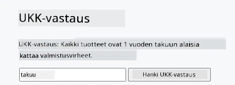
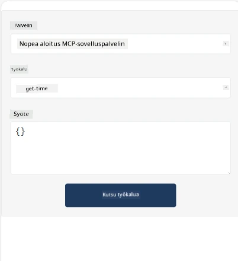
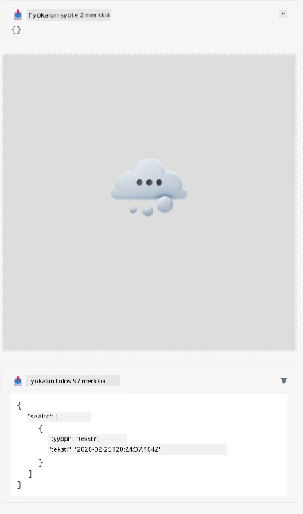

Tässä on esimerkki, joka demonstroi MCP-sovellusta

## Asennus 

1. Siirry *mcp-app*-kansioon
1. Suorita `npm install`, tämän pitäisi asentaa frontend- ja backend-riippuvuudet

Varmista backendin kääntyminen suorittamalla:

```sh
npx tsc --noEmit
```

Jos kaikki on kunnossa, ei pitäisi olla mitään tulostetta.

## Suorita backend

> Tämä vaatii hieman lisätyötä, jos käytät Windows-koneetta, koska MCP Apps -ratkaisu käyttää `concurrently`-kirjastoa, jolle sinun täytyy löytää korvaava vaihtoehto. Tässä on ongelmallinen rivi *package.json* tiedostossa MCP Appissa:

```json
"start": "concurrently \"cross-env NODE_ENV=development INPUT=mcp-app.html vite build --watch\" \"tsx watch main.ts\""
```

Tässä sovelluksessa on kaksi osaa, backend-osa ja isäntäosa.

Käynnistä backend kutsumalla:

```sh
npm start
```

Tämä käynnistää backendin osoitteessa `http://localhost:3001/mcp`. 

> Huomaa, jos olet Codespacessa, saatat joutua asettamaan portin näkyvyyden julkiseksi. Tarkista, että pääset päätepisteeseen selaimessa osoitteessa https://<name of Codespace>.app.github.dev/mcp

## Vaihtoehto 1 - Testaa sovellus Visual Studio Codessa

Testataksesi ratkaisua Visual Studio Codessa, tee seuraavat:

- Lisää palvelinmerkintä `mcp.json` tiedostoon seuraavasti:

    ```json
    {
        "servers": {
            "my-mcp-server-7178eca7": {
                "url": "http://localhost:3001/mcp",
                "type": "http"
            }
        },
        "inputs": []
    }
    ```

1. Klikkaa "start" painiketta tiedostossa *mcp.json*
1. Varmista, että chat-ikkuna on auki ja kirjoita `get-faq`, sinun pitäisi nähdä tulos seuraavasti:

    

## Vaihtoehto 2 - Testaa sovellus isännän kanssa

Repo <https://github.com/modelcontextprotocol/ext-apps> sisältää useita erilaisia isäntiä, joita voit käyttää MVP-sovellustesi testaamiseen. 

Esittelemme sinulle tässä kaksi eri vaihtoehtoa:

### Paikallinen kone

- Siirry kansioon *ext-apps* sen jälkeen kun olet kloonannut repositorion.

- Asenna riippuvuudet

   ```sh
   npm install
   ```

- Avaa toinen terminaali-ikkuna ja siirry kansioon *ext-apps/examples/basic-host*

    > Jos olet Codespacessa, sinun täytyy navigoida tiedostoon serve.ts ja riville 27, ja vaihtaa osoite http://localhost:3001/mcp Codespace-URL:ksi backendille, esimerkiksi https://psychic-xylophone-657rpjgvxpc5g64-3001.app.github.dev/mcp

- Käynnistä isäntä:

    ```sh
    npm start
    ```

    Tämän pitäisi yhdistää isäntä backendin kanssa ja sinun pitäisi nähdä sovellus käynnissä seuraavasti:

    

### Codespace

Codespace-ympäristön toimintaan saaminen vaatii hieman ylimääräistä työtä. Isännän käyttäminen Codespacen kautta:

- Katso *ext-apps* -hakemisto ja siirry kansioon *examples/basic-host*.
- Suorita `npm install` asentaaksesi riippuvuudet
- Suorita `npm start` käynnistääksesi isännän.

## Testaa sovellusta

Kokeile sovellusta seuraavasti:

- Valitse "Call Tool" -painike ja sinun pitäisi nähdä tulokset seuraavasti:

    

Hienoa, kaikki toimii.

---

<!-- CO-OP TRANSLATOR DISCLAIMER START -->
**Vastuuvapauslauseke**:
Tämä asiakirja on käännetty käyttämällä tekoälypohjaista käännöspalvelua [Co-op Translator](https://github.com/Azure/co-op-translator). Vaikka pyrimme tarkkuuteen, otathan huomioon, että automaattiset käännökset saattavat sisältää virheitä tai epätarkkuuksia. Alkuperäinen asiakirja sen alkuperäiskielellä on virallinen lähde. Tärkeissä asioissa suositellaan ammattimaista ihmiskäännöstä. Emme ole vastuussa tämän käännöksen käytöstä aiheutuvista väärinymmärryksistä tai tulkinnoista.
<!-- CO-OP TRANSLATOR DISCLAIMER END -->