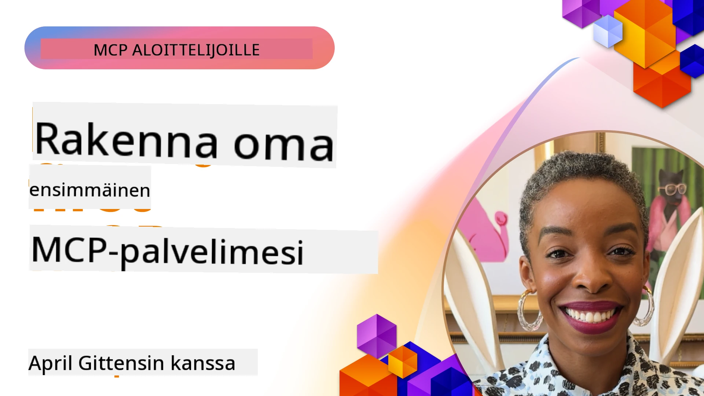

## Aloittaminen  

_(Klikkaa yllä olevaa kuvaa katsoaksesi tämän oppitunnin videon)_

Tämä osio koostuu useista oppitunneista:

- **1 Ensimmäinen palvelimesi**, tässä ensimmäisessä oppitunnissa opit luomaan ensimmäisen palvelimesi ja tarkastelemaan sitä inspector-työkalulla, arvokas tapa testata ja debugata palvelinta, [oppitunnille](01-first-server/README.md)

- **2 Asiakas**, tässä oppitunnissa opit kirjoittamaan asiakkaan, joka pystyy yhdistämään palvelimeesi, [oppitunnille](02-client/README.md)

- **3 Asiakas LLM:llä**, vielä parempi tapa kirjoittaa asiakas on lisätä siihen LLM, jotta se voi "neuvotella" palvelimesi kanssa siitä, mitä tehdä, [oppitunnille](03-llm-client/README.md)

- **4 Palvelimen GitHub Copilot Agent -tilan käyttäminen Visual Studio Codessa**. Tässä tarkastelemme MCP-palvelimen ajamista Visual Studio Coden sisällä, [oppitunnille](04-vscode/README.md)

- **5 stdio Transport Server** stdio-siirto on suositeltu standardi paikalliseen MCP-palvelin-asiakasviestintään, tarjoten turvallisen alaiheprosessipohjaisen viestinnän sisäänrakennetulla prosessieristyksellä [oppitunnille](05-stdio-server/README.md)

- **6 HTTP Streaming MCP:llä (Streamable HTTP)**. Opi standardista
	etäsiirrosta [MCP Specification 2026-07-28](https://modelcontextprotocol.io/specification/2026-07-28/basic/transports/streamable-http),
	sekä perintönä säilytetystä istuntopohjaisesta toteutuksesta oppitunnissa.
	[oppitunnille](06-http-streaming/README.md)

- **7 Microsoft Foundry Toolkitin käyttäminen Visual Studio Codessa** MCP-asiakas- ja palvelinohjelmien kulutukseen ja testaamiseen [tässä oppitunnissa](07-aitk/README.md)

- **8 Testaus**. Tässä keskitymme erityisesti siihen, miten voimme testata palvelinta ja asiakasta eri tavoin, [oppitunnille](08-testing/README.md)

- **9 Käyttöönotto**. Tämä luku tarkastelee eri tapoja ottaa MCP-ratkaisut käyttöön, [oppitunnille](09-deployment/README.md)

- **10 Edistynyt palvelimen käyttö**. Tämä luku käsittelee edistynyttä palvelimen käyttöä, [oppitunnille](./10-advanced/README.md)

- **11 Todennus**. Tämä luku käsittelee yksinkertaisen todennuksen lisäämistä, Basic Authista JWT:hen ja RBACiin. On suositeltavaa aloittaa tästä ja katsoa sitten Edistyneet Aiheet luvussa 5 sekä suorittaa lisäturvavahvistuksia luvun 2 suositusten mukaan, [oppitunnille](./11-simple-auth/README.md)

- **12 MCP Isännät**. Konfiguroi ja käytä suosittuja MCP-asiakasisäntäsovelluksia kuten Claude Desktop, Cursor, Cline ja Windsurf. Opi siirtotyypeistä ja vianmäärityksestä, [oppitunnille](./12-mcp-hosts/README.md)

- **13 MCP Inspector**. Debuggaa ja testaa MCP-palvelimiasi interaktiivisesti MCP Inspector -työkalulla. Opi vianmääritystyökaluista, resursseista ja protokollaviesteistä, [oppitunnille](./13-mcp-inspector/README.md)

- **14 Näytteistäminen**. Opi perintönä oleva Näytteistäminen `2025-11-25`:llä ja
	miten siirtyä uusiin suunnitelmiin suorassa LLM-palvelinintegraatiossa. Näytteistäminen on
	vanhentunut MCP:ssa `2026-07-28`. [oppitunnille](./14-sampling/README.md)

- **15 MCP Sovellukset**. Rakenna MCP-palvelimia, jotka myös vastaavat käyttöliittymäohjeilla, [oppitunnille](./15-mcp-apps/README.md)

Model Context Protocol (MCP) on avoin protokolla, joka standardisoi sovellusten tavan tarjota kontekstia LLM-malleille. Ajattele MCP:tä kuin USB-C-porttina tekoälysovelluksille – se tarjoaa standardisoidun tavan yhdistää tekoälymalleja erilaisiin tietolähteisiin ja työkaluihin.

## Oppimistavoitteet

Tämän oppitunnin jälkeen osaat:

- Määrittää MCP-kehitysympäristöt C#, Java, Python, TypeScript ja JavaScript -kielille
- Rakentaa ja ottaa käyttöön perustason MCP-palvelimia, joissa on mukautettuja ominaisuuksia (resurssit, kehotteet ja työkalut)
- Luoda isäntäsovelluksia, jotka yhdistävät MCP-palvelimiin
- Testata ja debugata MCP-toteutuksia
- Ymmärtää yleisiä asennushaasteita ja niiden ratkaisuja
- Yhdistää MCP-toteutuksesi suosittuihin LLM-palveluihin

## MCP-ympäristösi määrittäminen

Ennen kuin alat työstää MCP:tä, on tärkeää valmistella kehitysympäristösi ja ymmärtää perus työnkulku. Tämä osio ohjaa sinua alkuasetuksissa varmistaaksesi sujuvan alun MCP:n kanssa.

### Esivaatimukset

Ennen MCP-kehityksen aloittamista varmista, että sinulla on:

- **Kehitysympäristö**: Valitsemallesi kielelle (C#, Java, Python, TypeScript tai JavaScript)
- **IDE/Editor**: Visual Studio, Visual Studio Code, IntelliJ, Eclipse, PyCharm tai mikä tahansa moderni koodieditori
- **Pakettien hallinta**: NuGet, Maven/Gradle, pip tai npm/yarn
- **API-avaimet**: Kaikille AI-palveluille, joita aiot käyttää isäntäsovelluksissasi

### Viralliset SDK:t

Tulevissa luvuissa näet ratkaisuja, jotka on rakennettu Pythonilla, TypeScriptillä,
Javalla ja .NET:llä. Tässä ovat viralliset SDK:t.

SDK-tuki MCP `2026-07-28`:lle ilmestyy kielikohtaisesti itsenäisesti.
Ennen esimerkin ajamista tarkista sen pakettiversio ja SDK:n julkaisumuistiinpanot
tuetuista protokollaversioista. Katso
[virallinen SDK-lista](https://modelcontextprotocol.io/docs/sdk):
- [C# SDK](https://github.com/modelcontextprotocol/csharp-sdk) - Ylläpidetään yhteistyössä Microsoftin kanssa
- [Java SDK](https://github.com/modelcontextprotocol/java-sdk) - Ylläpidetään yhteistyössä Spring AI:n kanssa
- [TypeScript SDK](https://github.com/modelcontextprotocol/typescript-sdk) - Virallinen TypeScript-toteutus
- [Python SDK](https://github.com/modelcontextprotocol/python-sdk) - Virallinen Python-toteutus (FastMCP)
- [Kotlin SDK](https://github.com/modelcontextprotocol/kotlin-sdk) - Virallinen Kotlin-toteutus
- [Swift SDK](https://github.com/modelcontextprotocol/swift-sdk) - Ylläpidetään yhteistyössä Loopwork AI:n kanssa
- [Rust SDK](https://github.com/modelcontextprotocol/rust-sdk) - Virallinen Rust-toteutus
- [Go SDK](https://github.com/modelcontextprotocol/go-sdk) - Virallinen Go-toteutus

## Keskeiset Opit

- MCP-kehitysympäristön määrittäminen on suoraviivaista kielikohtaisilla SDK:illa
- MCP-palvelinten rakentaminen sisältää työkalujen luomisen ja rekisteröinnin selkeillä skeemoilla
- MCP-asiakkaat yhdistävät palvelimiin ja malleihin laajennettujen ominaisuuksien hyödyntämiseksi
- Testaus ja debuggaus ovat välttämättömiä luotettaville MCP-toteutuksille
- Käyttöönotto vaihtoehdot vaihtelevat paikallisesta kehityksestä pilvipohjaisiin ratkaisuihin

## Harjoittelu

Meillä on joukko näytteitä, jotka täydentävät harjoituksia, joita näet kaikissa tämän osion luvuissa. Lisäksi jokaisella luvulla on omat harjoituksensa ja tehtävänsä.

- [Java Laskin](./samples/java/calculator/README.md)
- [.NET Laskin](../../../03-GettingStarted/samples/csharp)
- [JavaScript Laskin](./samples/javascript/README.md)
- [TypeScript Laskin](./samples/typescript/README.md)
- [Python Laskin](../../../03-GettingStarted/samples/python)

## Lisäresurssit

- [Rakenna Agentteja käyttäen Model Context Protocolia Azurella](https://learn.microsoft.com/azure/developer/ai/intro-agents-mcp)
- [Etä-MCP Azure Container Appsilla (Node.js/TypeScript/JavaScript)](https://learn.microsoft.com/samples/azure-samples/mcp-container-ts/mcp-container-ts/)
- [.NET OpenAI MCP Agentti](https://learn.microsoft.com/samples/azure-samples/openai-mcp-agent-dotnet/openai-mcp-agent-dotnet/)

## Mitä seuraavaksi

Aloita ensimmäisestä oppitunnista: [Luomalla ensimmäinen MCP-palvelimesi](01-first-server/README.md)

Kun olet suorittanut tämän moduulin, jatka: [Moduuli 4: Käytännön toteutus](../04-PracticalImplementation/README.md)

---

<!-- CO-OP TRANSLATOR DISCLAIMER START -->
**Vastuuvapauslauseke**:
Tämä asiakirja on käännetty käyttämällä tekoälypohjaista käännöspalvelua [Co-op Translator](https://github.com/Azure/co-op-translator). Vaikka pyrimme tarkkuuteen, otathan huomioon, että automaattiset käännökset saattavat sisältää virheitä tai epätarkkuuksia. Alkuperäinen asiakirja sen alkuperäiskielellä on virallinen lähde. Tärkeissä asioissa suositellaan ammattimaista ihmiskäännöstä. Emme ole vastuussa tämän käännöksen käytöstä aiheutuvista väärinymmärryksistä tai tulkinnoista.
<!-- CO-OP TRANSLATOR DISCLAIMER END -->