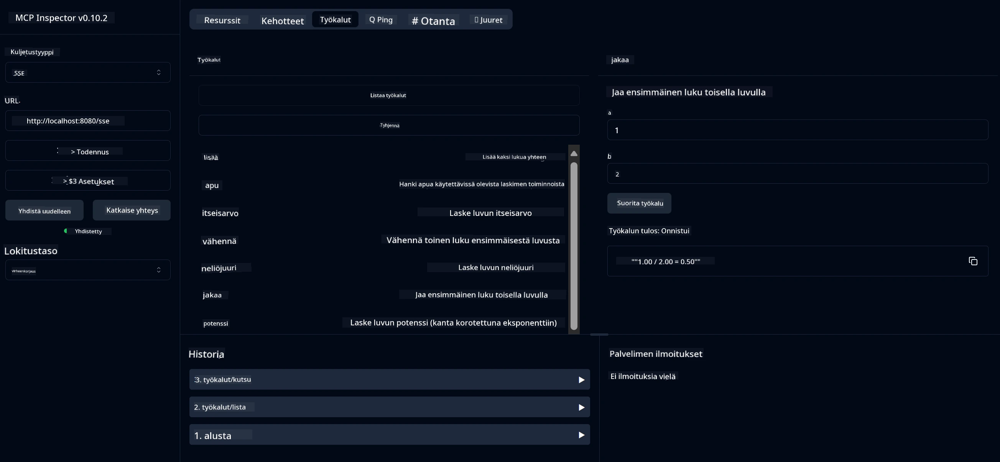

# Peruslaskimen MCP-palvelu

> [!NOTE]
> Tämä esimerkki käyttää vanhaa HTTP+SSE-välitystä ja kohdistuu SDK:hon, joka on yhteensopiva
> MCP:n kanssa `2025-11-25`. Uusien etäpalvelimien tulisi käyttää `2026-07-28` Streamable
> HTTP -tukea.

Tämä palvelu tarjoaa peruslaskimen toimintoja Model Context Protocolin (MCP) kautta käyttäen Spring Bootia WebFlux-välityksellä. Se on suunniteltu yksinkertaiseksi esimerkiksi aloittelijoille, jotka opettelevat MCP:n toteuttamista.

Lisätietoja löydät [MCP Server Boot Starter](https://docs.spring.io/spring-ai/reference/api/mcp/mcp-server-boot-starter-docs.html) viitedokumentaatiosta.

## Yleiskatsaus

Palvelu esittelee:
- Tuen SSE:lle (Server-Sent Events)
- Automaattisen työkalujen rekisteröinnin Spring AI:n `@Tool`-annotaation avulla
- Peruslaskimen toiminnot:
  - Yhteenlasku, vähennyslasku, kertolasku, jakolasku
  - Potenssilasku ja neliöjuuri
  - Moduuli (jäännös) ja itseisarvo
  - Ohjefunktio operaatiokuvauksille

## Ominaisuudet

Tämä laskinpalvelu tarjoaa seuraavat toiminnot:

1. **Peruslaskutoimitukset**:
   - Kahden luvun yhteenlasku
   - Toisen luvun vähennys toisesta
   - Kahden luvun kertolasku
   - Ensimmäisen luvun jakaminen toisella (nollajaon tarkistus)

2. **Edistyneet operaatiot**:
   - Potenssin laskeminen (kannan korotus eksponenttiin)
   - Neliöjuuren laskeminen (negatiivisten lukujen tarkistus)
   - Moduuli (jäännös) laskeminen
   - Itseisarvon laskeminen

3. **Ohjejärjestelmä**:
   - Sisäänrakennettu ohjefunktio, joka selittää kaikki käytettävissä olevat toiminnot

## Palvelun käyttö

Palvelu tarjoaa seuraavat API-päätepisteet MCP-protokollan kautta:

- `add(a, b)`: Kahden luvun lisääminen yhteen
- `subtract(a, b)`: Toisen luvun vähentäminen ensimmäisestä
- `multiply(a, b)`: Kahden luvun kertominen
- `divide(a, b)`: Ensimmäisen luvun jakaminen toisella (nollantarkistus)
- `power(base, exponent)`: Potenssin laskeminen
- `squareRoot(number)`: Neliöjuuren laskeminen (negatiivisen luvun tarkistus)
- `modulus(a, b)`: Jäännöksen laskeminen jakolaskusta
- `absolute(number)`: Itseisarvon laskeminen
- `help()`: Saatavilla olevien toimintojen tiedot

## Testiasiakas

Yksinkertainen testiasiakas sisältyy pakettiin `com.microsoft.mcp.sample.client`. Luokka `SampleCalculatorClient` esittelee käytettävissä olevat laskintoiminnot.

## LangChain4j-asiakkaan käyttö

Projekti sisältää LangChain4j-esimerkkiasiakkaan
`com.microsoft.mcp.sample.client.LangChain4jClient`, joka näyttää, miten
laskinpalvelu integroidaan Microsoft Foundry -mallin kanssa.

### Esivaatimukset

1. Luo Microsoft Foundry -resurssi ja ota käyttöön aktiivinen malli, kuten
   `gpt-5.1`.
2. Aseta mallin päätepiste, API-avain ja käyttöönoton nimi:

   ```bash
   export AZURE_OPENAI_ENDPOINT="https://<resource-name>.openai.azure.com"
   export AZURE_OPENAI_API_KEY="<api-key>"
   export AZURE_OPENAI_DEPLOYMENT="gpt-5.1"
   ```

3. Tarkista
   [Microsoft Foundry mallin poistumisaikataulu](https://learn.microsoft.com/azure/foundry/openai/concepts/model-retirement-schedule)
   ennen käyttöönoton valintaa.
4. Varmista, että laskinpalvelin on käynnissä osoitteessa `localhost:8080`.

### LangChain4j-asiakkaan käynnistäminen

Tämä esimerkki havainnollistaa:
- Yhteyden muodostamisen laskimen MCP-palvelimeen SSE-välityksen kautta
- LangChain4j:n käyttöä chat-botin luomiseen, joka hyödyntää laskimen toimintoja
- Integroinnin käyttöön otettuun Microsoft Foundry -malliin

Asiakas lähettää seuraavat esimerkkikyselyt toiminnallisuuden esittelemiseksi:
1. Kahden luvun summan laskeminen
2. Neliöjuuren löytäminen luvulle
3. Ohjetietojen saaminen käytettävissä olevista laskintoiminnoista

Suorita esimerkki ja tarkista konsolin tuloste nähdäksesi, miten tekoälymalli käyttää laskintyökaluja vastaamiseen.

### Microsoft Foundry -mallin konfigurointi

LangChain4j-asiakas käyttää Azure OpenAI v1 -yhteensopivaa päätepistettä, joka tarjotaan
Microsoft Foundryn kautta:

```java
String endpoint = System.getenv("AZURE_OPENAI_ENDPOINT");
ChatLanguageModel model = OpenAiOfficialChatModel.builder()
   .baseUrl(endpoint.replaceAll("/+$", "") + "/openai/v1/")
   .apiKey(System.getenv("AZURE_OPENAI_API_KEY"))
   .isAzure(true)
   .modelName(System.getenv().getOrDefault("AZURE_OPENAI_DEPLOYMENT", "gpt-5.1"))
    .timeout(Duration.ofSeconds(60))
    .build();
```

`AZURE_OPENAI_DEPLOYMENT` on vastattava nimeä, joka mallille on annettu
käyttöönoton yhteydessä, ja se saattaa poiketa varsinaisesta mallin nimestä.

## Riippuvuudet

Projekti vaatii seuraavat keskeiset riippuvuudet:

```xml
<!-- For MCP Server -->
<dependency>
    <groupId>org.springframework.ai</groupId>
    <artifactId>spring-ai-starter-mcp-server-webflux</artifactId>
</dependency>

<!-- For LangChain4j integration -->
<dependency>
    <groupId>dev.langchain4j</groupId>
    <artifactId>langchain4j-mcp</artifactId>
    <version>${langchain4j.version}</version>
</dependency>

<!-- For Microsoft Foundry's OpenAI-compatible endpoint -->
<dependency>
    <groupId>dev.langchain4j</groupId>
   <artifactId>langchain4j-open-ai-official</artifactId>
    <version>${langchain4j.version}</version>
</dependency>
```

## Projektin rakentaminen

Rakenna projekti käyttäen Maventia:
```bash
./mvnw clean install -DskipTests
```

## Palvelimen käynnistäminen

### Java-käyttö

```bash
java -jar target/calculator-server-0.0.1-SNAPSHOT.jar
```

### MCP Inspectorin käyttö

MCP Inspector on hyödyllinen työkalu MCP-palveluihin vuorovaikutukseen. Käyttääksesi sitä tämän laskinpalvelun kanssa:

1. **Asenna ja käynnistä MCP Inspector** uudessa terminaali-ikkunassa:
   ```bash
   npx @modelcontextprotocol/inspector
   ```

2. **Avaa verkkokäyttöliittymä** napsauttamalla sovelluksen näyttämää URL-osoitetta (yleensä http://localhost:6274)

3. **Konfiguroi yhteys**:
   - Aseta välitystyypiksi "SSE"
   - Aseta URL käynnissä olevan palvelimesi SSE-päätepisteeseen: `http://localhost:8080/sse`
   - Klikkaa "Connect"

4. **Käytä työkaluja**:
   - Klikkaa "List Tools" nähdäksesi käytettävissä olevat laskintoiminnot
   - Valitse työkalu ja napsauta "Run Tool" suorittaaksesi toiminnon



### Dockerin käyttö

Projekti sisältää Dockerfilen säilöönottamista varten:

1. **Rakenna Docker-kuva**:
   ```bash
   docker build -t calculator-mcp-service .
   ```

2. **Käynnistä Docker-säilö**:
   ```bash
   docker run -p 8080:8080 calculator-mcp-service
   ```

Tämä suorittaa:
- Monivaiheisen Docker-kuvan rakentamisen Maven 3.9.9:llä ja Eclipse Temurin 24 JDK:lla
- Optimoidun säilökuvan luomisen
- Palvelun avaamisen portissa 8080
- MCP-laskinpalvelun käynnistämisen säilön sisällä

Voit käyttää palvelua osoitteessa `http://localhost:8080`, kun säilö on käynnissä.

## Vianmääritys

### Yleisimmät yhteysongelmat malliin

1. **Todennusvirheet**: Varmista, että `AZURE_OPENAI_API_KEY` kuuluu
   resurssille, jonka tunniste on `AZURE_OPENAI_ENDPOINT`.
2. **Käyttöönottoa ei löydy**: Varmista, että `AZURE_OPENAI_DEPLOYMENT` vastaa täsmälleen
   Microsoft Foundryn käyttöönoton nimeä.
3. **Rajoitusten ylitys**: Tarkista käyttöönoton kiintiö ja yritä uudelleen palvelun
   ilmoittaman odotusajan jälkeen.

Lisäapua varten katso
[LangChain4j-dokumentaatio](https://github.com/langchain4j/langchain4j) ja
[Microsoft Foundryn dokumentaatio](https://learn.microsoft.com/azure/ai-foundry/).

---

<!-- CO-OP TRANSLATOR DISCLAIMER START -->
**Vastuuvapauslauseke**:
Tämä asiakirja on käännetty käyttämällä tekoälypohjaista käännöspalvelua [Co-op Translator](https://github.com/Azure/co-op-translator). Vaikka pyrimme tarkkuuteen, otathan huomioon, että automaattiset käännökset saattavat sisältää virheitä tai epätarkkuuksia. Alkuperäinen asiakirja sen alkuperäiskielellä on virallinen lähde. Tärkeissä asioissa suositellaan ammattimaista ihmiskäännöstä. Emme ole vastuussa tämän käännöksen käytöstä aiheutuvista väärinymmärryksistä tai tulkinnoista.
<!-- CO-OP TRANSLATOR DISCLAIMER END -->