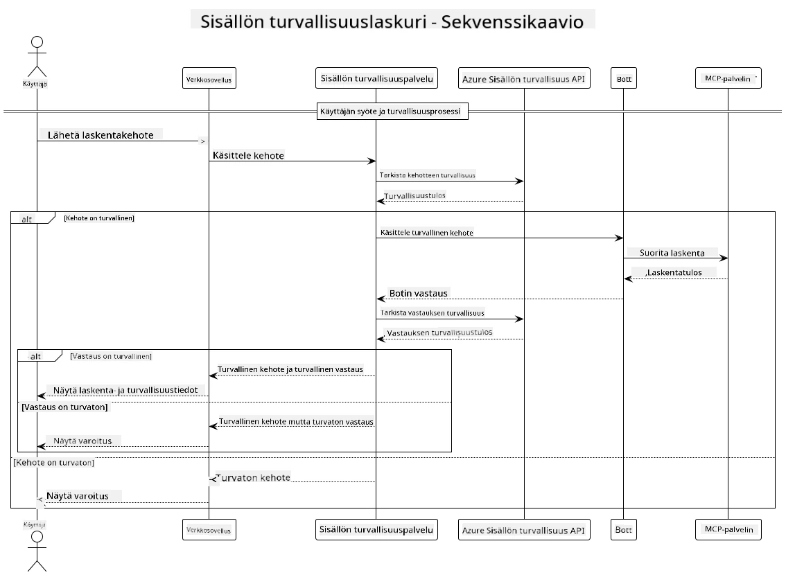

## Järjestelmän Arkkitehtuuri

Tämä projekti esittelee verkkosovelluksen, joka käyttää sisällön turvallisuustarkastusta ennen käyttäjän kehotteiden välittämistä laskinpalvelimelle Model Context Protocolin (MCP) kautta.



### Miten Se Toimii

1. **Käyttäjän syöte**: Käyttäjä syöttää laskentakehotteen verkkokäyttöliittymään
2. **Sisällön turvallisuustarkastus (syöte)**: Kehote analysoidaan Azure Content Safety API:lla
3. **Turvallisuuspäätös (syöte)**:
   - Jos sisältö on turvallista (vakavuus < 2 kaikissa kategorioissa), se siirtyy laskimelle
   - Jos sisältö on merkitty mahdollisesti haitalliseksi, prosessi pysähtyy ja palauttaa varoituksen
4. **Laskimen integrointi**: Turvallinen sisältö käsitellään LangChain4j:n kautta, joka kommunikoi MCP-laskinpalvelimen kanssa
5. **Sisällön turvallisuustarkastus (tulos)**: Botin vastaus analysoidaan Azure Content Safety API:lla
6. **Turvallisuuspäätös (tulos)**:
   - Jos botin vastaus on turvallinen, se näytetään käyttäjälle
   - Jos botin vastaus on merkitty mahdollisesti haitalliseksi, se korvataan varoituksella
7. **Vastaus**: Tulokset (jos turvallisia) näytetään käyttäjälle yhdessä molempien turvallisuusanalyysien kanssa

## Model Context Protocolin (MCP) Käyttö Laskinpalveluiden Kanssa

Tämä projekti osoittaa, miten Model Context Protocolia (MCP) käytetään laskin MCP -palvelujen kutsumiseen LangChain4j:stä. Toteutus käyttää paikallista MCP-palvelinta portissa 8080 tarjoamaan laskutoimituksia.

### Azure Content Safety -palvelun Määrittäminen

Ennen sisällön turvallisuusominaisuuksien käyttöä sinun tulee luoda Azure Content Safety -palveluresurssi:

1. Kirjaudu sisään [Azure-portaaliin](https://portal.azure.com)
2. Klikkaa "Create a resource" ja hae "Content Safety"
3. Valitse "Content Safety" ja klikkaa "Create"
4. Syötä resurssillesi yksilöllinen nimi
5. Valitse tilaus ja resurssiryhmä (tai luo uusi)
6. Valitse tuettu alue (katso [Alueiden saatavuus](https://azure.microsoft.com/en-us/global-infrastructure/services/?products=cognitive-services) yksityiskohtia varten)
7. Valitse sopiva hinnoitteluluokka
8. Klikkaa "Create" ottaaksesi resurssin käyttöön
9. Kun käyttöönotto on valmis, klikkaa "Go to resource"
10. Vasemmalla paneelissa, kohdassa "Resource Management", valitse "Keys and Endpoint"
11. Kopioi jompikumpi avaimista ja päätepisteen URL seuraavaa vaihetta varten

### Ympäristömuuttujien Konfigurointi

Aseta Microsoft Foundryn mallin pääte, API-avain ja käyttöönoton nimi:
```sh
export AZURE_OPENAI_ENDPOINT="https://<resource-name>.openai.azure.com"
export AZURE_OPENAI_API_KEY="<api-key>"
export AZURE_OPENAI_DEPLOYMENT="gpt-5.1"
```

Sisällön turvallisuusominaisuuksia varten aseta:
```sh
export CONTENT_SAFETY_ENDPOINT=<your_content_safety_endpoint>
export CONTENT_SAFETY_KEY=<your_content_safety_key>
```

Näitä ympäristömuuttujia sovellus käyttää Azure Content Safety -palveluun tunnistautumiseen. Jos muuttujia ei ole asetettu, sovellus käyttää paikkamerkkien arvoja esittelyä varten, mutta sisällön turvallisuusominaisuudet eivät toimi oikein.

### Laskin MCP -palvelimen Käynnistäminen

Ennen asiakkaan käynnistämistä, sinun tulee käynnistää laskin MCP -palvelin SSE-tilassa osoitteessa localhost:8080.

## Projektin Kuvaus

Tämä projekti esittelee Model Context Protocolin (MCP) integroinnin LangChain4j:n kanssa laskinpalveluiden kutsumiseen. Keskeiset ominaisuudet sisältävät:

- MCP:n käyttö laskinpalveluun perustason matemaattisia operaatioita varten
- Kaksikerroksinen sisällön turvallisuustarkastus sekä käyttäjän kehotteille että botin vastauksille
- Integrointi käyttöön otettuun Microsoft Foundry -malliin LangChain4j:n kautta
- MCP-liikenteen kuljettaminen Server-Sent Events (SSE) -tekniikalla

## Sisällön Turvallisuuden Integrointi

Projekti sisältää kattavat sisällön turvallisuusominaisuudet varmistaakseen, että sekä käyttäjän syötteet että järjestelmän vastaukset ovat vapaita haitallisesta sisällöstä:

1. **Syötteen tarkastus**: Kaikki käyttäjän kehotteet analysoidaan haitallisten sisältökategorioiden, kuten vihapuheen, väkivallan, itsehaitan ja seksuaalisen sisällön osalta ennen käsittelyä.

2. **Tuloksen tarkastus**: Vaikka käytettäisiin mahdollisesti sääntelemättömiä malleja, järjestelmä tarkastaa kaikki tuotetut vastaukset samoilla sisällön turvallisuusfilttereillä ennen niiden näyttämistä käyttäjälle.

Tämä kaksikerroksinen lähestymistapa varmistaa järjestelmän turvallisuuden riippumatta käytetystä tekoälymallista, suojellen käyttäjiä sekä haitallisilta syötteilta että mahdollisesti ongelmallisilta tekoälyn generoamilta vastauksilta.

## Verkkoklientti

Sovellus sisältää käyttäjäystävällisen verkkokäyttöliittymän, jonka avulla käyttäjät voivat olla vuorovaikutuksessa Content Safety Calculator -järjestelmän kanssa:

### Verkkokäyttöliittymän Ominaisuudet

- Yksinkertainen, intuitiivinen lomake laskentakehotteiden syöttämiseen
- Kaksikerroksinen sisällön turvallisuustarkastus (syöte ja tulos)
- Reaaliaikainen palaute kehotteen ja vastauksen turvallisuudesta
- Värikoodatut turvallisuusindikaattorit helppoon tulkintaan
- Selkeä, responsiivinen muotoilu, joka toimii eri laitteilla
- Esimerkkiturvalliset kehotteet käyttäjien ohjaamiseksi

### Verkkoklientin Käyttö

1. Käynnistä sovellus:
   ```sh
   mvn spring-boot:run
   ```

2. Avaa selaimesi ja siirry osoitteeseen `http://localhost:8087`

3. Syötä laskentakehote annettuun tekstikenttään (esim. "Laske lukujen 24,5 ja 17,3 summa")

4. Klikkaa "Submit" käsitelläksesi pyyntösi

5. Katso tulokset, jotka sisältävät:
   - Kehotteesi sisällön turvallisuusanalyysin
   - Lasketun tuloksen (jos kehote oli turvallinen)
   - Botin vastauksen sisällön turvallisuusanalyysin
   - Mahdolliset turvallisuusvaroitukset, jos syöte tai tulos oli merkitty

Verkkoklientti hoitaa automaattisesti molemmat sisällön turvallisuuden tarkistusprosessit varmistaen, että kaikki vuorovaikutukset ovat turvallisia ja sopivia riippumatta käytettävästä tekoälymallista.

---

<!-- CO-OP TRANSLATOR DISCLAIMER START -->
**Vastuuvapauslauseke**:
Tämä asiakirja on käännetty käyttämällä tekoälypohjaista käännöspalvelua [Co-op Translator](https://github.com/Azure/co-op-translator). Vaikka pyrimme tarkkuuteen, otathan huomioon, että automaattiset käännökset saattavat sisältää virheitä tai epätarkkuuksia. Alkuperäinen asiakirja sen alkuperäiskielellä on virallinen lähde. Tärkeissä asioissa suositellaan ammattimaista ihmiskäännöstä. Emme ole vastuussa tämän käännöksen käytöstä aiheutuvista väärinymmärryksistä tai tulkinnoista.
<!-- CO-OP TRANSLATOR DISCLAIMER END -->