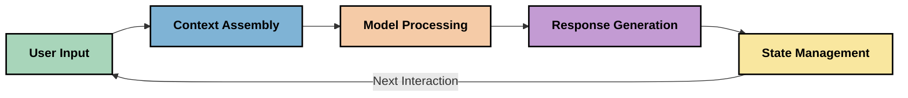
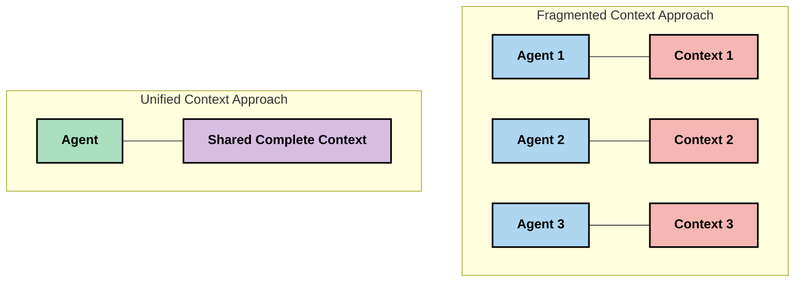
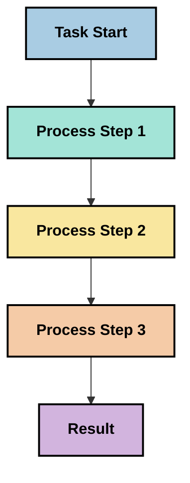
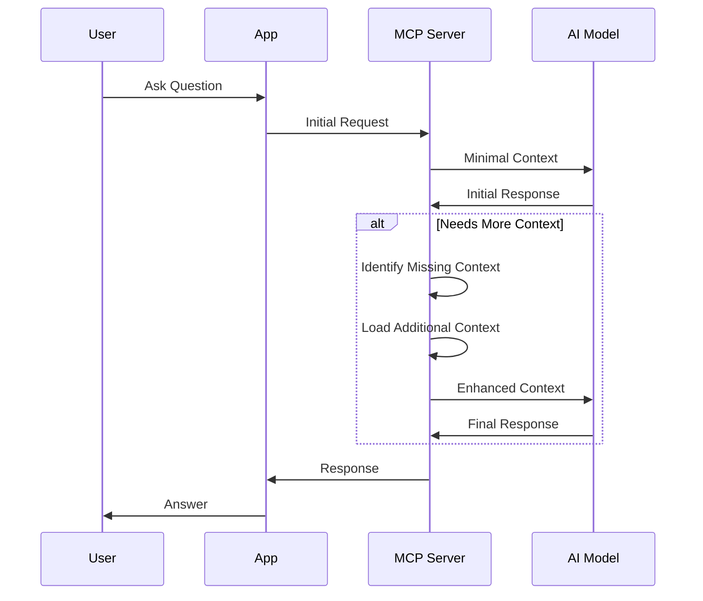
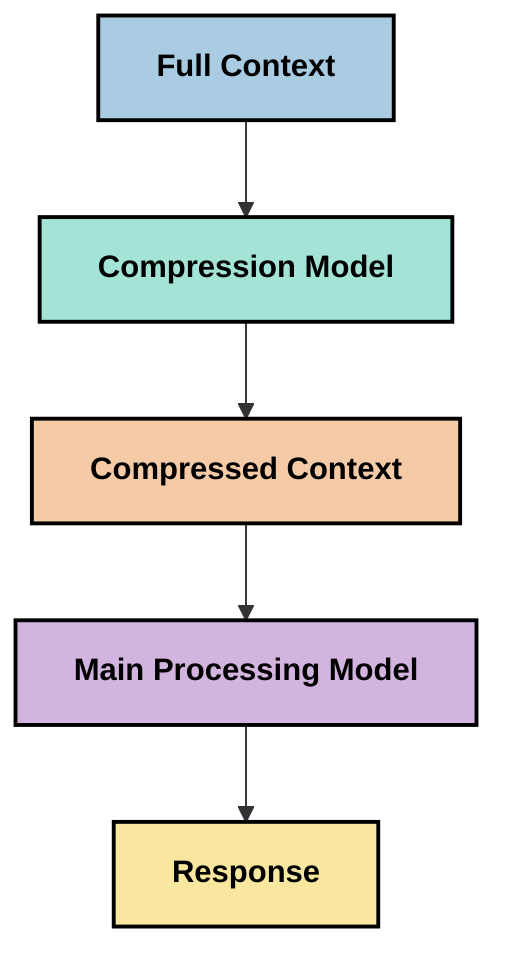
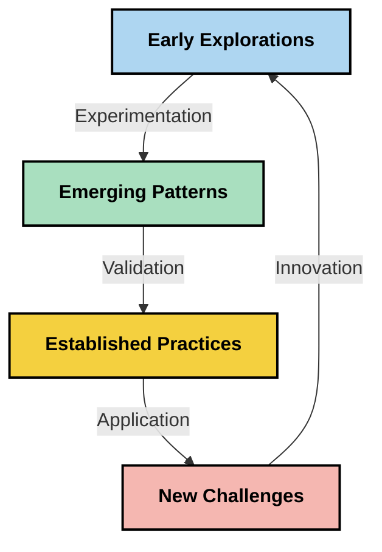

# Kontekstisuunnittelu: Nouseva käsite MCP-ekosysteemissä

## Yleiskatsaus

Kontekstisuunnittelu on tekoälytilan nouseva käsite, joka tutkii, miten tietoa jäsennetään, toimitetaan ja ylläpidetään asiakkaiden ja tekoälypalveluiden välisissä vuorovaikutuksissa. Mallin kontekstiprotokollan (MCP) ekosysteemin kehittyessä kontekstin tehokas hallinta korostuu entisestään. Tämä moduuli esittelee kontekstisuunnittelun käsitteen ja tutkii sen mahdollisia sovelluksia MCP-toteutuksissa.

## Oppimistavoitteet

Tämän moduulin lopussa osaat:

- Ymmärtää nousevan kontekstisuunnittelun käsitteen ja sen mahdollisen roolin MCP-sovelluksissa
- Tunnistaa keskeiset kontekstinhallinnan haasteet, joihin MCP-protokollasuunnittelu pyrkii vastaamaan
- Tutkia tekniikoita mallin suorituskyvyn parantamiseksi paremman kontekstinhallinnan avulla
- Tarkastella lähestymistapoja kontekstin tehokkuuden mittaamiseen ja arviointiin
- Soveltaa näitä nousevia konsepteja parantaakseen tekoälykokemuksia MCP-kehyksen kautta

## Johdanto kontekstisuunnitteluun

Kontekstisuunnittelu on nouseva käsite, joka keskittyy tietovirran tarkoitukselliseen suunnitteluun ja hallintaan käyttäjien, sovellusten ja tekoälymallien välillä. Toisin kuin vakiintuneet alat, kuten prompttisuunnittelu, kontekstisuunnittelu on vielä määrittelemättömässä vaiheessa ja käytännön tekijät ratkovat ainutlaatuisia haasteita tarjotakseen tekoälymalleille oikeaa tietoa oikeaan aikaan.

Suurten kielimallien (LLM) kehittyessä kontekstin merkitys on käynyt yhä ilmeisemmäksi. Tarjottavan kontekstin laatu, merkityksellisyys ja rakenne vaikuttavat suoraan mallin tuloksiin. Kontekstisuunnittelu tutkii tätä suhdetta ja pyrkii kehittämään periaatteita tehokkaaseen kontekstinhallintaan.

> "Vuonna 2025 olemassa olevat mallit ovat erittäin älykkäitä. Mutta edes älykkäin ihminen ei pysty tekemään työtään tehokkaasti ilman kontekstia siitä, mitä heiltä pyydetään... 'Kontekstisuunnittelu' on seuraava taso prompttisuunnittelussa. Kyse on tämän automaattisesta tekemisestä dynaamisessa järjestelmässä." — Walden Yan, Cognition AI

Kontekstisuunnittelu saattaa sisältää:

1. **Kontekstin valinta**: Päättää, mikä tieto on relevanttia tehtävälle
2. **Kontekstin jäsentäminen**: Järjestää tieto mallin ymmärryksen maksimoimiseksi
3. **Kontekstin toimitus**: Optimoida, miten ja milloin tietoa lähetetään malleille
4. **Kontekstin ylläpito**: Hallita kontekstin tilaa ja kehittymistä ajan mittaan
5. **Kontekstin arviointi**: Mitata ja parantaa kontekstin tehokkuutta

Nämä painopisteet ovat erityisen merkityksellisiä MCP-ekosysteemille, joka tarjoaa standardoidun tavan sovelluksille toimittaa konteksti LLM-malleille.


## Kontekstin matkan näkökulma

Yksi tapa visualisoida kontekstisuunnittelua on jäljittää tiedon matka MCP-järjestelmän läpi:



### Keskeiset vaiheet kontekstin matkassa:

1. **Käyttäjän syöte**: Raakadata käyttäjältä (teksti, kuvat, asiakirjat)
2. **Kontekstin kokoaminen**: Käyttäjän syötteen yhdistäminen järjestelmän kontekstiin, keskusteluhistoriaan ja muuhun haettuun tietoon
3. **Mallin prosessointi**: Tekoälymalli prosessoi kootun kontekstin
4. **Vastauksen tuottaminen**: Malle tuottaa vastaukset annetun kontekstin perusteella
5. **Tilanhallinta**: Järjestelmä päivittää sisäisen tilansa vuorovaikutuksen perusteella

Tämä näkökulma korostaa kontekstin dynaamista luonnetta tekoälyjärjestelmissä ja herättää tärkeitä kysymyksiä siitä, miten tietoa tulisi parhaiten hallita kussakin vaiheessa.

## Nousevia periaatteita kontekstisuunnittelussa

Kun kontekstisuunnittelu ala muotoutuu, jotkut varhaiset periaatteet alkavat nousta käytännön tekijöiltä. Nämä periaatteet voivat auttaa ohjaamaan MCP-toteutusten valintoja:

### Periaate 1: Jaa konteksti kokonaisuudessaan

Koko järjestelmän komponenttien välillä tulisi jakaa konteksti kokonaisuudessaan, ei hajautettuna useille agenteille tai prosesseille. Kun konteksti on hajautettu, yhden osan tekemät päätökset voivat olla ristiriidassa toisaalla tehtyjen päätösten kanssa.



MCP-sovelluksissa tämä tarkoittaa suunnittelua siten, että konteksti virtaa saumattomasti koko putken läpi eikä ole eristetty osiin.

### Periaate 2: Tunnista, että toimet sisältävät piileviä päätöksiä

Jokainen mallin tekemä toimi sisältää piileviä päätöksiä siitä, miten kontekstia tulkitaan. Kun useat komponentit toimivat eri konteksteilla, nämä piilevät päätökset voivat olla ristiriidassa, mikä johtaa epäjohdonmukaisiin tuloksiin.

Tämä periaate on tärkeä MCP-sovelluksissa:
- Suosi lineaarista prosessointia monimutkaisissa tehtävissä hajautetun kontekstin parissa tapahtuvan rinnakkaisen suorituksen sijaan
- Varmista, että kaikilla päätöspisteillä on pääsy samaan kontekstuaaliseen tietoon
- Suunnittele järjestelmiä siten, että myöhemmät vaiheet näkevät aiempien päätösten kokonaiskontekstin

### Periaate 3: Tasapainota kontekstin syvyys ikkuna-rajoitusten kanssa

Keskustelujen ja prosessien kasvaessa pidemmiksi, kontekstin ikkunat lopulta ylikuormittuvat. Tehokas kontekstisuunnittelu tutkii lähestymistapoja hallita tätä jännitettä kattavan kontekstin ja teknisten rajoitusten välillä.

Mahdollisia tutkittavia lähestymistapoja ovat:
- Kontekstin pakkaus, joka säilyttää olennaiset tiedot mutta vähentää token-kulutusta
- Kontekstin progressiivinen lataaminen nykyisten tarpeiden mukaan
- Aiemman vuorovaikutuksen tiivistäminen samalla, kun säilytetään keskeiset päätökset ja faktat

## Kontekstin haasteet ja MCP-protokollan suunnittelu

Mallin kontekstiprotokolla (MCP) on suunniteltu tietoisena ainutlaatuisista kontekstinhallinnan haasteista. Näiden haasteiden ymmärtäminen auttaa selittämään MCP-protokollasuunnittelun keskeisiä piirteitä:


### Haaste 1: Kontekstin ikkunarajoitukset
Useimmilla tekoälymalleilla on kiinteät kontekstin ikkunoiden koko rajoittamassa, kuinka paljon tietoa ne voivat käsitellä kerralla.

**MCP:n suunnitteluvastaus:** 
- Protokolla tukee jäsenneltyä, resurssipohjaista kontekstia, johon voidaan viitata tehokkaasti
- Resurssit voidaan paginoida ja ladata asteittain

### Haaste 2: Merkityksellisyyden määrittäminen
On vaikea määrittää, mikä tieto on tärkeintä sisällyttää kontekstiin.

**MCP:n suunnitteluvastaus:**
- Joustavat työkalut mahdollistavat tiedon dynaamisen hakemisen tarpeen mukaan
- Jäsennetyt kehotteet mahdollistavat yhdenmukaisen kontekstin järjestelyn

### Haaste 3: Kontekstin pysyvyys
Tilanhallinta vuorovaikutusten välillä vaatii tarkkaa kontekstin seurantaa.

**MCP:n suunnitteluvastaus:**
- Standardoitu istunnoin hallinta
- Selkeästi määritellyt vuorovaikutuskuviot kontekstin kehitykselle

### Haaste 4: Monimodaalinen konteksti
Erilaiset tietotyypit (teksti, kuvat, jäsennelty data) vaativat erilaista käsittelyä.

**MCP:n suunnitteluvastaus:**
- Protokollasuunnittelu kattaa erilaiset sisältötyypit
- Monimodaalisen informaation standardoitu esitys

### Haaste 5: Turvallisuus ja yksityisyys
Konteksti sisältää usein arkaluontoista tietoa, joka tulee suojata.

**MCP:n suunnitteluvastaus:**
- Selkeät rajat asiakas- ja palvelinvastuiden välillä
- Paikalliset prosessointivaihtoehdot datan paljastuksen minimoimiseksi

Näiden haasteiden ymmärtäminen ja MCP:n ratkaisut luovat perustan edistyneempien kontekstisuunnittelutekniikoiden tutkimiselle.

## Nousevia lähestymistapoja kontekstisuunnittelussa

Kun kontekstisuunnittelun ala kehittyy, useita lupaavia lähestymistapoja on nousemassa esiin. Nämä edustavat nykyistä ajattelua eikä vakiintuneita parhaita käytäntöjä, ja ne kehittyvät todennäköisesti kokemuksen karttuessa MCP-toteutuksista.

### 1. Yksisäikeinen lineaarinen prosessointi

Toisin kuin monitoimittajapohjaiset arkkitehtuurit, jotka hajauttavat kontekstia, jotkut käytännön tekijät ovat huomanneet, että yksisäikeinen lineaarinen prosessointi tuottaa johdonmukaisempia tuloksia. Tämä sopii yhteen kokonaisvaltaisen kontekstin ylläpidon periaatteen kanssa.



Vaikka tämä lähestymistapa saattaa vaikuttaa rinnakkaista prosessointia vähemmän tehokkaalta, se usein tuottaa johdonmukaisempia ja luotettavampia tuloksia, koska kukin vaihe rakentuu täydellisen ymmärryksen pohjalle aiemmista päätöksistä.

### 2. Kontekstin pilkkominen ja priorisointi

Suurten kontekstien pilkkominen hallittaviksi osiksi ja merkityksellisimmän valitseminen.

```python
# Conceptual Example: Context Chunking and Prioritization
def process_with_chunked_context(documents, query):
    # 1. Break documents into smaller chunks
    chunks = chunk_documents(documents)
    
    # 2. Calculate relevance scores for each chunk
    scored_chunks = [(chunk, calculate_relevance(chunk, query)) for chunk in chunks]
    
    # 3. Sort chunks by relevance score
    sorted_chunks = sorted(scored_chunks, key=lambda x: x[1], reverse=True)
    
    # 4. Use the most relevant chunks as context
    context = create_context_from_chunks([chunk for chunk, score in sorted_chunks[:5]])
    
    # 5. Process with the prioritized context
    return generate_response(context, query)
```

Yllä oleva käsite havainnollistaa, miten voimme pilkkoa suuria asiakirjoja hallittaviksi osiksi ja valita kontekstiin vain merkityksellisimmät osat. Tämä lähestymistapa voi auttaa toimimaan kontekstin ikkuna-rajojen sisällä hyödyntäen silti laajoja tietopankkeja.

### 3. Progressiivinen kontekstin lataus

Ladataan konteksti asteittain tarpeen mukaan eikä kerralla.



Progressiivinen kontekstin lataus alkaa minimikontekstilla ja laajenee vain tarvittaessa. Tämä voi merkittävästi vähentää token-kulutusta yksinkertaisissa kysymyksissä samalla kun säilyttää kyvyn vastata monimutkaisiin kysymyksiin.

### 4. Kontekstin pakkaus ja tiivistäminen

Pienennetään kontekstin kokoa säilyttäen olennaiset tiedot.



Kontekstin pakkaus keskittyy:
- Ylimääräisen tiedon poistamiseen
- Pitkien sisältöjen tiivistämiseen
- Keskeisten faktojen ja yksityiskohtien erotteluun
- Tärkeiden kontekstielementtien säilyttämiseen
- Tokenien käytön optimointiin

Tämä lähestymistapa on erityisen arvokas pitkiä keskusteluja ylläpitävien kontekstin ikkunoiden hallinnassa tai suurten asiakirjojen tehokkaassa käsittelyssä. Jotkut käytännön tekijät käyttävät erityismalleja juuri kontekstin pakkaamiseen ja keskusteluhistorian tiivistämiseen.


## Tutkimuksellisia huomioita kontekstisuunnittelussa

Kun tutkimme nousevaa kontekstisuunnittelun alaa, useita huomioita kannattaa pitää mielessä MCP-toteutusten kanssa työskennellessä. Nämä eivät ole sääntöjä vaan tutkimusalueita, jotka voivat parantaa omaa käyttötapaustasi.

### Mieti kontekstin tavoitteitasi

Ennen monimutkaisten kontekstinhallintaratkaisujen toteutusta, määrittele selkeästi, mitä haluat saavuttaa:
- Mitä erityistä tietoa malli tarvitsee menestyäkseen?
- Mikä tieto on olennaista ja mikä lisätietoa?
- Mitkä ovat suorituskykyrajoitteesi (viive, token-rajoitukset, kustannukset)?

### Tutki kerroksellisia konstekstilähestymistapoja

Jotkut käytännön tekijät onnistuvat järjestämällä kontekstin konseptuaalisiin kerroksiin:
- **Ydin kerros**: Olennaiset tiedot, joita malli aina tarvitsee
- **Tilannekerros**: Konteksti, joka liittyy nykyiseen vuorovaikutukseen
- **Tukikerros**: Lisätiedot, jotka voivat olla hyödyllisiä
- **Varakerros**: Tiedot, joihin päästään käsiksi vain tarvittaessa

### Tutki tiedon hakustrategioita

Kontekstin tehokkuus riippuu usein siitä, miten tieto haetaan:
- Semanttinen haku ja upotukset käsitteellisesti relevantin tiedon löytämiseksi
- Avainsanapohjainen haku erityisten tosiseikkojen löytämiseksi
- Hybridilähestymistavat, jotka yhdistävät useita hakumenetelmiä
- Metatietosuodatus rajaamaan kohteita kategorioiden, päivämäärien tai lähteiden mukaan

### Kokeile kontekstin johdonmukaisuutta

Kontekstin rakenne ja virtaus voivat vaikuttaa mallin ymmärrykseen:
- Ryhmittele toisiinsa liittyviä tietoja yhteen
- Käytä johdonmukaista muotoilua ja järjestelyä
- Säilytä looginen tai kronologinen järjestys, kun se on tarkoituksenmukaista
- Vältä ristiriitaista tietoa

### Punnitse monitoimittaja-arkkitehtuurien kompromisseja

Vaikka monitoimittaja-arkkitehtuurit ovat suosittuja monissa tekoälykehyksissä, niihin liittyy merkittäviä haasteita kontekstinhallinnassa:
- Kontekstin pirstoutuminen voi johtaa ristiriitaisiin päätöksiin eri toimijoiden välillä
- Rinnakkainen prosessointi voi aiheuttaa vaikeasti sovitettavia konflikteja
- Viestintäkuorma toimijoiden välillä voi kumota suorituskyvyn parannuksia
- Johdonmukaisuuden ylläpitämiseksi tarvitaan monimutkainen tilanhallinta

Monissa tapauksissa yksittäisen toimijan lähestymistapa kattavalla kontekstinhallinnalla voi tuottaa luotettavampia tuloksia kuin useat erikoistuneet toimijat hajautetulla kontekstilla.

### Kehitä arviointimenetelmiä

Jotta kontekstisuunnittelua voi parantaa ajan kuluessa, mieti, miten mittaat onnistumisen:
- A/B-testaus erilaisilla kontekstirakenteilla
- Token-kulutuksen ja vastausajan seuranta
- Käyttäjätyytyväisyyden ja tehtävien suoritusasteiden seuranta
- Analysoi, milloin ja miksi kontekstistrategiat eivät toimi

Nämä huomioitavat alueet edustavat aktiivisia tutkimusalueita kontekstisuunnittelussa. Alan kehittyessä todennäköisesti ilmestyy selkeämpiä toimintamalleja ja -käytäntöjä.

## Kontekstin tehokkuuden mittaaminen: kehittyvä viitekehys

Kontekstisuunnittelun noustessa käsitteenä käytännön tekijät ovat alkaneet tutkia, miten sen tehokkuutta voitaisiin mitata. Vakiintunutta viitekehystä ei vielä ole, mutta erilaisia mittareita harkitaan ohjaamaan tulevaa työtä.

### Mahdolliset mittausulotteet


#### 1. Syötteen tehokkuus

- **Kontekstin ja vastauksen suhde**: Kuinka paljon kontekstia tarvitaan suhteessa vastauksen kokoon?
- **Tokenien käyttö**: Kuinka suuri osa annetun kontekstin tokeneista vaikuttaa vastaukseen?
- **Kontekstin tiivistäminen**: Kuinka tehokkaasti raakadata voitaisiin pakata?

#### 2. Suorituskyky

- **Viivevaikutus**: Miten kontekstinhallinta vaikuttaa vastausaikaan?
- **Token-talous**: Optimoidaanko tokenien käyttö tehokkaasti?
- **Hakutarkkuus**: Kuinka relevanttia haettu tieto on?
- **Resurssien käyttö**: Mitä laskentaresursseja tarvitaan?

#### 3. Laatu

- **Vastauksen merkityksellisyys**: Kuinka hyvin vastaus käsittelee kyselyn?
- **Faktuaalinen tarkkuus**: Parantaako kontekstinhallinta faktuaalista oikeellisuutta?
- **Johdonmukaisuus**: Ovatko vastaukset johdonmukaisia samanlaisiin kyselyihin?
- **Havainnointivirheiden määrä**: Vähentääkö parempi konteksti mallin harhakuvitelmia?

#### 4. Käyttäjäkokemus

- **Seurantaraja-arvo**: Kuinka usein käyttäjät tarvitsevat lisäselvityksiä?
- **Tehtävän suorittaminen**: Saavuttavatko käyttäjät tavoitteensa onnistuneesti?
- **Tyytyväisyysindikaattorit**: Miten käyttäjät arvioivat kokemustaan?

### Tutkimukselliset mittauslähestymistavat

Kokeillessasi kontekstisuunnittelua MCP-toteutuksissa, harkitse seuraavia kokeilevia lähestymistapoja:

1. **Perusarvovertailut**: Perusta yksinkertaisilla konstekstilähestymistavoilla ennen monimutkaisempien menetelmien testaamista

2. **Inkrementaaliset muutokset**: Muuta yhtä kontekstinhallinnan osa-aluetta kerrallaan sen vaikutusten eristämiseksi

3. **Käyttäjäkeskeinen arviointi**: Yhdistä kvantitatiiviset mittarit laadulliseen käyttäjäpalautteeseen

4. **Virheanalyysi**: Tarkastele tapauksia, joissa kontekstistrategiat epäonnistuvat, selvittääksesi parannusmahdollisuuksia

5. **Moniulotteinen arviointi**: Harkitse tehokkuuden, laadun ja käyttäjäkokemuksen välisiä kompromisseja

Tämä kokeellinen, monipuolinen mittaustapa vastaa kontekstisuunnittelun nousevaa luonnetta.

## Lopuksi

Kontekstisuunnittelu on nouseva tutkimusalue, josta voi tulla keskeinen osa tehokkaita MCP-sovelluksia. Miettimällä tarkkaan, miten tieto virtaa järjestelmässäsi, voit luoda tekoälykokemuksia, jotka ovat tehokkaampia, tarkempia ja arvokkaampia käyttäjille.

Tässä moduulissa esitetyt tekniikat ja lähestymistavat edustavat alan varhaista ajattelua, eivät vakiintuneita käytäntöjä. Kontekstisuunnittelu saattaa kehittyä määritellymmäksi tieteenalaksi tekoälyn kykyjen kehittyessä ja ymmärryksemme syventyessä. Toistaiseksi kokeilu yhdistettynä huolelliseen mittaukseen näyttää olevan tuottavin lähestymistapa.

## Mahdolliset tulevat suuntaukset

Kontekstisuunnittelun ala on vielä alkuvaiheessa, mutta useita lupaavia suuntia on nousemassa esiin:

- Kontekstisuunnittelun periaatteet saattavat vaikuttaa merkittävästi mallin suorituskykyyn, tehokkuuteen, käyttäjäkokemukseen ja luotettavuuteen
- Yksisäikeiset lähestymistavat, joissa on kattava kontekstinhallinta, voivat ylittää monitoimittaja-arkkitehtuurit monissa käyttötapauksissa
- Erikoistuneet kontekstin pakkausmallit voivat tulla AI-putkistojen vakiokomponenteiksi
- Jännite kontekstin täydellisyyden ja token-rajoitusten välillä todennäköisesti ohjaa innovaatioita kontekstinhallinnassa
- Mallien kehittyessä tehokkaaseen ihmisenkaltaiseen viestintään, aito monitoimittajayhteistyö voi tulla paremmin mahdolliseksi
- MCP-toteutukset voivat kehittyä standardoimaan kontekstinhallintamalleja, jotka nousevat nykyisestä kokeilusta



## Resurssit

### Viralliset MCP-resurssit
- [Model Context Protocol Website](https://modelcontextprotocol.io/)
- [Model Context Protocol Specification](https://github.com/modelcontextprotocol/modelcontextprotocol)
- [MCP Dokumentaatio](https://modelcontextprotocol.io/docs)
- [MCP C# SDK](https://github.com/modelcontextprotocol/csharp-sdk)
- [MCP Python SDK](https://github.com/modelcontextprotocol/python-sdk)
- [MCP TypeScript SDK](https://github.com/modelcontextprotocol/typescript-sdk)
- [MCP Inspector](https://github.com/modelcontextprotocol/inspector) - Visuaalinen testausväline MCP-palvelimille

### Kontekstin suunnittelun artikkelit
- [Älä rakenna moniagentteja: Kontekstin suunnittelun periaatteet](https://cognition.ai/blog/dont-build-multi-agents) - Walden Yanin näkemyksiä kontekstin suunnittelun periaatteista
- [Käytännön opas agenteille](https://cdn.openai.com/business-guides-and-resources/a-practical-guide-to-building-agents.pdf) - OpenAI:n opas tehokkaasta agenttien suunnittelusta
- [Tehokkaiden agenttien rakentaminen](https://www.anthropic.com/engineering/building-effective-agents) - Anthropicin lähestymistapa agenttien kehittämiseen

### Aiheeseen liittyvä tutkimus
- [Dynaaminen hakulisäys suurille kielimalleille](https://arxiv.org/abs/2310.01487) - Tutkimus dynaamisista hakumenetelmistä
- [Eksyksissä keskellä: Kuinka kielimallit käyttävät pitkiä konteksteja](https://arxiv.org/abs/2307.03172) - Tärkeä tutkimus kontekstin käsittelyn malleista
- [Hierarkkinen tekstipohjainen kuvasynteesi CLIP-latenteilla](https://arxiv.org/abs/2204.06125) - DALL-E 2 -artikkeli näkemyksillä kontekstin rakentamisesta
- [Kontekstin roolin tutkiminen suurissa kielimallirakenteissa](https://aclanthology.org/2023.findings-emnlp.124/) - Uusinta tutkimusta kontekstin käsittelystä
- [Moniagenttien yhteistyö: Katsaus](https://arxiv.org/abs/2304.03442) - Tutkimus moniagenttijärjestelmistä ja niiden haasteista

### Lisäresurssit
- [Kontekstin ikkunan optimointitekniikat](https://learn.microsoft.com/en-us/azure/ai-services/openai/concepts/context-window)
- [Edistyneet RAG-tekniikat](https://www.microsoft.com/en-us/research/blog/retrieval-augmented-generation-rag-and-frontier-models/)
- [Semantic Kernel -dokumentaatio](https://github.com/microsoft/semantic-kernel)
- [Microsoft Foundry Toolkit Visual Studio Codeen](https://github.com/microsoft/vscode-ai-toolkit)

## Mitä seuraavaksi

- [5.15 MCP Custom Transport](../mcp-transport/README.md)

---

<!-- CO-OP TRANSLATOR DISCLAIMER START -->
**Vastuuvapauslauseke**:
Tämä asiakirja on käännetty käyttämällä tekoälypohjaista käännöspalvelua [Co-op Translator](https://github.com/Azure/co-op-translator). Vaikka pyrimme tarkkuuteen, otathan huomioon, että automaattiset käännökset saattavat sisältää virheitä tai epätarkkuuksia. Alkuperäinen asiakirja sen alkuperäiskielellä on virallinen lähde. Tärkeissä asioissa suositellaan ammattimaista ihmiskäännöstä. Emme ole vastuussa tämän käännöksen käytöstä aiheutuvista väärinymmärryksistä tai tulkinnoista.
<!-- CO-OP TRANSLATOR DISCLAIMER END -->