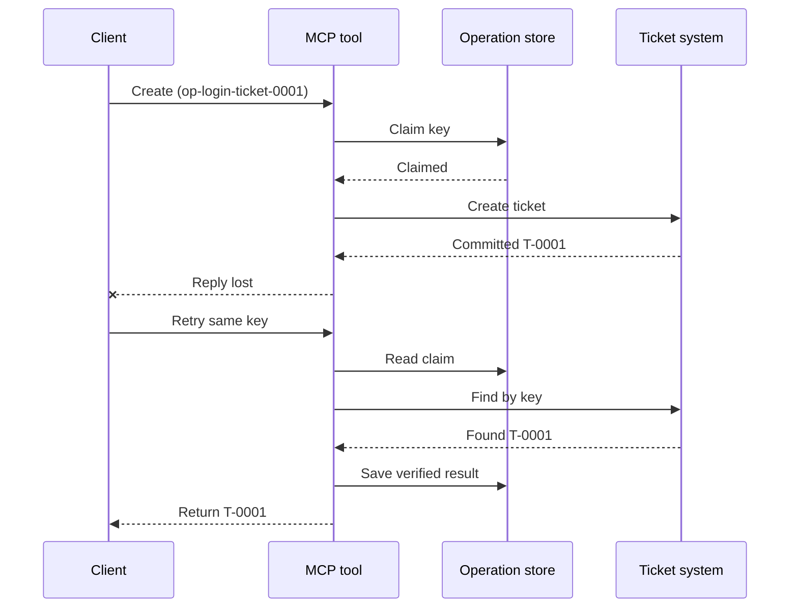
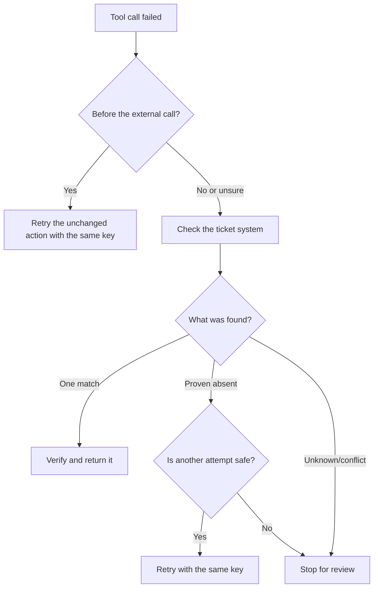

# Turvalliset uudelleenyritykset MCP-työkaluille: Luotettavuuden sivuvaunu-malli

Puuttuva vastaus ei tarkoita, että toiminto olisi jäänyt tekemättä. Tukipyyntökalu
saattaa luoda tiketin `T-0001` ja sitten menettää yhteytensä ennen kuin asiakas näkee
tuloksen. Jos asiakas yrittää uudelleen sokeasti, se saattaa luoda tiketin `T-0002`.

Tämä oppitunti näyttää, miten tunnistaa epävarma lopputulos, säilyttää yksi vakaa
identiteetti aiotulle toiminnolle ja tarkistaa tiketijärjestelmä ennen uudelleenyritystä.
Mukana oleva Python-harjoitus toimii paikallisesti standardikirjaston
ja SQLite:n kanssa.

## Miksi aikakatkaisu tarkoittaa ”Lopputulos tuntematon”

Oletetaan, että asiakas kutsuu `create_support_ticket` operaatioavaimella
`op-login-ticket-0001`:



Yhteys epäonnistuu lipun sitoutumisen jälkeen mutta ennen tuloksen saapumista.
Asiakas tietää vain, että vastaus puuttuu. Se ei tiedä, onko
lippu kadonnut. Toimintoavaimen uudelleenkäyttö antaa työkalun löytää ja palauttaa
`T-0001` luomisen sijaan `T-0002`.

## Mitä luotettavuussidecar tekee

Luotettavuussidecar on sovelluskoodia, joka säilyttää palautumistilan
työkalun ympärillä. Se voi olla kirjasto, välikerros, tietokantapohjainen
palvelu tai yksinkertaisesti osa työkalun toteutusta. Sen ei tarvitse olla erillinen
prosessi, eikä se ole MCP-protokollan ominaisuus.

Sidecarilla on neljä tehtävää:

1. tallentaa tarkoitettu toiminto ennen ulkoisen järjestelmän kutsumista;
2. sallia vain yhden työntekijän vaatia kyseistä toimintoa;
3. muistaa tarpeeksi tilaa palautumista varten kaatumisen jälkeen; ja
4. tarkistaa ulkoinen järjestelmä, kun tulos on epävarma.

Tämä opetus on suunnattu lopulliseen MCP-määritykseen `2026-07-28`. MCP:llä ei ole
protokollatason istuntoa, joten operaatioavain on tavallinen työkalun argumentti,
joka perustuu kestävään sovellustilaan. Sama malli toimii myös aiempien
MCP-versioiden kanssa.

## Neljä ID:tä, jotka ratkaisevat eri ongelmia

Nämä tunnisteet liittyvät toisiinsa, mutta eivät ole vaihdettavissa keskenään:

| Tunniste | Mitä se tunnistaa | Kestääkö uudelleenkäytön? |
| --- | --- | --- |
| JSON-RPC ID | Yksi pyyntö ja vastaus | Ei; käytä uutta pyyntö-ID:tä |
| MCP-tehtävän ID | Yksi pitkäkestoinen tehtävä | Kyllä; pidä se käytössä kyselyjä varten |
| Operaatioavain | Yksi tarkoitettu toiminto | Kyllä; käytä uudelleen kyseiseen toimintaan |
| Lipun ID | Tallennettu tulos | Kyllä; palauta se vahvistuksen jälkeen |

Edistymisilmoitukset ja jäljitety konteksti auttavat sinua havainnoimaan pyyntöä.
Peruutus pyytää työtä lopettamaan. Mikään niistä ei estä kaksoiskappale-lippua.

## Rakenna suoja

Luo operaatioavain ennen ensimmäistä työkalukutsua ja tallenna se työnkulun kanssa.
Jokainen yritys luoda sama tarkoitettu lippu käyttää samaa avainta:

```json
{
  "operation_key": "op-login-ticket-0001",
  "title": "Cannot sign in"
}
```

Eri tarkoitettu lippu saa uuden avaimen. Tuotannossa luo läpinäkymätön,
arvaamaton arvo, eikä laita asiakastietoja avaimen sisään.

Tässä on täydellinen MCP-työkalun skeema, jota käytetään tässä opetuksessa:

```json
{
  "name": "create_support_ticket",
  "title": "Create support ticket",
  "description": "Creates or recovers one support ticket for an operation key.",
  "inputSchema": {
    "$schema": "https://json-schema.org/draft/2020-12/schema",
    "type": "object",
    "properties": {
      "operation_key": {
        "type": "string",
        "minLength": 16,
        "maxLength": 128,
        "description": "Stable key reused for the same intended action."
      },
      "title": {
        "type": "string",
        "minLength": 1,
        "maxLength": 200
      }
    },
    "required": ["operation_key", "title"],
    "additionalProperties": false
  },
  "outputSchema": {
    "$schema": "https://json-schema.org/draft/2020-12/schema",
    "type": "object",
    "properties": {
      "ticket_id": {
        "type": "string"
      },
      "operation_key": {
        "type": "string"
      },
      "status": {
        "type": "string",
        "const": "verified"
      }
    },
    "required": ["ticket_id", "operation_key", "status"],
    "additionalProperties": false
  }
}
```

Todennettu kutsujan identiteetti tulee palvelinympäristöstä, ei
mallin toimittamasta työkalun syötteestä. Rajaa tallennettu operaatio:

- kyseiselle kutsujalle, vuokraajalle tai palvelutilille;
- työkalun nimi ja versio; sekä
- normaalisoitujen syötteiden tiiviste, joka määrittää ulkoisen toiminnon.

Syötteen tiiviste vastaa yksinkertaiseen kysymykseen: "Pyytääkö tämä uudelleenyrittäminen samaa
lippua?" Jos avain kuuluu jo eri otsikolle, hylkää kutsu.
Aiemman tuloksen palauttaminen muuttuneille syötteille peittäisi sopimusvirheen.

Tallenna vaatimus yhdellä atomisella tietokantaoperaatiolla. "Atominen" tarkoittaa, että kaksi
työntekijää eivät molemmat voi havaita tyhjää riviä ja molemmat tulla omistajiksi. Paikallinen
lukitus ei riitä, kun toinen palvelininstanssi voi vastaanottaa uudelleenkokeilun.

Työnkulku luo avaimen samalla, kun toiminto on `planned`. Esimerkki tallentaa sitten nämä tilat:


- `claimed`: yksi työntekijä on varannut operaation;
- `completed`: lippujärjestelmä palautti tuloksen; ja
- `verified`: lippujärjestelmän luku vahvistaa tuloksen.

Järjestelmän kaatuminen voi jättää tallennetun tilan kohtaan `claimed`, vaikka lippu olisi
jo luotu. Käsittele jokaista kesken olevaa väitettä epävarmana, kunnes ulkoinen todiste
vahvistaa sen. Älä oleta, että `claimed` tarkoittaa "mitään ei tapahtunut."

## Palauta tila ennen uudelleenyritystä

Kun työkalukutsu epäonnistuu, päätä, mitä tiedetään, ennen kuin lähetät toisen ulkoisen
kirjoituskutsun:



Todennus, joka epäonnistuu ennen lippu-API:n kutsua, on tunnettu epäonnistuminen.
Yritä uudelleen muuttumatonta toimintoa samalla operaatioavaimella. Jos syötteen korjaus
muuttaa tarkoitettua lippua, luo uusi avain tälle uudelle toiminnolle.

Jos pyyntö on saattanut tavoittaa lippujärjestelmän, sovita tilanne ensin.
Sovittaminen tarkoittaa tallennetun väitteen vertaamista auktoritatiiviseen lippu-
tietueeseen. Palauta olemassa oleva lippu, kun tarkalleen yksi vastaava tietue löytyy.
Yritä uudelleen vain, kun lippua ei ole selvästi olemassa ja alavirran sopimus
tekee toisesta yrityksestä turvallisen.

"Ei löydy" ei aina ole ratkaisevaa. Lopulta yhdenmukainen tarjoaja
haussa saattaa tarvita rajatun odotuksen ja toisen tarkistuksen. Jos järjestelmää ei voi
hakea, se antaa ristiriitaisia tuloksia tai ei pysty turvallisesti poissulkemaan toista
yritystä, lopeta ja raportoi `outcome unknown`. Tämä lopettaminen tunnetaan joskus
nimellä "epäonnistuminen suljettuna": työnkulku kieltäytyy arvaamasta.

## Todisteet, tehtävät ja peruutus

Työkalun vastaus kertoo, mitä työkalu raportoi. Tallennettu tarkistuspiste kertoo, mitä
työnkulku kirjasi. Vahvin todiste tulee järjestelmästä, joka omistaa
tuloksen: tässä esimerkissä lippujärjestelmän luku, joka löytää tarkan yhden
vastaavan lipun.

Sovita todiste riskiin. Tarjoajan viesti-ID voi riittää
vähäriskiseen ilmoitukseen. Maksut, käyttöönotot ja tuhoavat toimet saattavat
tarvita tarjoajan tilan, pääkirjan tai manuaalisen tarkastusnäkökohdan.

MCP-tehtävälaajennus täydentää tätä rakennetta pitkäkestoisessa työssä. Tehtävän
tunniste antaa asiakkaalle mahdollisuuden jatkaa kyselyjä yhteyden katketessa, mutta se ei
tunnista tai kaksoiskappaleista lippua itseään. Kun Tasks on käytössä, identiteetit yhdistyvät
seuraavasti:

```text
operation key -> Task ID -> ticket ID -> verification evidence
```

Peruutus on yhteistyöperusteinen, ei peruutustoiminto. Lippu voidaan silti luoda
peruutuksen vahvistamisen jälkeen, joten epävarma tulos tarvitsee edelleen
sovittamista.

## Suorita epäonnistumisen injektointiharjoitus

Näyte käyttää kahta SQLite-tiedostoa: yksi edustaa operatiivista tallennusta ja
toinen edustaa ulkoista lippujärjestelmää. Tiedostojen välillä ei ole transaktiota.
Virhe injektoidaan lipun sitoutumisen jälkeen, mutta ennen
sivuvaunun tallentavan valmistumista.

Suora Python-menetelmä hyväksyy `caller_id` todentettuna palvelinyhteyden sijaisena.
Älä lisää `caller_id` mallin ohjaaman MCP-sisääntulon
skeemaan.

Ennusta tulos ennen testien suorittamista:

| Polku | Tulos uudelleenyrityksen jälkeen | Lippujen määrä |
| --- | --- | --- |
| Sokea uudelleenyritys | Luo `T-0002` vastauksen menetettyään `T-0001` | 2 |
| Suojattu uudelleenyritys | Etsii ja palauttaa `T-0001` | 1 |

Suorita:

```bash
cd 08-BestPractices/reliability-sidecars/python
python -m unittest discover -p "test_*.py" -v
```

Kuusi testiä osoittavat, että:

1. sokea uudelleenyrittäminen luo kopion;
2. vasteen menetys ja uudelleenkäynnistys palauttaa yhden lipun kestävän vaateen perusteella;
3. vahvistettu uudelleenyrittäminen käyttää tallennettua tulosta uudelleen;
4. muuttunut syöte tai ristiriitaiset ulkoiset todisteet hylätään;
5. olemassa oleva vaatimus ilman ulkoisia todisteita pysäyttää turvallisesti; ja
6. samanaikaiset vaatimukset myöntävät yhden omistajan ilman, että vahvistetun tuloksen tila huononee.

Avaa esimerkki:

- [Python-toteutus](../../../../08-BestPractices/reliability-sidecars/python/reliability_sidecar.py)
- [Deterministiset testit](../../../../08-BestPractices/reliability-sidecars/python/test_reliability_sidecar.py)

Esimerkki jättää tahallaan pois vanhentuneet vuokraukset. Tuotantoympäristön haltuunottopolitiikka
vaatii rajatun vuokra-ajan, atomisen omistajuuden siirron ja toisen ulkoisen
tarkistuksen ennen suoritusta.

## Valinnainen yhteisön toteutus

Agent Enhancer Utilities on yksi yhteisön toteutus tästä
sovellustason mallista. Sen suunnittelija valitsee palautumistavan, kun taas sen
tarkistuskohta tallentaa vaatimuksen ja epävarman tuloksen tilat. Domain-työkalu tai MCP
palvelin suorittaa ja varmistaa edelleen varsinaisen toiminnon. Tämä palvelu ei ole osa
MCP-määrittelyä eikä se ole pakollinen tämän oppitunnin kannalta.

| Oppitunti-konsepti | Agentin parannusosa | Tärkeä rajoitus |
| --- | --- | --- |
| Palautussuunnitelma | `workflow-guard-planner` | Ei kutsu domain-työkalua |
| Vaatimus ja palautus | `workflow-checkpoint` | `external_proof` pysyy `false` |
| Tarkka sidecar-toisto | `lab.invoke_tool` | Käyttää erillistä idempotenssiavainta |
| Vahvista todellinen toiminto | Kohteen haku/luku takaisin | Domain MCP omistaa sen |

Tarkkaa yhden sidecar-kutsun uudelleenkäsittelyä varten `lab.invoke_tool` hyväksyy ulkoisen
`idempotency_key`. Tämä avain tunnistaa sidecar-kutsun; se ei ole
liiketoiminnallinen `operation_key`, jota lippu käyttää.

Merkitty julkinen sopimus ja valinnainen verkotettu esimerkki ovat saatavilla
täällä:

- [Reliability Sidecar Contract v1](https://github.com/artiehinz/Agent-Enhancer-Utilities/blob/v1.6.0/docs/RELIABILITY_SIDECAR_CONTRACT_V1.md)
- [Planner and mock-domain example](https://github.com/artiehinz/Agent-Enhancer-Utilities/tree/v1.6.0/examples/reliability-sidecar)

Nämä linkit havainnollistavat sovelluskuviota. Ne eivät väitä, että
isännöity palvelu noudattaa MCP:n `2026-07-28`, eikä tarkistusasemien tila ole koskaan
ulkoista todistetta lipusta.

## Tuotantotarkistuslista

- [ ] Luo ja tallenna toimintavain ennen ensimmäistä ulkoista yritystä.
- [ ] Sitota avain kutsujaan, työkalun versioon ja normalisoituun syötetarkisteeseen.
- [ ] Hylkää muutettu syöte olemassa olevan avaimen alla.
- [ ] Salli yksi omistaja atomisella jaetun tallennuksen operaatiolla.
- [ ] Lähetä avain alavirran tarjoajalle, kun se tukee idempotenssia.
- [ ] Sovita epävarmat tulokset ennen seuraavaa kirjoitusta.
- [ ] Säilytä vahvistetut tulokset ja todisteet koko uudelleenkäsittelyikkunan ajan.
- [ ] Pysähdy tarkastukseen, kun ulkoista lopputulosta ei voida varmuudella määrittää.

## Viitteet

- [MCP-määrittely `2026-07-28`](https://modelcontextprotocol.io/specification/2026-07-28)
- [MCP `2026-07-28` työkalun ohjeistus](https://modelcontextprotocol.io/specification/2026-07-28/server/tools)
- [MCP Tasks -laajennus](https://modelcontextprotocol.io/extensions/tasks/overview)
- [JSON-RPC 2.0 -määrittely](https://www.jsonrpc.org/specification)

---

<!-- CO-OP TRANSLATOR DISCLAIMER START -->
**Vastuuvapauslauseke**:
Tämä asiakirja on käännetty käyttämällä tekoälypohjaista käännöspalvelua [Co-op Translator](https://github.com/Azure/co-op-translator). Vaikka pyrimme tarkkuuteen, otathan huomioon, että automaattiset käännökset saattavat sisältää virheitä tai epätarkkuuksia. Alkuperäinen asiakirja sen alkuperäiskielellä on virallinen lähde. Tärkeissä asioissa suositellaan ammattimaista ihmiskäännöstä. Emme ole vastuussa tämän käännöksen käytöstä aiheutuvista väärinymmärryksistä tai tulkinnoista.
<!-- CO-OP TRANSLATOR DISCLAIMER END -->