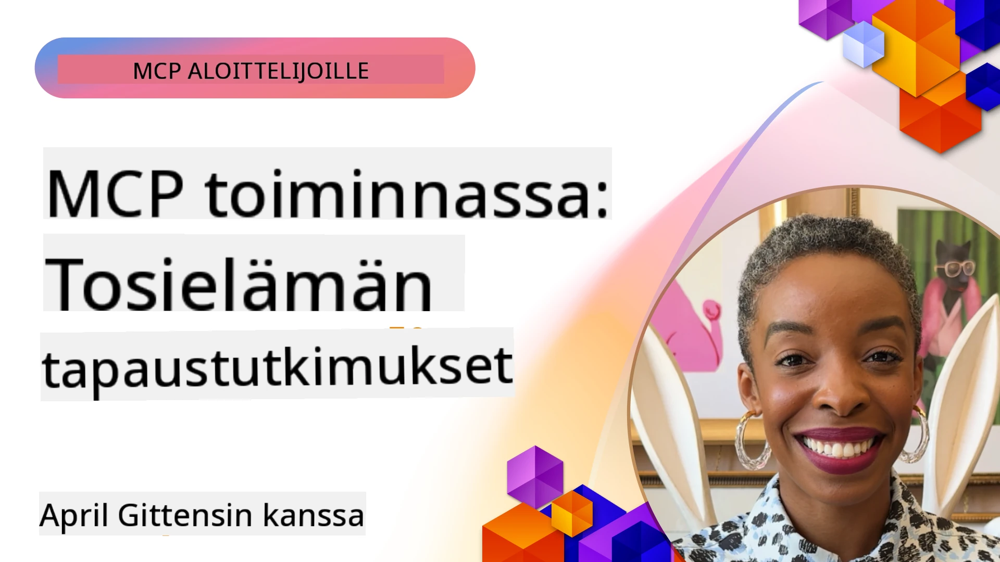

# MCP käytännössä: Todellisia tapaustutkimuksia

_(Napsauta yllä olevaa kuvaa nähdäksesi tämän oppitunnin videon)_

Model Context Protocol (MCP) muuttaa tapaa, jolla tekoälysovellukset kommunikoivat datan, työkalujen ja palvelujen kanssa. Tässä osiossa esitellään todellisia tapaustutkimuksia, jotka osoittavat MCP:n käytännön sovelluksia eri yritysmaailman tilanteissa.

## Yleiskatsaus

Tässä osiossa esitellään konkreettisia MCP:n käyttötapauksia, jotka korostavat, miten organisaatiot hyödyntävät tätä protokollaa ratkaistakseen monimutkaisia liiketoiminnan haasteita. Tutustumalla näihin tapaustutkimuksiin saat tietoa MCP:n monipuolisuudesta, skaalautuvuudesta ja käytännön eduista tosielämän tilanteissa.

## Keskeiset oppimistavoitteet

Tutustumalla näihin tapaustutkimuksiin sinä:

- Ymmärrät, miten MCP:tä voidaan soveltaa tiettyjen liiketoimintaongelmien ratkaisuun
- Opit erilaisista integraatiokuvioista ja arkkitehtonisista lähestymistavoista
- Tunnistat parhaat käytännöt MCP:n toteuttamiseen yritysympäristöissä
- Saat näkemyksiä todellisissa toteutuksissa kohdatuista haasteista ja ratkaisuista
- Löydät mahdollisuuksia soveltaa samankaltaisia malleja omissa projekteissasi

## Esitellyt tapaustutkimukset

### 1. [Azure AI Travel Agents – Referenssitoteutus](./travelagentsample.md)

Tässä tapaustutkimuksessa tarkastellaan Microsoftin kattavaa referenssiratkaisua, joka osoittaa, miten rakentaa monitoimijainen, tekoälyn voimalla toimiva matkasuunnittelu-sovellus MCP:n, Azure OpenAI:n ja Azure AI Searchin avulla. Projekti esittelee:

- Monitoimijaorchestrointi MCP:n kautta
- Yritystason dataintegraatio Azure AI Searchilla
- Turvallinen, skaalautuva arkkitehtuuri Azure-palveluiden avulla
- Laajennettavat työkalut uudelleenkäytettävillä MCP-komponenteilla
- Keskustelupohjainen käyttäjäkokemus Azure OpenAI:n avulla

Arkkitehtuuri ja toteutuksen yksityiskohdat tarjoavat arvokkaita näkemyksiä monimutkaisten, monitoimijajärjestelmien rakentamiseen MCP:n koordinointikerroksena.

### 2. [Azure DevOps -kohteiden päivittäminen YouTube-datan perusteella](./UpdateADOItemsFromYT.md)

Tässä tapaustutkimuksessa havainnollistetaan MCP:n käytännön sovellusta työnkulkujen automaatiossa. Se osoittaa, miten MCP-työkaluja voidaan käyttää:

- Keräämään dataa verkkopalveluista (YouTube)
- Päivittämään työtehtäviä Azure DevOps -järjestelmissä
- Luomaan toistettavia automaatiotyönkulkuja
- Integroimaan dataa eri järjestelmien välillä

Tämä esimerkki osoittaa, miten jopa suhteellisen yksinkertaiset MCP-toteutukset voivat tuoda merkittäviä tehokkuushyötyjä automatisoimalla rutiinitehtäviä ja parantamalla datan johdonmukaisuutta järjestelmien välillä.

### 3. [Reaaliaikainen dokumentaation haku MCP:llä](./docs-mcp/README.md)

Tässä tapaustutkimuksessa opastetaan, miten yhdistää Python-konsoliasiakas Model Context Protocol (MCP) -palvelimeen reaaliaikaisen, kontekstuaalisen Microsoft-dokumentaation hakemiseksi ja lokittamiseksi. Opit, miten:

- Yhdistää MCP-palvelimeen Python-asiakkaalla ja virallisella MCP SDK:lla
- Käyttää suoratoistavia HTTP-asiakkaita tehokkaaseen reaaliaikaiseen datan hakuun
- Kutsua dokumentaatiotyökaluja palvelimella ja kirjata vastaukset suoraan konsoliin
- Integroida ajan tasalla oleva Microsoft-dokumentaatio työnkulkuun ilman, että tarvitsee poistua terminaalista

Luvussa on käytännön harjoitus, yksinkertainen toimiva koodiesimerkki ja linkkejä lisäresursseihin syvempää oppimista varten. Katso koko läpikäynti ja koodi linkatusta luvusta ymmärtääksesi, miten MCP voi muuttaa dokumentaatioon pääsyä ja kehittäjien tuottavuutta konsolipohjaisissa ympäristöissä.

### 4. [Interaktiivinen opintosuunnitelman generaattorisovellus MCP:llä](./docs-mcp/README.md)

Tässä tapaustutkimuksessa näytetään, miten rakentaa interaktiivinen web-sovellus Chainlitin ja Model Context Protocolin (MCP) avulla, joka generoi henkilökohtaisia opintosuunnitelmia mille tahansa aiheelle. Käyttäjät voivat määrittää aiheen (esim. "AI-900 sertifiointi") ja opiskeluaikataulun (esim. 8 viikkoa), ja sovellus tarjoaa viikko viikolta suositellun sisältöjaon. Chainlit mahdollistaa keskustelupohjaisen chat-käyttöliittymän, tehden kokemuksesta mukaansatempaavan ja mukautuvan.

- Keskustelupohjainen web-sovellus Chainlitin voimalla
- Käyttäjälähtöiset kehotteet aiheen ja keston määrittämiseen
- Viikko viikolta sisältösuositukset MCP:n avulla
- Reaaliaikaiset, mukautuvat vastaukset chat-käyttöliittymässä

Projekti havainnollistaa, miten keskusteleva tekoäly ja MCP voidaan yhdistää dynaamisten, käyttäjälähtöisten oppimistyökalujen luomiseksi nykyaikaisessa verkkoympäristössä.

### 5. [Editorin sisäinen dokumentaatio MCP-palvelimen avulla VS Codessa](./docs-mcp/README.md)

Tässä tapaustutkimuksessa näytetään, miten Microsoft Learn Docs voidaan tuoda suoraan VS Code -ympäristöön MCP-palvelimen avulla – ei enää välilehtien vaihtelua selaimessa! Näet, miten:

- Voit hakea ja lukea dokumentaatiota välittömästi VS Codessa MCP-paneelia tai komentopalettia käyttäen
- Viitata dokumentaatioon ja lisätä linkkejä suoraan README- tai kurssin markdown-tiedostoihin
- Käyttää GitHub Copilotia ja MCP:tä yhdessä saumattomaan, tekoälyn tukemaan dokumentaatio- ja koodityönkulkuun
- Vahvistaa ja parantaa dokumentaatiota reaaliaikaisella palautteella ja Microsoftin tarjoamalla tarkkuudella
- Integroida MCP GitHub-työnkulkuihin jatkuvaa dokumentaation varmennusta varten

Toteutus sisältää:

- Esimerkki `.vscode/mcp.json` -konfiguraatiosta helppoa asennusta varten
- Kuvakaappauspohjaiset opastukset editorin käyttökokemuksesta
- Vinkkejä Copilotin ja MCP:n yhdistämiseen maksimaalisen tuottavuuden saavuttamiseksi

Tämä skenaario sopii erinomaisesti kurssin tekijöille, dokumentaation kirjoittajille ja kehittäjille, jotka haluavat pysyä keskittyneinä editorissaan työskennellessään dokumenttien, Copilotin ja validointityökalujen parissa — kaikki MCP:n voimin.

### 6. [APIM MCP -palvelimen luominen](./apimsample.md)

Tämä tapaustutkimus tarjoaa vaiheittaisen oppaan MCP-palvelimen luomiseen Azure API Managementin (APIM) avulla. Se kattaa:

- MCP-palvelimen perustamisen Azure API Managementiin
- API-toimintojen tarjoamisen MCP-työkaluina
- Käytäntöjen konfiguroinnin nopeusrajoituksille ja turvallisuudelle
- MCP-palvelimen testaamisen Visual Studio Coden ja GitHub Copilotin avulla

Tämä esimerkki havainnollistaa, kuinka Azure-resursseja hyödyntämällä voidaan luoda vakaa MCP-palvelin, jota voidaan käyttää eri sovelluksissa parantaen tekoälyjärjestelmien integrointia yritystason API:en kanssa.

### 7. [GitHub MCP Registry — Agenttisen integraation nopeuttaminen](https://github.com/mcp)

Tämä tapaustutkimus käsittelee GitHubin syyskuussa 2025 lanseeratun MCP Registryn ratkaisua AI-ekosysteemin kriittiseen haasteeseen: hajallaan olevien Model Context Protocol (MCP) -palvelimien löytämiseen ja käyttöönottoon.

#### Yleiskatsaus
**MCP Registry** ratkaisee kasvavan ongelman MCP-palvelimien hajanaisuudesta eri arkistoissa ja rekistereissä, mikä aiemmin teki integraatiosta hidasta ja virhealttiita. Nämä palvelimet mahdollistavat tekoälyagenttien vuorovaikutuksen ulkoisten järjestelmien kuten API:en, tietokantojen ja dokumentaatiolähteiden kanssa.

#### Ongelmakuvaus
Agenttipohjaisten työnkulkujen kehittäjät kohtasivat useita haasteita:
- **Heikko löydettävyys** MCP-palvelimille eri alustoilla
- **Toistuvat asennuskysymykset** hajallaan foorumeilla ja dokumentaatiossa
- **Turvariskit** vahvistamattomista ja epäluotettavista lähteistä
- **Standardoinnin puute** palvelinten laadussa ja yhteensopivuudessa

#### Ratkaisuarkkitehtuuri
GitHubin MCP Registry keskittää luotettavat MCP-palvelimet keskeisin ominaisuuksin:
- **Yhden klikkauksen asennus** VS Code -integraatiolla sujuvaan käyttöönottoon
- **Signaali-kohinajärjestys** tähtien, aktiivisuuden ja yhteisön validoinnin mukaan
- **Suora integraatio** GitHub Copilotin ja muiden MCP-yhteensopivien työkalujen kanssa
- **Avoin kontribuutiomalli** sallien sekä yhteisön että yritysmahdollisuudet osallistua

#### Liiketoiminnallinen vaikutus
Rekisteri on tuonut mitattavia parannuksia:
- **Nopeampi käyttöönotto** kehittäjille kuten Microsoft Learn MCP Serverin kautta, joka suoratoistaa virallista dokumentaatiota suoraan agenteille
- **Parantunut tuottavuus** erikoistuneiden palvelimien kuten `github-mcp-server` avulla, mahdollistaen luonnollisen kielen GitHub-automaatioita (PR-luonti, CI-uudelleenkäynnistykset, koodiskannaus)
- **Vahvempi ekosysteemin luottamus** kuratoitujen listojen ja läpinäkyvien konfiguraatioiden ansiosta

#### Strateginen arvo
Agenttien elinkaarihallintaan ja toistettaviin työnkulkujen erikoistuneille käytännön tekijöille MCP Registry tarjoaa:
- **Modulaarisen agenttien käyttöönoton** ominaisuuksia standardoitujen komponenttien kanssa
- **Rekisterin tukemat arviointiputket** johdonmukaiseen testaukseen ja validointiin
- **Työkalujen välinen yhteensopivuus** saaden aikaan sujuvan integraation eri tekoälyalustojen välillä

Tämä tapaustutkimus osoittaa, että MCP Registry ei ole pelkästään hakemisto — se on perustavanlaatuinen alusta laajamittaiseen, käytännön malliin perustuvaan agenttisten järjestelmien käyttöönottoon.

### 8. [Julkaiseminen sosiaalisiin verkostoihin agentin kautta](./publora-social-publishing.md)

Tämä tapaustutkimus käynnistyy **kirjoitusoikeuksilla varustetulla etä-MCP-palvelimella** — sellaisella, jonka työkalut tekevät peruuttamattomia toimia käyttäjän puolesta — käyttäen sosiaalisen julkaisun esimerkkinä. Agentti luonnostelee julkaisun, ihminen hyväksyy sen, ja palvelin aikatauluttaa sen verkostoihin.

Mielenkiintoisena osana ovat julkaisun asettamat suunnittelurajoitteet, jotka koskevat mitä tahansa palvelinta, joka kirjoittaa lukemisen sijaan:

- **Avoin löytäminen, todentamaton suoritus** — `tools/list` vastataan ilman tunnuksia, jotta rekisterit ja asiakkaat voivat tarkastella sisäisesti, kun taas jokainen `tools/call` vaatii tunnuksen ja muuten palauttaa `401`, jossa on `WWW-Authenticate`-otsake
- **OAuth-rekisteröinti ilman erillistä ulkopuolista vaihetta** — nykyaikainen dynaaminen asiakasrekisteröinti, Client ID Metadata Documents -ohjeistuksen suuntaan, johon `2026-07-28`-määrittely viittaa
- **Työkalukommentit** (`readOnlyHint`, `destructiveHint`, `idempotentHint`), joita asiakkaat käyttävät päättää vahvistettavista asioista — vihjeitä pakottamisen sijaan, ja jotain mitä liitännäishakemistot nyt odottavat tarkastuksessa
- **Ei-keksittäviä tunnisteita**, jotta kuvitteellinen arvo epäonnistuu selkeästi sen sijaan, että se toimisi uskottavalta näyttävällä arvolla
- **Idempotenssiavaimet julkaisua luovissa työkaluissa**, jotta agentin suoritusympäristön uudelleenyrittäminen ei johda kaksoisjulkaisuun
- **Toimintoa tekemätön kohde työkalukaavassa**, joka kulkee koko kirjoituspolun ilman julkaisua, tarkastajia ja jatkuvaa integraatiota varten

Luku päättyy lyhyeen tarkistuslistaan, jota voit soveltaa rakentamaasi palvelimeen.

## Yhteenveto

Nämä kahdeksan kattavaa tapaustutkimusta osoittavat Model Context Protocolin poikkeuksellisen monipuolisuuden ja käytännön sovellukset erilaisissa todellisissa tilanteissa. Monimutkaisista monen agentin matkajärjestelmis­tä ja yritysten API-hallinnasta virtaviivaistettuihin dokumentaation työnkulkuihin ja mullistavaan GitHub MCP Registryyn, nämä esimerkit näyttävät, kuinka MCP tarjoaa standardoidun, skaalautuvan tavan yhdistää tekoälyjärjestelmät tarvitsemiinsa työkaluihin, datoihin ja palveluihin tuottaen ainutlaatuista arvoa.

Tapaustutkimukset kattavat MCP:n toteutuksen useita ulottuvuuksia:
- **Yritysintegrointi**: Azure API Management ja Azure DevOps -automaatiot
- **Moni-agentin orkestrointi**: Matkan suunnittelu koordinoiduilla tekoälyagenteilla
- **Kehittäjien tuottavuus**: VS Code -integraatio ja reaaliaikainen dokumentaatio
- **Ekosysteemin kehitys**: GitHubin MCP Registry perustana
- **Koulutussovellukset**: Interaktiiviset opintosuunnitelman generaattorit ja keskusteleva käyttöliittymä

Näitä toteutuksia tutkimalla saat tärkeää tietoa:
- **Arkkitehtonisista malleista** eri mittakaavoihin ja käyttötapauksiin
- **Toteutusstrategioista**, jotka tasapainottavat toiminnallisuuden ja ylläpidettävyyden
- **Turvallisuus- ja skaalautuvuusnäkökohdista** tuotantoympäristössä
- **Parhaista käytännöistä** MCP-palvelinten kehittämisessä ja asiakasintegraatiossa
- **Ekosysteemiajattelusta** yhdistettyjen tekoälyratkaisujen rakentamisessa

Nämä esimerkit yhdessä todistavat, että MCP ei ole vain teoreettinen viitekehys, vaan kypsä, tuotantovalmiiksi kehitetty protokolla, joka mahdollistaa käytännön ratkaisut monimutkaisiin liiketoiminnan haasteisiin. Rakensitpa yksinkertaisia automaatiotyökaluja tai monimutkaisia moni-agenttijärjestelmiä, tässä selostetut mallit ja lähestymistavat tarjoavat vankan perustan omille MCP-projekteillesi.

## Lisäresurssit

- [Azure AI Travel Agents GitHub Repository](https://github.com/Azure-Samples/azure-ai-travel-agents)
- [Azure DevOps MCP Tool](https://github.com/microsoft/azure-devops-mcp)
- [Playwright MCP Tool](https://github.com/microsoft/playwright-mcp)
- [Microsoft Docs MCP Server](https://github.com/MicrosoftDocs/mcp)
- [GitHub MCP Registry — Accelerating Agentic Integration](https://github.com/mcp)
- [MCP Community Examples](https://github.com/microsoft/mcp)

## Mitä seuraavaksi

- Edellinen: [Moduuli 8: Parhaat käytännöt](../08-BestPractices/README.md)
- Seuraava: [Moduuli 10: AI-työnkulkujen virtaviivaistaminen: MCP-palvelimen rakentaminen Microsoft Foundry Toolkitin avulla](../10-StreamliningAIWorkflowsBuildingAnMCPServerWithAIToolkit/README.md)

---

<!-- CO-OP TRANSLATOR DISCLAIMER START -->
**Vastuuvapauslauseke**:
Tämä asiakirja on käännetty käyttämällä tekoälypohjaista käännöspalvelua [Co-op Translator](https://github.com/Azure/co-op-translator). Vaikka pyrimme tarkkuuteen, otathan huomioon, että automaattiset käännökset saattavat sisältää virheitä tai epätarkkuuksia. Alkuperäinen asiakirja sen alkuperäiskielellä on virallinen lähde. Tärkeissä asioissa suositellaan ammattimaista ihmiskäännöstä. Emme ole vastuussa tämän käännöksen käytöstä aiheutuvista väärinymmärryksistä tai tulkinnoista.
<!-- CO-OP TRANSLATOR DISCLAIMER END -->