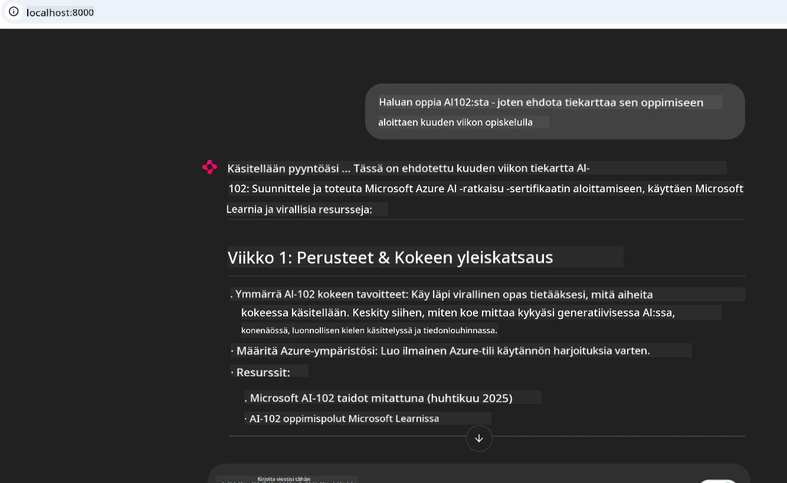
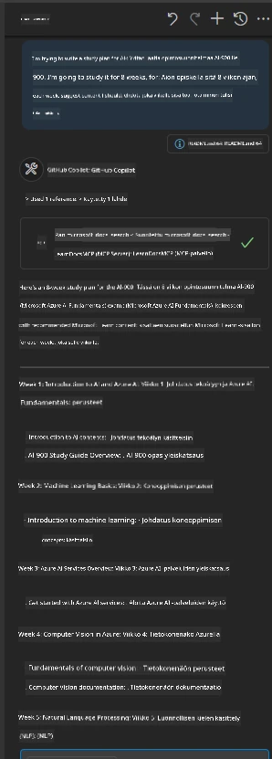

# Tapaustutkimus: Yhteyden muodostaminen Microsoft Learn Docs MCP -palvelimeen asiakkaalta

Oletko koskaan huomannut hyppääväsi dokumentaatiosivustojen, Stack Overflown ja loputtomien hakukonevälilehtien välillä yrittäessäsi ratkaista ongelmaa koodissasi? Ehkä sinulla on toinen näyttö vain dokumentaatiota varten, tai vaihdat jatkuvasti IDE:n ja selaimen välillä alt-tab-näppäimellä. Eikö olisi parempi, jos voisit tuoda dokumentaation suoraan työnkulkuusi — integroituna sovelluksiisi, IDE:hesi tai jopa omiin räätälöityihin työkaluihisi? Tässä tapaustutkimuksessa tutustumme siihen, miten se tehdään yhdistämällä suoraan Microsoft Learn Docs MCP -palvelimeen omasta asiakasohjelmastasi.

## Yleiskatsaus

Moderni kehitys ei ole pelkkää koodin kirjoittamista — kyse on oikean tiedon löytämisestä oikeaan aikaan. Dokumentaatiota on kaikkialla, mutta se ei useinkaan ole siellä, missä sitä eniten tarvitset: työkalujesi ja työnkulkujensi sisällä. Integroimalla dokumentaation hakeminen suoraan sovelluksiisi voit säästää aikaa, vähentää kontekstin vaihtamista ja lisätä tuottavuutta. Tässä osiossa näytämme, miten asiakas yhdistetään Microsoft Learn Docs MCP -palvelimeen, jotta voit käyttää reaaliaikaista, kontekstitietoista dokumentaatiota poistumatta sovelluksestasi.

Käymme läpi yhteyden muodostamisen, pyynnön lähettämisen ja virtaavien vastausten tehokkaan käsittelyn. Tämä lähestymistapa sujuvoittaa työnkulkua ja avaa ovet älykkäämpien, hyödyllisempien kehittäjätyökalujen rakentamiseen.

## Oppimistavoitteet

Miksi teemme tämän? Koska parhaat kehittäjäkokemukset poistavat kitkan. Kuvittele maailma, jossa koodieditorisi, chatbotisi tai web-sovelluksesi voi vastata dokumentaatiokysymyksiisi välittömästi käyttäen Microsoft Learnin uusinta sisältöä. Tämän luvun lopussa osaat:

- Ymmärtää MCP-palvelin-asiakasviestinnän perusteet dokumentaatiota varten
- Toteuttaa konsoli- tai web-sovellus, joka muodostaa yhteyden Microsoft Learn Docs MCP -palvelimeen
- Käyttää virtaavia HTTP-asiakkaita reaaliaikaiseen dokumentaation hakemiseen
- Kirjata ja tulkita dokumentaatiovastauksia sovelluksessasi

Näet, miten nämä taidot auttavat sinua rakentamaan työkaluja, jotka eivät ole vain reaktiivisia, vaan aidosti vuorovaikutteisia ja kontekstitietoisia.

## Tilanne 1 - Reaaliaikainen dokumentaation haku MCP:llä

Tässä tilanteessa näytämme, miten yhdistää asiakas Microsoft Learn Docs MCP -palvelimeen, jotta voit käyttää reaaliaikaista, kontekstitietoista dokumentaatiota poistumatta sovelluksestasi.

Otetaan tämä käytäntöön. Tehtäväsi on kirjoittaa sovellus, joka muodostaa yhteyden Microsoft Learn Docs MCP -palvelimeen, kutsuu `microsoft_docs_search`-työkalua ja kirjaa virtaavan vastauksen konsoliin.

### Miksi tämä lähestymistapa?
Koska se on pohja kehittyneemmille integraatioille — halusitpa sitten voiman antaa chatbotille, IDE-laajennukselle tai web-hallintapaneelille.

Löydät tämän tilanteen koodin ja ohjeet [`solution`](./solution/README.md) -kansiosta tässä tapaustutkimuksessa. Vaiheet opastavat sinua yhteyden muodostamisessa:
- Käytä virallista MCP SDK:ta ja virtaavaa HTTP-asiakasta yhteyteen
- Kutsu `microsoft_docs_search`-työkalua kyselyparametrilla dokumentaation hakemiseksi
- Toteuta asianmukainen lokitus ja virheenkäsittely
- Luo vuorovaikutteinen konsoli, jolla käyttäjät voivat syöttää useita hakukyselyjä

Tämä tilanne havainnollistaa, miten:
- Yhdistetään Docs MCP -palvelimeen
- Lähetetään kysely
- Tulokset jäsennetään ja tulostetaan

Näin ratkaisun suorittaminen voisi näyttää:

```
Prompt> What is Azure Key Vault?
Answer> Azure Key Vault is a cloud service for securely storing and accessing secrets. ...
```

Alla on minimaalinen esimerkkiratkaisu. Täysi koodi ja yksityiskohdat löytyvät ratkaisukansiosta.

<details>
<summary>Python</summary>

```python
import asyncio
from mcp.client.streamable_http import streamablehttp_client
from mcp import ClientSession

async def main():
    async with streamablehttp_client("https://learn.microsoft.com/api/mcp") as (read_stream, write_stream, _):
        async with ClientSession(read_stream, write_stream) as session:
            await session.initialize()
            result = await session.call_tool("microsoft_docs_search", {"query": "Azure Functions best practices"})
            print(result.content)

if __name__ == "__main__":
    asyncio.run(main())
```

- Täyden toteutuksen ja lokituksen löydät osoitteesta [`scenario1.py`](../../../../09-CaseStudy/docs-mcp/solution/python/scenario1.py).
- Asennus- ja käyttöönotto-ohjeet ovat tiedostossa [`README.md`](./solution/python/README.md) samassa kansiossa.
</details>


## Tilanne 2 - Vuorovaikutteinen opintosuunnitelman generaattorin web-sovellus MCP:llä

Tässä tilanteessa opit integroimaan Docs MCP:n web-kehitysprojektiin. Tavoitteena on mahdollistaa käyttäjien hakea Microsoft Learnin dokumentaatiota suoraan web-käyttöliittymästä, jolloin dokumentaatio on heti saatavilla sovelluksessasi tai sivustollasi.

Näet, miten:
- Otat käyttöön web-sovelluksen
- Yhdistät Docs MCP -palvelimeen
- Käsittelet käyttäjän syötteen ja näytät tulokset

Näin ratkaisun suorittaminen voisi näyttää:

```
User> I want to learn about AI102 - so suggest the roadmap to get it started from learn for 6 weeks

Assistant> Here’s a detailed 6-week roadmap to start your preparation for the AI-102: Designing and Implementing a Microsoft Azure AI Solution certification, using official Microsoft resources and focusing on exam skills areas:

---
## Week 1: Introduction & Fundamentals
- **Understand the Exam**: Review the [AI-102 exam skills outline](https://learn.microsoft.com/en-us/credentials/certifications/exams/ai-102/).
- **Set up Azure**: Sign up for a free Azure account if you don't have one.
- **Learning Path**: [Introduction to Azure AI services](https://learn.microsoft.com/en-us/training/modules/intro-to-azure-ai/)
- **Focus**: Get familiar with Azure portal, AI capabilities, and necessary tools.

....more weeks of the roadmap...

Let me know if you want module-specific recommendations or need more customized weekly tasks!
```

Alla on minimaalinen esimerkkiratkaisu. Täysi koodi ja yksityiskohdat löytyvät ratkaisukansiosta.



<details>
<summary>Python (Chainlit)</summary>

Chainlit on kehys keskustelevien tekoäly-web-sovellusten rakentamiseen. Sen avulla on helppo luoda vuorovaikutteisia chatboteja ja assistentteja, jotka voivat kutsua MCP-työkaluja ja näyttää tuloksia reaaliajassa. Se on ihanteellinen nopeaan prototypointiin ja käyttäjäystävällisiin toiminnallisuuksiin.

```python
import chainlit as cl
import requests

MCP_URL = "https://learn.microsoft.com/api/mcp"

@cl.on_message
def handle_message(message):
    query = {"question": message}
    response = requests.post(MCP_URL, json=query)
    if response.ok:
        result = response.json()
        cl.Message(content=result.get("answer", "No answer found.")).send()
    else:
        cl.Message(content="Error: " + response.text).send()
```

- Täyden toteutuksen löydät osoitteesta [`scenario2.py`](../../../../09-CaseStudy/docs-mcp/solution/python/scenario2.py).
- Asennus- ja ajo-ohjeet ovat tiedoissa [`README.md`](./solution/python/README.md).
</details>


## Tilanne 3: Dokumentaatiot suoraan editorissa MCP-palvelimella VS Codessa

Jos haluat saada Microsoft Learn Docsin suoraan VS Codeen (sen sijaan, että vaihtaisit selaimen välilehtiä), voit käyttää MCP-palvelinta editorissasi. Tämä mahdollistaa, että:
- Etsit ja luet dokumentaatiota VS Codessa poistumatta koodausympäristöstäsi.
- Viittaat dokumentaatioon ja lisäät linkkejä suoraan README- tai kurssitiedostoihisi.
- Hyödynnät GitHub Copilotia ja MCP:tä yhdessä saumattomaan tekoälypohjaiseen dokumentaatiotyönkulkuun.

**Näet, miten:**
- Lisäät kelvollisen `.vscode/mcp.json`-tiedoston työtilasi juureen (katso alla oleva esimerkki).
- Avatset MCP-paneelin tai käytät komentopalettia VS Codessa dokumentaation hakuun ja lisäämiseen.
- Viittaat dokumentaatioon suoraan markdown-tiedostoissasi työn aikana.
- Yhdistät tämän työnkulun GitHub Copilotin kanssa entistä suurempaan tuottavuuteen.

Tässä esimerkki siitä, miten MCP-palvelin asetetaan VS Codeen:

```json
{
  "servers": {
    "LearnDocsMCP": {
      "url": "https://learn.microsoft.com/api/mcp"
    }
  }
}
```

</details>

> Yksityiskohtaisen läpikäynnin kuvakaappauksineen ja vaihe vaiheelta -oppaan löydät osoitteesta [`README.md`](./solution/scenario3/README.md).



Tämä lähestymistapa sopii erinomaisesti teknisten kurssien laatijoille, dokumentaation kirjoittajille tai koodin kehittäjille, joilla on tarve usein viitata materiaaliin.

## Keskeiset Opit

Dokumentaation integroiminen suoraan työkaluihisi ei ole vain mukavuutta — se on tuottavuuden mullistaja. Yhdistämällä Microsoft Learn Docs MCP -palvelimeen asiakkaaltasi voit:

- Poistaa kontekstin vaihtamisen koodin ja dokumentaation välillä
- Hakea ajan tasalla olevaa, kontekstitietoista dokumentaatiota reaaliajassa
- Rakentaa älykkäämpiä, vuorovaikutteisempia kehittäjätyökaluja

Nämä taidot auttavat sinua luomaan ratkaisuja, jotka eivät ole vain tehokkaita vaan myös miellyttäviä käyttää.

## Lisäresurssit

Syventääksesi ymmärrystäsi tutustu näihin virallisiin resursseihin:

- [Microsoft Learn Docs MCP Server (GitHub)](https://github.com/MicrosoftDocs/mcp)
- [Aloita Azure MCP Serverilla (mcp-python)](https://learn.microsoft.com/en-us/azure/developer/azure-mcp-server/get-started#create-the-python-app)
- [Mikä on Azure MCP Server?](https://learn.microsoft.com/en-us/azure/developer/azure-mcp-server/)
- [Model Context Protocol (MCP) Esittely](https://modelcontextprotocol.io/introduction)
- [Lisää liitännäisiä MCP-palvelimelta (Python)](https://learn.microsoft.com/en-us/semantic-kernel/concepts/plugins/adding-mcp-plugins)

## Mitä Seuraavaksi

- Takaisin: [Tapaustutkimusten yleiskatsaus](../README.md)
- Jatka: [Moduuli 10: AI-työnkulkujen virtaviivaistaminen Microsoft Foundry Toolkitilla](../../10-StreamliningAIWorkflowsBuildingAnMCPServerWithAIToolkit/README.md)

---

<!-- CO-OP TRANSLATOR DISCLAIMER START -->
**Vastuuvapauslauseke**:
Tämä asiakirja on käännetty käyttämällä tekoälypohjaista käännöspalvelua [Co-op Translator](https://github.com/Azure/co-op-translator). Vaikka pyrimme tarkkuuteen, otathan huomioon, että automaattiset käännökset saattavat sisältää virheitä tai epätarkkuuksia. Alkuperäinen asiakirja sen alkuperäiskielellä on virallinen lähde. Tärkeissä asioissa suositellaan ammattimaista ihmiskäännöstä. Emme ole vastuussa tämän käännöksen käytöstä aiheutuvista väärinymmärryksistä tai tulkinnoista.
<!-- CO-OP TRANSLATOR DISCLAIMER END -->