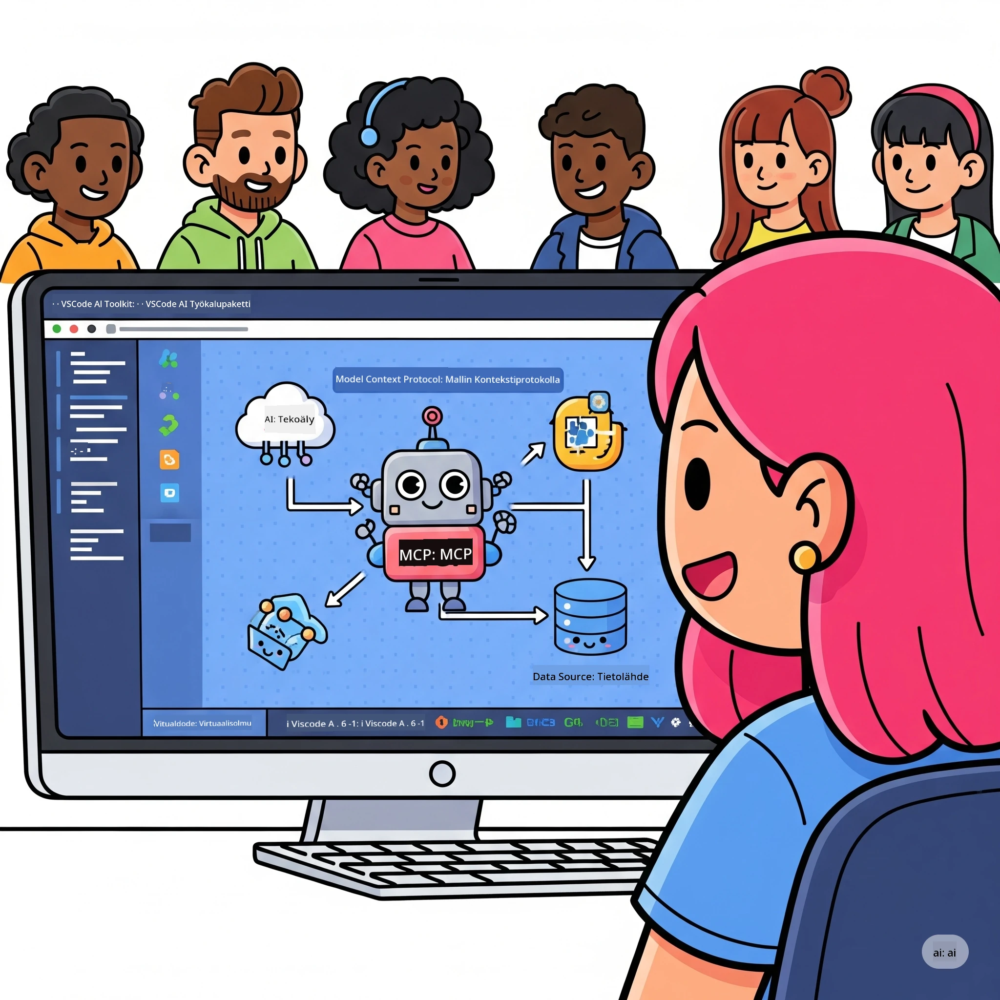
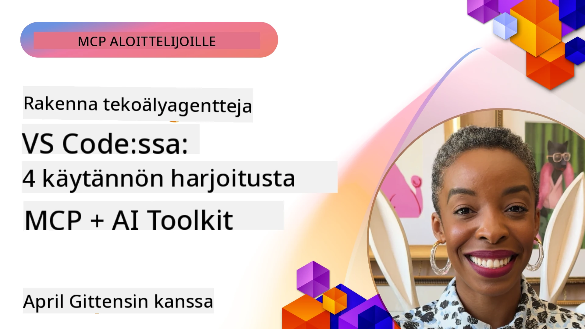

# AI-työnkulkujen tehostaminen: MCP-palvelimen rakentaminen Microsoft Foundry Toolkitin avulla

## 🎯 Yleiskatsaus

_(Napsauta yllä olevaa kuvaa nähdäksesi tämän oppitunnin videon)_

Tervetuloa **Model Context Protocol (MCP) -työpajaan**! Tämä kattava käytännön työpaja yhdistää kaksi huipputeknologiaa mullistaakseen AI-sovelluskehityksen:

> **Yhteensopivuustieto:** työpajan koodi on rakennettu ja testattu MCP
> `2025-11-25` kanssa, kuten yllä oleva merkki osoittaa. Käytä
> [nykyistä `2026-07-28`-määritystä](https://modelcontextprotocol.io/specification/2026-07-28/)
> uusien protokollien toteutuksiin ja tarkista SDK:n julkaisumuistiinpanot
> ennen labrojen siirtämistä.

- **🔗 Model Context Protocol (MCP)**: Avoin standardi saumattomaan AI-työkalujen integrointiin
- **🛠️ Microsoft Foundry Toolkit Extension for VS Code**: Microsoftin tehokas AI-kehitystyyökalu

### 🎓 Mitä opit

Tämän työpajan lopussa hallitset älykkäiden sovellusten rakentamisen taidon, jotka yhdistävät AI-mallit todellisiin työkaluihin ja palveluihin. Automaattisesta testauksesta räätälöityihin API-integraatioihin saat käytännön taitoja monimutkaisten liiketoimintaongelmien ratkaisuun.

## 🏗️ Teknologiapino

### 🔌 Model Context Protocol (MCP)

MCP on **"USB-C AI:lle"** – universaali standardi, joka yhdistää AI-mallit ulkoisiin työkaluihin ja tietolähteisiin.

**✨ Keskeiset ominaisuudet:**

- 🔄 **Standardoitu integrointi**: Yleinen rajapinta AI-työkaluyhteyksille
- 🏛️ **Joustava arkkitehtuuri**: Paikalliset ja etäpalvelimet stdio/SSE-siirrolla
- 🧰 **Rikas ekosysteemi**: Työkaluja, kehotteita ja resursseja yhdessä protokollassa
- 🔒 **Yritystason valmius**: Sisäänrakennettu turvallisuus ja luotettavuus

**🎯 Miksi MCP on tärkeä:**
Aivan kuten USB-C poisti kaosn kaapeleissa, MCP poistaa AI-integraatioiden monimutkaisuuden. Yksi protokolla, rajattomat mahdollisuudet.

### 🤖 Microsoft Foundry Toolkit Extension for VS Code

Microsoftin lippulaivana toimiva AI-kehityslaajennus, joka muuttaa VS Coden AI-voimamyllyksi.

**🚀 Keskeiset kyvyt:**

- 📦 **Malliluettelo**: Pääsy malleihin Azure AI:sta, GitHubista, Hugging Facesta, Ollamasta
- ⚡ **Paikallinen inferenssi**: ONNX-optimoitu CPU/GPU/NPU-suoritus
- 🏗️ **Agenttien rakentaja**: Visuaalinen AI-agenttien kehitys MCP-integraatiolla
- 🎭 **Monimodaalinen**: Teksti-, näkö- ja rakenteellisen tulostuksen tuki

**💡 Kehityksen edut:**

- Nolla-asennuksen malli käyttöönotto
- Visuaalinen kehotteiden suunnittelu
- Reaaliaikainen testausympäristö
- Saumaton MCP-palvelimen integrointi

## 📚 Oppimismatka

### [🚀 Moduuli 1: Microsoft Foundry Toolkitin perusteet](./lab1/README.md)

**Kesto**: 15 minuuttia

- 🛠️ Asenna ja konfiguroi Microsoft Foundry Toolkit VS Codeen
- 🗂️ Tutustu malliluetteloon (yli 100 mallia GitHubista, ONNX:stä, OpenAI:sta, Anthropicista, Googlelta)
- 🎮 Hallitse interaktiivinen testiympäristö reaaliaikaiseen mallien testaukseen
- 🤖 Rakenna ensimmäinen AI-agenttisi Agent Builderilla
- 📊 Arvioi mallin suorituskykyä sisäänrakennetuilla mittareilla (F1, merkityksellisyys, yhtäläisyys, johdonmukaisuus)
- ⚡ Opi eräajon ja monimodaalisen tuen ominaisuudet

**🎯 Oppimistavoite**: Luo toimiva AI-agentti Microsoft Foundry Toolkitin ominaisuuksien kattavalla ymmärryksellä

### [🌐 Moduuli 2: MCP Microsoft Foundry Toolkitin perusteilla](./lab2/README.md)

**Kesto**: 20 minuuttia

- 🧠 Hallitse Model Context Protocol (MCP) -arkkitehtuuri ja käsitteet
- 🌐 Tutustu Microsoftin MCP-palvelin-ekosysteemiin
- 🤖 Rakenna selainautomaattinen agentti Playwright MCP -palvelimella
- 🔧 Integroi MCP-palvelimet Microsoft Foundry Toolkit Agent Builderiin
- 📊 Määritä ja testaa MCP-työkaluja agenteissasi
- 🚀 Vie ja ota käyttöön MCP-vahvistettuja agenteja tuotantokäyttöön

**🎯 Oppimistavoite**: Ota käyttöön AI-agentti, joka on superlatautunut ulkoisilla työkaluilla MCP:n avulla

### [🔧 Moduuli 3: Edistynyt MCP-kehitys Microsoft Foundry Toolkitilla](./lab3/README.md)

**Kesto**: 20 minuuttia

- 💻 Luo räätälöityjä MCP-palvelimia Microsoft Foundry Toolkitilla
- 🐍 Konfiguroi ja käytä uusinta MCP Python SDK:ta (v1.9.3)
- 🔍 Ota käyttöön ja hyödynnä MCP Inspector debuggausta varten
- 🛠️ Rakenna ammattimaisin debuggauskäytännöin varustettu Weather MCP Server
- 🧪 Debuggaa MCP-palvelimia sekä Agent Builder- että Inspector-ympäristöissä

**🎯 Oppimistavoite**: Kehitä ja debuggaa räätälöityjä MCP-palvelimia nykyaikaisin työkaluin

### [🐙 Moduuli 4: Käytännön MCP-kehitys - Räätälöity GitHub-kloonipalvelin](./lab4/README.md)

**Kesto**: 30 minuuttia

- 🏗️ Rakenna todellisen maailman GitHub Clone MCP Server kehitystyönkuluille
- 🔄 Toteuta älykäs arkistokloonaus validoinnilla ja virheenkäsittelyllä
- 📁 Luo älykäs hakemiston hallinta ja VS Code -integraatio
- 🤖 Käytä GitHub Copilot Agent Modea räätälöityjen MCP-työkalujen kanssa
- 🛡️ Hyödynnä tuotantovalmiita luotettavuus- ja alustojen välistä yhteensopivuutta

**🎯 Oppimistavoite**: Ota käyttöön tuotantovalmiiksi hiottu MCP-palvelin, joka virtaviivaistaa aitoja kehitystyönkulkuja

## 💡 Käytännön sovellukset ja vaikutus

### 🏢 Yrityskäyttö

#### 🔄 DevOps-automaatio

Muuta kehitystyönkulku älykkäällä automaatiolla:

- **Älykäs arkiston hallinta**: AI-ohjattu koodin tarkastus ja yhdistämispäätökset
- **Älykäs CI/CD**: Automaattinen putkien optimointi koodimuutosten perusteella
- **Ongelmien lajittelu**: Automaattinen bugien luokittelu ja osoittaminen

#### 🧪 Laadunvarmistuksen vallankumous

Nosta testaus uudelle tasolle AI-avusteisella automaatiolla:

- **Älykäs testien luonti**: Luo kattavat testipaketit automaattisesti
- **Visuaalinen regressiotestaus**: AI-avusteinen käyttöliittymän muutosten tunnistus
- **Suorituskyvyn seuranta**: Ennakoiva ongelmien tunnistus ja ratkaisu

#### 📊 Tietoputken älykkyys

Rakenna älykkäämpiä tietojenkäsittelytyönkulkuja:

- **Mukautuva ETL**: Itseoptimoituvat datamuunnokset
- **Poikkeamien tunnistus**: Reaaliaikainen datan laadunvalvonta
- **Älykäs reititys**: Älykäs datavirran hallinta

#### 🎧 Asiakaskokemuksen parantaminen

Luo poikkeuksellisia asiakaskohtaamisia:

- **Kontekstitietoinen tuki**: AI-agentit pääsyllä asiakashistoriaan
- **Ennakoiva ongelmanratkaisu**: Ennustava asiakaspalvelu
- **Monikanavainen integraatio**: Yhtenäinen AI-kokemus eri alustoilla

## 🛠️ Edellytykset ja asennus

### 💻 Järjestelmävaatimukset

| Komponentti | Vaatimus | Muistiinpanot |
|-----------|-------------|-------|
| **Käyttöjärjestelmä** | Windows 10+, macOS 10.15+, Linux | Mikä tahansa nykyaikainen käyttöjärjestelmä |
| **Visual Studio Code** | Uusin vakaa versio | Tarvitaan Microsoft Foundry Toolkitille |
| **Node.js** | v18.0+ ja npm | MCP-palvelin-kehitykseen |
| **Python** | 3.10+ | Vaihtoehtoinen Python MCP -palvelimille |
| **Muisti** | väh. 8GB RAM | 16GB suositeltu paikallisille malleille |

### 🔧 Kehitysympäristö

#### Suositellut VS Code -laajennukset

- **Microsoft Foundry Toolkit** (ms-windows-ai-studio.windows-ai-studio)
- **Python** (ms-python.python)
- **Python Debugger** (ms-python.debugpy)
- **GitHub Copilot** (GitHub.copilot) - Valinnainen, mutta hyödyllinen

#### Valinnaiset työkalut

- **uv**: Moderni Python-paketinhallinta
- **MCP Inspector**: MCP-palvelimien visuaalinen debuggaustyökalu
- **Playwright**: Verkkoselaimen automaatiiesimerkkeihin

## 🎖️ Oppimistulokset ja sertifikaattipolku

### 🏆 Taitojen hallintaan tähtäävä tarkistuslista

Tämän työpajan suorittamalla saavutat hallinnan seuraavilla osa-alueilla:

#### 🎯 Keskeiset taidot

- [ ] **MCP-protokollan hallinta**: Syvä ymmärrys arkkitehtuurista ja toteutustavoista
- [ ] **Microsoft Foundry Toolkitin taitavuus**: Asiantuntijatasoinen käyttö nopeassa kehityksessä
- [ ] **Räätälöity palvelinkehitys**: Tuotantovalmiiden MCP-palvelimien rakentaminen, käyttöönotto ja ylläpito
- [ ] **Työkalujen integrointiosaaminen**: Saumaton AI-yhdistäminen olemassa oleviin kehitystyönkulkuun
- [ ] **Ongelmanratkaisukyky**: Opittujen taitojen soveltaminen aitoihin liiketoimintaongelmiin

#### 🔧 Tekninen osaaminen

- [ ] Asenna ja konfiguroi Microsoft Foundry Toolkit VS Codessa
- [ ] Suunnittele ja toteuta räätälöityjä MCP-palvelimia
- [ ] Integroi Microsoft Foundryn mallit MCP-arkkitehtuuriin
- [ ] Rakenna automatisoituja testausvirtoja Playwrightilla
- [ ] Ota AI-agentit käyttöön tuotantokäytössä
- [ ] Debuggaa ja optimoi MCP-palvelimen suorituskykyä

#### 🚀 Edistyneet ominaisuudet

- [ ] Suunnittele yritystason AI-integraatioiden arkkitehtuuri
- [ ] Toteuta AI-sovellusten turvallisuuden parhaat käytännöt
- [ ] Suunnittele skaalautuvia MCP-palvelinarkkitehtuureja
- [ ] Luo räätälöityjä työkaluketjuja tiettyihin toimialoihin
- [ ] Ohjaa muita AI-syntyisessä kehityksessä

## 📖 Lisäresurssit

- [MCP-määritys (2026-07-28)](https://modelcontextprotocol.io/specification/2026-07-28/)
- [Microsoft Foundry Toolkit GitHub-repositorio](https://github.com/microsoft/vscode-ai-toolkit)
- [EsimerkkimCP-palvelimet](https://github.com/modelcontextprotocol/servers)
- [Parhaiden käytäntöjen opas](https://modelcontextprotocol.io/docs/best-practices)
- [OWASP MCP Top 10](https://microsoft.github.io/mcp-azure-security-guide/mcp/) - Turvallisuuden parhaat käytännöt

---

**🚀 Valmiina mullistamaan AI-kehitystyönkulkuasi?**

Rakennetaan yhdessä älykkäiden sovellusten tulevaisuus MCP:n ja Microsoft Foundry Toolkitin avulla!

## Mitä seuraavaksi

Jatka: [Moduuli 11: MCP-palvelimen käytännön laboratoriot](../11-MCPServerHandsOnLabs/README.md)

---

<!-- CO-OP TRANSLATOR DISCLAIMER START -->
**Vastuuvapauslauseke**:
Tämä asiakirja on käännetty käyttämällä tekoälypohjaista käännöspalvelua [Co-op Translator](https://github.com/Azure/co-op-translator). Vaikka pyrimme tarkkuuteen, otathan huomioon, että automaattiset käännökset saattavat sisältää virheitä tai epätarkkuuksia. Alkuperäinen asiakirja sen alkuperäiskielellä on virallinen lähde. Tärkeissä asioissa suositellaan ammattimaista ihmiskäännöstä. Emme ole vastuussa tämän käännöksen käytöstä aiheutuvista väärinymmärryksistä tai tulkinnoista.
<!-- CO-OP TRANSLATOR DISCLAIMER END -->