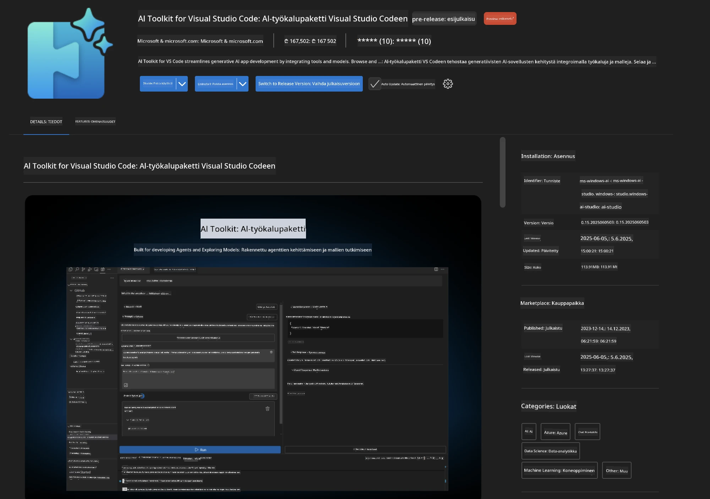
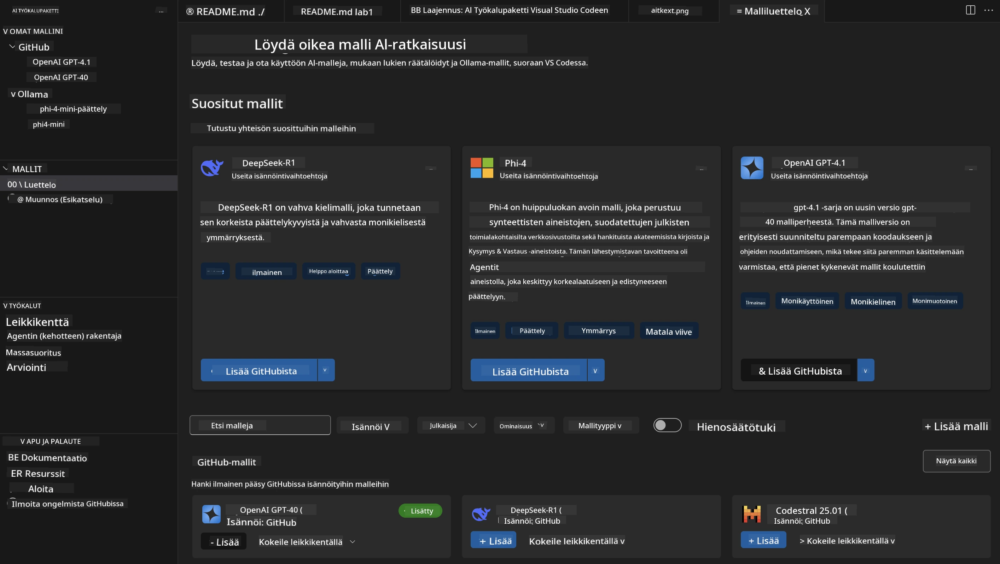
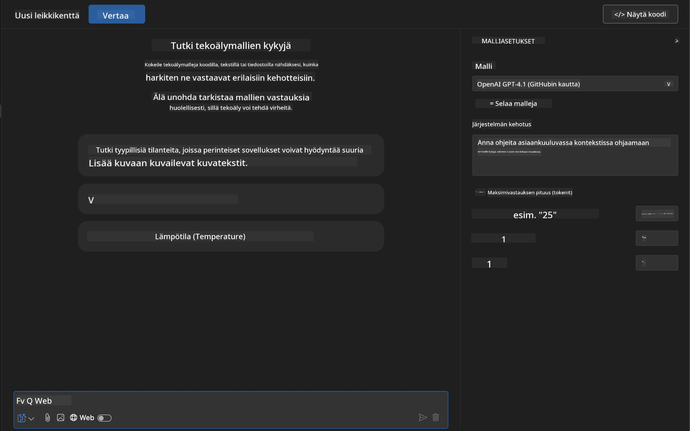
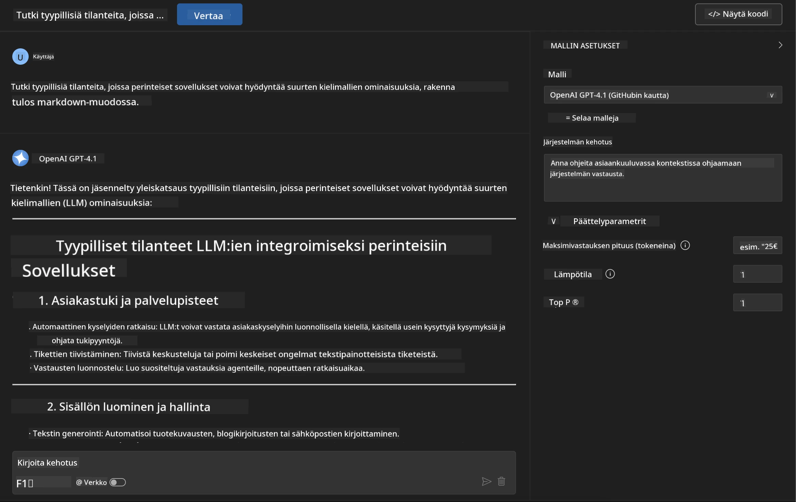
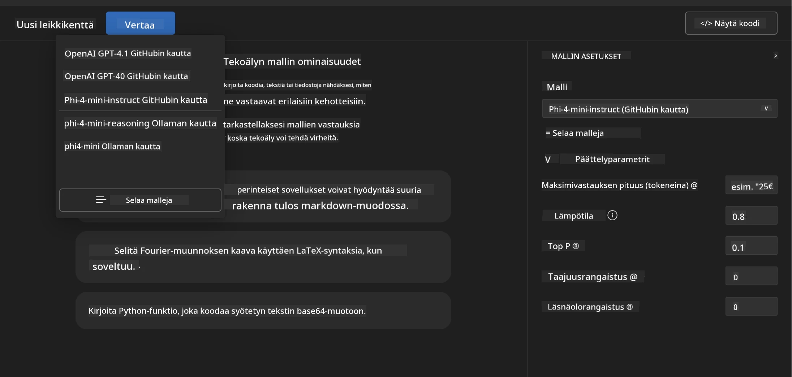
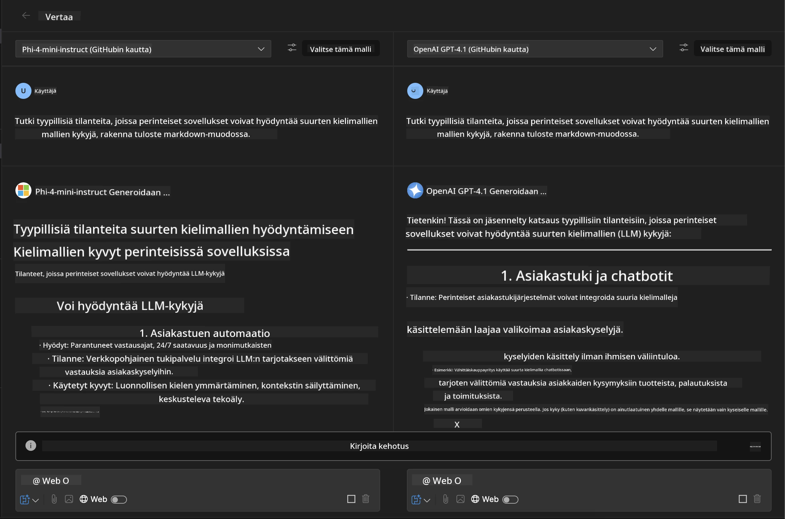
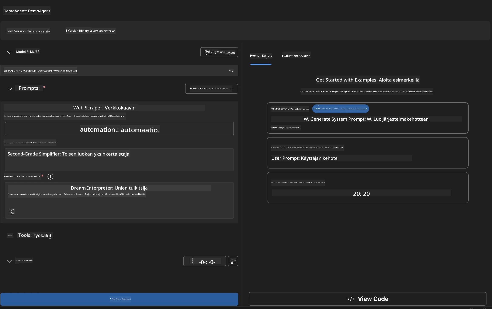
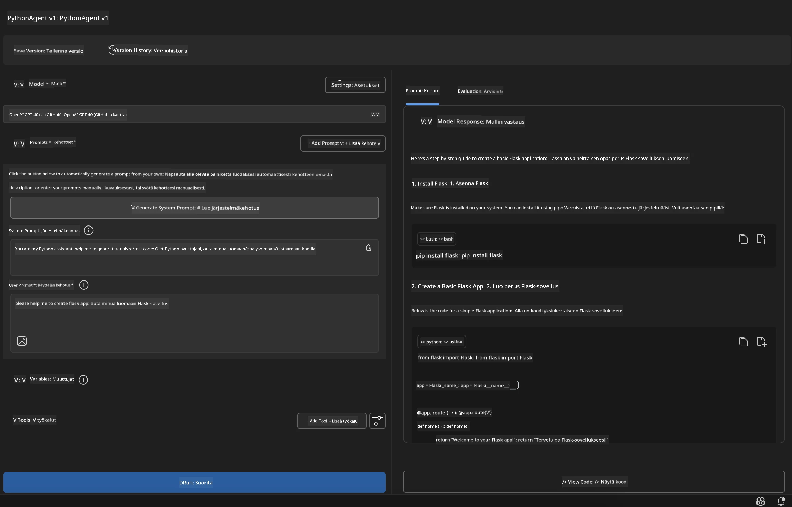

# 🚀 Moduuli 1: Microsoft Foundry Toolkit -periaatteet

[]()
[]()
[]()

## 📋 Oppimistavoitteet

Tämän moduulin lopussa osaat:
- ✅ Asentaa ja konfiguroida Microsoft Foundry Toolkit -laajennuksen VS Codeen
- ✅ Navigoida Malliluettelossa ja ymmärtää eri mallilähteet
- ✅ Käyttää Playgroundia mallin testaamiseen ja kokeiluun
- ✅ Luoda omia tekoälyagentteja Agent Builderilla
- ✅ Verrata mallien suorituskykyä eri tarjoajien välillä
- ✅ Soveltaa parhaita käytäntöjä kehotteiden suunnittelussa

## 🧠 Johdanto Microsoft Foundry Toolkit -työkalupakkiin

**Microsoft Foundry Toolkit Extension for VS Code** on Microsoftin lippulaivalaajennus, joka muuttaa VS Coden kaikenkattavaksi tekoälyn kehitysympäristöksi. Se yhdistää tekoälytutkimuksen ja käytännön sovelluskehityksen, tehden generatiivisesta tekoälystä saavutettavaa kehittäjille kaikilla taitotasoilla.

### 🌟 Keskeiset ominaisuudet

| Ominaisuus | Kuvaus | Käyttötapaus |
|---------|-------------|----------|
| **🗂️ Malliluettelo** | Pääsy 100+ malliin GitHubista, ONNX:stä, OpenAI:sta, Anthropicista, Googlelta | Mallien löytäminen ja valinta |
| **🔌 BYOM-tuki** | Omien mallien integrointi (paikallinen/kaukainen) | Räätälöityjen mallien käyttöönotto |
| **🎮 Interaktiivinen Playground** | Reaaliaikainen mallin testaus chat-käyttöliittymällä | Nopea prototypointi ja testaus |
| **📎 Monimuotoinen tuki** | Käsittele tekstiä, kuvia ja liitteitä | Monimutkaiset tekoälysovellukset |
| **⚡ Eräajot** | Suorita useita kehotteita samanaikaisesti | Tehokkaat testausprosessit |
| **📊 Mallin arviointi** | Sisäänrakennetut mittarit (F1, relevanssi, samankaltaisuus, johdonmukaisuus) | Suorituskyvyn arviointi |

### 🎯 Miksi Microsoft Foundry Toolkit on tärkeä

- **🚀 Nopeutettu kehitys**: Ideasta prototyyppiin minuuteissa
- **🔄 Yhtenäinen työnkulku**: Yksi käyttöliittymä useille tekoälypalveluntarjoajille
- **🧪 Helppo kokeilu**: Vertaa malleja ilman monimutkaista asetusta
- **📈 Tuotantovalmius**: Saumaton siirtymä prototyypistä käyttöönottoon

## 🛠️ Esivaatimukset & käyttöönotto

### 📦 Asenna Microsoft Foundry Toolkit -laajennus

**Vaihe 1: Pääsy laajennustoriin**
1. Avaa Visual Studio Code
2. Siirry Laajennukset-näkymään (`Ctrl+Shift+X` tai `Cmd+Shift+X`)
3. Hae "Microsoft Foundry Toolkit"

**Vaihe 2: Valitse versiosi**
- **🟢 Julkaisu**: Suositeltu tuotantokäyttöön
- **🔶 Esijulkaisu**: Varhainen pääsy uusimpiin ominaisuuksiin

**Vaihe 3: Asenna ja ota käyttöön**



### ✅ Tarkistuslista
- [ ] Microsoft Foundry Toolkit -kuvake näkyy VS Code sivupalkissa
- [ ] Laajennus on käytössä ja aktivoitu
- [ ] Asennuksessa ei ole virheitä tulosruudussa

## 🧪 Käytännön harjoitus 1: Microsoft Foundry -mallien tutkiminen

**🎯 Tavoite**: Hallitse Malliluettelo ja testaa ensimmäinen tekoälymallisi

### 📊 Vaihe 1: Navigoi Malliluettelossa

Malliluettelo on porttisi tekoälyekosysteemiin. Se kokoaa malleja useilta tarjoajilta, mikä helpottaa mallien löytämistä ja vertailua.

**🔍 Navigointiohje:**

Klikkaa **MODELS - Catalog** Microsoft Foundry Toolkit -sivupalkissa



**💡 Vinkki**: Etsi malleja, joilla on erityisiä ominaisuuksia, jotka sopivat käyttötarkoitukseesi (esim. koodin generointi, luova kirjoittaminen, analyysi).

> [!NOTE]
> GitHub-mallit poistettiin käytöstä 30.7.2026. Käytä Microsoft Foundry -mallin käyttöönottoa ja varmista tunnistautuminen Microsoft Entra ID:llä tai Azure API-avaimella.


### 🚀 Vaihe 2: Lisää ja konfiguroi ensimmäinen mallisi

**Mallin valintastrategia:**
- **GPT-5.1**: Suositeltu yleiskäyttöinen malli työkalujen käyttöön ja päättelyyn
- **Phi-4-mini**: Kevyt, nopea vaste yksinkertaisiin tehtäviin

**🔧 Konfigurointiprosessi:**
1. Valitse **OpenAI GPT-5.1** luettelosta
2. Klikkaa **Add to My Models** - tämä rekisteröi mallin käytettäväksi
3. Valitse **Try in Playground** käynnistääksesi testausympäristön
4. Odota mallin aloitus (ensiasetus voi kestää hetken)



**⚙️ Malliparametrien ymmärtäminen:**
- **Temperature**: Ohjaa luovuutta (0 = deterministinen, 1 = luova)
- **Max Tokens**: Maksimivasteen pituus
- **Top-p**: Nucleus-sampling vastauksen monipuolisuudelle

### 🎯 Vaihe 3: Hallitse Playgroundin käyttöliittymää

Playground on tekoälykokeilu laboratoriosi. Näin hyödynnät sitä parhaalla tavalla:

**🎨 Kehoteinsinööritaidon parhaat käytännöt:**
1. **Ole täsmällinen**: Selkeät ja yksityiskohtaiset ohjeet tuottavat parempia tuloksia
2. **Tarjoa konteksti**: Sisällytä oleellista taustatietoa
3. **Käytä esimerkkejä**: Näytä mallille, mitä haluat esimerkkien avulla
4. **Iteroi**: Hio kehotteita alkuperäisten tulosten perusteella

**🧪 Testausvaihtoehdot:**
```markdown
# Example 1: Code Generation
"Write a Python function that calculates the factorial of a number using recursion. Include error handling and docstrings."

# Example 2: Creative Writing
"Write a professional email to a client explaining a project delay, maintaining a positive tone while being transparent about challenges."

# Example 3: Data Analysis
"Analyze this sales data and provide insights: [paste your data]. Focus on trends, anomalies, and actionable recommendations."
```



### 🏆 Haasteharjoitus: Mallien suorituskyvyn vertailu

**🎯 Tavoite**: Vertaa eri malleja samoilla kehotteilla ymmärtääksesi niiden vahvuudet

**📋 Ohjeet:**
1. Lisää **Phi-4-mini** työtilaan
2. Käytä samaa kehotetta sekä GPT-5.1:lle että Phi-4-minille



3. Vertaa vastausten laatua, nopeutta ja tarkkuutta
4. Dokumentoi havaintosi tulososiossa



**💡 Keskeiset oivallukset:**
- Milloin käyttää LLM:ää vs. SLM:ää
- Kustannusten ja suorituskyvyn kompromissit
- Mallien erityisominaisuudet

## 🤖 Käytännön harjoitus 2: Räätälöityjen agenttien rakentaminen Agent Builderilla

**🎯 Tavoite**: Luo erikoistuneita tekoälyagentteja tiettyihin tehtäviin ja työnkulkuihin

### 🏗️ Vaihe 1: Ymmärrä Agent Builder

Agent Builder on Microsoft Foundry Toolkitin todellinen voimannäyttö. Sen avulla voit luoda tarkoituksenmukaisia tekoälyavustajia, jotka yhdistävät suurten kielimallien voiman mukautettuihin ohjeisiin, erityisiin parametreihin ja asiantuntijatietoon.

**🧠 Agentin arkkitehtuurin osat:**
- **Päällekainen malli**: Perustana LLM (GPT-5.1, Phi jne.)
- **Järjestelmäkehotus**: Määrittelee agentin persoonallisuuden ja käyttäytymisen
- **Parametrit**: Optimaaliset asetukset suorituskyvyn parantamiseksi
- **Työkalujen integrointi**: Yhdistää ulkoisiin API:ihin ja MCP-palveluihin
- **Muisti**: Keskustelun konteksti ja istunnon kesto



### ⚙️ Vaihe 2: Agentin konfiguroinnin syväluotaus

**🎨 Tehokkaiden järjestelmäkehotusten luominen:**
```markdown
# Template Structure:
## Role Definition
You are a [specific role] with expertise in [domain].

## Capabilities
- List specific abilities
- Define scope of knowledge
- Clarify limitations

## Behavior Guidelines
- Response style (formal, casual, technical)
- Output format preferences
- Error handling approach

## Examples
Provide 2-3 examples of ideal interactions
```

*Tietysti voit myös käyttää Generate System Promptia apuna kehotteiden generoinnissa ja optimoinnissa tekoälyn avulla*

**🔧 Parametrien optimointi:**
| Parametri | Suositeltu vaihteluväli | Käyttötapaus |
|-----------|------------------|----------|
| **Temperature** | 0.1-0.3 | Teknisiä/faktapohjaisia vastauksia varten |
| **Temperature** | 0.7-0.9 | Luovia/aivoriihitehtäviä varten |
| **Max Tokens** | 500-1000 | Ytimekkäitä vastauksia |
| **Max Tokens** | 2000-4000 | Yksityiskohtaisia selityksiä |

### 🐍 Vaihe 3: Käytännön harjoitus - Python-ohjelmointiagentti

**🎯 Tehtävä**: Luo erikoistunut Python-koodausavustaja

**📋 Konfigurointivaiheet:**

1. **Mallin valinta**: Valitse **Claude 3.5 Sonnet** (erinomainen koodaukseen)

2. **Järjestelmäkehotteen suunnittelu**:
```markdown
# Python Programming Expert Agent

## Role
You are a senior Python developer with 10+ years of experience. You excel at writing clean, efficient, and well-documented Python code.

## Capabilities
- Write production-ready Python code
- Debug complex issues
- Explain code concepts clearly
- Suggest best practices and optimizations
- Provide complete working examples

## Response Format
- Always include docstrings
- Add inline comments for complex logic
- Suggest testing approaches
- Mention relevant libraries when applicable

## Code Quality Standards
- Follow PEP 8 style guidelines
- Use type hints where appropriate
- Handle exceptions gracefully
- Write readable, maintainable code
```

3. **Parametrien konfigurointi**:
   - Temperature: 0.2 (vakaaseen, luotettavaan koodiin)
   - Max Tokens: 2000 (yksityiskohtaiset selitykset)
   - Top-p: 0.9 (tasapainoinen luovuus)



### 🧪 Vaihe 4: Testaa Python-agenttisi

**Testitilanteet:**
1. **Perustoiminto**: "Luo funktio alkulukujen löytämiseksi"
2. **Monimutkainen algoritmi**: "Toteuta binaarihaku-puu, jossa on lisäys-, poisto- ja hakuoperaatiot"
3. **Reaaliaikainen ongelma**: "Rakenna verkkosivujen kaavin, joka käsittelee nopeuden rajoitukset ja uudet yritykset"
4. **Virheiden korjaus**: "Korjaa tämä koodi [liitä virheellinen koodi]"

**🏆 Onnistumiskriteerit:**
- ✅ Koodi toimii virheittä
- ✅ Sisältää asianmukaisen dokumentaation
- ✅ Noudattaa Pythonin parhaita käytäntöjä
- ✅ Tarjoaa selkeät selitykset
- ✅ Ehdottaa parannuksia

## 🎓 Moduuli 1 Yhteenveto & Seuraavat askeleet

### 📊 Tietovisa

Testaa ymmärrystäsi:
- [ ] Osaatko selittää eron mallien välillä luettelossa?
- [ ] Oletko onnistuneesti luonut ja testannut räätälöidyn agentin?
- [ ] Ymmärrätkö, miten optimoida parametreja eri käyttötarkoituksiin?
- [ ] Osaatko suunnitella tehokkaita järjestelmäkehotteita?

### 📚 Lisäresurssit

- **Microsoft Foundry Toolkit -dokumentaatio**: [Viralliset Microsoftin dokumentit](https://github.com/microsoft/vscode-ai-toolkit)
- **Kehoteinsinöörin opas**: [Parhaat käytännöt](https://platform.openai.com/docs/guides/prompt-engineering)
- **Mallien kehitys Microsoft Foundry Toolkitissa**: [Kehitteillä olevat mallit](https://github.com/microsoft/vscode-ai-toolkit/blob/main/doc/models.md)

**🎉 Onnittelut!** Olet hallinnut Microsoft Foundry Toolkitin perusteet ja olet valmis rakentamaan kehittyneempiä tekoälysovelluksia!

### 🔜 Jatka seuraavaan moduuliin

Valmiina edistyneempiin ominaisuuksiin? Jatka kohtaan **[Moduuli 2: MCP Microsoft Foundry Toolkitin perusteiden kanssa](../lab2/README.md)**, jossa opit miten:
- Yhdistää agenttisi ulkoisiin työkaluihin Model Context Protocolin (MCP) avulla
- Rakentaa selaimen automaatioagentteja Playwrightilla
- Integroida MCP-palvelimet Microsoft Foundry Toolkitin agentteihisi
- Tehostaa agenttejasi ulkoisilla tiedoilla ja kyvyillä

---

<!-- CO-OP TRANSLATOR DISCLAIMER START -->
**Vastuuvapauslauseke**:
Tämä asiakirja on käännetty käyttämällä tekoälypohjaista käännöspalvelua [Co-op Translator](https://github.com/Azure/co-op-translator). Vaikka pyrimme tarkkuuteen, otathan huomioon, että automaattiset käännökset saattavat sisältää virheitä tai epätarkkuuksia. Alkuperäinen asiakirja sen alkuperäiskielellä on virallinen lähde. Tärkeissä asioissa suositellaan ammattimaista ihmiskäännöstä. Emme ole vastuussa tämän käännöksen käytöstä aiheutuvista väärinymmärryksistä tai tulkinnoista.
<!-- CO-OP TRANSLATOR DISCLAIMER END -->