# 🌐 Moduuli 2: MCP Microsoft Foundry Toolkitin perusteiden kanssa


## 📋 Oppimistavoitteet

Tämän moduulin lopuksi osaat:

- ✅ Ymmärtää Model Context Protocol (MCP) -arkkitehtuurin ja sen hyödyt
- ✅ Tutustua Microsoftin MCP-palvelinympäristöön
- ✅ Integroida MCP-palvelimet Microsoft Foundry Toolkit Agent Builderiin
- ✅ Rakentaa toimiva selainautomaatiovelho Playwright MCP:n avulla
- ✅ Määrittää ja testata MCP-työkaluja agenteissasi
- ✅ Viedä ja ottaa MCP-tehoa käyttävät agentit tuotantokäyttöön

## 🎯 Rakentaminen Moduulin 1 päälle

Moduulissa 1 hallitsimme Microsoft Foundry Toolkitin perusteet ja loimme ensimmäisen
Python- agenttimme. Nyt **tehostamme** agenttejasi yhdistämällä ne ulkoisiin työkaluihin
ja palveluihin mullistavan **Model Context Protocolin (MCP)** avulla.


- 📁 Käyttää ja käsitellä tiedostoja
- 🔧 Integroitua yritysjärjestelmiin
- 📊 Käsitellä reaaliaikaista dataa API:sta


yhdistää Suuret Kielenmallit (LLM) ulkoisiin työkaluihin, tietolähteisiin ja palveluihin.
Kuten USB-C tarjoaa yhden yleisen liittimen, MCP vähentää tekoälyintegraatioiden
monimutkaisuutta yhden standardoidun protokollan avulla.


- 🔄 Toimittajalukko suljetuilla ratkaisuilla
- 🔒 Turva-aukot ad-hoc -yhteyksistä
- ⏱️ Kuukausia kehitystyötä perusintegraatioihin


- 🔄 Toimittajariippumaton arkkitehtuuri
- 🛡️ Sisäänrakennetut turvallisuuden parhaat käytännöt
- 🚀 Minuutit uusien ominaisuuksien lisäämiseen


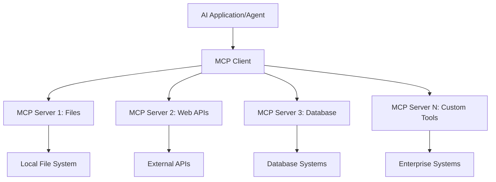

**🔧 Ydinosa komponentit:**

| Komponentti | Rooli | Esimerkkejä |
| --------- | ---- | -------- |
| **MCP Hosts** | Kuluttavat MCP-palveluita | VS Code, Foundry Toolkit |
| **MCP Clients** | Käsittelevät protokollayhteyksiä | Sisäänrakennettu isäntiin |
| **MCP Servers** | Tarjoavat toiminnallisuuksia | Playwright, Files, Azure, GitHub |
| **Transport Layer** | Yhdistää asiakkaat ja palvelimet | stdio, HTTP, WebSockets |

## 🏢 Microsoftin MCP-palvelin-ekosysteemi

Microsoft johtaa MCP-ekosysteemiä kattavalla
yritystason palvelinvalikoimalla, jotka vastaavat todellisiin liiketoiminnan tarpeisiin.

### 🌟 Esitellyt Microsoft MCP -palvelimet

#### 1. ☁️ Azure MCP -palvelin

**🔗 Repo**: [azure/azure-mcp](https://github.com/azure/azure-mcp)
**🎯 Tarkoitus**: Laaja Azure-resurssien hallinta AI-integraatiolla

**✨ Keskeiset ominaisuudet:**

- Määrittelevä infrastruktuurin provisiointi
- Resurssien reaaliaikainen valvonta
- Kustannusten optimointisuositukset
- Turvallisuusvaatimusten tarkistus

**🚀 Käyttötapaukset:**

- Infrastructure-as-Code AI-avusteisesti
- Automaattinen resurssien skaalaus
- Pilvikustannusten optimointi
- DevOps-työnkulkujen automaatio

#### 2. 📊 Microsoft Dataverse MCP

**📚 Dokumentaatio**: [Microsoft Dataverse Integration](https://go.microsoft.com/fwlink/?linkid=2320176)
**🎯 Tarkoitus**: Luonnollisen kielen käyttöliittymä liiketoimintadataan

**✨ Keskeiset ominaisuudet:**

- Luonnollisen kielen tietokantakyselyt
- Liiketoimintayhteyksien ymmärrys
- Räätälöidyt kehotemallit
- Yritystason datanhallinta

**🚀 Käyttötapaukset:**

- Liiketoimintatiedon raportointi
- Asiakasdatan analysointi
- Myyntiputken näkemykset
- Säädösten mukaiset datakyselyt

#### 3. 🌐 Playwright MCP -palvelin

**🔗 Repo**: [microsoft/playwright-mcp](https://github.com/microsoft/playwright-mcp)
**🎯 Tarkoitus**: Selaimen automaatio ja web-interaktiot

**✨ Keskeiset ominaisuudet:**

- Moniselainautomaatio (Chrome, Firefox, Safari)
- Älykäs elementtien tunnistus
- Kuvakaappaukset ja PDF-luonti
- Verkkoliikenteen seuranta

**🚀 Käyttötapaukset:**

- Automaattiset testityönkulut
- Web-kaavinta ja tiedon poiminta
- Käyttöliittymän seuranta
- Kilpailija-analyysin automaatio

#### 4. 📁 Files MCP -palvelin

**🔗 Repo**: [microsoft/files-mcp-server](https://github.com/microsoft/files-mcp-server)
**🎯 Tarkoitus**: Älykäs tiedostojärjestelmän käsittely

**✨ Keskeiset ominaisuudet:**

- Määrittelevä tiedostohallinta
- Sisällön synkronointi
- Versiohallinnan integrointi
- Metadataekstraktio

**🚀 Käyttötapaukset:**

- Dokumentaation hallinta
- Koodivarastojen organisointi
- Sisällön julkaisutyönkulut
- Dataputken tiedostokäsittely

#### 5. 📝 MarkItDown MCP -palvelin

**🔗 Repo**: [microsoft/markitdown](https://github.com/microsoft/markitdown)
**🎯 Tarkoitus**: Edistynyt Markdownin käsittely ja manipulointi

**✨ Keskeiset ominaisuudet:**

- Rikas Markdown-parsinta
- Muunnokset (MD ↔ HTML ↔ PDF)
- Sisällön rakenteen analyysi
- Malliprosessointi

**🚀 Käyttötapaukset:**

- Teknisen dokumentaation työnkulut
- Sisällönhallintajärjestelmät
- Raporttien generointi
- Tietopankin automaatio

#### 6. 📈 Clarity MCP -palvelin

**📦 Paketti**: [@microsoft/clarity-mcp-server](https://www.npmjs.com/package/@microsoft/clarity-mcp-server)
**🎯 Tarkoitus**: Web-analytiikka ja käyttäjäkäyttäytymisen näkymät

**✨ Keskeiset ominaisuudet:**

- Heatmap-datan analyysi
- Käyttäjän istuntotallenteet
- Suorituskykymittarit
- Konversiokanavan analyysi

**🚀 Käyttötapaukset:**

- Verkkosivun optimointi
- Käyttäjäkokemuksen tutkimus
- A/B-testauksen analyysi
- Liiketoimintatiedon kojelaudat

### 🌍 Yhteisön ekosysteemi

Microsoftin palvelimien lisäksi MCP-ekosysteemiin kuuluu:

- **🐙 GitHub MCP**: Varaston hallinta ja koodianalyysi
- **🗄️ Tietokannat MCP:t**: PostgreSQL, MySQL, MongoDB -integraatiot
- **☁️ Pilvipalveluntarjoajat MCP:t**: AWS, GCP, Digital Ocean -välineet
- **📧 Viestintä MCP:t**: Slack, Teams, Sähköposti-integraatiot

## 🛠️ Käytännön työpaja: Selainautomaation agentin rakentaminen

**🎯 Projektin tavoite**: Luoda älykäs selainautomaation agentti käyttämällä
Playwright MCP -palvelinta, joka pystyy navigoimaan verkkosivuilla, poimimaan tietoja ja
suorittamaan monimutkaisia web-interaktioita.

### 🚀 Vaihe 1: Agentin perustuksen luominen

#### Vaihe 1: Alusta agenttisi

1. **Avaa Microsoft Foundry Toolkit Agent Builder**
2. **Luo uusi agentti** seuraavilla asetuksilla:
   - **Nimi**: `BrowserAgent`
   - **Malli**: Valitse GPT-5.1. Katso
      [Microsoft Foundry mallin elinkaariaikataulu](https://learn.microsoft.com/azure/foundry/openai/concepts/model-retirement-schedule)
      ajantasaiset tiedot mallin elinkaaresta.

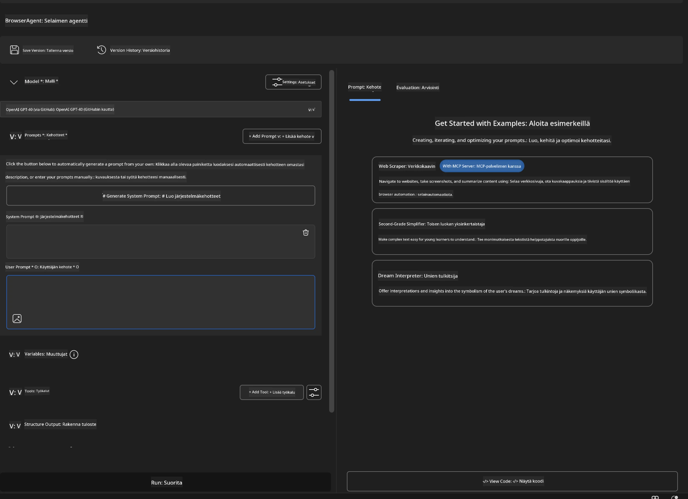

### 🔧 Vaihe 2: MCP-integraation työnkulku

#### Vaihe 3: Lisää MCP-palvelinintegraatio

1. **Siirry työkalut-osioon** Agent Builderissa
2. **Klikkaa "Add Tool"** avataksesi integraatiovalikon
3. **Valitse "MCP Server"** valikoimasta

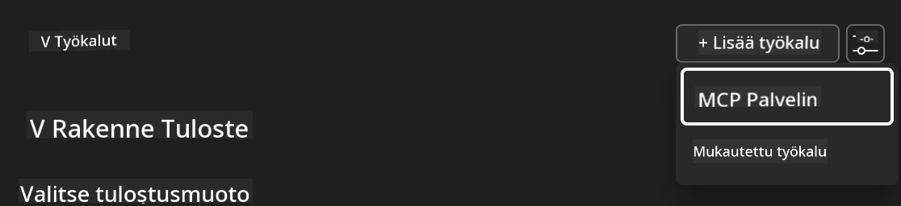

**🔍 Työkalutyyppien ymmärtäminen:**

- **Sisäänrakennetut työkalut**: Esiasetetut Microsoft Foundry Toolkit -funktiot
- **MCP-palvelimet**: Ulkoiset palveluintegratiot
- **Omat API:t**: Omien palvelupisteidesi rajapinnat
- **Funktiokutsut**: Suora mallin funktiokutsu käyttö

#### Vaihe 4: MCP-palvelimen valinta

1. **Valitse "MCP Server"** jatkaaksesi
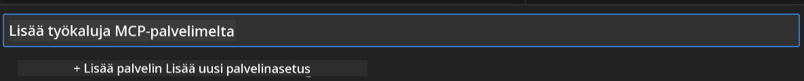

2. **Selaa MCP-katalogia** tutustuaksesi tarjolla oleviin integraatioihin
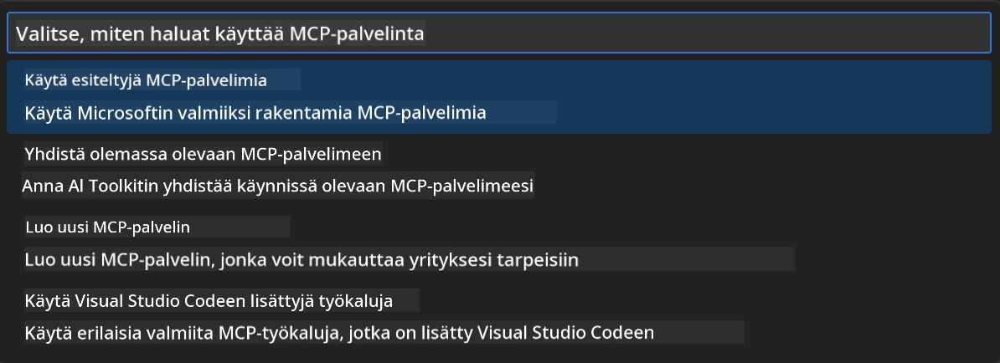

### 🎮 Vaihe 3: Playwright MCP:n konfigurointi

#### Vaihe 5: Valitse ja konfiguroi Playwright

1. **Klikkaa "Use Featured MCP Servers"** avataksesi Microsoftin varmennetut palvelimet
2. **Valitse "Playwright"** esitellyistä
3. **Hyväksy oletus MCP ID** tai räätälöi ympäristöösi sopivaksi

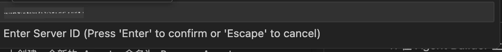

#### Vaihe 6: Ota Playwright-ominaisuudet käyttöön

**🔑 Tärkeä vaihe**: Valitse **KAIKKI** käytettävissä olevat Playwright-menetelmät maksimaalisen toiminnallisuuden takaamiseksi

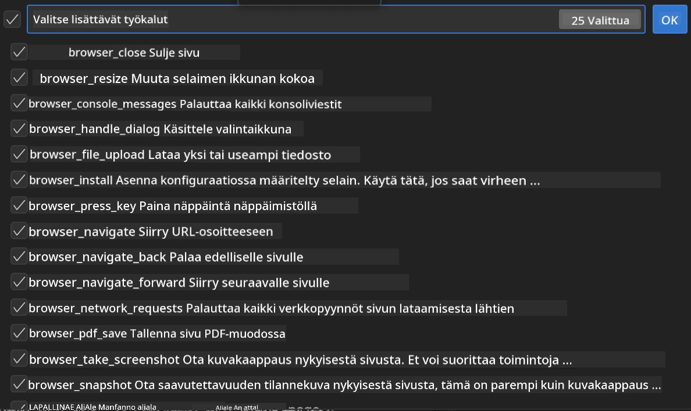

**🛠️ Välttämättömät Playwright-työkalut:**

- **Navigointi**: `goto`, `goBack`, `goForward`, `reload`
- **Vuorovaikutus**: `click`, `fill`, `press`, `hover`, `drag`
- **Tiedon poiminta**: `textContent`, `innerHTML`, `getAttribute`
- **Varmistus**: `isVisible`, `isEnabled`, `waitForSelector`
- **Tallennus**: `screenshot`, `pdf`, `video`
- **Verkko**: `setExtraHTTPHeaders`, `route`, `waitForResponse`

#### Vaihe 7: Varmista integraation onnistuminen

**✅ Onnistumisen merkit:**

- Kaikki työkalut näkyvät Agent Builderin käyttöliittymässä
- Integraatiopaneelissa ei ole virheilmoituksia
- Playwright-palvelimen tila näyttää "Connected"

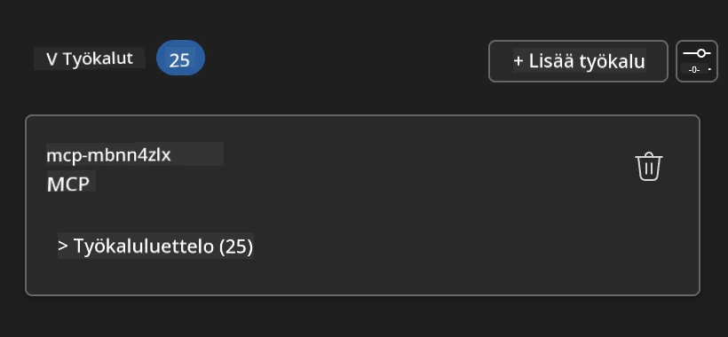

**🔧 Yleiset ongelmat ja niiden ratkaisut:**

- **Yhteys epäonnistui**: Tarkista internet-yhteys ja palomuuriasetukset
- **Puuttuvat työkalut**: Varmista, että kaikki ominaisuudet valittiin asennuksen aikana
- **Oikeusvirheet**: Varmista, että VS Code:lla on tarvittavat järjestelmäoikeudet

### 🎯 Vaihe 4: Edistynyt prompttitekniikka

#### Vaihe 8: Suunnittele älykkäät järjestelmäpromptit

Luo monimutkaisia promptteja, jotka hyödyntävät Playwrightin koko toiminnallisuutta:

```markdown
# Web Automation Expert System Prompt

## Core Identity
You are an advanced web automation specialist with deep expertise in browser
automation, web scraping, and user experience analysis. You have access to
Playwright tools for comprehensive browser control.

## Capabilities & Approach
### Navigation Strategy
- Always start with screenshots to understand page layout
- Use semantic selectors (text content, labels) when possible
- Implement wait strategies for dynamic content
- Handle single-page applications (SPAs) effectively

### Error Handling
- Retry failed operations with exponential backoff
- Provide clear error descriptions and solutions
- Suggest alternative approaches when primary methods fail
- Always capture diagnostic screenshots on errors

### Data Extraction
- Extract structured data in JSON format when possible
- Provide confidence scores for extracted information
- Validate data completeness and accuracy
- Handle pagination and infinite scroll scenarios

### Reporting
- Include step-by-step execution logs
- Provide before/after screenshots for verification
- Suggest optimizations and alternative approaches
- Document any limitations or edge cases encountered

## Ethical Guidelines
- Respect robots.txt and rate limiting
- Avoid overloading target servers
- Only extract publicly available information
- Follow website terms of service
```

#### Vaihe 9: Luo dynaamisia käyttäjäpromptteja

Suunnittele promptteja, jotka demonstroivat eri toiminnallisuuksia:

**🌐 Verkanalyysin esimerkki:**

```markdown
Navigate to github.com/kinfey and provide a comprehensive analysis including:
1. Repository structure and organization
2. Recent activity and contribution patterns  
3. Documentation quality assessment
4. Technology stack identification
5. Community engagement metrics
6. Notable projects and their purposes

Include screenshots at key steps and provide actionable insights.
```

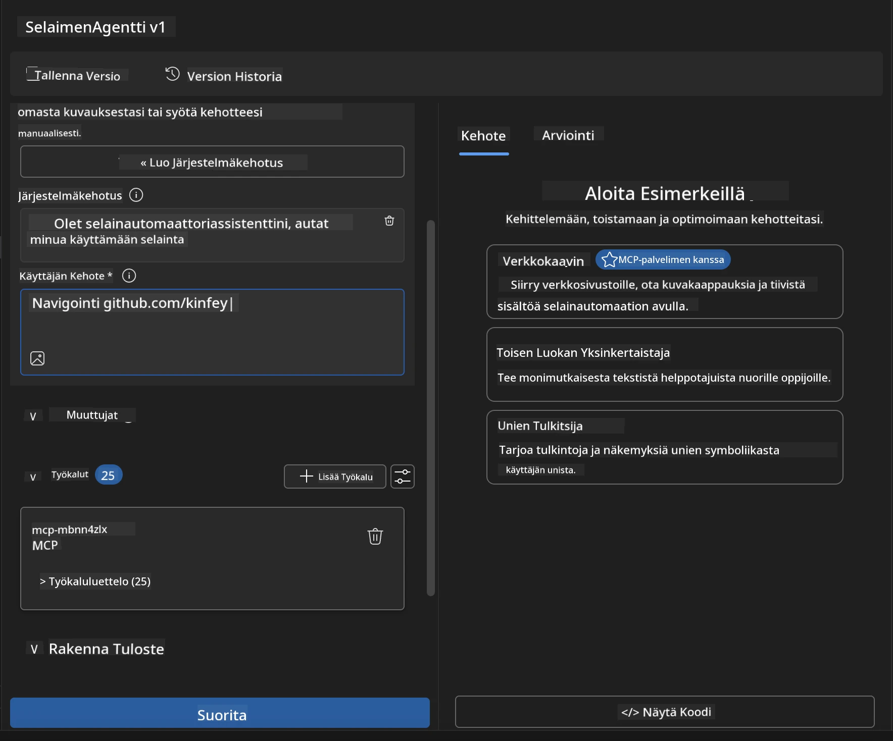

### 🚀 Vaihe 5: Suoritus ja testaus

#### Vaihe 10: Suorita ensimmäinen automaatiosi

1. **Klikkaa "Run"** käynnistääksesi automaatiosarjan
2. **Seuraa suoritusta reaaliajassa**:
   - Chrome-selain avautuu automaattisesti
   - Agentti navigoi kohdesivustolle
   - Kuvakaappaukset tallentavat tärkeät vaiheet
   - Analyysitulokset saapuvat reaaliajassa

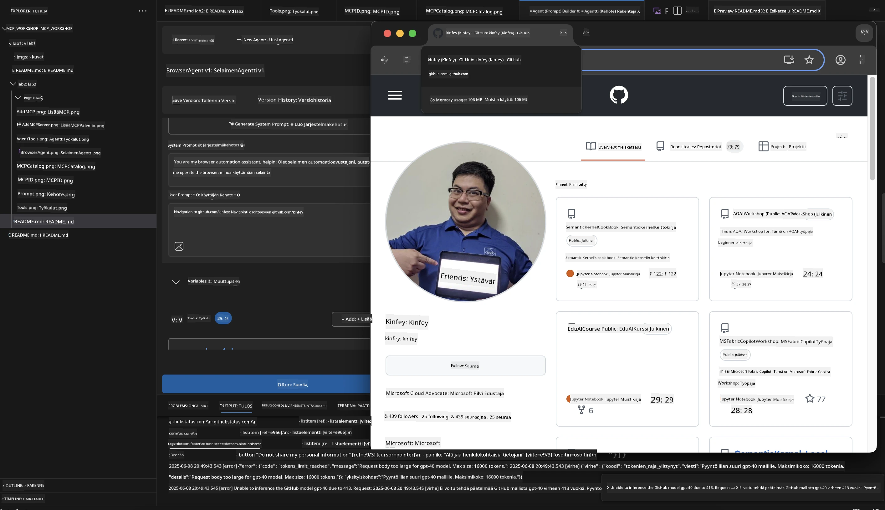

#### Vaihe 11: Analysoi tulokset ja näkemykset

Tarkastele kattavaa analyysiä Agent Builderin käyttöliittymässä:

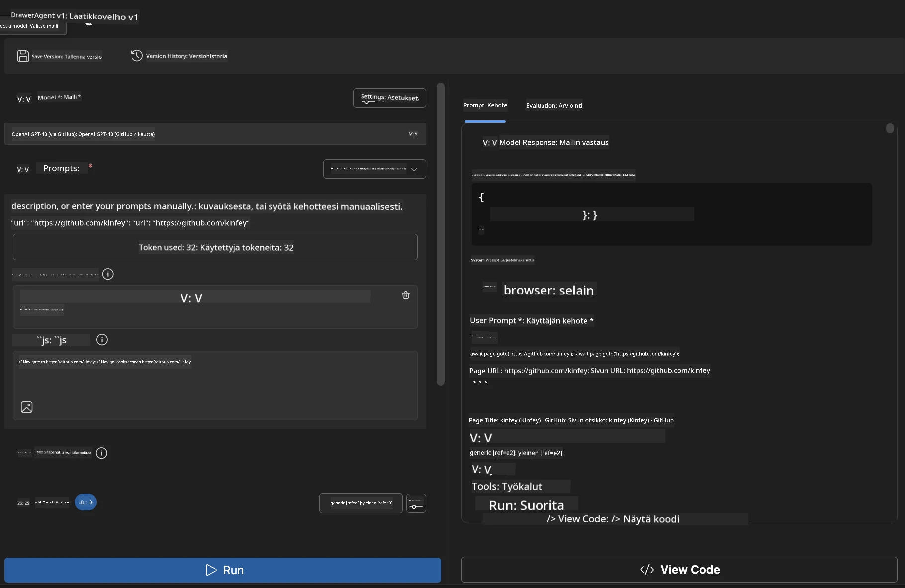

### 🌟 Vaihe 6: Edistyneet ominaisuudet ja tuotantoon vienti

#### Vaihe 12: Export ja tuotantoon vienti

Agent Builder tukee useita käyttöönotto vaihtoehtoja:

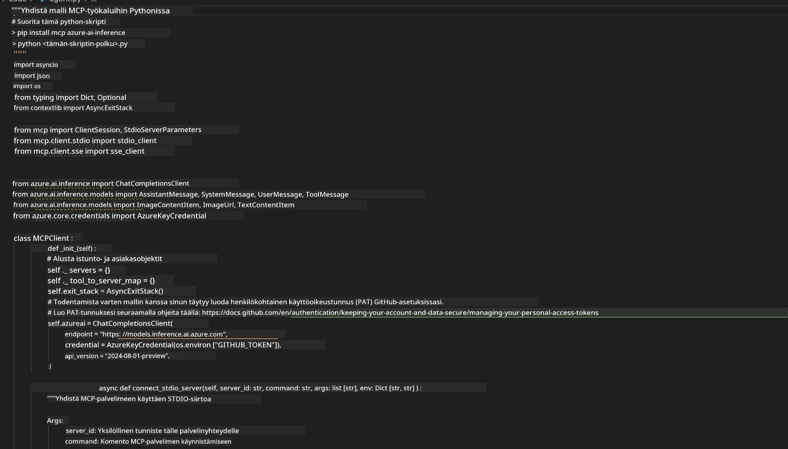

## 🎓 Moduuli 2 yhteenveto & seuraavat askeleet

### 🏆 Saavutus avattu: MCP-integraation mestari

**✅ Hallitut taidot:**

- [ ] MCP-arkkitehtuurin ja hyötyjen ymmärtäminen
- [ ] Microsoftin MCP-palvelin-ekosysteemin navigointi
- [ ] Playwright MCP:n integrointi Microsoft Foundry Toolkitin kanssa
- [ ] Kehittyneiden selainautomaatioagenttien rakentaminen
- [ ] Edistynyt prompttitekniikka web-automaatioon

### 📚 Lisäresurssit

- **🔗 MCP-spesifikaatio**: [Virallinen protokolladokumentaatio](https://modelcontextprotocol.io/)
- **🛠️ Playwright API**: [Täydellinen metodiviite](https://playwright.dev/docs/api/class-playwright)
- **🏢 Microsoft MCP -palvelimet**:
   [Yritysintegrointiohje](https://github.com/microsoft/mcp-servers)
- **🌍 Yhteisöesimerkit**: [MCP-palvelinkuvagalleria](https://github.com/modelcontextprotocol/servers)

**🎉 Onnittelut!** Olet onnistuneesti hallinnut MCP-integraation ja voit
nyt rakentaa tuotantovalmiita AI-agentteja ulkoisilla työkalutoiminnoilla!

### 🔜 Jatka seuraavaan moduuliin

Valmis viemään MCP-taitosi seuraavalle tasolle? Jatka
**[Moduuli 3: Edistynyt MCP:n kehitys Microsoft Foundry Toolkitillä](../lab3/README.md)**
missä opit:

- Luo omat räätälöidyt MCP-palvelimesi
- Konfiguroi ja käytä uusinta MCP Python SDK:ta
- Ota MCP Inspector käyttöön virheenkorjausta varten
- Hallitse edistyneet MCP-palvelin-kehitystyönkulut
- Rakenna sää MCP-palvelin alusta alkaen

---

<!-- CO-OP TRANSLATOR DISCLAIMER START -->
**Vastuuvapauslauseke**:
Tämä asiakirja on käännetty käyttämällä tekoälypohjaista käännöspalvelua [Co-op Translator](https://github.com/Azure/co-op-translator). Vaikka pyrimme tarkkuuteen, otathan huomioon, että automaattiset käännökset saattavat sisältää virheitä tai epätarkkuuksia. Alkuperäinen asiakirja sen alkuperäiskielellä on virallinen lähde. Tärkeissä asioissa suositellaan ammattimaista ihmiskäännöstä. Emme ole vastuussa tämän käännöksen käytöstä aiheutuvista väärinymmärryksistä tai tulkinnoista.
<!-- CO-OP TRANSLATOR DISCLAIMER END -->